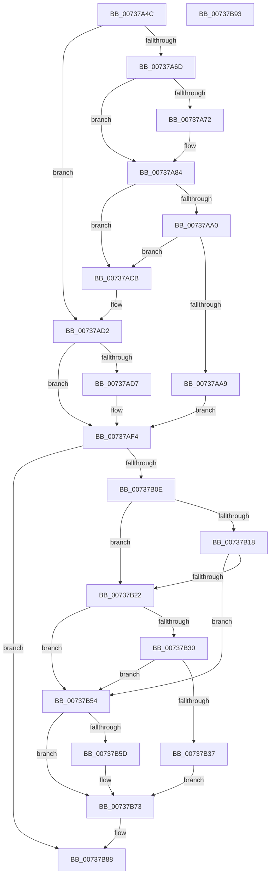

# PpProfileCommitTransitioningDock

- RVA: `0x00737A4C`–`0x00737B94` (길이 `328` bytes)
- VA: `0x0000000140737A4C`
- 실행 섹션: `PAGE`
- PDB 이름 있음: `예`; PDB Function 태그: `아니요`
- unwind 정보 RVA: `0x0005CAAC`
- 디코드: `82`개 명령, `328/328` bytes 표시
- 미해석 바이트: `0` (있으면 어셈블리에 `.byte`로 보존)

> 이 문서는 커널 이미지의 기계어와 PDB 기호를 분석해 생성했습니다. 4번과 5번은 함수 원형과 자료형을 바이너리 사용 방식에서 추정한 C 해석이며 원본 소스 복구 결과는 아닙니다.

## 1. Dependencies

- 직접 호출 지점: **9**; 고유 호출 대상: **8**
- 직접 호출자로 확인된 함수: **2**
- RIP 상대 이미지 참조: **7**

### Outgoing calls
- `0x00737A77` → [ExFreePoolWithTag](../../poolcode/B8/ExFreePoolWithTag_function_00B82870.md) (function, `0x00B82870`)
- `0x00737A8B` → [ExAcquireFastMutex](../../text/20/ExAcquireFastMutex_function_0020E5A0.md) (function, `0x0020E5A0`)
- `0x00737AC4` → [ExReleaseFastMutex](../../text/25/ExReleaseFastMutex_function_002519C0.md) (function, `0x002519C0`)
- `0x00737AE3` → [PnpIrpQueryID](../8F/PnpIrpQueryID_function_008FB714.md) (function, `0x008FB714`)
- `0x00737B27` → [PnpProfileUpdateHardwareProfile](PnpProfileUpdateHardwareProfile_function_0073773C.md) (function, `0x0073773C`)
- `0x00737B48` → [PnpRequestHwProfileChangeNotification](../72/PnpRequestHwProfileChangeNotification_function_00729E78.md) (function, `0x00729E78`)
- `0x00737B4D` → [PiProfileUpdateDeviceTree](PiProfileUpdateDeviceTree_function_007375D8.md) (function, `0x007375D8`)
- `0x00737B6E` → [PnpRequestHwProfileChangeNotification](../72/PnpRequestHwProfileChangeNotification_function_00729E78.md) (function, `0x00729E78`)
- `0x00737B83` → [KeReleaseSemaphore](../../text/39/KeReleaseSemaphore_function_00397080.md) (function, `0x00397080`)

### Direct callers
- [PnpRemoveLockedDeviceNode](../../text/47/PnpRemoveLockedDeviceNode_function_004702AC.md) at `0x004704BA`
- [PipProcessStartPhase2](../94/PipProcessStartPhase2_function_0094EE60.md) at `0x0094EEF9`

### Static image references
- `0x00737A84` → RVA `0x00F8ACA0` (`.data`; read)
- `0x00737ABE` → RVA `0x00F8ACD8` (`.data`; read/write)
- `0x00737B01` → RVA `0x00F8ACF0` (`.data`; read/write)
- `0x00737B3A` → RVA `0x00024178` (`.rdata`; read)
- `0x00737B54` → RVA `0x00F8ACF4` (`.data`; read)
- `0x00737B60` → RVA `0x000240B8` (`.rdata`; read)
- `0x00737B76` → RVA `0x00F8AD00` (`.data`; read)

## 2. Other-region calls and transfers

- 다른 실행 섹션으로 향하는 call: **4**
  - `0x00737A77` → [ExFreePoolWithTag](../../poolcode/B8/ExFreePoolWithTag_function_00B82870.md) (`PAGE` → `POOLCODE`)
  - `0x00737A8B` → [ExAcquireFastMutex](../../text/20/ExAcquireFastMutex_function_0020E5A0.md) (`PAGE` → `.text`)
  - `0x00737AC4` → [ExReleaseFastMutex](../../text/25/ExReleaseFastMutex_function_002519C0.md) (`PAGE` → `.text`)
  - `0x00737B83` → [KeReleaseSemaphore](../../text/39/KeReleaseSemaphore_function_00397080.md) (`PAGE` → `.text`)
- 별도 외부 분기/꼬리 이동을 확인하지 못했습니다.

## 3. Assembly (complete function range)

```asm
00737A4C  48 89 5C 24 08                  mov qword ptr [rsp + 8], rbx
00737A51  57                              push rdi
00737A52  48 83 EC 20                     sub rsp, 0x20
00737A56  48 83 64 24 40 00               and qword ptr [rsp + 0x40], 0
00737A5C  8B FA                           mov edi, edx
00737A5E  48 8B 81 50 02 00 00            mov rax, qword ptr [rcx + 0x250]
00737A65  48 8B D9                        mov rbx, rcx
00737A68  83 FA 03                        cmp edx, 3
00737A6B  75 65                           jne 0x140737ad2
00737A6D  48 85 C0                        test rax, rax
00737A70  74 12                           je 0x140737a84
00737A72  33 D2                           xor edx, edx
00737A74  48 8B C8                        mov rcx, rax
00737A77  E8 F4 AD 44 00                  call 0x140b82870
00737A7C  48 83 A3 50 02 00 00 00         and qword ptr [rbx + 0x250], 0
00737A84  48 8D 0D 15 32 85 00            lea rcx, [rip + 0x853215]
00737A8B  E8 10 6B AD FF                  call 0x14020e5a0
00737A90  48 8D 83 40 02 00 00            lea rax, [rbx + 0x240]
00737A97  4C 8B 00                        mov r8, qword ptr [rax]
00737A9A  49 39 40 08                     cmp qword ptr [r8 + 8], rax
00737A9E  75 2B                           jne 0x140737acb
00737AA0  48 8B 50 08                     mov rdx, qword ptr [rax + 8]
00737AA4  48 39 02                        cmp qword ptr [rdx], rax
00737AA7  75 22                           jne 0x140737acb
00737AA9  4C 89 02                        mov qword ptr [rdx], r8
00737AAC  48 8D 0D ED 31 85 00            lea rcx, [rip + 0x8531ed]
00737AB3  49 89 50 08                     mov qword ptr [r8 + 8], rdx
00737AB7  48 89 40 08                     mov qword ptr [rax + 8], rax
00737ABB  48 89 00                        mov qword ptr [rax], rax
00737ABE  FF 0D 14 32 85 00               dec dword ptr [rip + 0x853214]
00737AC4  E8 F7 9E B1 FF                  call 0x1402519c0
00737AC9  EB 29                           jmp 0x140737af4
00737ACB  B9 03 00 00 00                  mov ecx, 3
00737AD0  CD 29                           int 0x29
00737AD2  48 85 C0                        test rax, rax
00737AD5  75 1D                           jne 0x140737af4
00737AD7  48 8B 49 20                     mov rcx, qword ptr [rcx + 0x20]
00737ADB  4C 8D 44 24 40                  lea r8, [rsp + 0x40]
00737AE0  8D 50 04                        lea edx, [rax + 4]
00737AE3  E8 2C 3C 1C 00                  call 0x1408fb714
00737AE8  48 8B 44 24 40                  mov rax, qword ptr [rsp + 0x40]
00737AED  48 89 83 50 02 00 00            mov qword ptr [rbx + 0x250], rax
00737AF4  C7 83 38 02 00 00 01 00 00 00   mov dword ptr [rbx + 0x238], 1
00737AFE  83 C8 FF                        or eax, 0xffffffff
00737B01  F0 0F C1 05 E7 31 85 00         lock xadd dword ptr [rip + 0x8531e7], eax
00737B09  83 F8 01                        cmp eax, 1
00737B0C  75 7A                           jne 0x140737b88
00737B0E  C6 44 24 38 00                  mov byte ptr [rsp + 0x38], 0
00737B13  83 FF 02                        cmp edi, 2
00737B16  75 0A                           jne 0x140737b22
00737B18  48 83 BB 50 02 00 00 00         cmp qword ptr [rbx + 0x250], 0
00737B20  74 32                           je 0x140737b54
00737B22  48 8D 4C 24 38                  lea rcx, [rsp + 0x38]
00737B27  E8 10 FC FF FF                  call 0x14073773c
00737B2C  85 C0                           test eax, eax
00737B2E  78 24                           js 0x140737b54
00737B30  80 7C 24 38 00                  cmp byte ptr [rsp + 0x38], 0
00737B35  74 1D                           je 0x140737b54
00737B37  45 33 C9                        xor r9d, r9d
00737B3A  48 8D 0D 37 C6 8E FF            lea rcx, [rip - 0x7139c9]
00737B41  45 33 C0                        xor r8d, r8d
00737B44  41 8D 51 02                     lea edx, [r9 + 2]
00737B48  E8 2B 23 FF FF                  call 0x140729e78
00737B4D  E8 86 FA FF FF                  call 0x1407375d8
00737B52  EB 1F                           jmp 0x140737b73
00737B54  80 3D 99 31 85 00 00            cmp byte ptr [rip + 0x853199], 0
00737B5B  74 16                           je 0x140737b73
00737B5D  45 33 C9                        xor r9d, r9d
00737B60  48 8D 0D 51 C5 8E FF            lea rcx, [rip - 0x713aaf]
00737B67  45 33 C0                        xor r8d, r8d
00737B6A  41 8D 51 02                     lea edx, [r9 + 2]
00737B6E  E8 05 23 FF FF                  call 0x140729e78
00737B73  45 33 C9                        xor r9d, r9d
00737B76  48 8D 0D 83 31 85 00            lea rcx, [rip + 0x853183]
00737B7D  33 D2                           xor edx, edx
00737B7F  45 8D 41 01                     lea r8d, [r9 + 1]
00737B83  E8 F8 F4 C5 FF                  call 0x140397080
00737B88  48 8B 5C 24 30                  mov rbx, qword ptr [rsp + 0x30]
00737B8D  48 83 C4 20                     add rsp, 0x20
00737B91  5F                              pop rdi
00737B92  C3                              ret
00737B93  CC                              int3
```

## 4. C-style interpretation (structured pseudocode)

```c
__int64 __fastcall PpProfileCommitTransitioningDock(__int64 a1, int a2, __int64 a3, int a4)
{
    __int64 result;
    __int64 v_rsp;
    unsigned __int8 v_stack_p10;
    unsigned __int64 v_stack_p18;
    unsigned __int64 v_stack_p8;

    v_stack_p8 = v_rbx;
    v_rsp = (v_rsp) - (32);
    if (a2 != 3) goto loc_00737AD2;
    result = *(unsigned __int64 *)(a1 + 592);
    if (*(unsigned __int64 *)(a1 + 592) != 0) {
        a2 = 0;
        a1 = *(unsigned __int64 *)(a1 + 592);
        result = ExFreePoolWithTag(a1, a2, a3, a4);
    }
    result = ExAcquireFastMutex(v_rip + 8729109, a2, a3, a4);
    if ((*(unsigned __int64 *)(*(unsigned __int64 *)(a1 + 576) + 8)) != (a1 + 576)) goto loc_00737ACB;
    if ((*(unsigned __int64 *)(*(unsigned __int64 *)(a1 + 576 + 8))) != (a1 + 576)) goto loc_00737ACB;
    *(unsigned __int64 *)(*(unsigned __int64 *)(a1 + 576 + 8)) = *(unsigned __int64 *)(a1 + 576);
    *(unsigned __int64 *)(*(unsigned __int64 *)(a1 + 576) + 8) = *(unsigned __int64 *)(a1 + 576 + 8);
    *(unsigned __int64 *)(a1 + 576 + 8) = a1 + 576;
    *(unsigned __int64 *)(a1 + 576) = a1 + 576;
    result = ExReleaseFastMutex(v_rip + 8729069, *(unsigned __int64 *)(a1 + 576 + 8), *(unsigned __int64 *)(a1 + 576), a4);
    goto loc_00737AF4;
loc_00737ACB:
loc_00737AD2:
    if (result == 0) {
        a1 = *(unsigned __int64 *)(3 + 32);
        a3 = v_stack_p18;
        a2 = result + 4;
        result = PnpIrpQueryID(a1, a2, a3, a4);
        result = v_stack_p18;
        *(unsigned __int64 *)(a1 + 592) = result;
    }
    *(unsigned int *)(a1 + 568) = 1;
    result = (unsigned int)((result) | (0xFFFFFFFFULL));
    if (((unsigned int)(result)) != 1) goto loc_00737B88;
    v_stack_p10 = 0;
    if (((unsigned int)((unsigned int)(a2))) != 2) goto loc_00737B22;
    if ((*(unsigned __int64 *)(a1 + 592)) == 0) goto loc_00737B54;
loc_00737B22:
    result = PnpProfileUpdateHardwareProfile(v_stack_p10, a2, a3, a4);
    if (sign_flag) goto loc_00737B54;
    if (v_stack_p10 == 0) goto loc_00737B54;
    a4 = 0;
    a3 = 0;
    result = PnpRequestHwProfileChangeNotification(v_rip - 7420361, a4 + 2, a3, a4);
    result = PiProfileUpdateDeviceTree(v_rip - 7420361, a4 + 2, a3, a4);
    goto loc_00737B73;
loc_00737B54:
    if ((*(unsigned __int8 *)(v_rip + 8728985)) != 0) {
        a4 = 0;
        a1 = v_rip - 7420591;
        a3 = 0;
        a2 = a4 + 2;
        result = PnpRequestHwProfileChangeNotification(a1, a2, a3, a4);
    }
    a4 = 0;
    a2 = 0;
    result = KeReleaseSemaphore(v_rip + 8728963, a2, a4 + 1, a4);
loc_00737B88:
    v_rsp = (v_rsp) + (32);
    return result;
}
```

## 5. (Beta) C Style

```c
int64_t PpProfileCommitTransitioningDock(void *Arg1, int32_t Arg2, int64_t Arg3, int32_t Arg4)
{
    uint8_t *arg1 = (uint8_t *)Arg1;

    int64_t result;
    int64_t local_rsp;
    uint8_t v_stack_p10;
    uint64_t v_stack_p18;
    uint64_t v_stack_p8;

    v_stack_p8 = local_rbx;
    local_rsp = (local_rsp) - (32);
    if (Arg2 != 3) goto loc_00737AD2;
    result = *(uint64_t *)(arg1 + 0x250);
    if (*(uint64_t *)(arg1 + 0x250) != 0) {
        Arg2 = 0;
        Arg1 = *(uint64_t *)(arg1 + 0x250);
        result = ExFreePoolWithTag(Arg1, Arg2, Arg3, Arg4);
    }
    result = ExAcquireFastMutex(v_rip + 8729109, Arg2, Arg3, Arg4);
    if ((*(uint64_t *)(*(uint64_t *)(arg1 + 0x240) + 0x8)) != (Arg1 + 576)) goto loc_00737ACB;
    if ((*(uint64_t *)(*(uint64_t *)(arg1 + 0x240 + 0x8))) != (Arg1 + 576)) goto loc_00737ACB;
    *(uint64_t *)(*(uint64_t *)(arg1 + 0x240 + 0x8)) = *(uint64_t *)(arg1 + 0x240);
    *(uint64_t *)(*(uint64_t *)(arg1 + 0x240) + 0x8) = *(uint64_t *)(arg1 + 0x240 + 0x8);
    *(void **)(arg1 + 0x240 + 0x8) = Arg1 + 576;
    *(void **)(arg1 + 0x240) = Arg1 + 576;
    result = ExReleaseFastMutex(v_rip + 8729069, *(uint64_t *)(arg1 + 0x240 + 0x8), *(uint64_t *)(arg1 + 0x240), Arg4);
    goto loc_00737AF4;
loc_00737ACB:
loc_00737AD2:
    if (result == 0) {
        Arg1 = *(uint64_t *)(3 + 0x20);
        Arg3 = v_stack_p18;
        Arg2 = result + 4;
        result = PnpIrpQueryID(Arg1, Arg2, Arg3, Arg4);
        result = v_stack_p18;
        *(uint64_t *)(arg1 + 0x250) = result;
    }
    *(uint32_t *)(arg1 + 0x238) = 1;
    result = (uint32_t)((result) | (0xFFFFFFFFULL));
    if (((uint32_t)(result)) != 1) goto loc_00737B88;
    v_stack_p10 = 0;
    if (((uint32_t)((uint32_t)(Arg2))) != 2) goto loc_00737B22;
    if ((*(uint64_t *)(arg1 + 0x250)) == 0) goto loc_00737B54;
loc_00737B22:
    result = PnpProfileUpdateHardwareProfile(v_stack_p10, Arg2, Arg3, Arg4);
    if (sign_flag) goto loc_00737B54;
    if (v_stack_p10 == 0) goto loc_00737B54;
    Arg4 = 0;
    Arg3 = 0;
    result = PnpRequestHwProfileChangeNotification(v_rip - 7420361, Arg4 + 2, Arg3, Arg4);
    result = PiProfileUpdateDeviceTree(v_rip - 7420361, Arg4 + 2, Arg3, Arg4);
    goto loc_00737B73;
loc_00737B54:
    if ((*(uint8_t *)(v_rip + 0x853199)) != 0) {
        Arg4 = 0;
        Arg1 = v_rip - 7420591;
        Arg3 = 0;
        Arg2 = Arg4 + 2;
        result = PnpRequestHwProfileChangeNotification(Arg1, Arg2, Arg3, Arg4);
    }
    Arg4 = 0;
    Arg2 = 0;
    result = KeReleaseSemaphore(v_rip + 8728963, Arg2, Arg4 + 1, Arg4);
loc_00737B88:
    local_rsp = (local_rsp) + (32);
    return result;
}
```

### 관측된 메모리 오프셋

구조체 형식이 확인되지 않은 접근은 인자 기준의 오프셋으로만 기록했습니다.

| 기준 인자 | 오프셋 표현 | 폭 (bit) | 접근 |
|---|---:|---:|---|
| `Arg1` | `+ 0x0` | `64` | `R` |
| `Arg1` | `+ 0x0` | `64` | `W` |
| `Arg1` | `+ 0x8` | `64` | `R` |
| `Arg1` | `+ 0x8` | `64` | `W` |
| `Arg1` | `+ 0x238` | `32` | `W` |
| `Arg1` | `+ 0x240` | `64` | `R` |
| `Arg1` | `+ 0x250` | `64` | `R` |
| `Arg1` | `+ 0x250` | `64` | `R/W` |
| `Arg1` | `+ 0x250` | `64` | `W` |

## 6. Execution-region graph

[열기: 2D/3D 그래프와 함수 탐색 컨트롤 패널](../../../control-panel.html?section=page&rva=0x00737A4C&view=graph)

- 2D 그래프는 위에서 아래로 흐르고, 3D 그래프는 빈 공간을 드래그해 회전합니다. Shift+드래그는 이동, 휠은 확대·축소, 함수 노드 선택은 대상 보고서 이동입니다.

### Static fallback


