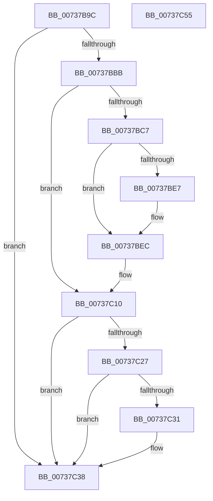

# PpProfileIncludeInHardwareProfileTransition

- RVA: `0x00737B9C`–`0x00737C56` (길이 `186` bytes)
- VA: `0x0000000140737B9C`
- 실행 섹션: `PAGE`
- PDB 이름 있음: `예`; PDB Function 태그: `아니요`
- unwind 정보 RVA: `0x00060BC4`
- 디코드: `46`개 명령, `186/186` bytes 표시
- 미해석 바이트: `0` (있으면 어셈블리에 `.byte`로 보존)

> 이 문서는 커널 이미지의 기계어와 PDB 기호를 분석해 생성했습니다. 4번과 5번은 함수 원형과 자료형을 바이너리 사용 방식에서 추정한 C 해석이며 원본 소스 복구 결과는 아닙니다.

## 1. Dependencies

- 직접 호출 지점: **4**; 고유 호출 대상: **4**
- 직접 호출자로 확인된 함수: **2**
- RIP 상대 이미지 참조: **5**

### Outgoing calls
- `0x00737BCE` → [ExAcquireFastMutex](../../text/20/ExAcquireFastMutex_function_0020E5A0.md) (function, `0x0020E5A0`)
- `0x00737C0B` → [ExReleaseFastMutex](../../text/25/ExReleaseFastMutex_function_002519C0.md) (function, `0x002519C0`)
- `0x00737C1E` → [PnpIrpQueryID](../8F/PnpIrpQueryID_function_008FB714.md) (function, `0x008FB714`)
- `0x00737C33` → [ExFreePoolWithTag](../../poolcode/B8/ExFreePoolWithTag_function_00B82870.md) (function, `0x00B82870`)

### Direct callers
- [PipProcessStartPhase1](../8F/PipProcessStartPhase1_function_008FE1F8.md) at `0x008FE2D9`
- [sub_00B33FE8](../B3/Unknown_function_00B33FE8.md) at `0x00B34065`

### Static image references
- `0x00737BC7` → RVA `0x00F8ACA0` (`.data`; read)
- `0x00737BD3` → RVA `0x00F8ACE0` (`.data`; read)
- `0x00737BFE` → RVA `0x00F8ACD8` (`.data`; read/write)
- `0x00737C04` → RVA `0x00F8ACE0` (`.data`; write)
- `0x00737C38` → RVA `0x00F8ACF0` (`.data`; read/write)

## 2. Other-region calls and transfers

- 다른 실행 섹션으로 향하는 call: **3**
  - `0x00737BCE` → [ExAcquireFastMutex](../../text/20/ExAcquireFastMutex_function_0020E5A0.md) (`PAGE` → `.text`)
  - `0x00737C0B` → [ExReleaseFastMutex](../../text/25/ExReleaseFastMutex_function_002519C0.md) (`PAGE` → `.text`)
  - `0x00737C33` → [ExFreePoolWithTag](../../poolcode/B8/ExFreePoolWithTag_function_00B82870.md) (`PAGE` → `POOLCODE`)
- 별도 외부 분기/꼬리 이동을 확인하지 못했습니다.

## 3. Assembly (complete function range)

```asm
00737B9C  48 89 5C 24 08                  mov qword ptr [rsp + 8], rbx
00737BA1  48 89 74 24 10                  mov qword ptr [rsp + 0x10], rsi
00737BA6  57                              push rdi
00737BA7  48 83 EC 20                     sub rsp, 0x20
00737BAB  48 83 64 24 40 00               and qword ptr [rsp + 0x40], 0
00737BB1  8B F2                           mov esi, edx
00737BB3  48 8B F9                        mov rdi, rcx
00737BB6  83 FA 02                        cmp edx, 2
00737BB9  75 7D                           jne 0x140737c38
00737BBB  48 8D 99 40 02 00 00            lea rbx, [rcx + 0x240]
00737BC2  48 39 1B                        cmp qword ptr [rbx], rbx
00737BC5  75 49                           jne 0x140737c10
00737BC7  48 8D 0D D2 30 85 00            lea rcx, [rip + 0x8530d2]
00737BCE  E8 CD 69 AD FF                  call 0x14020e5a0
00737BD3  48 8B 05 06 31 85 00            mov rax, qword ptr [rip + 0x853106]
00737BDA  48 8D 0D FF 30 85 00            lea rcx, [rip + 0x8530ff]
00737BE1  48 39 48 08                     cmp qword ptr [rax + 8], rcx
00737BE5  74 05                           je 0x140737bec
00737BE7  8D 4E 01                        lea ecx, [rsi + 1]
00737BEA  CD 29                           int 0x29
00737BEC  48 89 4B 08                     mov qword ptr [rbx + 8], rcx
00737BF0  48 8D 0D A9 30 85 00            lea rcx, [rip + 0x8530a9]
00737BF7  48 89 03                        mov qword ptr [rbx], rax
00737BFA  48 89 58 08                     mov qword ptr [rax + 8], rbx
00737BFE  FF 05 D4 30 85 00               inc dword ptr [rip + 0x8530d4]
00737C04  48 89 1D D5 30 85 00            mov qword ptr [rip + 0x8530d5], rbx
00737C0B  E8 B0 9D B1 FF                  call 0x1402519c0
00737C10  48 8B 4F 20                     mov rcx, qword ptr [rdi + 0x20]
00737C14  4C 8D 44 24 40                  lea r8, [rsp + 0x40]
00737C19  BA 04 00 00 00                  mov edx, 4
00737C1E  E8 F1 3A 1C 00                  call 0x1408fb714
00737C23  85 C0                           test eax, eax
00737C25  78 11                           js 0x140737c38
00737C27  48 8B 4C 24 40                  mov rcx, qword ptr [rsp + 0x40]
00737C2C  48 85 C9                        test rcx, rcx
00737C2F  74 07                           je 0x140737c38
00737C31  33 D2                           xor edx, edx
00737C33  E8 38 AC 44 00                  call 0x140b82870
00737C38  F0 FF 05 B1 30 85 00            lock inc dword ptr [rip + 0x8530b1]
00737C3F  48 8B 5C 24 30                  mov rbx, qword ptr [rsp + 0x30]
00737C44  89 B7 38 02 00 00               mov dword ptr [rdi + 0x238], esi
00737C4A  48 8B 74 24 38                  mov rsi, qword ptr [rsp + 0x38]
00737C4F  48 83 C4 20                     add rsp, 0x20
00737C53  5F                              pop rdi
00737C54  C3                              ret
00737C55  CC                              int3
```

## 4. C-style interpretation (structured pseudocode)

```c
__int64 __fastcall PpProfileIncludeInHardwareProfileTransition(__int64 a1, int a2)
{
    __int64 result;
    __int64 v_rsp;
    unsigned __int64 v_stack_p10;
    unsigned __int64 v_stack_p18;
    unsigned __int64 v_stack_p8;

    v_stack_p8 = v_rbx;
    v_stack_p10 = v_rsi;
    v_rsp = (v_rsp) - (32);
    if (a2 != 2) goto loc_00737C38;
    if ((*(unsigned __int64 *)(a1 + 576)) != (a1 + 576)) goto loc_00737C10;
    result = ExAcquireFastMutex(v_rip + 8728786, a2, a3, a4);
    if ((*(unsigned __int64 *)(*(unsigned __int64 *)(v_rip + 8728838) + 8)) != (v_rip + 8728831)) {
        a1 = (unsigned int)(a2) + 1;
    }
    *(unsigned __int64 *)(a1 + 576 + 8) = a1;
    *(unsigned __int64 *)(a1 + 576) = *(unsigned __int64 *)(v_rip + 8728838);
    *(unsigned __int64 *)(*(unsigned __int64 *)(v_rip + 8728838) + 8) = a1 + 576;
    *(unsigned __int64 *)(v_rip + 8728789) = a1 + 576;
    result = ExReleaseFastMutex(v_rip + 8728745, a2, a3, a4);
loc_00737C10:
    result = PnpIrpQueryID(*(unsigned __int64 *)(a1 + 32), 4, v_stack_p18, a4);
    if (sign_flag) goto loc_00737C38;
    if (v_stack_p18 != 0) {
        a2 = 0;
        result = ExFreePoolWithTag(v_stack_p18, a2, v_stack_p18, a4);
    }
    *(unsigned int *)(a1 + 568) = (unsigned int)((unsigned int)(a2));
    v_rsp = (v_rsp) + (32);
    return result;
}
```

## 5. (Beta) C Style

```c
int64_t PpProfileIncludeInHardwareProfileTransition(void *Arg1, void *Arg2)
{
    uint8_t *arg1 = (uint8_t *)Arg1;
    uint8_t *arg2 = (uint8_t *)Arg2;

    int64_t result;
    int64_t local_rsp;
    uint64_t v_stack_p10;
    uint64_t v_stack_p18;
    uint64_t v_stack_p8;

    v_stack_p8 = local_rbx;
    v_stack_p10 = local_rsi;
    local_rsp = (local_rsp) - (32);
    if (Arg2 != 2) goto loc_00737C38;
    if ((*(uint64_t *)(arg1 + 0x240)) != (Arg1 + 576)) goto loc_00737C10;
    result = ExAcquireFastMutex(v_rip + 8728786, Arg2, a3, a4);
    if ((*(uint64_t *)(*(uint64_t *)(v_rip + 0x853106) + 0x8)) != (v_rip + 8728831)) {
        Arg1 = (uint32_t)(Arg2) + 1;
    }
    *(void **)(arg1 + 0x240 + 0x8) = Arg1;
    *(uint64_t *)(arg1 + 0x240) = *(uint64_t *)(v_rip + 0x853106);
    *(void **)(*(uint64_t *)(v_rip + 0x853106) + 0x8) = Arg1 + 576;
    *(void **)(v_rip + 0x8530D5) = Arg1 + 576;
    result = ExReleaseFastMutex(v_rip + 8728745, Arg2, a3, a4);
loc_00737C10:
    result = PnpIrpQueryID(*(uint64_t *)(arg1 + 0x20), 4, v_stack_p18, a4);
    if (sign_flag) goto loc_00737C38;
    if (v_stack_p18 != 0) {
        Arg2 = 0;
        result = ExFreePoolWithTag(v_stack_p18, Arg2, v_stack_p18, a4);
    }
    *(uint32_t *)(arg1 + 0x238) = (uint32_t)((uint32_t)(Arg2));
    local_rsp = (local_rsp) + (32);
    return result;
}
```

### 관측된 메모리 오프셋

구조체 형식이 확인되지 않은 접근은 인자 기준의 오프셋으로만 기록했습니다.

| 기준 인자 | 오프셋 표현 | 폭 (bit) | 접근 |
|---|---:|---:|---|
| `Arg1` | `+ 0x0` | `64` | `R` |
| `Arg1` | `+ 0x0` | `64` | `W` |
| `Arg1` | `+ 0x8` | `64` | `W` |
| `Arg1` | `+ 0x20` | `64` | `R` |
| `Arg1` | `+ 0x238` | `32` | `W` |
| `Arg1` | `+ 0x240` | `64` | `R` |
| `Arg2` | `+ 0x1` | `32` | `R` |

## 6. Execution-region graph

[열기: 2D/3D 그래프와 함수 탐색 컨트롤 패널](../../../control-panel.html?section=page&rva=0x00737B9C&view=graph)

- 2D 그래프는 위에서 아래로 흐르고, 3D 그래프는 빈 공간을 드래그해 회전합니다. Shift+드래그는 이동, 휠은 확대·축소, 함수 노드 선택은 대상 보고서 이동입니다.

### Static fallback


