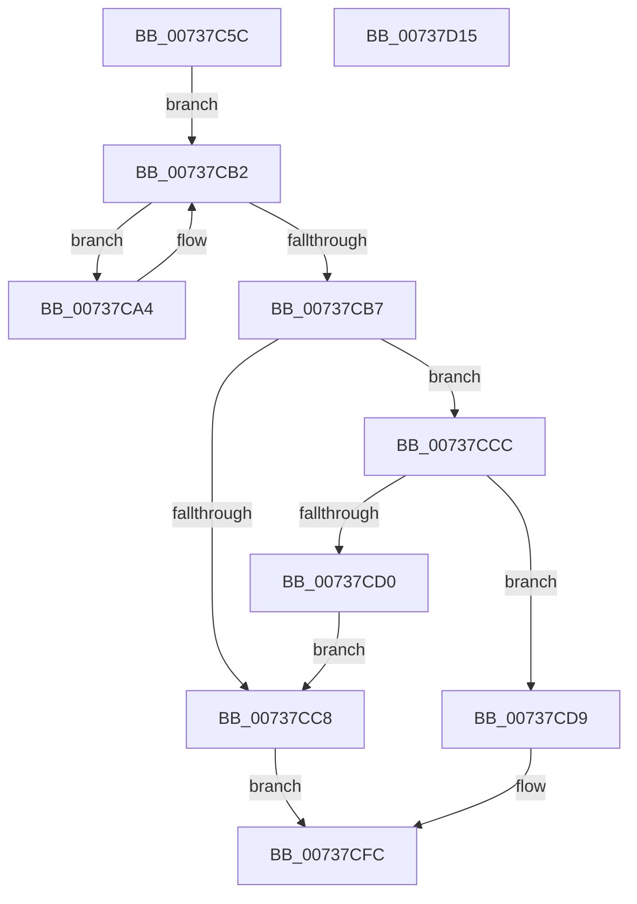

# PpProfileQueryHardwareProfileChange

- RVA: `0x00737C5C`–`0x00737D16` (길이 `186` bytes)
- VA: `0x0000000140737C5C`
- 실행 섹션: `PAGE`
- PDB 이름 있음: `예`; PDB Function 태그: `아니요`
- unwind 정보 RVA: `0x00060300`
- 디코드: `52`개 명령, `186/186` bytes 표시
- 미해석 바이트: `0` (있으면 어셈블리에 `.byte`로 보존)

> 이 문서는 커널 이미지의 기계어와 PDB 기호를 분석해 생성했습니다. 4번과 5번은 함수 원형과 자료형을 바이너리 사용 방식에서 추정한 C 해석이며 원본 소스 복구 결과는 아닙니다.

## 1. Dependencies

- 직접 호출 지점: **3**; 고유 호출 대상: **3**
- 직접 호출자로 확인된 함수: **2**
- RIP 상대 이미지 참조: **4**

### Outgoing calls
- `0x00737C87` → [ExAcquireFastMutex](../../text/20/ExAcquireFastMutex_function_0020E5A0.md) (function, `0x0020E5A0`)
- `0x00737CBE` → [ExReleaseFastMutex](../../text/25/ExReleaseFastMutex_function_002519C0.md) (function, `0x002519C0`)
- `0x00737CE9` → [PnpRequestHwProfileChangeNotification](../72/PnpRequestHwProfileChangeNotification_function_00729E78.md) (function, `0x00729E78`)

### Direct callers
- [PipProcessStartPhase1](../8F/PipProcessStartPhase1_function_008FE1F8.md) at `0x008FE2EA`
- [sub_00B33FE8](../B3/Unknown_function_00B33FE8.md) at `0x00B3412B`

### Static image references
- `0x00737C7A` → RVA `0x00F8ACA0` (`.data`; read)
- `0x00737C8C` → RVA `0x00F8ACE0` (`.data`; read)
- `0x00737CD0` → RVA `0x00F8ACF4` (`.data`; write)
- `0x00737CDC` → RVA `0x00024028` (`.rdata`; read)

## 2. Other-region calls and transfers

- 다른 실행 섹션으로 향하는 call: **2**
  - `0x00737C87` → [ExAcquireFastMutex](../../text/20/ExAcquireFastMutex_function_0020E5A0.md) (`PAGE` → `.text`)
  - `0x00737CBE` → [ExReleaseFastMutex](../../text/25/ExReleaseFastMutex_function_002519C0.md) (`PAGE` → `.text`)
- 별도 외부 분기/꼬리 이동을 확인하지 못했습니다.

## 3. Assembly (complete function range)

```asm
00737C5C  48 89 5C 24 08                  mov qword ptr [rsp + 8], rbx
00737C61  48 89 6C 24 10                  mov qword ptr [rsp + 0x10], rbp
00737C66  48 89 74 24 18                  mov qword ptr [rsp + 0x18], rsi
00737C6B  57                              push rdi
00737C6C  41 56                           push r14
00737C6E  41 57                           push r15
00737C70  48 83 EC 20                     sub rsp, 0x20
00737C74  40 8A F9                        mov dil, cl
00737C77  49 8B F1                        mov rsi, r9
00737C7A  48 8D 0D 1F 30 85 00            lea rcx, [rip + 0x85301f]
00737C81  49 8B E8                        mov rbp, r8
00737C84  44 8B F2                        mov r14d, edx
00737C87  E8 14 69 AD FF                  call 0x14020e5a0
00737C8C  48 8B 05 4D 30 85 00            mov rax, qword ptr [rip + 0x85304d]
00737C93  48 8D 0D 46 30 85 00            lea rcx, [rip + 0x853046]
00737C9A  32 DB                           xor bl, bl
00737C9C  41 BF 01 00 00 00               mov r15d, 1
00737CA2  EB 0E                           jmp 0x140737cb2
00737CA4  83 78 F8 02                     cmp dword ptr [rax - 8], 2
00737CA8  48 8B 00                        mov rax, qword ptr [rax]
00737CAB  0F B6 DB                        movzx ebx, bl
00737CAE  41 0F 44 DF                     cmove ebx, r15d
00737CB2  48 3B C1                        cmp rax, rcx
00737CB5  75 ED                           jne 0x140737ca4
00737CB7  48 8D 0D E2 2F 85 00            lea rcx, [rip + 0x852fe2]
00737CBE  E8 FD 9C B1 FF                  call 0x1402519c0
00737CC3  40 84 FF                        test dil, dil
00737CC6  74 04                           je 0x140737ccc
00737CC8  33 C0                           xor eax, eax
00737CCA  EB 30                           jmp 0x140737cfc
00737CCC  84 DB                           test bl, bl
00737CCE  74 09                           je 0x140737cd9
00737CD0  C6 05 1D 30 85 00 00            mov byte ptr [rip + 0x85301d], 0
00737CD7  EB EF                           jmp 0x140737cc8
00737CD9  4C 8B CE                        mov r9, rsi
00737CDC  48 8D 0D 45 C3 8E FF            lea rcx, [rip - 0x713cbb]
00737CE3  4C 8B C5                        mov r8, rbp
00737CE6  41 8B D6                        mov edx, r14d
00737CE9  E8 8A 21 FF FF                  call 0x140729e78
00737CEE  8B C8                           mov ecx, eax
00737CF0  C1 E9 1F                        shr ecx, 0x1f
00737CF3  41 32 CF                        xor cl, r15b
00737CF6  88 0D F8 2F 85 00               mov byte ptr [rip + 0x852ff8], cl
00737CFC  48 8B 5C 24 40                  mov rbx, qword ptr [rsp + 0x40]
00737D01  48 8B 6C 24 48                  mov rbp, qword ptr [rsp + 0x48]
00737D06  48 8B 74 24 50                  mov rsi, qword ptr [rsp + 0x50]
00737D0B  48 83 C4 20                     add rsp, 0x20
00737D0F  41 5F                           pop r15
00737D11  41 5E                           pop r14
00737D13  5F                              pop rdi
00737D14  C3                              ret
00737D15  CC                              int3
```

## 4. C-style interpretation (structured pseudocode)

```c
__int64 __fastcall PpProfileQueryHardwareProfileChange(unsigned __int8 a1, int a2, __int64 a3, __int64 a4)
{
    __int64 result;
    __int64 v_rbx;
    __int64 v_rsp;
    unsigned __int64 v_stack_p10;
    unsigned __int64 v_stack_p18;
    unsigned __int64 v_stack_p8;

    v_stack_p8 = v_rbx;
    v_stack_p10 = v_rbp;
    v_stack_p18 = v_rsi;
    v_rsp = (v_rsp) - (32);
    result = ExAcquireFastMutex(v_rip + 8728607, a2, a3, a4);
    v_rbx = 0;
    goto loc_00737CB2;
loc_00737CA4:
    v_rbx = 0;
    if ((*(unsigned int *)(*(unsigned __int64 *)(v_rip + 8728653) - 8)) == 2) { v_rbx = 1; }
loc_00737CB2:
    if ((*(unsigned __int64 *)(*(unsigned __int64 *)(v_rip + 8728653))) != (v_rip + 8728646)) goto loc_00737CA4;
    result = ExReleaseFastMutex(v_rip + 8728546, a2, a3, a4);
    if (a1 == 0) goto loc_00737CCC;
loc_00737CC8:
    result = 0;
    goto loc_00737CFC;
loc_00737CCC:
    if ((unsigned __int8)(v_rbx) == 0) goto loc_00737CD9;
    *(unsigned __int8 *)(v_rip + 8728605) = 0;
    goto loc_00737CC8;
loc_00737CD9:
    result = PnpRequestHwProfileChangeNotification(v_rip - 7421115, (unsigned int)((unsigned int)((unsigned int)(a2))), a3, a4);
    a1 = (unsigned int)(((unsigned int)((unsigned int)(result))) >> (31));
    a1 = (unsigned __int8)((a1) ^ (1));
    *(unsigned __int8 *)(v_rip + 8728568) = a1;
loc_00737CFC:
    v_rsp = (v_rsp) + (32);
    return result;
}
```

## 5. (Beta) C Style

```c
int64_t PpProfileQueryHardwareProfileChange(uint8_t Arg1, int32_t Arg2, int64_t Arg3, int64_t Arg4)
{
    int64_t result;
    int64_t local_rbx;
    int64_t local_rsp;
    uint64_t v_stack_p10;
    uint64_t v_stack_p18;
    uint64_t v_stack_p8;

    v_stack_p8 = local_rbx;
    v_stack_p10 = local_rbp;
    v_stack_p18 = local_rsi;
    local_rsp = (local_rsp) - (32);
    result = ExAcquireFastMutex(v_rip + 8728607, Arg2, Arg3, Arg4);
    local_rbx = 0;
    goto loc_00737CB2;
loc_00737CA4:
    local_rbx = 0;
    if ((*(uint32_t *)(*(uint64_t *)(v_rip + 0x85304D) - 0x8)) == 2) { local_rbx = 1; }
loc_00737CB2:
    if ((*(uint64_t *)(*(uint64_t *)(v_rip + 0x85304D))) != (v_rip + 8728646)) goto loc_00737CA4;
    result = ExReleaseFastMutex(v_rip + 8728546, Arg2, Arg3, Arg4);
    if (Arg1 == 0) goto loc_00737CCC;
loc_00737CC8:
    result = 0;
    goto loc_00737CFC;
loc_00737CCC:
    if ((uint8_t)(local_rbx) == 0) goto loc_00737CD9;
    *(uint8_t *)(v_rip + 0x85301D) = 0;
    goto loc_00737CC8;
loc_00737CD9:
    result = PnpRequestHwProfileChangeNotification(v_rip - 7421115, (uint32_t)((uint32_t)((uint32_t)(Arg2))), Arg3, Arg4);
    Arg1 = (uint32_t)(((uint32_t)((uint32_t)(result))) >> (31));
    Arg1 = (uint8_t)((Arg1) ^ (1));
    *(uint8_t *)(v_rip + 0x852FF8) = Arg1;
loc_00737CFC:
    local_rsp = (local_rsp) + (32);
    return result;
}
```

## 6. Execution-region graph

[열기: 2D/3D 그래프와 함수 탐색 컨트롤 패널](../../../control-panel.html?section=page&rva=0x00737C5C&view=graph)

- 2D 그래프는 위에서 아래로 흐르고, 3D 그래프는 빈 공간을 드래그해 회전합니다. Shift+드래그는 이동, 휠은 확대·축소, 함수 노드 선택은 대상 보고서 이동입니다.

### Static fallback


