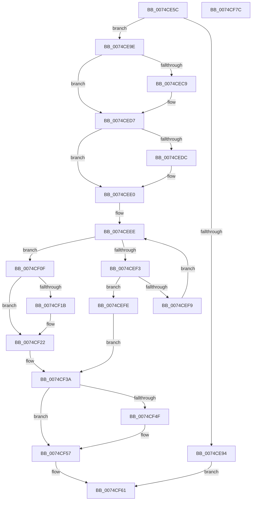

# AlpcRegisterLogRoutine

- RVA: `0x0074CE5C`–`0x0074CF7D` (길이 `289` bytes)
- VA: `0x000000014074CE5C`
- 실행 섹션: `PAGE`
- PDB 이름 있음: `예`; PDB Function 태그: `아니요`
- unwind 정보 RVA: `0x0005E6B4`
- 디코드: `75`개 명령, `289/289` bytes 표시
- 미해석 바이트: `0` (있으면 어셈블리에 `.byte`로 보존)

> 이 문서는 커널 이미지의 기계어와 PDB 기호를 분석해 생성했습니다. 4번과 5번은 함수 원형과 자료형을 바이너리 사용 방식에서 추정한 C 해석이며 원본 소스 복구 결과는 아닙니다.

## 1. Dependencies

- 직접 호출 지점: **6**; 고유 호출 대상: **6**
- 직접 호출자로 확인된 함수: **1**
- RIP 상대 이미지 참조: **7**

### Outgoing calls
- `0x0074CE85` → [ExAllocatePool2](../../poolcode/B8/ExAllocatePool2_function_00B820F0.md) (function, `0x00B820F0`)
- `0x0074CEB8` → [KeAbPreAcquire](../../text/21/KeAbPreAcquire_function_00210230.md) (function, `0x00210230`)
- `0x0074CED2` → [ExfAcquirePushLockExclusiveEx](../../text/20/ExfAcquirePushLockExclusiveEx_function_0020FC90.md) (function, `0x0020FC90`)
- `0x0074CF03` → [ExFreePoolWithTag](../../poolcode/B8/ExFreePoolWithTag_function_00B82870.md) (function, `0x00B82870`)
- `0x0074CF52` → [ExfTryToWakePushLock](../../text/26/ExfTryToWakePushLock_function_00265DD0.md) (function, `0x00265DD0`)
- `0x0074CF5A` → [KeAbPostRelease](../../text/2E/KeAbPostRelease_function_002E1600.md) (function, `0x002E1600`)

### Direct callers
- [EtwpEnableKernelTrace](../A4/EtwpEnableKernelTrace_function_00A4FBCC.md) at `0x00A5013A`

### Static image references
- `0x0074CE9E` → RVA `0x00F100D8` (`.data`; read)
- `0x0074CEA8` → RVA `0x00650BA0` (`EtwpTraceALPC`; read)
- `0x0074CEE0` → RVA `0x00E07490` (`.data`; read)
- `0x0074CF0F` → RVA `0x00E07498` (`.data`; read)
- `0x0074CF2C` → RVA `0x00E07498` (`.data`; write)
- `0x0074CF33` → RVA `0x00E66D00` (`.data`; write)
- `0x0074CF3E` → RVA `0x00F100D8` (`.data`; read/write)

## 2. Other-region calls and transfers

- 다른 실행 섹션으로 향하는 call: **6**
  - `0x0074CE85` → [ExAllocatePool2](../../poolcode/B8/ExAllocatePool2_function_00B820F0.md) (`PAGE` → `POOLCODE`)
  - `0x0074CEB8` → [KeAbPreAcquire](../../text/21/KeAbPreAcquire_function_00210230.md) (`PAGE` → `.text`)
  - `0x0074CED2` → [ExfAcquirePushLockExclusiveEx](../../text/20/ExfAcquirePushLockExclusiveEx_function_0020FC90.md) (`PAGE` → `.text`)
  - `0x0074CF03` → [ExFreePoolWithTag](../../poolcode/B8/ExFreePoolWithTag_function_00B82870.md) (`PAGE` → `POOLCODE`)
  - `0x0074CF52` → [ExfTryToWakePushLock](../../text/26/ExfTryToWakePushLock_function_00265DD0.md) (`PAGE` → `.text`)
  - `0x0074CF5A` → [KeAbPostRelease](../../text/2E/KeAbPostRelease_function_002E1600.md) (`PAGE` → `.text`)
- 별도 외부 분기/꼬리 이동을 확인하지 못했습니다.

## 3. Assembly (complete function range)

```asm
0074CE5C  48 8B C4                        mov rax, rsp
0074CE5F  48 89 58 08                     mov qword ptr [rax + 8], rbx
0074CE63  48 89 68 10                     mov qword ptr [rax + 0x10], rbp
0074CE67  48 89 70 18                     mov qword ptr [rax + 0x18], rsi
0074CE6B  48 89 78 20                     mov qword ptr [rax + 0x20], rdi
0074CE6F  41 56                           push r14
0074CE71  48 83 EC 20                     sub rsp, 0x20
0074CE75  BA 18 00 00 00                  mov edx, 0x18
0074CE7A  B9 00 01 00 00                  mov ecx, 0x100
0074CE7F  41 B8 41 6C 4C 63               mov r8d, 0x634c6c41
0074CE85  E8 66 52 43 00                  call 0x140b820f0
0074CE8A  33 FF                           xor edi, edi
0074CE8C  48 8B D8                        mov rbx, rax
0074CE8F  48 85 C0                        test rax, rax
0074CE92  75 0A                           jne 0x14074ce9e
0074CE94  B8 9A 00 00 C0                  mov eax, 0xc000009a
0074CE99  E9 C3 00 00 00                  jmp 0x14074cf61
0074CE9E  48 8D 2D 33 32 7C 00            lea rbp, [rip + 0x7c3233]
0074CEA5  45 33 C0                        xor r8d, r8d
0074CEA8  4C 8D 35 F1 3C F0 FF            lea r14, [rip - 0xfc30f]
0074CEAF  48 8B CD                        mov rcx, rbp
0074CEB2  33 D2                           xor edx, edx
0074CEB4  4C 89 70 10                     mov qword ptr [rax + 0x10], r14
0074CEB8  E8 73 33 AC FF                  call 0x140210230
0074CEBD  F0 48 0F BA 6D 00 00            lock bts qword ptr [rbp], 0
0074CEC4  48 8B F0                        mov rsi, rax
0074CEC7  73 0E                           jae 0x14074ced7
0074CEC9  4C 8B C5                        mov r8, rbp
0074CECC  48 8B D0                        mov rdx, rax
0074CECF  48 8B CD                        mov rcx, rbp
0074CED2  E8 B9 2D AC FF                  call 0x14020fc90
0074CED7  48 85 F6                        test rsi, rsi
0074CEDA  74 04                           je 0x14074cee0
0074CEDC  C6 46 0A 01                     mov byte ptr [rsi + 0xa], 1
0074CEE0  48 8B 05 A9 A5 6B 00            mov rax, qword ptr [rip + 0x6ba5a9]
0074CEE7  48 8D 0D A2 A5 6B 00            lea rcx, [rip + 0x6ba5a2]
0074CEEE  48 3B C1                        cmp rax, rcx
0074CEF1  74 1C                           je 0x14074cf0f
0074CEF3  4C 39 70 10                     cmp qword ptr [rax + 0x10], r14
0074CEF7  74 05                           je 0x14074cefe
0074CEF9  48 8B 00                        mov rax, qword ptr [rax]
0074CEFC  EB F0                           jmp 0x14074ceee
0074CEFE  33 D2                           xor edx, edx
0074CF00  48 8B CB                        mov rcx, rbx
0074CF03  E8 68 59 43 00                  call 0x140b82870
0074CF08  BF 18 07 00 C0                  mov edi, 0xc0000718
0074CF0D  EB 2B                           jmp 0x14074cf3a
0074CF0F  48 8B 05 82 A5 6B 00            mov rax, qword ptr [rip + 0x6ba582]
0074CF16  48 39 08                        cmp qword ptr [rax], rcx
0074CF19  74 07                           je 0x14074cf22
0074CF1B  B9 03 00 00 00                  mov ecx, 3
0074CF20  CD 29                           int 0x29
0074CF22  48 89 0B                        mov qword ptr [rbx], rcx
0074CF25  48 89 43 08                     mov qword ptr [rbx + 8], rax
0074CF29  48 89 18                        mov qword ptr [rax], rbx
0074CF2C  48 89 1D 65 A5 6B 00            mov qword ptr [rip + 0x6ba565], rbx
0074CF33  C6 05 C6 9D 71 00 01            mov byte ptr [rip + 0x719dc6], 1
0074CF3A  48 83 CA FF                     or rdx, 0xffffffffffffffff
0074CF3E  F0 48 0F C1 15 91 31 7C 00      lock xadd qword ptr [rip + 0x7c3191], rdx
0074CF47  80 E2 06                        and dl, 6
0074CF4A  80 FA 02                        cmp dl, 2
0074CF4D  75 08                           jne 0x14074cf57
0074CF4F  48 8B CD                        mov rcx, rbp
0074CF52  E8 79 8E B1 FF                  call 0x140265dd0
0074CF57  48 8B CD                        mov rcx, rbp
0074CF5A  E8 A1 46 B9 FF                  call 0x1402e1600
0074CF5F  8B C7                           mov eax, edi
0074CF61  48 8B 5C 24 30                  mov rbx, qword ptr [rsp + 0x30]
0074CF66  48 8B 6C 24 38                  mov rbp, qword ptr [rsp + 0x38]
0074CF6B  48 8B 74 24 40                  mov rsi, qword ptr [rsp + 0x40]
0074CF70  48 8B 7C 24 48                  mov rdi, qword ptr [rsp + 0x48]
0074CF75  48 83 C4 20                     add rsp, 0x20
0074CF79  41 5E                           pop r14
0074CF7B  C3                              ret
0074CF7C  CC                              int3
```

## 4. C-style interpretation (structured pseudocode)

```c
__int64 __fastcall AlpcRegisterLogRoutine(void)
{
    __int64 result;
    __int64 v_rdi;
    __int64 v_rsp;
    unsigned __int64 v_stack_p10;
    unsigned __int64 v_stack_p18;
    unsigned __int64 v_stack_p20;
    unsigned __int64 v_stack_p8;

    *(unsigned __int64 *)(v_rsp + 8) = v_rbx;
    *(unsigned __int64 *)(v_rsp + 16) = v_rbp;
    *(unsigned __int64 *)(v_rsp + 24) = v_rsi;
    *(unsigned __int64 *)(v_rsp + 32) = v_rdi;
    v_rsp = (v_rsp) - (32);
    result = ExAllocatePool2(256, 24, (unsigned int)(0x634C6C41ULL), a4);
    v_rdi = 0;
    if (result != 0) goto loc_0074CE9E;
    goto loc_0074CF61;
loc_0074CE9E:
    a3 = 0;
    a2 = 0;
    *(unsigned __int64 *)((unsigned int)(0xC000009AULL) + 16) = v_rip - 1032975;
    result = KeAbPreAcquire(v_rip + 8139315, a2, a3, a4);
    if (!(condition_is_above_or_equal)) {
        a3 = v_rip + 8139315;
        a2 = result;
        a1 = v_rip + 8139315;
        result = ExfAcquirePushLockExclusiveEx(a1, a2, a3, a4);
    }
    if (result != 0) {
        *(unsigned __int8 *)(result + 10) = 1;
    }
loc_0074CEEE:
    if ((*(unsigned __int64 *)(v_rip + 7054761)) == (v_rip + 7054754)) goto loc_0074CF0F;
    if ((*(unsigned __int64 *)(*(unsigned __int64 *)(v_rip + 7054761) + 16)) == (v_rip - 1032975)) goto loc_0074CEFE;
    goto loc_0074CEEE;
loc_0074CEFE:
    a2 = 0;
    result = ExFreePoolWithTag(result, a2, a3, a4);
    goto loc_0074CF3A;
loc_0074CF0F:
    if ((*(unsigned __int64 *)(*(unsigned __int64 *)(v_rip + 7054722))) != result) {
        a1 = 3;
    }
    *(unsigned __int64 *)(result) = a1;
    *(unsigned __int64 *)(result + 8) = *(unsigned __int64 *)(v_rip + 7054722);
    *(unsigned __int64 *)(*(unsigned __int64 *)(v_rip + 7054722)) = result;
    *(unsigned __int64 *)(v_rip + 7054693) = result;
    *(unsigned __int8 *)(v_rip + 7445958) = 1;
loc_0074CF3A:
    a2 = (a2) | (-1);
    a2 = (unsigned __int8)((a2) & (6));
    result = *(unsigned __int64 *)(v_rip + 7054722);
    if (((unsigned __int8)(a2)) == 2) {
        a1 = v_rip + 8139315;
        result = ExfTryToWakePushLock(a1, a2, a3, a4);
    }
    result = KeAbPostRelease(v_rip + 8139315, a2, a3, a4);
loc_0074CF61:
    v_rsp = (v_rsp) + (32);
    return (unsigned int)((unsigned int)((unsigned int)(0xC0000718ULL)));
}
```

## 5. (Beta) C Style

```c
void AlpcRegisterLogRoutine(void)
{
    int64_t result;
    int64_t local_rdi;
    int64_t local_rsp;
    uint64_t v_stack_p10;
    uint64_t v_stack_p18;
    uint64_t v_stack_p20;
    uint64_t v_stack_p8;

    *(uint64_t *)(local_rsp + 0x8) = local_rbx;
    *(uint64_t *)(local_rsp + 0x10) = local_rbp;
    *(uint64_t *)(local_rsp + 0x18) = local_rsi;
    *(uint64_t *)(local_rsp + 0x20) = local_rdi;
    local_rsp = (local_rsp) - (32);
    result = ExAllocatePool2(256, 24, (uint32_t)(0x634C6C41ULL), a4);
    local_rdi = 0;
    if (result != 0) goto loc_0074CE9E;
    goto loc_0074CF61;
loc_0074CE9E:
    a3 = 0;
    a2 = 0;
    *(uint64_t *)((uint32_t)(0xC000009AULL) + 0x10) = v_rip - 1032975;
    result = KeAbPreAcquire(v_rip + 8139315, a2, a3, a4);
    if (!(condition_is_above_or_equal)) {
        a3 = v_rip + 8139315;
        a2 = result;
        a1 = v_rip + 8139315;
        result = ExfAcquirePushLockExclusiveEx(a1, a2, a3, a4);
    }
    if (result != 0) {
        *(uint8_t *)(result + 0xA) = 1;
    }
loc_0074CEEE:
    if ((*(uint64_t *)(v_rip + 0x6BA5A9)) == (v_rip + 7054754)) goto loc_0074CF0F;
    if ((*(uint64_t *)(*(uint64_t *)(v_rip + 0x6BA5A9) + 0x10)) == (v_rip - 1032975)) goto loc_0074CEFE;
    goto loc_0074CEEE;
loc_0074CEFE:
    a2 = 0;
    result = ExFreePoolWithTag(result, a2, a3, a4);
    goto loc_0074CF3A;
loc_0074CF0F:
    if ((*(uint64_t *)(*(uint64_t *)(v_rip + 0x6BA582))) != result) {
        a1 = 3;
    }
    *(uint64_t *)(result) = a1;
    *(uint64_t *)(result + 0x8) = *(uint64_t *)(v_rip + 0x6BA582);
    *(uint64_t *)(*(uint64_t *)(v_rip + 0x6BA582)) = result;
    *(uint64_t *)(v_rip + 0x6BA565) = result;
    *(uint8_t *)(v_rip + 0x719DC6) = 1;
loc_0074CF3A:
    a2 = (a2) | (-1);
    a2 = (uint8_t)((a2) & (6));
    result = *(uint64_t *)(v_rip + 0x6BA582);
    if (((uint8_t)(a2)) == 2) {
        a1 = v_rip + 8139315;
        result = ExfTryToWakePushLock(a1, a2, a3, a4);
    }
    result = KeAbPostRelease(v_rip + 8139315, a2, a3, a4);
loc_0074CF61:
    local_rsp = (local_rsp) + (32);
    return (uint32_t)((uint32_t)((uint32_t)(0xC0000718ULL)));
}
```

## 6. Execution-region graph

[열기: 2D/3D 그래프와 함수 탐색 컨트롤 패널](../../../control-panel.html?section=page&rva=0x0074CE5C&view=graph)

- 2D 그래프는 위에서 아래로 흐르고, 3D 그래프는 빈 공간을 드래그해 회전합니다. Shift+드래그는 이동, 휠은 확대·축소, 함수 노드 선택은 대상 보고서 이동입니다.

### Static fallback


