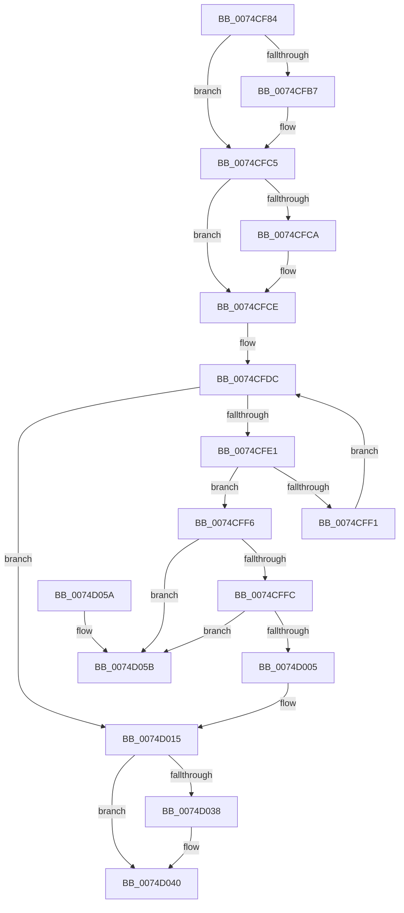

# AlpcUnregisterLogRoutine

- RVA: `0x0074CF84`–`0x0074D062` (길이 `222` bytes)
- VA: `0x000000014074CF84`
- 실행 섹션: `PAGE`
- PDB 이름 있음: `예`; PDB Function 태그: `아니요`
- unwind 정보 RVA: `0x0006383C`
- 디코드: `60`개 명령, `222/222` bytes 표시
- 미해석 바이트: `0` (있으면 어셈블리에 `.byte`로 보존)

> 이 문서는 커널 이미지의 기계어와 PDB 기호를 분석해 생성했습니다. 4번과 5번은 함수 원형과 자료형을 바이너리 사용 방식에서 추정한 C 해석이며 원본 소스 복구 결과는 아닙니다.

## 1. Dependencies

- 직접 호출 지점: **5**; 고유 호출 대상: **5**
- 직접 호출자로 확인된 함수: **1**
- RIP 상대 이미지 참조: **5**

### Outgoing calls
- `0x0074CFA7` → [KeAbPreAcquire](../../text/21/KeAbPreAcquire_function_00210230.md) (function, `0x00210230`)
- `0x0074CFC0` → [ExfAcquirePushLockExclusiveEx](../../text/20/ExfAcquirePushLockExclusiveEx_function_0020FC90.md) (function, `0x0020FC90`)
- `0x0074D00E` → [ExFreePoolWithTag](../../poolcode/B8/ExFreePoolWithTag_function_00B82870.md) (function, `0x00B82870`)
- `0x0074D03B` → [ExfTryToWakePushLock](../../text/26/ExfTryToWakePushLock_function_00265DD0.md) (function, `0x00265DD0`)
- `0x0074D043` → [KeAbPostRelease](../../text/2E/KeAbPostRelease_function_002E1600.md) (function, `0x002E1600`)

### Direct callers
- [EtwpDisableKernelTrace](../A4/EtwpDisableKernelTrace_function_00A4F7D8.md) at `0x00A4FA36`

### Static image references
- `0x0074CF93` → RVA `0x00F100D8` (`.data`; read)
- `0x0074CFCE` → RVA `0x00E07490` (`.data`; read)
- `0x0074CFE4` → RVA `0x00650BA0` (`EtwpTraceALPC`; read)
- `0x0074D01C` → RVA `0x00E66D00` (`.data`; write)
- `0x0074D027` → RVA `0x00F100D8` (`.data`; read/write)

## 2. Other-region calls and transfers

- 다른 실행 섹션으로 향하는 call: **5**
  - `0x0074CFA7` → [KeAbPreAcquire](../../text/21/KeAbPreAcquire_function_00210230.md) (`PAGE` → `.text`)
  - `0x0074CFC0` → [ExfAcquirePushLockExclusiveEx](../../text/20/ExfAcquirePushLockExclusiveEx_function_0020FC90.md) (`PAGE` → `.text`)
  - `0x0074D00E` → [ExFreePoolWithTag](../../poolcode/B8/ExFreePoolWithTag_function_00B82870.md) (`PAGE` → `POOLCODE`)
  - `0x0074D03B` → [ExfTryToWakePushLock](../../text/26/ExfTryToWakePushLock_function_00265DD0.md) (`PAGE` → `.text`)
  - `0x0074D043` → [KeAbPostRelease](../../text/2E/KeAbPostRelease_function_002E1600.md) (`PAGE` → `.text`)
- 별도 외부 분기/꼬리 이동을 확인하지 못했습니다.

## 3. Assembly (complete function range)

```asm
0074CF84  48 89 5C 24 08                  mov qword ptr [rsp + 8], rbx
0074CF89  48 89 74 24 10                  mov qword ptr [rsp + 0x10], rsi
0074CF8E  57                              push rdi
0074CF8F  48 83 EC 20                     sub rsp, 0x20
0074CF93  48 8D 35 3E 31 7C 00            lea rsi, [rip + 0x7c313e]
0074CF9A  45 33 C0                        xor r8d, r8d
0074CF9D  48 8B CE                        mov rcx, rsi
0074CFA0  33 D2                           xor edx, edx
0074CFA2  BF 25 02 00 C0                  mov edi, 0xc0000225
0074CFA7  E8 84 32 AC FF                  call 0x140210230
0074CFAC  F0 48 0F BA 2E 00               lock bts qword ptr [rsi], 0
0074CFB2  48 8B D8                        mov rbx, rax
0074CFB5  73 0E                           jae 0x14074cfc5
0074CFB7  4C 8B C6                        mov r8, rsi
0074CFBA  48 8B D0                        mov rdx, rax
0074CFBD  48 8B CE                        mov rcx, rsi
0074CFC0  E8 CB 2C AC FF                  call 0x14020fc90
0074CFC5  48 85 DB                        test rbx, rbx
0074CFC8  74 04                           je 0x14074cfce
0074CFCA  C6 43 0A 01                     mov byte ptr [rbx + 0xa], 1
0074CFCE  48 8B 0D BB A4 6B 00            mov rcx, qword ptr [rip + 0x6ba4bb]
0074CFD5  48 8D 1D B4 A4 6B 00            lea rbx, [rip + 0x6ba4b4]
0074CFDC  48 3B CB                        cmp rcx, rbx
0074CFDF  74 34                           je 0x14074d015
0074CFE1  48 8B 01                        mov rax, qword ptr [rcx]
0074CFE4  48 8D 15 B5 3B F0 FF            lea rdx, [rip - 0xfc44b]
0074CFEB  48 39 51 10                     cmp qword ptr [rcx + 0x10], rdx
0074CFEF  74 05                           je 0x14074cff6
0074CFF1  48 8B C8                        mov rcx, rax
0074CFF4  EB E6                           jmp 0x14074cfdc
0074CFF6  48 39 48 08                     cmp qword ptr [rax + 8], rcx
0074CFFA  75 5F                           jne 0x14074d05b
0074CFFC  48 8B 51 08                     mov rdx, qword ptr [rcx + 8]
0074D000  48 39 0A                        cmp qword ptr [rdx], rcx
0074D003  75 56                           jne 0x14074d05b
0074D005  48 89 02                        mov qword ptr [rdx], rax
0074D008  48 89 50 08                     mov qword ptr [rax + 8], rdx
0074D00C  33 D2                           xor edx, edx
0074D00E  E8 5D 58 43 00                  call 0x140b82870
0074D013  33 FF                           xor edi, edi
0074D015  48 39 1D 74 A4 6B 00            cmp qword ptr [rip + 0x6ba474], rbx
0074D01C  0F 95 05 DD 9C 71 00            setne byte ptr [rip + 0x719cdd]
0074D023  48 83 CA FF                     or rdx, 0xffffffffffffffff
0074D027  F0 48 0F C1 15 A8 30 7C 00      lock xadd qword ptr [rip + 0x7c30a8], rdx
0074D030  80 E2 06                        and dl, 6
0074D033  80 FA 02                        cmp dl, 2
0074D036  75 08                           jne 0x14074d040
0074D038  48 8B CE                        mov rcx, rsi
0074D03B  E8 90 8D B1 FF                  call 0x140265dd0
0074D040  48 8B CE                        mov rcx, rsi
0074D043  E8 B8 45 B9 FF                  call 0x1402e1600
0074D048  48 8B 5C 24 30                  mov rbx, qword ptr [rsp + 0x30]
0074D04D  8B C7                           mov eax, edi
0074D04F  48 8B 74 24 38                  mov rsi, qword ptr [rsp + 0x38]
0074D054  48 83 C4 20                     add rsp, 0x20
0074D058  5F                              pop rdi
0074D059  C3                              ret
0074D05A  CC                              int3
0074D05B  B9 03 00 00 00                  mov ecx, 3
0074D060  CD 29                           int 0x29
```

## 4. C-style interpretation (structured pseudocode)

```c
__int64 __fastcall AlpcUnregisterLogRoutine(__int64 a1, int a2, int a3)
{
    __int64 result;
    __int64 v_rdi;
    __int64 v_rsp;
    unsigned __int64 v_stack_p10;
    unsigned __int64 v_stack_p8;

    v_stack_p8 = v_rbx;
    v_stack_p10 = v_rsi;
    v_rsp = (v_rsp) - (32);
    a3 = 0;
    a2 = 0;
    result = KeAbPreAcquire(v_rip + 8139070, a2, a3, a4);
    if (!(condition_is_above_or_equal)) {
        a3 = v_rip + 8139070;
        a2 = result;
        a1 = v_rip + 8139070;
        result = ExfAcquirePushLockExclusiveEx(a1, a2, a3, a4);
    }
    if (result != 0) {
        *(unsigned __int8 *)(result + 10) = 1;
    }
loc_0074CFDC:
    if ((*(unsigned __int64 *)(v_rip + 7054523)) == (v_rip + 7054516)) goto loc_0074D015;
    if ((*(unsigned __int64 *)(*(unsigned __int64 *)(v_rip + 7054523) + 16)) == (v_rip - 1033291)) goto loc_0074CFF6;
    goto loc_0074CFDC;
loc_0074CFF6:
    if ((*(unsigned __int64 *)(*(unsigned __int64 *)(*(unsigned __int64 *)(v_rip + 7054523)) + 8)) != (*(unsigned __int64 *)(*(unsigned __int64 *)(v_rip + 7054523)))) goto loc_0074D05B;
    if ((*(unsigned __int64 *)(*(unsigned __int64 *)(*(unsigned __int64 *)(*(unsigned __int64 *)(v_rip + 7054523)) + 8))) != (*(unsigned __int64 *)(*(unsigned __int64 *)(v_rip + 7054523)))) goto loc_0074D05B;
    *(unsigned __int64 *)(*(unsigned __int64 *)(*(unsigned __int64 *)(*(unsigned __int64 *)(v_rip + 7054523)) + 8)) = *(unsigned __int64 *)(*(unsigned __int64 *)(v_rip + 7054523));
    *(unsigned __int64 *)(*(unsigned __int64 *)(*(unsigned __int64 *)(v_rip + 7054523)) + 8) = *(unsigned __int64 *)(*(unsigned __int64 *)(*(unsigned __int64 *)(v_rip + 7054523)) + 8);
    a2 = 0;
    result = ExFreePoolWithTag(*(unsigned __int64 *)(*(unsigned __int64 *)(v_rip + 7054523)), a2, a3, a4);
    v_rdi = 0;
loc_0074D015:
    a2 = (a2) | (-1);
    a2 = (unsigned __int8)((a2) & (6));
    if (((unsigned __int8)(a2)) == 2) {
        a1 = v_rip + 8139070;
        result = ExfTryToWakePushLock(a1, a2, a3, a4);
    }
    result = KeAbPostRelease(v_rip + 8139070, a2, a3, a4);
    v_rsp = (v_rsp) + (32);
    return 0;
loc_0074D05B:
    return 0;
}
```

## 5. (Beta) C Style

```c
int64_t AlpcUnregisterLogRoutine(int64_t Arg1, int32_t Arg2, int32_t Arg3)
{
    int64_t result;
    int64_t local_rdi;
    int64_t local_rsp;
    uint64_t v_stack_p10;
    uint64_t v_stack_p8;

    v_stack_p8 = local_rbx;
    v_stack_p10 = local_rsi;
    local_rsp = (local_rsp) - (32);
    Arg3 = 0;
    Arg2 = 0;
    result = KeAbPreAcquire(v_rip + 8139070, Arg2, Arg3, a4);
    if (!(condition_is_above_or_equal)) {
        Arg3 = v_rip + 8139070;
        Arg2 = result;
        Arg1 = v_rip + 8139070;
        result = ExfAcquirePushLockExclusiveEx(Arg1, Arg2, Arg3, a4);
    }
    if (result != 0) {
        *(uint8_t *)(result + 0xA) = 1;
    }
loc_0074CFDC:
    if ((*(uint64_t *)(v_rip + 0x6BA4BB)) == (v_rip + 7054516)) goto loc_0074D015;
    if ((*(uint64_t *)(*(uint64_t *)(v_rip + 0x6BA4BB) + 0x10)) == (v_rip - 1033291)) goto loc_0074CFF6;
    goto loc_0074CFDC;
loc_0074CFF6:
    if ((*(uint64_t *)(*(uint64_t *)(*(uint64_t *)(v_rip + 0x6BA4BB)) + 0x8)) != (*(uint64_t *)(*(uint64_t *)(v_rip + 0x6BA4BB)))) goto loc_0074D05B;
    if ((*(uint64_t *)(*(uint64_t *)(*(uint64_t *)(*(uint64_t *)(v_rip + 0x6BA4BB)) + 0x8))) != (*(uint64_t *)(*(uint64_t *)(v_rip + 0x6BA4BB)))) goto loc_0074D05B;
    *(uint64_t *)(*(uint64_t *)(*(uint64_t *)(*(uint64_t *)(v_rip + 0x6BA4BB)) + 0x8)) = *(uint64_t *)(*(uint64_t *)(v_rip + 0x6BA4BB));
    *(uint64_t *)(*(uint64_t *)(*(uint64_t *)(v_rip + 0x6BA4BB)) + 0x8) = *(uint64_t *)(*(uint64_t *)(*(uint64_t *)(v_rip + 0x6BA4BB)) + 0x8);
    Arg2 = 0;
    result = ExFreePoolWithTag(*(uint64_t *)(*(uint64_t *)(v_rip + 0x6BA4BB)), Arg2, Arg3, a4);
    local_rdi = 0;
loc_0074D015:
    Arg2 = (Arg2) | (-1);
    Arg2 = (uint8_t)((Arg2) & (6));
    if (((uint8_t)(Arg2)) == 2) {
        Arg1 = v_rip + 8139070;
        result = ExfTryToWakePushLock(Arg1, Arg2, Arg3, a4);
    }
    result = KeAbPostRelease(v_rip + 8139070, Arg2, Arg3, a4);
    local_rsp = (local_rsp) + (32);
    return 0;
loc_0074D05B:
    return 0;
}
```

## 6. Execution-region graph

[열기: 2D/3D 그래프와 함수 탐색 컨트롤 패널](../../../control-panel.html?section=page&rva=0x0074CF84&view=graph)

- 2D 그래프는 위에서 아래로 흐르고, 3D 그래프는 빈 공간을 드래그해 회전합니다. Shift+드래그는 이동, 휠은 확대·축소, 함수 노드 선택은 대상 보고서 이동입니다.

### Static fallback


