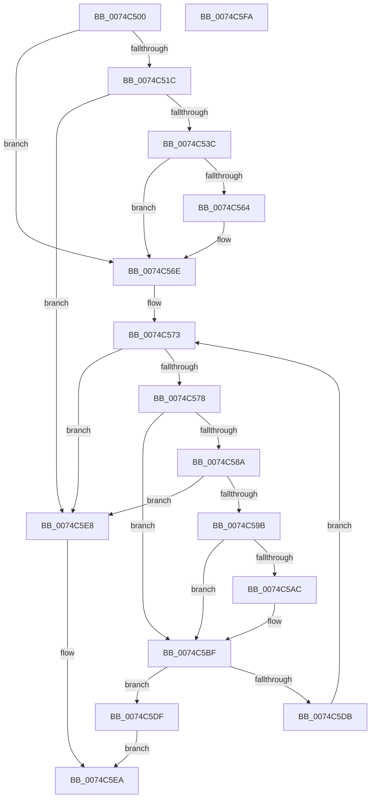

# AlpcpAllocateMessageFromExtendedTables

- RVA: `0x0074C500`–`0x0074C5FB` (길이 `251` bytes)
- VA: `0x000000014074C500`
- 실행 섹션: `PAGE`
- PDB 이름 있음: `예`; PDB Function 태그: `아니요`
- unwind 정보 RVA: `0x000794E0`
- 디코드: `69`개 명령, `251/251` bytes 표시
- 미해석 바이트: `0` (있으면 어셈블리에 `.byte`로 보존)

> 이 문서는 커널 이미지의 기계어와 PDB 기호를 분석해 생성했습니다. 4번과 5번은 함수 원형과 자료형을 바이너리 사용 방식에서 추정한 C 해석이며 원본 소스 복구 결과는 아닙니다.

## 1. Dependencies

- 직접 호출 지점: **6**; 고유 호출 대상: **6**
- 직접 호출자로 확인된 함수: **1**
- RIP 상대 이미지 참조: **2**

### Outgoing calls
- `0x0074C52B` → [ExAllocatePool2](../../poolcode/B8/ExAllocatePool2_function_00B820F0.md) (function, `0x00B820F0`)
- `0x0074C548` → [memset](../../text/6C/memset_function_006C6C40.md) (function, `0x006C6C40`)
- `0x0074C569` → [ExFreePoolWithTag](../../poolcode/B8/ExFreePoolWithTag_function_00B82870.md) (function, `0x00B82870`)
- `0x0074C58E` → [ExCreateHandleTable](../94/ExCreateHandleTable_function_0094C7E8.md) (function, `0x0094C7E8`)
- `0x0074C5AF` → [ExDestroyHandleTable](../90/ExDestroyHandleTable_function_00904D18.md) (function, `0x00904D18`)
- `0x0074C5D1` → [ExCreateHandleEx](../86/ExCreateHandleEx_function_0086ACB0.md) (function, `0x0086ACB0`)

### Direct callers
- [AlpcpAllocateMessageFunction](../89/AlpcpAllocateMessageFunction_function_00892FF0.md) at `0x0089305C`

### Static image references
- `0x0074C50F` → RVA `0x00FC5130` (`ALMOSTRO`; read)
- `0x0074C54D` → RVA `0x00FC6F68` (`ALMOSTRO`; read)

## 2. Other-region calls and transfers

- 다른 실행 섹션으로 향하는 call: **3**
  - `0x0074C52B` → [ExAllocatePool2](../../poolcode/B8/ExAllocatePool2_function_00B820F0.md) (`PAGE` → `POOLCODE`)
  - `0x0074C548` → [memset](../../text/6C/memset_function_006C6C40.md) (`PAGE` → `.text`)
  - `0x0074C569` → [ExFreePoolWithTag](../../poolcode/B8/ExFreePoolWithTag_function_00B82870.md) (`PAGE` → `POOLCODE`)
- 별도 외부 분기/꼬리 이동을 확인하지 못했습니다.

## 3. Assembly (complete function range)

```asm
0074C500  48 89 5C 24 08                  mov qword ptr [rsp + 8], rbx
0074C505  48 89 74 24 10                  mov qword ptr [rsp + 0x10], rsi
0074C50A  57                              push rdi
0074C50B  48 83 EC 30                     sub rsp, 0x30
0074C50F  48 83 3D 19 8C 87 00 00         cmp qword ptr [rip + 0x878c19], 0
0074C517  48 8B F1                        mov rsi, rcx
0074C51A  75 52                           jne 0x14074c56e
0074C51C  B9 00 01 00 00                  mov ecx, 0x100
0074C521  BF 41 6C 48 61                  mov edi, 0x61486c41
0074C526  44 8B C7                        mov r8d, edi
0074C529  8B D1                           mov edx, ecx
0074C52B  E8 C0 5B 43 00                  call 0x140b820f0
0074C530  48 8B D8                        mov rbx, rax
0074C533  48 85 C0                        test rax, rax
0074C536  0F 84 AC 00 00 00               je 0x14074c5e8
0074C53C  48 8D 48 08                     lea rcx, [rax + 8]
0074C540  33 D2                           xor edx, edx
0074C542  41 B8 F8 00 00 00               mov r8d, 0xf8
0074C548  E8 F3 A6 F7 FF                  call 0x1406c6c40
0074C54D  48 8B 05 14 AA 87 00            mov rax, qword ptr [rip + 0x87aa14]
0074C554  48 89 03                        mov qword ptr [rbx], rax
0074C557  33 C0                           xor eax, eax
0074C559  F0 48 0F B1 1D CE 8B 87 00      lock cmpxchg qword ptr [rip + 0x878bce], rbx
0074C562  74 0A                           je 0x14074c56e
0074C564  8B D7                           mov edx, edi
0074C566  48 8B CB                        mov rcx, rbx
0074C569  E8 02 63 43 00                  call 0x140b82870
0074C56E  BF 01 00 00 00                  mov edi, 1
0074C573  83 FF 20                        cmp edi, 0x20
0074C576  73 70                           jae 0x14074c5e8
0074C578  48 8B 05 B1 8B 87 00            mov rax, qword ptr [rip + 0x878bb1]
0074C57F  8B DF                           mov ebx, edi
0074C581  4C 8B 14 D8                     mov r10, qword ptr [rax + rbx*8]
0074C585  4D 85 D2                        test r10, r10
0074C588  75 35                           jne 0x14074c5bf
0074C58A  33 D2                           xor edx, edx
0074C58C  33 C9                           xor ecx, ecx
0074C58E  E8 55 02 20 00                  call 0x14094c7e8
0074C593  4C 8B D0                        mov r10, rax
0074C596  48 85 C0                        test rax, rax
0074C599  74 4D                           je 0x14074c5e8
0074C59B  48 8B 0D 8E 8B 87 00            mov rcx, qword ptr [rip + 0x878b8e]
0074C5A2  33 C0                           xor eax, eax
0074C5A4  F0 4C 0F B1 14 D9               lock cmpxchg qword ptr [rcx + rbx*8], r10
0074C5AA  74 13                           je 0x14074c5bf
0074C5AC  49 8B CA                        mov rcx, r10
0074C5AF  E8 64 87 1B 00                  call 0x140904d18
0074C5B4  48 8B 05 75 8B 87 00            mov rax, qword ptr [rip + 0x878b75]
0074C5BB  4C 8B 14 D8                     mov r10, qword ptr [rax + rbx*8]
0074C5BF  48 83 64 24 20 00               and qword ptr [rsp + 0x20], 0
0074C5C5  45 33 C9                        xor r9d, r9d
0074C5C8  45 33 C0                        xor r8d, r8d
0074C5CB  48 8B D6                        mov rdx, rsi
0074C5CE  49 8B CA                        mov rcx, r10
0074C5D1  E8 DA E6 11 00                  call 0x14086acb0
0074C5D6  48 85 C0                        test rax, rax
0074C5D9  75 04                           jne 0x14074c5df
0074C5DB  FF C7                           inc edi
0074C5DD  EB 94                           jmp 0x14074c573
0074C5DF  48 C1 E3 1A                     shl rbx, 0x1a
0074C5E3  48 0B C3                        or rax, rbx
0074C5E6  EB 02                           jmp 0x14074c5ea
0074C5E8  33 C0                           xor eax, eax
0074C5EA  48 8B 5C 24 40                  mov rbx, qword ptr [rsp + 0x40]
0074C5EF  48 8B 74 24 48                  mov rsi, qword ptr [rsp + 0x48]
0074C5F4  48 83 C4 30                     add rsp, 0x30
0074C5F8  5F                              pop rdi
0074C5F9  C3                              ret
0074C5FA  CC                              int3
```

## 4. C-style interpretation (structured pseudocode)

```c
__int64 __fastcall AlpcpAllocateMessageFromExtendedTables(__int64 a1, __int64 a2, __int64 a3, int a4)
{
    __int64 result;
    __int64 v_r10;
    __int64 v_rbx;
    __int64 v_rdi;
    __int64 v_rsp;
    unsigned __int64 v_stack_m18;
    unsigned __int64 v_stack_p10;
    unsigned __int64 v_stack_p8;

    v_stack_p8 = v_rbx;
    v_stack_p10 = v_rsi;
    v_rsp = (v_rsp) - (48);
    if ((*(unsigned __int64 *)(v_rip + 8883225)) != 0) goto loc_0074C56E;
    result = ExAllocatePool2(256, 256, (unsigned int)((unsigned int)((unsigned int)(0x61486C41ULL))), a4);
    if (result == 0) goto loc_0074C5E8;
    a2 = 0;
    result = memset(result + 8, a2, 248, a4);
    *(unsigned __int64 *)(result) = *(unsigned __int64 *)(v_rip + 8890900);
    result = 0;
    if (!(condition_is_equal)) {
        a2 = (unsigned int)((unsigned int)(0x61486C41ULL));
        a1 = 0;
        result = ExFreePoolWithTag(a1, a2, 248, a4);
    }
loc_0074C573:
    if (1 >= 32) goto loc_0074C5E8;
    if (*(unsigned __int64 *)(*(unsigned __int64 *)(v_rip + 8883121) + 1 * 8) != 0) goto loc_0074C5BF;
    a2 = 0;
    a1 = 0;
    result = ExCreateHandleTable(a1, a2, 248, a4);
    if (result == 0) goto loc_0074C5E8;
    result = 0;
    v_r10 = result;
    if (!(condition_is_equal)) {
        a1 = 0;
        result = ExDestroyHandleTable(a1, a2, 248, a4);
        result = *(unsigned __int64 *)(v_rip + 8883061);
        v_r10 = *(unsigned __int64 *)(result + 1 * 8);
    }
    a4 = 0;
    a3 = 0;
    result = ExCreateHandleEx(v_r10, a1, a3, a4);
    if (result != 0) goto loc_0074C5DF;
    v_rdi = (unsigned int)((1) + 1);
    goto loc_0074C573;
loc_0074C5DF:
    v_rbx = (1) << (26);
    result = (result) | (v_rbx);
    goto loc_0074C5EA;
loc_0074C5E8:
    result = 0;
loc_0074C5EA:
    v_rsp = (v_rsp) + (48);
    return result;
}
```

## 5. (Beta) C Style

```c
int64_t AlpcpAllocateMessageFromExtendedTables(int64_t Arg1, int64_t Arg2, int64_t Arg3, int32_t Arg4)
{
    int64_t result;
    int64_t local_r10;
    int64_t local_rbx;
    int64_t local_rdi;
    int64_t local_rsp;
    uint64_t v_stack_m18;
    uint64_t v_stack_p10;
    uint64_t v_stack_p8;

    v_stack_p8 = local_rbx;
    v_stack_p10 = local_rsi;
    local_rsp = (local_rsp) - (48);
    if ((*(uint64_t *)(v_rip + 0x878C19)) != 0) goto loc_0074C56E;
    result = ExAllocatePool2(256, 256, (uint32_t)((uint32_t)((uint32_t)(0x61486C41ULL))), Arg4);
    if (result == 0) goto loc_0074C5E8;
    Arg2 = 0;
    result = memset(result + 8, Arg2, 248, Arg4);
    *(uint64_t *)(result) = *(uint64_t *)(v_rip + 0x87AA14);
    result = 0;
    if (!(condition_is_equal)) {
        Arg2 = (uint32_t)((uint32_t)(0x61486C41ULL));
        Arg1 = 0;
        result = ExFreePoolWithTag(Arg1, Arg2, 248, Arg4);
    }
loc_0074C573:
    if (1 >= 32) goto loc_0074C5E8;
    if (*(uint64_t *)(*(uint64_t *)(v_rip + 0x878BB1) + 0x1 * 8) != 0) goto loc_0074C5BF;
    Arg2 = 0;
    Arg1 = 0;
    result = ExCreateHandleTable(Arg1, Arg2, 248, Arg4);
    if (result == 0) goto loc_0074C5E8;
    result = 0;
    local_r10 = result;
    if (!(condition_is_equal)) {
        Arg1 = 0;
        result = ExDestroyHandleTable(Arg1, Arg2, 248, Arg4);
        result = *(uint64_t *)(v_rip + 0x878B75);
        local_r10 = *(uint64_t *)(result + 0x1 * 8);
    }
    Arg4 = 0;
    Arg3 = 0;
    result = ExCreateHandleEx(local_r10, Arg1, Arg3, Arg4);
    if (result != 0) goto loc_0074C5DF;
    local_rdi = (uint32_t)((1) + 1);
    goto loc_0074C573;
loc_0074C5DF:
    local_rbx = (1) << (26);
    result = (result) | (local_rbx);
    goto loc_0074C5EA;
loc_0074C5E8:
    result = 0;
loc_0074C5EA:
    local_rsp = (local_rsp) + (48);
    return result;
}
```

## 6. Execution-region graph

[열기: 2D/3D 그래프와 함수 탐색 컨트롤 패널](../../../control-panel.html?section=page&rva=0x0074C500&view=graph)

- 2D 그래프는 위에서 아래로 흐르고, 3D 그래프는 빈 공간을 드래그해 회전합니다. Shift+드래그는 이동, 휠은 확대·축소, 함수 노드 선택은 대상 보고서 이동입니다.

### Static fallback


