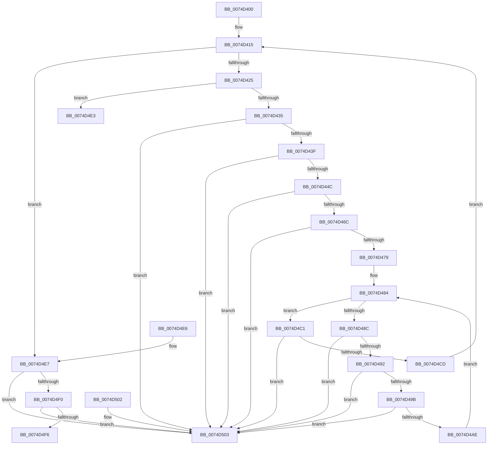

# AlpcpAllocateSnapshotMessageLog

- RVA: `0x0074D400`–`0x0074D50A` (길이 `266` bytes)
- VA: `0x000000014074D400`
- 실행 섹션: `PAGE`
- PDB 이름 있음: `예`; PDB Function 태그: `아니요`
- unwind 정보 RVA: `0x000DB714`
- 디코드: `67`개 명령, `266/266` bytes 표시
- 미해석 바이트: `0` (있으면 어셈블리에 `.byte`로 보존)

> 이 문서는 커널 이미지의 기계어와 PDB 기호를 분석해 생성했습니다. 4번과 5번은 함수 원형과 자료형을 바이너리 사용 방식에서 추정한 C 해석이며 원본 소스 복구 결과는 아닙니다.

## 1. Dependencies

- 직접 호출 지점: **0**; 고유 호출 대상: **0**
- 직접 호출자로 확인된 함수: **1**
- RIP 상대 이미지 참조: **9**

### Outgoing calls
- 직접 디코드된 call 명령이 없습니다.

### Direct callers
- [AlpcpEnterStateChangeEventMessageLog](../89/AlpcpEnterStateChangeEventMessageLog_function_00897CF8.md) at `0x00897DD2`

### Static image references
- `0x0074D400` → RVA `0x00F10090` (`.data`; read)
- `0x0074D407` → RVA `0x00F100B0` (`.data`; read)
- `0x0074D40E` → RVA `0x00F100C0` (`.data`; read)
- `0x0074D44C` → RVA `0x00F100B0` (`.data`; write)
- `0x0074D4A2` → RVA `0x00F10098` (`.data`; read)
- `0x0074D4B8` → RVA `0x00F10098` (`.data`; write)
- `0x0074D4C1` → RVA `0x00F100C8` (`.data`; read)
- `0x0074D4D7` → RVA `0x00F100C8` (`.data`; write)
- `0x0074D4F6` → RVA `0x00F10090` (`.data`; write)

## 2. Other-region calls and transfers

- 다른 실행 섹션으로 향하는 call: **0**
- 별도 외부 분기/꼬리 이동을 확인하지 못했습니다.

## 3. Assembly (complete function range)

```asm
0074D400  4C 8D 0D 89 2C 7C 00            lea r9, [rip + 0x7c2c89]
0074D407  4C 8D 15 A2 2C 7C 00            lea r10, [rip + 0x7c2ca2]
0074D40E  4C 8D 1D AB 2C 7C 00            lea r11, [rip + 0x7c2cab]
0074D415  48 8B 05 74 2C 7C 00            mov rax, qword ptr [rip + 0x7c2c74]
0074D41C  49 3B C1                        cmp rax, r9
0074D41F  0F 85 C2 00 00 00               jne 0x14074d4e7
0074D425  48 8B 05 84 2C 7C 00            mov rax, qword ptr [rip + 0x7c2c84]
0074D42C  49 3B C2                        cmp rax, r10
0074D42F  0F 84 AE 00 00 00               je 0x14074d4e3
0074D435  4C 39 50 08                     cmp qword ptr [rax + 8], r10
0074D439  0F 85 C4 00 00 00               jne 0x14074d503
0074D43F  48 8B 08                        mov rcx, qword ptr [rax]
0074D442  48 39 41 08                     cmp qword ptr [rcx + 8], rax
0074D446  0F 85 B7 00 00 00               jne 0x14074d503
0074D44C  48 89 0D 5D 2C 7C 00            mov qword ptr [rip + 0x7c2c5d], rcx
0074D453  4C 89 51 08                     mov qword ptr [rcx + 8], r10
0074D457  48 8D 48 10                     lea rcx, [rax + 0x10]
0074D45B  83 60 2C 00                     and dword ptr [rax + 0x2c], 0
0074D45F  4C 8B 01                        mov r8, qword ptr [rcx]
0074D462  49 39 48 08                     cmp qword ptr [r8 + 8], rcx
0074D466  0F 85 97 00 00 00               jne 0x14074d503
0074D46C  48 8B 51 08                     mov rdx, qword ptr [rcx + 8]
0074D470  48 39 0A                        cmp qword ptr [rdx], rcx
0074D473  0F 85 8A 00 00 00               jne 0x14074d503
0074D479  4C 89 02                        mov qword ptr [rdx], r8
0074D47C  49 89 50 08                     mov qword ptr [r8 + 8], rdx
0074D480  48 8D 50 30                     lea rdx, [rax + 0x30]
0074D484  48 8B 0A                        mov rcx, qword ptr [rdx]
0074D487  48 3B CA                        cmp rcx, rdx
0074D48A  74 35                           je 0x14074d4c1
0074D48C  48 39 51 08                     cmp qword ptr [rcx + 8], rdx
0074D490  75 71                           jne 0x14074d503
0074D492  4C 8B 01                        mov r8, qword ptr [rcx]
0074D495  49 39 48 08                     cmp qword ptr [r8 + 8], rcx
0074D499  75 68                           jne 0x14074d503
0074D49B  4C 89 02                        mov qword ptr [rdx], r8
0074D49E  49 89 50 08                     mov qword ptr [r8 + 8], rdx
0074D4A2  4C 8B 05 EF 2B 7C 00            mov r8, qword ptr [rip + 0x7c2bef]
0074D4A9  4D 39 08                        cmp qword ptr [r8], r9
0074D4AC  75 55                           jne 0x14074d503
0074D4AE  4C 89 09                        mov qword ptr [rcx], r9
0074D4B1  4C 89 41 08                     mov qword ptr [rcx + 8], r8
0074D4B5  49 89 08                        mov qword ptr [r8], rcx
0074D4B8  48 89 0D D9 2B 7C 00            mov qword ptr [rip + 0x7c2bd9], rcx
0074D4BF  EB C3                           jmp 0x14074d484
0074D4C1  48 8B 0D 00 2C 7C 00            mov rcx, qword ptr [rip + 0x7c2c00]
0074D4C8  4C 39 19                        cmp qword ptr [rcx], r11
0074D4CB  75 36                           jne 0x14074d503
0074D4CD  4C 89 18                        mov qword ptr [rax], r11
0074D4D0  48 89 48 08                     mov qword ptr [rax + 8], rcx
0074D4D4  48 89 01                        mov qword ptr [rcx], rax
0074D4D7  48 89 05 EA 2B 7C 00            mov qword ptr [rip + 0x7c2bea], rax
0074D4DE  E9 32 FF FF FF                  jmp 0x14074d415
0074D4E3  33 C0                           xor eax, eax
0074D4E5  C3                              ret
0074D4E6  CC                              int3
0074D4E7  48 8B 08                        mov rcx, qword ptr [rax]
0074D4EA  4C 39 48 08                     cmp qword ptr [rax + 8], r9
0074D4EE  75 13                           jne 0x14074d503
0074D4F0  48 39 41 08                     cmp qword ptr [rcx + 8], rax
0074D4F4  75 0D                           jne 0x14074d503
0074D4F6  48 89 0D 93 2B 7C 00            mov qword ptr [rip + 0x7c2b93], rcx
0074D4FD  4C 89 49 08                     mov qword ptr [rcx + 8], r9
0074D501  C3                              ret
0074D502  CC                              int3
0074D503  B9 03 00 00 00                  mov ecx, 3
0074D508  CD 29                           int 0x29
```

## 4. C-style interpretation (structured pseudocode)

```c
__int64 __fastcall AlpcpAllocateSnapshotMessageLog(void)
{
    __int64 result;

loc_0074D415:
    if ((*(unsigned __int64 *)(v_rip + 8137844)) != (v_rip + 8137865)) goto loc_0074D4E7;
    if ((*(unsigned __int64 *)(v_rip + 8137860)) == (v_rip + 8137890)) goto loc_0074D4E3;
    if ((*(unsigned __int64 *)(*(unsigned __int64 *)(v_rip + 8137860) + 8)) != (v_rip + 8137890)) goto loc_0074D503;
    if ((*(unsigned __int64 *)(*(unsigned __int64 *)(*(unsigned __int64 *)(v_rip + 8137860)) + 8)) != (*(unsigned __int64 *)(v_rip + 8137860))) goto loc_0074D503;
    *(unsigned __int64 *)(v_rip + 8137821) = *(unsigned __int64 *)(*(unsigned __int64 *)(v_rip + 8137860));
    *(unsigned __int64 *)(*(unsigned __int64 *)(*(unsigned __int64 *)(v_rip + 8137860)) + 8) = v_rip + 8137890;
    if ((*(unsigned __int64 *)(*(unsigned __int64 *)(*(unsigned __int64 *)(v_rip + 8137860) + 16) + 8)) != (*(unsigned __int64 *)(v_rip + 8137860) + 16)) goto loc_0074D503;
    if ((*(unsigned __int64 *)(*(unsigned __int64 *)(*(unsigned __int64 *)(v_rip + 8137860) + 16 + 8))) != (*(unsigned __int64 *)(v_rip + 8137860) + 16)) goto loc_0074D503;
    *(unsigned __int64 *)(*(unsigned __int64 *)(*(unsigned __int64 *)(v_rip + 8137860) + 16 + 8)) = *(unsigned __int64 *)(*(unsigned __int64 *)(v_rip + 8137860) + 16);
    *(unsigned __int64 *)(*(unsigned __int64 *)(*(unsigned __int64 *)(v_rip + 8137860) + 16) + 8) = *(unsigned __int64 *)(*(unsigned __int64 *)(v_rip + 8137860) + 16 + 8);
loc_0074D484:
    if ((*(unsigned __int64 *)(*(unsigned __int64 *)(v_rip + 8137860) + 48)) == (*(unsigned __int64 *)(v_rip + 8137860) + 48)) goto loc_0074D4C1;
    if ((*(unsigned __int64 *)(*(unsigned __int64 *)(*(unsigned __int64 *)(v_rip + 8137860) + 48) + 8)) != (*(unsigned __int64 *)(v_rip + 8137860) + 48)) goto loc_0074D503;
    if ((*(unsigned __int64 *)(*(unsigned __int64 *)(*(unsigned __int64 *)(*(unsigned __int64 *)(v_rip + 8137860) + 48)) + 8)) != (*(unsigned __int64 *)(*(unsigned __int64 *)(v_rip + 8137860) + 48))) goto loc_0074D503;
    *(unsigned __int64 *)(*(unsigned __int64 *)(v_rip + 8137860) + 48) = *(unsigned __int64 *)(*(unsigned __int64 *)(*(unsigned __int64 *)(v_rip + 8137860) + 48));
    *(unsigned __int64 *)(*(unsigned __int64 *)(*(unsigned __int64 *)(*(unsigned __int64 *)(v_rip + 8137860) + 48)) + 8) = *(unsigned __int64 *)(v_rip + 8137860) + 48;
    if ((*(unsigned __int64 *)(*(unsigned __int64 *)(v_rip + 8137711))) != (v_rip + 8137865)) goto loc_0074D503;
    *(unsigned __int64 *)(*(unsigned __int64 *)(*(unsigned __int64 *)(v_rip + 8137860) + 48)) = v_rip + 8137865;
    *(unsigned __int64 *)(*(unsigned __int64 *)(*(unsigned __int64 *)(v_rip + 8137860) + 48) + 8) = *(unsigned __int64 *)(v_rip + 8137711);
    *(unsigned __int64 *)(*(unsigned __int64 *)(v_rip + 8137711)) = *(unsigned __int64 *)(*(unsigned __int64 *)(v_rip + 8137860) + 48);
    *(unsigned __int64 *)(v_rip + 8137689) = *(unsigned __int64 *)(*(unsigned __int64 *)(v_rip + 8137860) + 48);
    goto loc_0074D484;
loc_0074D4C1:
    if ((*(unsigned __int64 *)(*(unsigned __int64 *)(v_rip + 8137728))) != (v_rip + 8137899)) goto loc_0074D503;
    *(unsigned __int64 *)(*(unsigned __int64 *)(v_rip + 8137860)) = v_rip + 8137899;
    *(unsigned __int64 *)(*(unsigned __int64 *)(v_rip + 8137860) + 8) = *(unsigned __int64 *)(v_rip + 8137728);
    *(unsigned __int64 *)(*(unsigned __int64 *)(v_rip + 8137728)) = *(unsigned __int64 *)(v_rip + 8137860);
    *(unsigned __int64 *)(v_rip + 8137706) = *(unsigned __int64 *)(v_rip + 8137860);
    goto loc_0074D415;
loc_0074D4E3:
    result = 0;
    return result;
loc_0074D4E7:
    if ((*(unsigned __int64 *)(result + 8)) != (v_rip + 8137865)) goto loc_0074D503;
    if ((*(unsigned __int64 *)(*(unsigned __int64 *)(result) + 8)) != 0) goto loc_0074D503;
    *(unsigned __int64 *)(v_rip + 8137619) = *(unsigned __int64 *)(result);
    *(unsigned __int64 *)(*(unsigned __int64 *)(result) + 8) = v_rip + 8137865;
    return result;
loc_0074D503:
    return result;
}
```

## 5. (Beta) C Style

```c
void AlpcpAllocateSnapshotMessageLog(void)
{
    int64_t result;

loc_0074D415:
    if ((*(uint64_t *)(v_rip + 0x7C2C74)) != (v_rip + 8137865)) goto loc_0074D4E7;
    if ((*(uint64_t *)(v_rip + 0x7C2C84)) == (v_rip + 8137890)) goto loc_0074D4E3;
    if ((*(uint64_t *)(*(uint64_t *)(v_rip + 0x7C2C84) + 0x8)) != (v_rip + 8137890)) goto loc_0074D503;
    if ((*(uint64_t *)(*(uint64_t *)(*(uint64_t *)(v_rip + 0x7C2C84)) + 0x8)) != (*(uint64_t *)(v_rip + 0x7C2C84))) goto loc_0074D503;
    *(uint64_t *)(v_rip + 0x7C2C5D) = *(uint64_t *)(*(uint64_t *)(v_rip + 0x7C2C84));
    *(uint64_t *)(*(uint64_t *)(*(uint64_t *)(v_rip + 0x7C2C84)) + 0x8) = v_rip + 8137890;
    if ((*(uint64_t *)(*(uint64_t *)(*(uint64_t *)(v_rip + 0x7C2C84) + 0x10) + 0x8)) != (*(uint64_t *)(v_rip + 0x7C2C84) + 16)) goto loc_0074D503;
    if ((*(uint64_t *)(*(uint64_t *)(*(uint64_t *)(v_rip + 0x7C2C84) + 0x10 + 0x8))) != (*(uint64_t *)(v_rip + 0x7C2C84) + 16)) goto loc_0074D503;
    *(uint64_t *)(*(uint64_t *)(*(uint64_t *)(v_rip + 0x7C2C84) + 0x10 + 0x8)) = *(uint64_t *)(*(uint64_t *)(v_rip + 0x7C2C84) + 0x10);
    *(uint64_t *)(*(uint64_t *)(*(uint64_t *)(v_rip + 0x7C2C84) + 0x10) + 0x8) = *(uint64_t *)(*(uint64_t *)(v_rip + 0x7C2C84) + 0x10 + 0x8);
loc_0074D484:
    if ((*(uint64_t *)(*(uint64_t *)(v_rip + 0x7C2C84) + 0x30)) == (*(uint64_t *)(v_rip + 0x7C2C84) + 48)) goto loc_0074D4C1;
    if ((*(uint64_t *)(*(uint64_t *)(*(uint64_t *)(v_rip + 0x7C2C84) + 0x30) + 0x8)) != (*(uint64_t *)(v_rip + 0x7C2C84) + 48)) goto loc_0074D503;
    if ((*(uint64_t *)(*(uint64_t *)(*(uint64_t *)(*(uint64_t *)(v_rip + 0x7C2C84) + 0x30)) + 0x8)) != (*(uint64_t *)(*(uint64_t *)(v_rip + 0x7C2C84) + 0x30))) goto loc_0074D503;
    *(uint64_t *)(*(uint64_t *)(v_rip + 0x7C2C84) + 0x30) = *(uint64_t *)(*(uint64_t *)(*(uint64_t *)(v_rip + 0x7C2C84) + 0x30));
    *(uint64_t *)(*(uint64_t *)(*(uint64_t *)(*(uint64_t *)(v_rip + 0x7C2C84) + 0x30)) + 0x8) = *(uint64_t *)(v_rip + 0x7C2C84) + 48;
    if ((*(uint64_t *)(*(uint64_t *)(v_rip + 0x7C2BEF))) != (v_rip + 8137865)) goto loc_0074D503;
    *(uint64_t *)(*(uint64_t *)(*(uint64_t *)(v_rip + 0x7C2C84) + 0x30)) = v_rip + 8137865;
    *(uint64_t *)(*(uint64_t *)(*(uint64_t *)(v_rip + 0x7C2C84) + 0x30) + 0x8) = *(uint64_t *)(v_rip + 0x7C2BEF);
    *(uint64_t *)(*(uint64_t *)(v_rip + 0x7C2BEF)) = *(uint64_t *)(*(uint64_t *)(v_rip + 0x7C2C84) + 0x30);
    *(uint64_t *)(v_rip + 0x7C2BD9) = *(uint64_t *)(*(uint64_t *)(v_rip + 0x7C2C84) + 0x30);
    goto loc_0074D484;
loc_0074D4C1:
    if ((*(uint64_t *)(*(uint64_t *)(v_rip + 0x7C2C00))) != (v_rip + 8137899)) goto loc_0074D503;
    *(uint64_t *)(*(uint64_t *)(v_rip + 0x7C2C84)) = v_rip + 8137899;
    *(uint64_t *)(*(uint64_t *)(v_rip + 0x7C2C84) + 0x8) = *(uint64_t *)(v_rip + 0x7C2C00);
    *(uint64_t *)(*(uint64_t *)(v_rip + 0x7C2C00)) = *(uint64_t *)(v_rip + 0x7C2C84);
    *(uint64_t *)(v_rip + 0x7C2BEA) = *(uint64_t *)(v_rip + 0x7C2C84);
    goto loc_0074D415;
loc_0074D4E3:
    result = 0;
    return result;
loc_0074D4E7:
    if ((*(uint64_t *)(result + 0x8)) != (v_rip + 8137865)) goto loc_0074D503;
    if ((*(uint64_t *)(*(uint64_t *)(result) + 0x8)) != 0) goto loc_0074D503;
    *(uint64_t *)(v_rip + 0x7C2B93) = *(uint64_t *)(result);
    *(uint64_t *)(*(uint64_t *)(result) + 0x8) = v_rip + 8137865;
    return result;
loc_0074D503:
    return result;
}
```

## 6. Execution-region graph

[열기: 2D/3D 그래프와 함수 탐색 컨트롤 패널](../../../control-panel.html?section=page&rva=0x0074D400&view=graph)

- 2D 그래프는 위에서 아래로 흐르고, 3D 그래프는 빈 공간을 드래그해 회전합니다. Shift+드래그는 이동, 휠은 확대·축소, 함수 노드 선택은 대상 보고서 이동입니다.

### Static fallback


