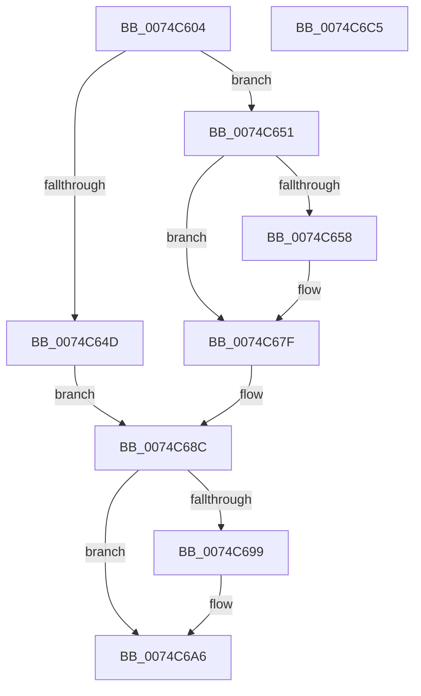

# AlpcpForceUnlinkSecureView

- RVA: `0x0074C604`–`0x0074C6C6` (길이 `194` bytes)
- VA: `0x000000014074C604`
- 실행 섹션: `PAGE`
- PDB 이름 있음: `예`; PDB Function 태그: `아니요`
- unwind 정보 RVA: `0x0007CF64`
- 디코드: `51`개 명령, `194/194` bytes 표시
- 미해석 바이트: `0` (있으면 어셈블리에 `.byte`로 보존)

> 이 문서는 커널 이미지의 기계어와 PDB 기호를 분석해 생성했습니다. 4번과 5번은 함수 원형과 자료형을 바이너리 사용 방식에서 추정한 C 해석이며 원본 소스 복구 결과는 아닙니다.

## 1. Dependencies

- 직접 호출 지점: **7**; 고유 호출 대상: **7**
- 직접 호출자로 확인된 함수: **1**
- RIP 상대 이미지 참조: **1**

### Outgoing calls
- `0x0074C642` → [AlpcpLockForCachedReferenceBlob](../88/AlpcpLockForCachedReferenceBlob_function_0088A8B0.md) (function, `0x0088A8B0`)
- `0x0074C660` → [KeStackAttachProcess](../../text/21/KeStackAttachProcess_function_00216800.md) (function, `0x00216800`)
- `0x0074C669` → [MmUnsecureVirtualMemory](../88/MmUnsecureVirtualMemory_function_0088A2A0.md) (function, `0x0088A2A0`)
- `0x0074C675` → [KiUnstackDetachProcess](../../text/21/KiUnstackDetachProcess_function_00217D30.md) (function, `0x00217D30`)
- `0x0074C68F` → [AlpcpUnlockBlob](../88/AlpcpUnlockBlob_function_0088B990.md) (function, `0x0088B990`)
- `0x0074C6A1` → [AlpcpDereferenceBlobEx](../88/AlpcpDereferenceBlobEx_function_0088AF00.md) (function, `0x0088AF00`)
- `0x0074C6AE` → [_security_check_cookie](../../text/6A/_security_check_cookie_function_006AC640.md) (function, `0x006AC640`)

### Direct callers
- [sub_00B20EEE](../B2/Unknown_function_00B20EEE.md) at `0x00B20FE7`

### Static image references
- `0x0074C613` → RVA `0x00E0A740` (`.data`; read)

## 2. Other-region calls and transfers

- 다른 실행 섹션으로 향하는 call: **3**
  - `0x0074C660` → [KeStackAttachProcess](../../text/21/KeStackAttachProcess_function_00216800.md) (`PAGE` → `.text`)
  - `0x0074C675` → [KiUnstackDetachProcess](../../text/21/KiUnstackDetachProcess_function_00217D30.md) (`PAGE` → `.text`)
  - `0x0074C6AE` → [_security_check_cookie](../../text/6A/_security_check_cookie_function_006AC640.md) (`PAGE` → `.text`)
- 별도 외부 분기/꼬리 이동을 확인하지 못했습니다.

## 3. Assembly (complete function range)

```asm
0074C604  48 89 5C 24 10                  mov qword ptr [rsp + 0x10], rbx
0074C609  48 89 74 24 18                  mov qword ptr [rsp + 0x18], rsi
0074C60E  57                              push rdi
0074C60F  48 83 EC 60                     sub rsp, 0x60
0074C613  48 8B 05 26 E1 6B 00            mov rax, qword ptr [rip + 0x6be126]
0074C61A  48 33 C4                        xor rax, rsp
0074C61D  48 89 44 24 50                  mov qword ptr [rsp + 0x50], rax
0074C622  48 8B 79 10                     mov rdi, qword ptr [rcx + 0x10]
0074C626  0F 57 C0                        xorps xmm0, xmm0
0074C629  48 8B 71 20                     mov rsi, qword ptr [rcx + 0x20]
0074C62D  48 8B D9                        mov rbx, rcx
0074C630  48 8B CF                        mov rcx, rdi
0074C633  0F 11 44 24 20                  movups xmmword ptr [rsp + 0x20], xmm0
0074C638  0F 11 44 24 30                  movups xmmword ptr [rsp + 0x30], xmm0
0074C63D  0F 11 44 24 40                  movups xmmword ptr [rsp + 0x40], xmm0
0074C642  E8 69 E2 13 00                  call 0x14088a8b0
0074C647  48 3B 5F 48                     cmp rbx, qword ptr [rdi + 0x48]
0074C64B  74 04                           je 0x14074c651
0074C64D  33 DB                           xor ebx, ebx
0074C64F  EB 3B                           jmp 0x14074c68c
0074C651  48 83 7B 40 00                  cmp qword ptr [rbx + 0x40], 0
0074C656  74 27                           je 0x14074c67f
0074C658  48 8D 54 24 20                  lea rdx, [rsp + 0x20]
0074C65D  48 8B CE                        mov rcx, rsi
0074C660  E8 9B A1 AC FF                  call 0x140216800
0074C665  48 8B 4B 40                     mov rcx, qword ptr [rbx + 0x40]
0074C669  E8 32 DC 13 00                  call 0x14088a2a0
0074C66E  33 D2                           xor edx, edx
0074C670  48 8D 4C 24 20                  lea rcx, [rsp + 0x20]
0074C675  E8 B6 B6 AC FF                  call 0x140217d30
0074C67A  48 83 63 40 00                  and qword ptr [rbx + 0x40], 0
0074C67F  83 4B 48 01                     or dword ptr [rbx + 0x48], 1
0074C683  48 83 67 48 00                  and qword ptr [rdi + 0x48], 0
0074C688  83 4B 48 04                     or dword ptr [rbx + 0x48], 4
0074C68C  48 8B CF                        mov rcx, rdi
0074C68F  E8 FC F2 13 00                  call 0x14088b990
0074C694  48 85 DB                        test rbx, rbx
0074C697  74 0D                           je 0x14074c6a6
0074C699  BA 01 00 00 00                  mov edx, 1
0074C69E  48 8B CB                        mov rcx, rbx
0074C6A1  E8 5A E8 13 00                  call 0x14088af00
0074C6A6  48 8B 4C 24 50                  mov rcx, qword ptr [rsp + 0x50]
0074C6AB  48 33 CC                        xor rcx, rsp
0074C6AE  E8 8D FF F5 FF                  call 0x1406ac640
0074C6B3  4C 8D 5C 24 60                  lea r11, [rsp + 0x60]
0074C6B8  49 8B 5B 18                     mov rbx, qword ptr [r11 + 0x18]
0074C6BC  49 8B 73 20                     mov rsi, qword ptr [r11 + 0x20]
0074C6C0  49 8B E3                        mov rsp, r11
0074C6C3  5F                              pop rdi
0074C6C4  C3                              ret
0074C6C5  CC                              int3
```

## 4. C-style interpretation (structured pseudocode)

```c
__int64 __fastcall AlpcpForceUnlinkSecureView(__int64 a1)
{
    __int64 result;
    __int64 v_rbx;
    __int64 v_rsp;
    unsigned __int64 v_stack_m18;
    unsigned __int64 v_stack_m28;
    unsigned __int64 v_stack_m38;
    unsigned __int64 v_stack_m48;
    unsigned __int64 v_stack_m8;
    unsigned __int64 v_stack_p10;
    unsigned __int64 v_stack_p18;

    v_stack_p10 = v_rbx;
    v_stack_p18 = v_rsi;
    v_rsp = (v_rsp) - (96);
    result = (*(unsigned __int64 *)(v_rip + 7069990)) ^ (v_rsp);
    v_stack_m18 = result;
    v_stack_m48 = v_xmm0;
    v_stack_m38 = v_xmm0;
    v_stack_m28 = v_xmm0;
    result = AlpcpLockForCachedReferenceBlob(*(unsigned __int64 *)(a1 + 16), a2, a3, a4);
    if (a1 == (*(unsigned __int64 *)(*(unsigned __int64 *)(a1 + 16) + 72))) goto loc_0074C651;
    v_rbx = 0;
    goto loc_0074C68C;
loc_0074C651:
    if ((*(unsigned __int64 *)(v_rbx + 64)) != 0) {
        a2 = v_stack_m48;
        a1 = *(unsigned __int64 *)(a1 + 32);
        result = KeStackAttachProcess(a1, a2, a3, a4);
        a1 = *(unsigned __int64 *)(v_rbx + 64);
        result = MmUnsecureVirtualMemory(a1, a2, a3, a4);
        a2 = 0;
        a1 = v_stack_m48;
        result = KiUnstackDetachProcess(a1, a2, a3, a4);
    }
loc_0074C68C:
    result = AlpcpUnlockBlob(*(unsigned __int64 *)(a1 + 16), a2, a3, a4);
    if (0 != 0) {
        a2 = 1;
        a1 = 0;
        result = AlpcpDereferenceBlobEx(a1, a2, a3, a4);
    }
    a1 = (v_stack_m18) ^ (v_rsp);
    result = _security_check_cookie(a1, a2, a3, a4);
    return result;
}
```

## 5. (Beta) C Style

```c
int64_t AlpcpForceUnlinkSecureView(void *Arg1)
{
    uint8_t *arg1 = (uint8_t *)Arg1;

    int64_t result;
    int64_t local_rbx;
    int64_t local_rsp;
    uint64_t v_stack_m18;
    uint64_t v_stack_m28;
    uint64_t v_stack_m38;
    uint64_t v_stack_m48;
    uint64_t v_stack_m8;
    uint64_t v_stack_p10;
    uint64_t v_stack_p18;

    v_stack_p10 = local_rbx;
    v_stack_p18 = local_rsi;
    local_rsp = (local_rsp) - (96);
    result = (*(uint64_t *)(v_rip + 0x6BE126)) ^ (local_rsp);
    v_stack_m18 = result;
    v_stack_m48 = v_xmm0;
    v_stack_m38 = v_xmm0;
    v_stack_m28 = v_xmm0;
    result = AlpcpLockForCachedReferenceBlob(*(uint64_t *)(arg1 + 0x10), a2, a3, a4);
    if (Arg1 == (*(uint64_t *)(*(uint64_t *)(arg1 + 0x10) + 0x48))) goto loc_0074C651;
    local_rbx = 0;
    goto loc_0074C68C;
loc_0074C651:
    if ((*(uint64_t *)(local_rbx + 0x40)) != 0) {
        a2 = v_stack_m48;
        Arg1 = *(uint64_t *)(arg1 + 0x20);
        result = KeStackAttachProcess(Arg1, a2, a3, a4);
        Arg1 = *(uint64_t *)(local_rbx + 0x40);
        result = MmUnsecureVirtualMemory(Arg1, a2, a3, a4);
        a2 = 0;
        Arg1 = v_stack_m48;
        result = KiUnstackDetachProcess(Arg1, a2, a3, a4);
    }
loc_0074C68C:
    result = AlpcpUnlockBlob(*(uint64_t *)(arg1 + 0x10), a2, a3, a4);
    if (0 != 0) {
        a2 = 1;
        Arg1 = 0;
        result = AlpcpDereferenceBlobEx(Arg1, a2, a3, a4);
    }
    Arg1 = (v_stack_m18) ^ (local_rsp);
    result = _security_check_cookie(Arg1, a2, a3, a4);
    return result;
}
```

### 관측된 메모리 오프셋

구조체 형식이 확인되지 않은 접근은 인자 기준의 오프셋으로만 기록했습니다.

| 기준 인자 | 오프셋 표현 | 폭 (bit) | 접근 |
|---|---:|---:|---|
| `Arg1` | `+ 0x10` | `64` | `R` |
| `Arg1` | `+ 0x20` | `64` | `R` |

## 6. Execution-region graph

[열기: 2D/3D 그래프와 함수 탐색 컨트롤 패널](../../../control-panel.html?section=page&rva=0x0074C604&view=graph)

- 2D 그래프는 위에서 아래로 흐르고, 3D 그래프는 빈 공간을 드래그해 회전합니다. Shift+드래그는 이동, 휠은 확대·축소, 함수 노드 선택은 대상 보고서 이동입니다.

### Static fallback


