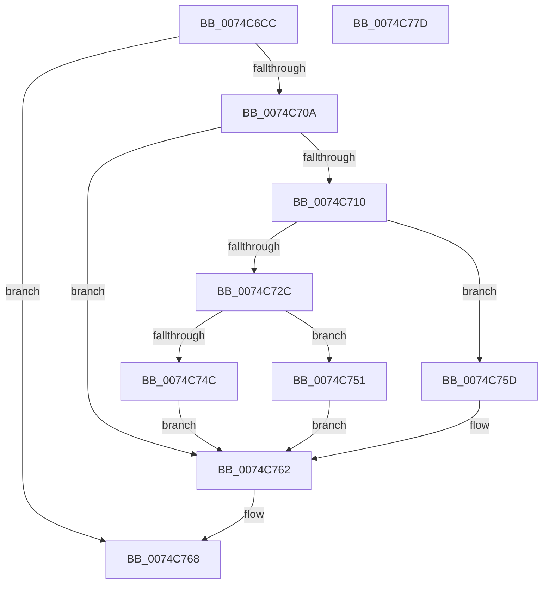

# AlpcpGetPortNameInformation

- RVA: `0x0074C6CC`–`0x0074C77E` (길이 `178` bytes)
- VA: `0x000000014074C6CC`
- 실행 섹션: `PAGE`
- PDB 이름 있음: `예`; PDB Function 태그: `아니요`
- unwind 정보 RVA: `0x000A2264`
- 디코드: `56`개 명령, `178/178` bytes 표시
- 미해석 바이트: `0` (있으면 어셈블리에 `.byte`로 보존)

> 이 문서는 커널 이미지의 기계어와 PDB 기호를 분석해 생성했습니다. 4번과 5번은 함수 원형과 자료형을 바이너리 사용 방식에서 추정한 C 해석이며 원본 소스 복구 결과는 아닙니다.

## 1. Dependencies

- 직접 호출 지점: **4**; 고유 호출 대상: **3**
- 직접 호출자로 확인된 함수: **2**
- RIP 상대 이미지 참조: **0**

### Outgoing calls
- `0x0074C6FC` → [ObQueryNameStringMode](../8A/ObQueryNameStringMode_function_008A7ED0.md) (function, `0x008A7ED0`)
- `0x0074C71F` → [ExAllocatePool2](../../poolcode/B8/ExAllocatePool2_function_00B820F0.md) (function, `0x00B820F0`)
- `0x0074C741` → [ObQueryNameStringMode](../8A/ObQueryNameStringMode_function_008A7ED0.md) (function, `0x008A7ED0`)
- `0x0074C756` → [ExFreePoolWithTag](../../poolcode/B8/ExFreePoolWithTag_function_00B82870.md) (function, `0x00B82870`)

### Direct callers
- [AlpcpPortQueryServerInfo](AlpcpPortQueryServerInfo_function_0074C784.md) at `0x0074CA59`
- [AlpcpLogWaitForNewMessage](AlpcpLogWaitForNewMessage_function_0074D294.md) at `0x0074D2C4`

### Static image references
- 디코드된 RIP-relative 메모리 참조가 없습니다.

## 2. Other-region calls and transfers

- 다른 실행 섹션으로 향하는 call: **2**
  - `0x0074C71F` → [ExAllocatePool2](../../poolcode/B8/ExAllocatePool2_function_00B820F0.md) (`PAGE` → `POOLCODE`)
  - `0x0074C756` → [ExFreePoolWithTag](../../poolcode/B8/ExFreePoolWithTag_function_00B82870.md) (`PAGE` → `POOLCODE`)
- 별도 외부 분기/꼬리 이동을 확인하지 못했습니다.

## 3. Assembly (complete function range)

```asm
0074C6CC  48 8B C4                        mov rax, rsp
0074C6CF  48 89 58 08                     mov qword ptr [rax + 8], rbx
0074C6D3  48 89 68 10                     mov qword ptr [rax + 0x10], rbp
0074C6D7  56                              push rsi
0074C6D8  57                              push rdi
0074C6D9  41 56                           push r14
0074C6DB  48 83 EC 30                     sub rsp, 0x30
0074C6DF  41 8B 38                        mov edi, dword ptr [r8]
0074C6E2  4C 8D 48 18                     lea r9, [rax + 0x18]
0074C6E6  83 60 18 00                     and dword ptr [rax + 0x18], 0
0074C6EA  49 8B F0                        mov rsi, r8
0074C6ED  4C 8B F2                        mov r14, rdx
0074C6F0  C6 40 D8 00                     mov byte ptr [rax - 0x28], 0
0074C6F4  45 33 C0                        xor r8d, r8d
0074C6F7  33 D2                           xor edx, edx
0074C6F9  48 8B E9                        mov rbp, rcx
0074C6FC  E8 CF B7 15 00                  call 0x1408a7ed0
0074C701  8B D8                           mov ebx, eax
0074C703  3D 04 00 00 C0                  cmp eax, 0xc0000004
0074C708  75 5E                           jne 0x14074c768
0074C70A  39 7C 24 60                     cmp dword ptr [rsp + 0x60], edi
0074C70E  77 52                           ja 0x14074c762
0074C710  8B 54 24 60                     mov edx, dword ptr [rsp + 0x60]
0074C714  B9 00 01 00 00                  mov ecx, 0x100
0074C719  41 B8 41 4C 50 43               mov r8d, 0x43504c41
0074C71F  E8 CC 59 43 00                  call 0x140b820f0
0074C724  48 8B F8                        mov rdi, rax
0074C727  48 85 C0                        test rax, rax
0074C72A  74 31                           je 0x14074c75d
0074C72C  44 8B 44 24 60                  mov r8d, dword ptr [rsp + 0x60]
0074C731  4C 8D 4C 24 60                  lea r9, [rsp + 0x60]
0074C736  48 8B D0                        mov rdx, rax
0074C739  C6 44 24 20 00                  mov byte ptr [rsp + 0x20], 0
0074C73E  48 8B CD                        mov rcx, rbp
0074C741  E8 8A B7 15 00                  call 0x1408a7ed0
0074C746  8B D8                           mov ebx, eax
0074C748  85 C0                           test eax, eax
0074C74A  78 05                           js 0x14074c751
0074C74C  49 89 3E                        mov qword ptr [r14], rdi
0074C74F  EB 11                           jmp 0x14074c762
0074C751  33 D2                           xor edx, edx
0074C753  48 8B CF                        mov rcx, rdi
0074C756  E8 15 61 43 00                  call 0x140b82870
0074C75B  EB 05                           jmp 0x14074c762
0074C75D  BB 17 00 00 C0                  mov ebx, 0xc0000017
0074C762  8B 44 24 60                     mov eax, dword ptr [rsp + 0x60]
0074C766  89 06                           mov dword ptr [rsi], eax
0074C768  48 8B 6C 24 58                  mov rbp, qword ptr [rsp + 0x58]
0074C76D  8B C3                           mov eax, ebx
0074C76F  48 8B 5C 24 50                  mov rbx, qword ptr [rsp + 0x50]
0074C774  48 83 C4 30                     add rsp, 0x30
0074C778  41 5E                           pop r14
0074C77A  5F                              pop rdi
0074C77B  5E                              pop rsi
0074C77C  C3                              ret
0074C77D  CC                              int3
```

## 4. C-style interpretation (structured pseudocode)

```c
__int64 __fastcall AlpcpGetPortNameInformation(__int64 a1, __int64 a2, __int64 a3)
{
    __int64 result;
    __int64 v_rsp;
    unsigned __int8 v_stack_m28;
    unsigned __int64 v_stack_p10;
    unsigned int v_stack_p18;
    unsigned __int64 v_stack_p8;

    *(unsigned __int64 *)(v_rsp + 8) = v_rbx;
    *(unsigned __int64 *)(v_rsp + 16) = v_rbp;
    v_rsp = (v_rsp) - (48);
    *(unsigned __int8 *)(v_rsp - 40) = 0;
    a3 = 0;
    a2 = 0;
    result = ObQueryNameStringMode(a1, a2, a3, v_rsp + 24);
    if (((unsigned int)(result)) != 0xC0000004ULL) goto loc_0074C768;
    if (v_stack_p18 > ((unsigned int)((unsigned int)(*(unsigned int *)(a3))))) goto loc_0074C762;
    result = ExAllocatePool2(256, (unsigned int)(v_stack_p18), (unsigned int)(0x43504C41ULL), v_rsp + 24);
    if (result == 0) goto loc_0074C75D;
    v_stack_m28 = 0;
    result = ObQueryNameStringMode(a1, result, (unsigned int)(v_stack_p18), v_stack_p18);
    if (sign_flag) goto loc_0074C751;
    *(unsigned __int64 *)(a2) = result;
    goto loc_0074C762;
loc_0074C751:
    a2 = 0;
    result = ExFreePoolWithTag(result, a2, (unsigned int)(v_stack_p18), v_stack_p18);
    goto loc_0074C762;
loc_0074C75D:
loc_0074C762:
    *(unsigned int *)(a3) = (unsigned int)((unsigned int)(v_stack_p18));
loc_0074C768:
    v_rsp = (v_rsp) + (48);
    return (unsigned int)((unsigned int)((unsigned int)(0xC0000017ULL)));
}
```

## 5. (Beta) C Style

```c
int64_t AlpcpGetPortNameInformation(int64_t Arg1, void *Arg2, void *Arg3)
{
    uint8_t *arg2 = (uint8_t *)Arg2;
    uint8_t *arg3 = (uint8_t *)Arg3;

    int64_t result;
    int64_t local_rsp;
    uint8_t v_stack_m28;
    uint64_t v_stack_p10;
    uint32_t v_stack_p18;
    uint64_t v_stack_p8;

    *(uint64_t *)(local_rsp + 0x8) = local_rbx;
    *(uint64_t *)(local_rsp + 0x10) = local_rbp;
    local_rsp = (local_rsp) - (48);
    *(uint8_t *)(local_rsp - 0x28) = 0;
    Arg3 = 0;
    Arg2 = 0;
    result = ObQueryNameStringMode(Arg1, Arg2, Arg3, local_rsp + 24);
    if (((uint32_t)(result)) != 0xC0000004ULL) goto loc_0074C768;
    if (v_stack_p18 > ((uint32_t)((uint32_t)(*(uint32_t *)(arg3))))) goto loc_0074C762;
    result = ExAllocatePool2(256, (uint32_t)(v_stack_p18), (uint32_t)(0x43504C41ULL), local_rsp + 24);
    if (result == 0) goto loc_0074C75D;
    v_stack_m28 = 0;
    result = ObQueryNameStringMode(Arg1, result, (uint32_t)(v_stack_p18), v_stack_p18);
    if (sign_flag) goto loc_0074C751;
    *(uint64_t *)(arg2) = result;
    goto loc_0074C762;
loc_0074C751:
    Arg2 = 0;
    result = ExFreePoolWithTag(result, Arg2, (uint32_t)(v_stack_p18), v_stack_p18);
    goto loc_0074C762;
loc_0074C75D:
loc_0074C762:
    *(uint32_t *)(arg3) = (uint32_t)((uint32_t)(v_stack_p18));
loc_0074C768:
    local_rsp = (local_rsp) + (48);
    return (uint32_t)((uint32_t)((uint32_t)(0xC0000017ULL)));
}
```

### 관측된 메모리 오프셋

구조체 형식이 확인되지 않은 접근은 인자 기준의 오프셋으로만 기록했습니다.

| 기준 인자 | 오프셋 표현 | 폭 (bit) | 접근 |
|---|---:|---:|---|
| `Arg2` | `+ 0x0` | `64` | `W` |
| `Arg3` | `+ 0x0` | `32` | `R` |
| `Arg3` | `+ 0x0` | `32` | `W` |

## 6. Execution-region graph

[열기: 2D/3D 그래프와 함수 탐색 컨트롤 패널](../../../control-panel.html?section=page&rva=0x0074C6CC&view=graph)

- 2D 그래프는 위에서 아래로 흐르고, 3D 그래프는 빈 공간을 드래그해 회전합니다. Shift+드래그는 이동, 휠은 확대·축소, 함수 노드 선택은 대상 보고서 이동입니다.

### Static fallback


