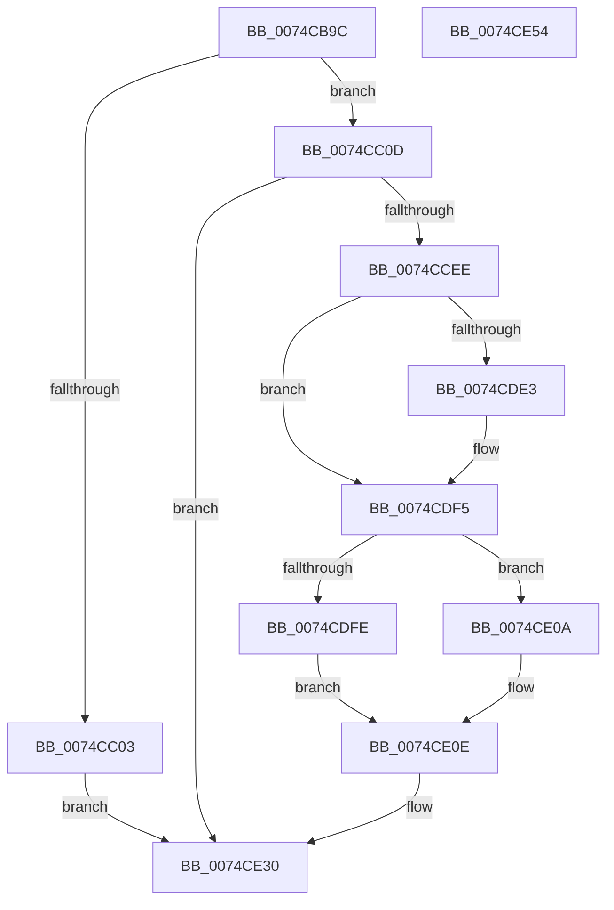

# AlpcpInitSystem

- RVA: `0x0074CB9C`–`0x0074CE55` (길이 `697` bytes)
- VA: `0x000000014074CB9C`
- 실행 섹션: `PAGE`
- PDB 이름 있음: `예`; PDB Function 태그: `아니요`
- unwind 정보 RVA: `0x000C38A8`
- 디코드: `143`개 명령, `697/697` bytes 표시
- 미해석 바이트: `0` (있으면 어셈블리에 `.byte`로 보존)

> 이 문서는 커널 이미지의 기계어와 PDB 기호를 분석해 생성했습니다. 4번과 5번은 함수 원형과 자료형을 바이너리 사용 방식에서 추정한 C 해석이며 원본 소스 복구 결과는 아닙니다.

## 1. Dependencies

- 직접 호출 지점: **15**; 고유 호출 대상: **12**
- 직접 호출자로 확인된 함수: **1**
- RIP 상대 이미지 참조: **28**

### Outgoing calls
- `0x0074CBCE` → [memset](../../text/6C/memset_function_006C6C40.md) (function, `0x006C6C40`)
- `0x0074CBF2` → [ExAllocatePool2](../../poolcode/B8/ExAllocatePool2_function_00B820F0.md) (function, `0x00B820F0`)
- `0x0074CC15` → [KeInitializeEvent](../../text/40/KeInitializeEvent_function_0040DD10.md) (function, `0x0040DD10`)
- `0x0074CC43` → [RtlInitUnicodeString](../../text/42/RtlInitUnicodeString_function_0042A780.md) (function, `0x0042A780`)
- `0x0074CC57` → [memset](../../text/6C/memset_function_006C6C40.md) (function, `0x006C6C40`)
- `0x0074CCDF` → [ObCreateObjectTypeEx](../AB/ObCreateObjectTypeEx_function_00AB46D0.md) (function, `0x00AB46D0`)
- `0x0074CCF2` → [ExCreateHandleTable](../94/ExCreateHandleTable_function_0094C7E8.md) (function, `0x0094C7E8`)
- `0x0074CD36` → [ExInitializePagedLookasideListInternal](../../text/46/ExInitializePagedLookasideListInternal_function_00468040.md) (function, `0x00468040`)
- `0x0074CD6E` → [ExInitializePagedLookasideListInternal](../../text/46/ExInitializePagedLookasideListInternal_function_00468040.md) (function, `0x00468040`)
- `0x0074CD9D` → [ExInitializePagedLookasideListInternal](../../text/46/ExInitializePagedLookasideListInternal_function_00468040.md) (function, `0x00468040`)
- `0x0074CDC6` → [ExInitializeNPagedLookasideList](../../text/46/ExInitializeNPagedLookasideList_function_004686E0.md) (function, `0x004686E0`)
- `0x0074CDD8` → [NtQuerySystemInformation](../A5/NtQuerySystemInformation_function_00A57780.md) (function, `0x00A57780`)
- `0x0074CE0E` → [AlpcpInitializeMessageLog](AlpcpInitializeMessageLog_function_0074D510.md) (function, `0x0074D510`)
- `0x0074CE30` → [KeLeaveCriticalRegion](../../text/25/KeLeaveCriticalRegion_function_0025D8B0.md) (function, `0x0025D8B0`)
- `0x0074CE3E` → [_security_check_cookie](../../text/6A/_security_check_cookie_function_006AC640.md) (function, `0x006AC640`)

### Direct callers
- [Phase1InitializationDiscard](../../init/C1/Phase1InitializationDiscard_function_00C1C728.md) at `0x00C1D325`

### Static image references
- `0x0074CBAE` → RVA `0x00E0A740` (`.data`; read)
- `0x0074CBF7` → RVA `0x00FC7050` (`ALMOSTRO`; write)
- `0x0074CC1A` → RVA `0x00F10100` (`.data`; read/write)
- `0x0074CC22` → RVA `0x00F100F0` (`.data`; read)
- `0x0074CC29` → RVA `0x00B01380` (` ?? ::NNGAKEGL::`string'`; read)
- `0x0074CC30` → RVA `0x00F100F8` (`.data`; write)
- `0x0074CC3C` → RVA `0x00F100F0` (`.data`; write)
- `0x0074CC5C` → RVA `0x00C826C0` (`AlpcpPortMapping`; read)
- `0x0074CC68` → RVA `0x00A35510` (`AlpcpOpenPort`; read)
- `0x0074CC78` → RVA `0x00924DE0` (`AlpcpClosePort`; read)
- `0x0074CC8D` → RVA `0x00925010` (`AlpcpDeletePort`; read)
- `0x0074CCC5` → RVA `0x00FC6C18` (`ALMOSTRO`; read)
- `0x0074CCFC` → RVA `0x0088A060` (`AlpcpFreeMessageFunction`; read)
- `0x0074CD08` → RVA `0x00FC6F68` (`ALMOSTRO`; write)
- `0x0074CD14` → RVA `0x00892FF0` (`AlpcpAllocateMessageFunction`; read)
- `0x0074CD23` → RVA `0x00E27180` (`.data`; read)
- `0x0074CD40` → RVA `0x009071C0` (`AlpcpFreeBuffer`; read)
- `0x0074CD4C` → RVA `0x00892BC0` (`AlpcpAllocateBuffer`; read)
- `0x0074CD5B` → RVA `0x00E27200` (`.data`; read)
- `0x0074CD78` → RVA `0x00E27280` (`.data`; read)
- `0x0074CDA7` → RVA `0x00E27100` (`.data`; read)
- `0x0074CDE6` → RVA `0x00FC6CDC` (`ALMOSTRO`; write)
- `0x0074CDEF` → RVA `0x00FC6CE0` (`ALMOSTRO`; write)
- `0x0074CDF5` → RVA `0x00F100D0` (`.data`; read)
- `0x0074CE13` → RVA `0x00F10120` (`.data`; read/write)
- `0x0074CE1B` → RVA `0x00F10130` (`.data`; read)
- `0x0074CE22` → RVA `0x00F10138` (`.data`; write)
- `0x0074CE29` → RVA `0x00F10130` (`.data`; write)

## 2. Other-region calls and transfers

- 다른 실행 섹션으로 향하는 call: **11**
  - `0x0074CBCE` → [memset](../../text/6C/memset_function_006C6C40.md) (`PAGE` → `.text`)
  - `0x0074CBF2` → [ExAllocatePool2](../../poolcode/B8/ExAllocatePool2_function_00B820F0.md) (`PAGE` → `POOLCODE`)
  - `0x0074CC15` → [KeInitializeEvent](../../text/40/KeInitializeEvent_function_0040DD10.md) (`PAGE` → `.text`)
  - `0x0074CC43` → [RtlInitUnicodeString](../../text/42/RtlInitUnicodeString_function_0042A780.md) (`PAGE` → `.text`)
  - `0x0074CC57` → [memset](../../text/6C/memset_function_006C6C40.md) (`PAGE` → `.text`)
  - `0x0074CD36` → [ExInitializePagedLookasideListInternal](../../text/46/ExInitializePagedLookasideListInternal_function_00468040.md) (`PAGE` → `.text`)
  - `0x0074CD6E` → [ExInitializePagedLookasideListInternal](../../text/46/ExInitializePagedLookasideListInternal_function_00468040.md) (`PAGE` → `.text`)
  - `0x0074CD9D` → [ExInitializePagedLookasideListInternal](../../text/46/ExInitializePagedLookasideListInternal_function_00468040.md) (`PAGE` → `.text`)
  - `0x0074CDC6` → [ExInitializeNPagedLookasideList](../../text/46/ExInitializeNPagedLookasideList_function_004686E0.md) (`PAGE` → `.text`)
  - `0x0074CE30` → [KeLeaveCriticalRegion](../../text/25/KeLeaveCriticalRegion_function_0025D8B0.md) (`PAGE` → `.text`)
  - `0x0074CE3E` → [_security_check_cookie](../../text/6A/_security_check_cookie_function_006AC640.md) (`PAGE` → `.text`)
- 별도 외부 분기/꼬리 이동을 확인하지 못했습니다.

## 3. Assembly (complete function range)

```asm
0074CB9C  48 89 5C 24 08                  mov qword ptr [rsp + 8], rbx
0074CBA1  55                              push rbp
0074CBA2  48 8D 6C 24 E0                  lea rbp, [rsp - 0x20]
0074CBA7  48 81 EC 20 01 00 00            sub rsp, 0x120
0074CBAE  48 8B 05 8B DB 6B 00            mov rax, qword ptr [rip + 0x6bdb8b]
0074CBB5  48 33 C4                        xor rax, rsp
0074CBB8  48 89 45 10                     mov qword ptr [rbp + 0x10], rax
0074CBBC  33 D2                           xor edx, edx
0074CBBE  48 8D 4D D0                     lea rcx, [rbp - 0x30]
0074CBC2  0F 57 C0                        xorps xmm0, xmm0
0074CBC5  0F 11 44 24 40                  movups xmmword ptr [rsp + 0x40], xmm0
0074CBCA  44 8D 42 40                     lea r8d, [rdx + 0x40]
0074CBCE  E8 6D A0 F7 FF                  call 0x1406c6c40
0074CBD3  65 48 8B 04 25 88 01 00 00      mov rax, qword ptr gs:[0x188]
0074CBDC  BA 18 00 00 00                  mov edx, 0x18
0074CBE1  41 B8 41 6C 49 6E               mov r8d, 0x6e496c41
0074CBE7  66 FF 88 E4 01 00 00            dec word ptr [rax + 0x1e4]
0074CBEE  8D 4A 28                        lea ecx, [rdx + 0x28]
0074CBF1  90                              nop
0074CBF2  E8 F9 54 43 00                  call 0x140b820f0
0074CBF7  48 89 05 52 A4 87 00            mov qword ptr [rip + 0x87a452], rax
0074CBFE  48 85 C0                        test rax, rax
0074CC01  75 0A                           jne 0x14074cc0d
0074CC03  BB 9A 00 00 C0                  mov ebx, 0xc000009a
0074CC08  E9 23 02 00 00                  jmp 0x14074ce30
0074CC0D  41 B0 01                        mov r8b, 1
0074CC10  33 D2                           xor edx, edx
0074CC12  48 8B C8                        mov rcx, rax
0074CC15  E8 F6 10 CC FF                  call 0x14040dd10
0074CC1A  48 83 25 DE 34 7C 00 00         and qword ptr [rip + 0x7c34de], 0
0074CC22  48 8D 05 C7 34 7C 00            lea rax, [rip + 0x7c34c7]
0074CC29  48 8D 15 50 47 3B 00            lea rdx, [rip + 0x3b4750]
0074CC30  48 89 05 C1 34 7C 00            mov qword ptr [rip + 0x7c34c1], rax
0074CC37  48 8D 4C 24 40                  lea rcx, [rsp + 0x40]
0074CC3C  48 89 05 AD 34 7C 00            mov qword ptr [rip + 0x7c34ad], rax
0074CC43  E8 38 DB CD FF                  call 0x14042a780
0074CC48  BB 78 00 00 00                  mov ebx, 0x78
0074CC4D  48 8D 4C 24 50                  lea rcx, [rsp + 0x50]
0074CC52  44 8B C3                        mov r8d, ebx
0074CC55  33 D2                           xor edx, edx
0074CC57  E8 E4 9F F7 FF                  call 0x1406c6c40
0074CC5C  0F 10 05 5D 5A 53 00            movups xmm0, xmmword ptr [rip + 0x535a5d]
0074CC63  83 64 24 78 00                  and dword ptr [rsp + 0x78], 0
0074CC68  48 8D 05 A1 88 2E 00            lea rax, [rip + 0x2e88a1]
0074CC6F  48 89 45 88                     mov qword ptr [rbp - 0x78], rax
0074CC73  48 8D 54 24 50                  lea rdx, [rsp + 0x50]
0074CC78  48 8D 05 61 81 1D 00            lea rax, [rip + 0x1d8161]
0074CC7F  66 89 5C 24 50                  mov word ptr [rsp + 0x50], bx
0074CC84  48 89 45 90                     mov qword ptr [rbp - 0x70], rax
0074CC88  48 8D 4C 24 40                  lea rcx, [rsp + 0x40]
0074CC8D  48 8D 05 7C 83 1D 00            lea rax, [rip + 0x1d837c]
0074CC94  C7 44 24 74 00 02 00 00         mov dword ptr [rsp + 0x74], 0x200
0074CC9C  48 89 45 98                     mov qword ptr [rbp - 0x68], rax
0074CCA0  41 B9 F9 00 00 00               mov r9d, 0xf9
0074CCA6  8A 44 24 52                     mov al, byte ptr [rsp + 0x52]
0074CCAA  45 33 C0                        xor r8d, r8d
0074CCAD  24 DB                           and al, 0xdb
0074CCAF  C7 44 24 7C F8 01 00 00         mov dword ptr [rsp + 0x7c], 0x1f8
0074CCB7  0C 10                           or al, 0x10
0074CCB9  C7 44 24 58 80 00 00 00         mov dword ptr [rsp + 0x58], 0x80
0074CCC1  88 44 24 52                     mov byte ptr [rsp + 0x52], al
0074CCC5  48 8D 05 4C 9F 87 00            lea rax, [rip + 0x879f4c]
0074CCCC  48 89 44 24 20                  mov qword ptr [rsp + 0x20], rax
0074CCD1  F3 0F 7F 44 24 5C               movdqu xmmword ptr [rsp + 0x5c], xmm0
0074CCD7  C7 44 24 6C 01 00 1F 00         mov dword ptr [rsp + 0x6c], 0x1f0001
0074CCDF  E8 EC 79 36 00                  call 0x140ab46d0
0074CCE4  8B D8                           mov ebx, eax
0074CCE6  85 C0                           test eax, eax
0074CCE8  0F 88 42 01 00 00               js 0x14074ce30
0074CCEE  33 D2                           xor edx, edx
0074CCF0  33 C9                           xor ecx, ecx
0074CCF2  E8 F1 FA 1F 00                  call 0x14094c7e8
0074CCF7  83 64 24 38 00                  and dword ptr [rsp + 0x38], 0
0074CCFC  4C 8D 05 5D D3 13 00            lea r8, [rip + 0x13d35d]
0074CD03  BB 20 00 00 00                  mov ebx, 0x20
0074CD08  48 89 05 59 A2 87 00            mov qword ptr [rip + 0x87a259], rax
0074CD0F  66 89 5C 24 30                  mov word ptr [rsp + 0x30], bx
0074CD14  48 8D 15 D5 62 14 00            lea rdx, [rip + 0x1462d5]
0074CD1B  C7 44 24 28 41 6C 4D 73         mov dword ptr [rsp + 0x28], 0x734d6c41
0074CD23  48 8D 0D 56 A4 6D 00            lea rcx, [rip + 0x6da456]
0074CD2A  45 33 C9                        xor r9d, r9d
0074CD2D  48 C7 44 24 20 48 03 00 00      mov qword ptr [rsp + 0x20], 0x348
0074CD36  E8 05 B3 D1 FF                  call 0x140468040
0074CD3B  83 64 24 38 00                  and dword ptr [rsp + 0x38], 0
0074CD40  4C 8D 05 79 A4 1B 00            lea r8, [rip + 0x1ba479]
0074CD47  66 89 5C 24 30                  mov word ptr [rsp + 0x30], bx
0074CD4C  48 8D 15 6D 5E 14 00            lea rdx, [rip + 0x145e6d]
0074CD53  C7 44 24 28 41 6C 43 49         mov dword ptr [rsp + 0x28], 0x49436c41
0074CD5B  48 8D 0D 9E A4 6D 00            lea rcx, [rip + 0x6da49e]
0074CD62  45 33 C9                        xor r9d, r9d
0074CD65  48 C7 44 24 20 80 00 00 00      mov qword ptr [rsp + 0x20], 0x80
0074CD6E  E8 CD B2 D1 FF                  call 0x140468040
0074CD73  83 64 24 38 00                  and dword ptr [rsp + 0x38], 0
0074CD78  48 8D 0D 01 A5 6D 00            lea rcx, [rip + 0x6da501]
0074CD7F  66 89 5C 24 30                  mov word ptr [rsp + 0x30], bx
0074CD84  45 33 C9                        xor r9d, r9d
0074CD87  C7 44 24 28 41 6C 48 61         mov dword ptr [rsp + 0x28], 0x61486c41
0074CD8F  45 33 C0                        xor r8d, r8d
0074CD92  33 D2                           xor edx, edx
0074CD94  48 C7 44 24 20 80 00 00 00      mov qword ptr [rsp + 0x20], 0x80
0074CD9D  E8 9E B2 D1 FF                  call 0x140468040
0074CDA2  66 89 5C 24 30                  mov word ptr [rsp + 0x30], bx
0074CDA7  48 8D 0D 52 A3 6D 00            lea rcx, [rip + 0x6da352]
0074CDAE  C7 44 24 28 41 6C 53 65         mov dword ptr [rsp + 0x28], 0x65536c41
0074CDB6  41 B9 00 02 00 00               mov r9d, 0x200
0074CDBC  45 33 C0                        xor r8d, r8d
0074CDBF  48 89 5C 24 20                  mov qword ptr [rsp + 0x20], rbx
0074CDC4  33 D2                           xor edx, edx
0074CDC6  E8 15 B9 D1 FF                  call 0x1404686e0
0074CDCB  45 33 C9                        xor r9d, r9d
0074CDCE  44 8D 43 20                     lea r8d, [rbx + 0x20]
0074CDD2  48 8D 55 D0                     lea rdx, [rbp - 0x30]
0074CDD6  33 C9                           xor ecx, ecx
0074CDD8  E8 A3 A9 30 00                  call 0x140a57780
0074CDDD  8B D8                           mov ebx, eax
0074CDDF  85 C0                           test eax, eax
0074CDE1  78 12                           js 0x14074cdf5
0074CDE3  8B 45 E8                        mov eax, dword ptr [rbp - 0x18]
0074CDE6  89 05 F0 9E 87 00               mov dword ptr [rip + 0x879ef0], eax
0074CDEC  8B 45 D8                        mov eax, dword ptr [rbp - 0x28]
0074CDEF  89 05 EB 9E 87 00               mov dword ptr [rip + 0x879eeb], eax
0074CDF5  83 3D D4 32 7C 00 00            cmp dword ptr [rip + 0x7c32d4], 0
0074CDFC  74 0C                           je 0x14074ce0a
0074CDFE  B9 00 10 00 00                  mov ecx, 0x1000
0074CE03  BA 00 80 00 00                  mov edx, 0x8000
0074CE08  EB 04                           jmp 0x14074ce0e
0074CE0A  33 C9                           xor ecx, ecx
0074CE0C  33 D2                           xor edx, edx
0074CE0E  E8 FD 06 00 00                  call 0x14074d510
0074CE13  48 83 25 05 33 7C 00 00         and qword ptr [rip + 0x7c3305], 0
0074CE1B  48 8D 05 0E 33 7C 00            lea rax, [rip + 0x7c330e]
0074CE22  48 89 05 0F 33 7C 00            mov qword ptr [rip + 0x7c330f], rax
0074CE29  48 89 05 00 33 7C 00            mov qword ptr [rip + 0x7c3300], rax
0074CE30  E8 7B 0A B1 FF                  call 0x14025d8b0
0074CE35  8B C3                           mov eax, ebx
0074CE37  48 8B 4D 10                     mov rcx, qword ptr [rbp + 0x10]
0074CE3B  48 33 CC                        xor rcx, rsp
0074CE3E  E8 FD F7 F5 FF                  call 0x1406ac640
0074CE43  48 8B 9C 24 30 01 00 00         mov rbx, qword ptr [rsp + 0x130]
0074CE4B  48 81 C4 20 01 00 00            add rsp, 0x120
0074CE52  5D                              pop rbp
0074CE53  C3                              ret
0074CE54  CC                              int3
```

## 4. C-style interpretation (structured pseudocode)

```c
__int64 __fastcall AlpcpInitSystem(__int64 a1, int a2)
{
    __int64 result;
    __int64 v_rsp;
    unsigned int v_stack_m100;
    unsigned __int64 v_stack_m108;
    unsigned __int64 v_stack_m18;
    unsigned __int64 v_stack_m28;
    unsigned int v_stack_m40;
    unsigned int v_stack_m50;
    unsigned __int64 v_stack_m58;
    unsigned __int64 v_stack_m90;
    unsigned __int64 v_stack_m98;
    unsigned __int64 v_stack_mA0;
    unsigned int v_stack_mAC;
    unsigned int v_stack_mB0;
    unsigned int v_stack_mB4;
    unsigned int v_stack_mBC;
    unsigned __int64 v_stack_mCC;
    unsigned int v_stack_mD0;
    unsigned __int8 v_stack_mD6;
    unsigned __int64 v_stack_mD8;
    unsigned __int64 v_stack_mE8;
    unsigned int v_stack_mF0;
    unsigned __int16 v_stack_mF8;
    unsigned __int64 v_stack_p8;

    v_stack_p8 = v_rbx;
    v_rsp = (v_rsp) - (288);
    result = (*(unsigned __int64 *)(v_rip + 7068555)) ^ (v_rsp);
    v_stack_m18 = result;
    a2 = 0;
    v_stack_mE8 = v_xmm0;
    result = memset(v_stack_m58, a2, a2 + 64, a4);
    result = ExAllocatePool2(24 + 40, 24, (unsigned int)(0x6E496C41ULL), a4);
    *(unsigned __int64 *)(v_rip + 8889426) = result;
    if (result != 0) goto loc_0074CC0D;
    goto loc_0074CE30;
loc_0074CC0D:
    a2 = 0;
    result = KeInitializeEvent(result, a2, 1, a4);
    *(unsigned __int64 *)(v_rip + 8139969) = v_rip + 8139975;
    *(unsigned __int64 *)(v_rip + 8139949) = v_rip + 8139975;
    result = RtlInitUnicodeString(v_stack_mE8, v_rip + 3884880, 1, a4);
    a2 = 0;
    result = memset(v_stack_mD8, a2, 120, a4);
    v_stack_mA0 = v_rip + 3049633;
    v_stack_mD8 = 120;
    v_stack_m98 = v_rip + 1933665;
    v_stack_mB4 = 512;
    v_stack_m90 = v_rip + 1934204;
    a3 = 0;
    result = (unsigned __int8)((v_stack_mD6) & (219));
    v_stack_mAC = 504;
    result = (unsigned __int8)((result) | (16));
    v_stack_mD0 = 128;
    v_stack_mD6 = (unsigned __int8)(result);
    v_stack_m108 = v_rip + 8888140;
    v_stack_mCC = v_xmm0;
    v_stack_mBC = 0x1F0001ULL;
    result = ObCreateObjectTypeEx(v_stack_mE8, v_stack_mD8, a3, 249);
    if (sign_flag) goto loc_0074CE30;
    a2 = 0;
    a1 = 0;
    result = ExCreateHandleTable(a1, a2, a3, 249);
    *(unsigned __int64 *)(v_rip + 8888921) = result;
    v_stack_mF8 = 32;
    v_stack_m100 = 0x734D6C41ULL;
    a4 = 0;
    v_stack_m108 = 840;
    result = ExInitializePagedLookasideListInternal(v_rip + 7185494, v_rip + 1336021, v_rip + 1299293, a4);
    v_stack_mF8 = 32;
    v_stack_m100 = 0x49436C41ULL;
    a4 = 0;
    v_stack_m108 = 128;
    result = ExInitializePagedLookasideListInternal(v_rip + 7185566, v_rip + 1334893, v_rip + 1811577, a4);
    v_stack_mF8 = 32;
    a4 = 0;
    v_stack_m100 = 0x61486C41ULL;
    a3 = 0;
    a2 = 0;
    v_stack_m108 = 128;
    result = ExInitializePagedLookasideListInternal(v_rip + 7185665, a2, a3, a4);
    v_stack_mF8 = 32;
    v_stack_m100 = 0x65536C41ULL;
    a3 = 0;
    v_stack_m108 = 32;
    a2 = 0;
    result = ExInitializeNPagedLookasideList(v_rip + 7185234, a2, a3, 512);
    a4 = 0;
    a1 = 0;
    result = NtQuerySystemInformation(a1, v_stack_m58, 32 + 32, a4);
    if (!(sign_flag)) {
        result = v_stack_m40;
        *(unsigned int *)(v_rip + 8888048) = (unsigned int)(result);
        result = v_stack_m50;
        *(unsigned int *)(v_rip + 8888043) = (unsigned int)(result);
    }
    if ((*(unsigned int *)(v_rip + 8139476)) == 0) goto loc_0074CE0A;
    goto loc_0074CE0E;
loc_0074CE0A:
    a1 = 0;
    a2 = 0;
loc_0074CE0E:
    result = AlpcpInitializeMessageLog(a1, a2, 32 + 32, a4);
    *(unsigned __int64 *)(v_rip + 8139535) = v_rip + 8139534;
    *(unsigned __int64 *)(v_rip + 8139520) = v_rip + 8139534;
loc_0074CE30:
    result = KeLeaveCriticalRegion(a1, a2, 32 + 32, a4);
    a1 = (v_stack_m18) ^ (v_rsp);
    result = _security_check_cookie(a1, a2, 32 + 32, a4);
    v_rsp = (v_rsp) + (288);
    return result;
}
```

## 5. (Beta) C Style

```c
int64_t AlpcpInitSystem(int64_t Arg1, int32_t Arg2)
{
    int64_t result;
    int64_t local_rsp;
    uint32_t v_stack_m100;
    uint64_t v_stack_m108;
    uint64_t v_stack_m18;
    uint64_t v_stack_m28;
    uint32_t v_stack_m40;
    uint32_t v_stack_m50;
    uint64_t v_stack_m58;
    uint64_t v_stack_m90;
    uint64_t v_stack_m98;
    uint64_t v_stack_mA0;
    uint32_t v_stack_mAC;
    uint32_t v_stack_mB0;
    uint32_t v_stack_mB4;
    uint32_t v_stack_mBC;
    uint64_t v_stack_mCC;
    uint32_t v_stack_mD0;
    uint8_t v_stack_mD6;
    uint64_t v_stack_mD8;
    uint64_t v_stack_mE8;
    uint32_t v_stack_mF0;
    uint16_t v_stack_mF8;
    uint64_t v_stack_p8;

    v_stack_p8 = local_rbx;
    local_rsp = (local_rsp) - (288);
    result = (*(uint64_t *)(v_rip + 0x6BDB8B)) ^ (local_rsp);
    v_stack_m18 = result;
    Arg2 = 0;
    v_stack_mE8 = v_xmm0;
    result = memset(v_stack_m58, Arg2, Arg2 + 64, a4);
    result = ExAllocatePool2(24 + 40, 24, (uint32_t)(0x6E496C41ULL), a4);
    *(uint64_t *)(v_rip + 0x87A452) = result;
    if (result != 0) goto loc_0074CC0D;
    goto loc_0074CE30;
loc_0074CC0D:
    Arg2 = 0;
    result = KeInitializeEvent(result, Arg2, 1, a4);
    *(uint64_t *)(v_rip + 0x7C34C1) = v_rip + 8139975;
    *(uint64_t *)(v_rip + 0x7C34AD) = v_rip + 8139975;
    result = RtlInitUnicodeString(v_stack_mE8, v_rip + 3884880, 1, a4);
    Arg2 = 0;
    result = memset(v_stack_mD8, Arg2, 120, a4);
    v_stack_mA0 = v_rip + 3049633;
    v_stack_mD8 = 120;
    v_stack_m98 = v_rip + 1933665;
    v_stack_mB4 = 512;
    v_stack_m90 = v_rip + 1934204;
    a3 = 0;
    result = (uint8_t)((v_stack_mD6) & (219));
    v_stack_mAC = 504;
    result = (uint8_t)((result) | (16));
    v_stack_mD0 = 128;
    v_stack_mD6 = (uint8_t)(result);
    v_stack_m108 = v_rip + 8888140;
    v_stack_mCC = v_xmm0;
    v_stack_mBC = 0x1F0001ULL;
    result = ObCreateObjectTypeEx(v_stack_mE8, v_stack_mD8, a3, 249);
    if (sign_flag) goto loc_0074CE30;
    Arg2 = 0;
    Arg1 = 0;
    result = ExCreateHandleTable(Arg1, Arg2, a3, 249);
    *(uint64_t *)(v_rip + 0x87A259) = result;
    v_stack_mF8 = 32;
    v_stack_m100 = 0x734D6C41ULL;
    a4 = 0;
    v_stack_m108 = 840;
    result = ExInitializePagedLookasideListInternal(v_rip + 7185494, v_rip + 1336021, v_rip + 1299293, a4);
    v_stack_mF8 = 32;
    v_stack_m100 = 0x49436C41ULL;
    a4 = 0;
    v_stack_m108 = 128;
    result = ExInitializePagedLookasideListInternal(v_rip + 7185566, v_rip + 1334893, v_rip + 1811577, a4);
    v_stack_mF8 = 32;
    a4 = 0;
    v_stack_m100 = 0x61486C41ULL;
    a3 = 0;
    Arg2 = 0;
    v_stack_m108 = 128;
    result = ExInitializePagedLookasideListInternal(v_rip + 7185665, Arg2, a3, a4);
    v_stack_mF8 = 32;
    v_stack_m100 = 0x65536C41ULL;
    a3 = 0;
    v_stack_m108 = 32;
    Arg2 = 0;
    result = ExInitializeNPagedLookasideList(v_rip + 7185234, Arg2, a3, 512);
    a4 = 0;
    Arg1 = 0;
    result = NtQuerySystemInformation(Arg1, v_stack_m58, 32 + 32, a4);
    if (!(sign_flag)) {
        result = v_stack_m40;
        *(uint32_t *)(v_rip + 0x879EF0) = (uint32_t)(result);
        result = v_stack_m50;
        *(uint32_t *)(v_rip + 0x879EEB) = (uint32_t)(result);
    }
    if ((*(uint32_t *)(v_rip + 0x7C32D4)) == 0) goto loc_0074CE0A;
    goto loc_0074CE0E;
loc_0074CE0A:
    Arg1 = 0;
    Arg2 = 0;
loc_0074CE0E:
    result = AlpcpInitializeMessageLog(Arg1, Arg2, 32 + 32, a4);
    *(uint64_t *)(v_rip + 0x7C330F) = v_rip + 8139534;
    *(uint64_t *)(v_rip + 0x7C3300) = v_rip + 8139534;
loc_0074CE30:
    result = KeLeaveCriticalRegion(Arg1, Arg2, 32 + 32, a4);
    Arg1 = (v_stack_m18) ^ (local_rsp);
    result = _security_check_cookie(Arg1, Arg2, 32 + 32, a4);
    local_rsp = (local_rsp) + (288);
    return result;
}
```

## 6. Execution-region graph

[열기: 2D/3D 그래프와 함수 탐색 컨트롤 패널](../../../control-panel.html?section=page&rva=0x0074CB9C&view=graph)

- 2D 그래프는 위에서 아래로 흐르고, 3D 그래프는 빈 공간을 드래그해 회전합니다. Shift+드래그는 이동, 휠은 확대·축소, 함수 노드 선택은 대상 보고서 이동입니다.

### Static fallback


