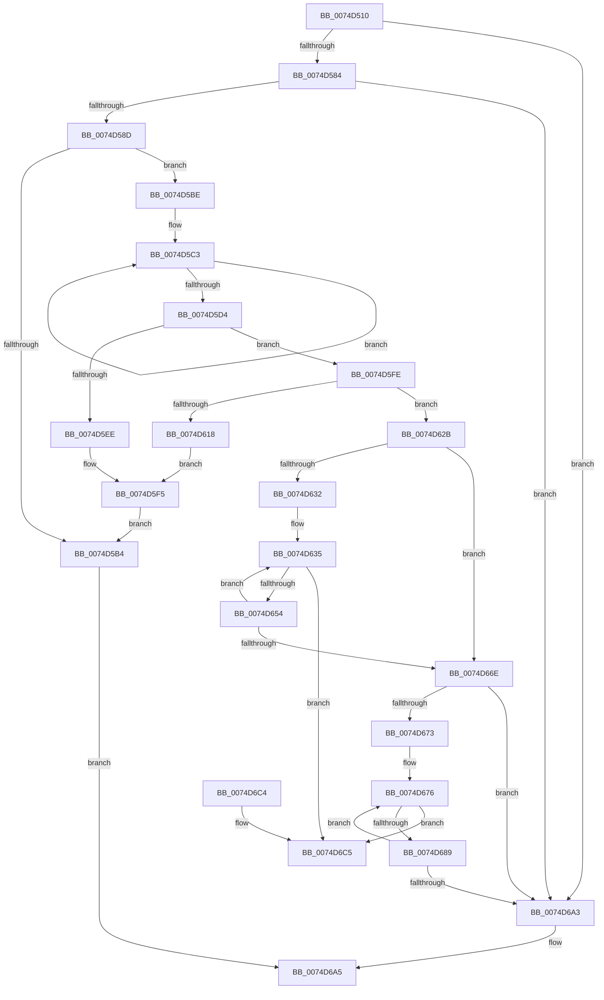

# AlpcpInitializeMessageLog

- RVA: `0x0074D510`–`0x0074D6CC` (길이 `444` bytes)
- VA: `0x000000014074D510`
- 실행 섹션: `PAGE`
- PDB 이름 있음: `예`; PDB Function 태그: `아니요`
- unwind 정보 RVA: `0x000C45E0`
- 디코드: `116`개 명령, `444/444` bytes 표시
- 미해석 바이트: `0` (있으면 어셈블리에 `.byte`로 보존)

> 이 문서는 커널 이미지의 기계어와 PDB 기호를 분석해 생성했습니다. 4번과 5번은 함수 원형과 자료형을 바이너리 사용 방식에서 추정한 C 해석이며 원본 소스 복구 결과는 아닙니다.

## 1. Dependencies

- 직접 호출 지점: **5**; 고유 호출 대상: **2**
- 직접 호출자로 확인된 함수: **1**
- RIP 상대 이미지 참조: **14**

### Outgoing calls
- `0x0074D5A3` → [ExAllocatePool2](../../poolcode/B8/ExAllocatePool2_function_00B820F0.md) (function, `0x00B820F0`)
- `0x0074D5E1` → [ExAllocatePool2](../../poolcode/B8/ExAllocatePool2_function_00B820F0.md) (function, `0x00B820F0`)
- `0x0074D5F7` → [ExFreePoolWithTag](../../poolcode/B8/ExFreePoolWithTag_function_00B82870.md) (function, `0x00B82870`)
- `0x0074D60B` → [ExAllocatePool2](../../poolcode/B8/ExAllocatePool2_function_00B820F0.md) (function, `0x00B820F0`)
- `0x0074D621` → [ExFreePoolWithTag](../../poolcode/B8/ExFreePoolWithTag_function_00B82870.md) (function, `0x00B82870`)

### Direct callers
- [AlpcpInitSystem](AlpcpInitSystem_function_0074CB9C.md) at `0x0074CE0E`

### Static image references
- `0x0074D52F` → RVA `0x00F100B0` (`.data`; read)
- `0x0074D536` → RVA `0x00F10080` (`.data`; write)
- `0x0074D53D` → RVA `0x00F100C0` (`.data`; read)
- `0x0074D544` → RVA `0x00F100B8` (`.data`; write)
- `0x0074D54B` → RVA `0x00F10090` (`.data`; read)
- `0x0074D552` → RVA `0x00F100B0` (`.data`; write)
- `0x0074D55C` → RVA `0x00F100C8` (`.data`; write)
- `0x0074D566` → RVA `0x00F100C0` (`.data`; write)
- `0x0074D56D` → RVA `0x00F10098` (`.data`; write)
- `0x0074D574` → RVA `0x00F10090` (`.data`; write)
- `0x0074D5A8` → RVA `0x00F100A0` (`.data`; write)
- `0x0074D5EE` → RVA `0x00F100A0` (`.data`; read)
- `0x0074D648` → RVA `0x00F100C8` (`.data`; read)
- `0x0074D676` → RVA `0x00F10098` (`.data`; read)

## 2. Other-region calls and transfers

- 다른 실행 섹션으로 향하는 call: **5**
  - `0x0074D5A3` → [ExAllocatePool2](../../poolcode/B8/ExAllocatePool2_function_00B820F0.md) (`PAGE` → `POOLCODE`)
  - `0x0074D5E1` → [ExAllocatePool2](../../poolcode/B8/ExAllocatePool2_function_00B820F0.md) (`PAGE` → `POOLCODE`)
  - `0x0074D5F7` → [ExFreePoolWithTag](../../poolcode/B8/ExFreePoolWithTag_function_00B82870.md) (`PAGE` → `POOLCODE`)
  - `0x0074D60B` → [ExAllocatePool2](../../poolcode/B8/ExAllocatePool2_function_00B820F0.md) (`PAGE` → `POOLCODE`)
  - `0x0074D621` → [ExFreePoolWithTag](../../poolcode/B8/ExFreePoolWithTag_function_00B82870.md) (`PAGE` → `POOLCODE`)
- 별도 외부 분기/꼬리 이동을 확인하지 못했습니다.

## 3. Assembly (complete function range)

```asm
0074D510  48 8B C4                        mov rax, rsp
0074D513  48 89 58 08                     mov qword ptr [rax + 8], rbx
0074D517  48 89 68 10                     mov qword ptr [rax + 0x10], rbp
0074D51B  48 89 70 18                     mov qword ptr [rax + 0x18], rsi
0074D51F  48 89 78 20                     mov qword ptr [rax + 0x20], rdi
0074D523  41 54                           push r12
0074D525  41 56                           push r14
0074D527  41 57                           push r15
0074D529  48 83 EC 20                     sub rsp, 0x20
0074D52D  33 DB                           xor ebx, ebx
0074D52F  48 8D 05 7A 2B 7C 00            lea rax, [rip + 0x7c2b7a]
0074D536  48 89 1D 43 2B 7C 00            mov qword ptr [rip + 0x7c2b43], rbx
0074D53D  4C 8D 3D 7C 2B 7C 00            lea r15, [rip + 0x7c2b7c]
0074D544  48 89 05 6D 2B 7C 00            mov qword ptr [rip + 0x7c2b6d], rax
0074D54B  4C 8D 35 3E 2B 7C 00            lea r14, [rip + 0x7c2b3e]
0074D552  48 89 05 57 2B 7C 00            mov qword ptr [rip + 0x7c2b57], rax
0074D559  48 8B FA                        mov rdi, rdx
0074D55C  4C 89 3D 65 2B 7C 00            mov qword ptr [rip + 0x7c2b65], r15
0074D563  48 8B F1                        mov rsi, rcx
0074D566  4C 89 3D 53 2B 7C 00            mov qword ptr [rip + 0x7c2b53], r15
0074D56D  4C 89 35 24 2B 7C 00            mov qword ptr [rip + 0x7c2b24], r14
0074D574  4C 89 35 15 2B 7C 00            mov qword ptr [rip + 0x7c2b15], r14
0074D57B  48 85 C9                        test rcx, rcx
0074D57E  0F 84 1F 01 00 00               je 0x14074d6a3
0074D584  48 85 D2                        test rdx, rdx
0074D587  0F 84 16 01 00 00               je 0x14074d6a3
0074D58D  BD 41 6C 4D 6C                  mov ebp, 0x6c4d6c41
0074D592  41 BC 00 01 00 00               mov r12d, 0x100
0074D598  44 8B C5                        mov r8d, ebp
0074D59B  41 8B CC                        mov ecx, r12d
0074D59E  BA 00 40 00 00                  mov edx, 0x4000
0074D5A3  E8 48 4B 43 00                  call 0x140b820f0
0074D5A8  48 89 05 F1 2A 7C 00            mov qword ptr [rip + 0x7c2af1], rax
0074D5AF  48 85 C0                        test rax, rax
0074D5B2  75 0A                           jne 0x14074d5be
0074D5B4  B8 9A 00 00 C0                  mov eax, 0xc000009a
0074D5B9  E9 E7 00 00 00                  jmp 0x14074d6a5
0074D5BE  B9 00 04 00 00                  mov ecx, 0x400
0074D5C3  48 89 40 08                     mov qword ptr [rax + 8], rax
0074D5C7  48 89 00                        mov qword ptr [rax], rax
0074D5CA  48 83 C0 10                     add rax, 0x10
0074D5CE  48 83 E9 01                     sub rcx, 1
0074D5D2  75 EF                           jne 0x14074d5c3
0074D5D4  48 8B D6                        mov rdx, rsi
0074D5D7  44 8B C5                        mov r8d, ebp
0074D5DA  48 C1 E2 06                     shl rdx, 6
0074D5DE  49 8B CC                        mov rcx, r12
0074D5E1  E8 0A 4B 43 00                  call 0x140b820f0
0074D5E6  48 8B E8                        mov rbp, rax
0074D5E9  48 85 C0                        test rax, rax
0074D5EC  75 10                           jne 0x14074d5fe
0074D5EE  48 8B 0D AB 2A 7C 00            mov rcx, qword ptr [rip + 0x7c2aab]
0074D5F5  33 D2                           xor edx, edx
0074D5F7  E8 74 52 43 00                  call 0x140b82870
0074D5FC  EB B6                           jmp 0x14074d5b4
0074D5FE  48 6B D7 78                     imul rdx, rdi, 0x78
0074D602  41 B8 41 6C 4D 73               mov r8d, 0x734d6c41
0074D608  49 8B CC                        mov rcx, r12
0074D60B  E8 E0 4A 43 00                  call 0x140b820f0
0074D610  4C 8B C0                        mov r8, rax
0074D613  48 85 C0                        test rax, rax
0074D616  75 13                           jne 0x14074d62b
0074D618  48 8B 0D 81 2A 7C 00            mov rcx, qword ptr [rip + 0x7c2a81]
0074D61F  33 D2                           xor edx, edx
0074D621  E8 4A 52 43 00                  call 0x140b82870
0074D626  48 8B CD                        mov rcx, rbp
0074D629  EB CA                           jmp 0x14074d5f5
0074D62B  8B D3                           mov edx, ebx
0074D62D  48 85 F6                        test rsi, rsi
0074D630  74 3C                           je 0x14074d66e
0074D632  48 8B C3                        mov rax, rbx
0074D635  48 C1 E0 06                     shl rax, 6
0074D639  48 8D 0C 28                     lea rcx, [rax + rbp]
0074D63D  48 8D 41 30                     lea rax, [rcx + 0x30]
0074D641  48 89 40 08                     mov qword ptr [rax + 8], rax
0074D645  48 89 00                        mov qword ptr [rax], rax
0074D648  48 8B 05 79 2A 7C 00            mov rax, qword ptr [rip + 0x7c2a79]
0074D64F  4C 39 38                        cmp qword ptr [rax], r15
0074D652  75 71                           jne 0x14074d6c5
0074D654  48 89 41 08                     mov qword ptr [rcx + 8], rax
0074D658  FF C2                           inc edx
0074D65A  4C 89 39                        mov qword ptr [rcx], r15
0074D65D  48 89 08                        mov qword ptr [rax], rcx
0074D660  8B C2                           mov eax, edx
0074D662  48 89 0D 5F 2A 7C 00            mov qword ptr [rip + 0x7c2a5f], rcx
0074D669  48 3B C6                        cmp rax, rsi
0074D66C  72 C7                           jb 0x14074d635
0074D66E  48 85 FF                        test rdi, rdi
0074D671  74 30                           je 0x14074d6a3
0074D673  48 8B C3                        mov rax, rbx
0074D676  48 8B 0D 1B 2A 7C 00            mov rcx, qword ptr [rip + 0x7c2a1b]
0074D67D  48 6B C0 78                     imul rax, rax, 0x78
0074D681  49 03 C0                        add rax, r8
0074D684  4C 39 31                        cmp qword ptr [rcx], r14
0074D687  75 3C                           jne 0x14074d6c5
0074D689  4C 89 30                        mov qword ptr [rax], r14
0074D68C  FF C3                           inc ebx
0074D68E  48 89 48 08                     mov qword ptr [rax + 8], rcx
0074D692  48 89 01                        mov qword ptr [rcx], rax
0074D695  48 89 05 FC 29 7C 00            mov qword ptr [rip + 0x7c29fc], rax
0074D69C  8B C3                           mov eax, ebx
0074D69E  48 3B C7                        cmp rax, rdi
0074D6A1  72 D3                           jb 0x14074d676
0074D6A3  33 C0                           xor eax, eax
0074D6A5  48 8B 5C 24 40                  mov rbx, qword ptr [rsp + 0x40]
0074D6AA  48 8B 6C 24 48                  mov rbp, qword ptr [rsp + 0x48]
0074D6AF  48 8B 74 24 50                  mov rsi, qword ptr [rsp + 0x50]
0074D6B4  48 8B 7C 24 58                  mov rdi, qword ptr [rsp + 0x58]
0074D6B9  48 83 C4 20                     add rsp, 0x20
0074D6BD  41 5F                           pop r15
0074D6BF  41 5E                           pop r14
0074D6C1  41 5C                           pop r12
0074D6C3  C3                              ret
0074D6C4  CC                              int3
0074D6C5  B9 03 00 00 00                  mov ecx, 3
0074D6CA  CD 29                           int 0x29
```

## 4. C-style interpretation (structured pseudocode)

```c
__int64 __fastcall AlpcpInitializeMessageLog(__int64 a1, __int64 a2)
{
    __int64 result;
    __int64 v_rbx;
    __int64 v_rsp;
    unsigned __int64 v_stack_p10;
    unsigned __int64 v_stack_p18;
    unsigned __int64 v_stack_p20;
    unsigned __int64 v_stack_p8;

    *(unsigned __int64 *)(v_rsp + 8) = v_rbx;
    *(unsigned __int64 *)(v_rsp + 16) = v_rbp;
    *(unsigned __int64 *)(v_rsp + 24) = v_rsi;
    *(unsigned __int64 *)(v_rsp + 32) = v_rdi;
    v_rsp = (v_rsp) - (32);
    v_rbx = 0;
    *(unsigned __int64 *)(v_rip + 8137539) = 0;
    *(unsigned __int64 *)(v_rip + 8137581) = v_rip + 8137594;
    *(unsigned __int64 *)(v_rip + 8137559) = v_rip + 8137594;
    *(unsigned __int64 *)(v_rip + 8137573) = v_rip + 8137596;
    *(unsigned __int64 *)(v_rip + 8137555) = v_rip + 8137596;
    *(unsigned __int64 *)(v_rip + 8137508) = v_rip + 8137534;
    *(unsigned __int64 *)(v_rip + 8137493) = v_rip + 8137534;
    if (a1 == 0) goto loc_0074D6A3;
    if (a2 == 0) goto loc_0074D6A3;
    result = ExAllocatePool2(256, (unsigned int)(0x4000ULL), (unsigned int)((unsigned int)((unsigned int)(0x6C4D6C41ULL))), a4);
    *(unsigned __int64 *)(v_rip + 8137457) = result;
    if (result != 0) goto loc_0074D5BE;
loc_0074D5B4:
    goto loc_0074D6A5;
loc_0074D5BE:
loc_0074D5C3:
    *(unsigned __int64 *)((unsigned int)(0xC000009AULL) + 8) = (unsigned int)(0xC000009AULL);
    *(unsigned __int64 *)((unsigned int)(0xC000009AULL)) = (unsigned int)(0xC000009AULL);
    result = ((unsigned int)(0xC000009AULL)) + (16);
    a1 = ((unsigned int)(0x400ULL)) - (1);
    if (condition_is_not_equal) goto loc_0074D5C3;
    a2 = (a1) << (6);
    result = ExAllocatePool2(256, a2, (unsigned int)((unsigned int)((unsigned int)(0x6C4D6C41ULL))), a4);
    if (result != 0) goto loc_0074D5FE;
loc_0074D5F5:
    a2 = 0;
    result = ExFreePoolWithTag(*(unsigned __int64 *)(v_rip + 8137387), a2, (unsigned int)((unsigned int)((unsigned int)(0x6C4D6C41ULL))), a4);
    goto loc_0074D5B4;
loc_0074D5FE:
    a2 = (a2) * (0);
    result = ExAllocatePool2(256, a2, (unsigned int)(0x734D6C41ULL), a4);
    if (result != 0) goto loc_0074D62B;
    a2 = 0;
    result = ExFreePoolWithTag(*(unsigned __int64 *)(v_rip + 8137345), a2, result, a4);
    goto loc_0074D5F5;
loc_0074D62B:
    if (a1 == 0) goto loc_0074D66E;
loc_0074D635:
    result = (0) << (6);
    *(unsigned __int64 *)(result + result * 1 + 48 + 8) = result + result * 1 + 48;
    *(unsigned __int64 *)(result + result * 1 + 48) = result + result * 1 + 48;
    if ((*(unsigned __int64 *)(*(unsigned __int64 *)(v_rip + 8137337))) != (v_rip + 8137596)) goto loc_0074D6C5;
    *(unsigned __int64 *)(result + result * 1 + 8) = *(unsigned __int64 *)(v_rip + 8137337);
    a2 = (unsigned int)((0) + 1);
    *(unsigned __int64 *)(result + result * 1) = v_rip + 8137596;
    *(unsigned __int64 *)(*(unsigned __int64 *)(v_rip + 8137337)) = result + result * 1;
    *(unsigned __int64 *)(v_rip + 8137311) = result + result * 1;
    if (((unsigned int)((unsigned int)(a2))) < a1) goto loc_0074D635;
loc_0074D66E:
    if (a2 == 0) goto loc_0074D6A3;
loc_0074D676:
    result = (0) * (0);
    result = (result) + (result);
    if ((*(unsigned __int64 *)(*(unsigned __int64 *)(v_rip + 8137243))) != (v_rip + 8137534)) goto loc_0074D6C5;
    *(unsigned __int64 *)(result) = v_rip + 8137534;
    v_rbx = (unsigned int)((v_rbx) + 1);
    *(unsigned __int64 *)(result + 8) = *(unsigned __int64 *)(v_rip + 8137243);
    *(unsigned __int64 *)(*(unsigned __int64 *)(v_rip + 8137243)) = result;
    *(unsigned __int64 *)(v_rip + 8137212) = result;
    if (((unsigned int)((unsigned int)(v_rbx))) < a2) goto loc_0074D676;
loc_0074D6A3:
    result = 0;
loc_0074D6A5:
    v_rsp = (v_rsp) + (32);
    return result;
loc_0074D6C5:
    return result;
}
```

## 5. (Beta) C Style

```c
int64_t AlpcpInitializeMessageLog(int64_t Arg1, int64_t Arg2)
{
    int64_t result;
    int64_t local_rbx;
    int64_t local_rsp;
    uint64_t v_stack_p10;
    uint64_t v_stack_p18;
    uint64_t v_stack_p20;
    uint64_t v_stack_p8;

    *(uint64_t *)(local_rsp + 0x8) = local_rbx;
    *(uint64_t *)(local_rsp + 0x10) = local_rbp;
    *(uint64_t *)(local_rsp + 0x18) = local_rsi;
    *(uint64_t *)(local_rsp + 0x20) = local_rdi;
    local_rsp = (local_rsp) - (32);
    local_rbx = 0;
    *(uint64_t *)(v_rip + 0x7C2B43) = 0;
    *(uint64_t *)(v_rip + 0x7C2B6D) = v_rip + 8137594;
    *(uint64_t *)(v_rip + 0x7C2B57) = v_rip + 8137594;
    *(uint64_t *)(v_rip + 0x7C2B65) = v_rip + 8137596;
    *(uint64_t *)(v_rip + 0x7C2B53) = v_rip + 8137596;
    *(uint64_t *)(v_rip + 0x7C2B24) = v_rip + 8137534;
    *(uint64_t *)(v_rip + 0x7C2B15) = v_rip + 8137534;
    if (Arg1 == 0) goto loc_0074D6A3;
    if (Arg2 == 0) goto loc_0074D6A3;
    result = ExAllocatePool2(256, (uint32_t)(0x4000ULL), (uint32_t)((uint32_t)((uint32_t)(0x6C4D6C41ULL))), a4);
    *(uint64_t *)(v_rip + 0x7C2AF1) = result;
    if (result != 0) goto loc_0074D5BE;
loc_0074D5B4:
    goto loc_0074D6A5;
loc_0074D5BE:
loc_0074D5C3:
    *(uint64_t *)((uint32_t)(0xC000009AULL) + 0x8) = (uint32_t)(0xC000009AULL);
    *(uint64_t *)((uint32_t)(0xC000009AULL)) = (uint32_t)(0xC000009AULL);
    result = ((uint32_t)(0xC000009AULL)) + (16);
    Arg1 = ((uint32_t)(0x400ULL)) - (1);
    if (condition_is_not_equal) goto loc_0074D5C3;
    Arg2 = (Arg1) << (6);
    result = ExAllocatePool2(256, Arg2, (uint32_t)((uint32_t)((uint32_t)(0x6C4D6C41ULL))), a4);
    if (result != 0) goto loc_0074D5FE;
loc_0074D5F5:
    Arg2 = 0;
    result = ExFreePoolWithTag(*(uint64_t *)(v_rip + 0x7C2AAB), Arg2, (uint32_t)((uint32_t)((uint32_t)(0x6C4D6C41ULL))), a4);
    goto loc_0074D5B4;
loc_0074D5FE:
    Arg2 = (Arg2) * (0);
    result = ExAllocatePool2(256, Arg2, (uint32_t)(0x734D6C41ULL), a4);
    if (result != 0) goto loc_0074D62B;
    Arg2 = 0;
    result = ExFreePoolWithTag(*(uint64_t *)(v_rip + 0x7C2A81), Arg2, result, a4);
    goto loc_0074D5F5;
loc_0074D62B:
    if (Arg1 == 0) goto loc_0074D66E;
loc_0074D635:
    result = (0) << (6);
    *(uint64_t *)(result + result * 1 + 0x30 + 0x8) = result + result * 1 + 48;
    *(uint64_t *)(result + result * 1 + 0x30) = result + result * 1 + 48;
    if ((*(uint64_t *)(*(uint64_t *)(v_rip + 0x7C2A79))) != (v_rip + 8137596)) goto loc_0074D6C5;
    *(uint64_t *)(result + result * 1 + 0x8) = *(uint64_t *)(v_rip + 0x7C2A79);
    Arg2 = (uint32_t)((0) + 1);
    *(uint64_t *)(result + result * 1) = v_rip + 8137596;
    *(uint64_t *)(*(uint64_t *)(v_rip + 0x7C2A79)) = result + result * 1;
    *(uint64_t *)(v_rip + 0x7C2A5F) = result + result * 1;
    if (((uint32_t)((uint32_t)(Arg2))) < Arg1) goto loc_0074D635;
loc_0074D66E:
    if (Arg2 == 0) goto loc_0074D6A3;
loc_0074D676:
    result = (0) * (0);
    result = (result) + (result);
    if ((*(uint64_t *)(*(uint64_t *)(v_rip + 0x7C2A1B))) != (v_rip + 8137534)) goto loc_0074D6C5;
    *(uint64_t *)(result) = v_rip + 8137534;
    local_rbx = (uint32_t)((local_rbx) + 1);
    *(uint64_t *)(result + 0x8) = *(uint64_t *)(v_rip + 0x7C2A1B);
    *(uint64_t *)(*(uint64_t *)(v_rip + 0x7C2A1B)) = result;
    *(uint64_t *)(v_rip + 0x7C29FC) = result;
    if (((uint32_t)((uint32_t)(local_rbx))) < Arg2) goto loc_0074D676;
loc_0074D6A3:
    result = 0;
loc_0074D6A5:
    local_rsp = (local_rsp) + (32);
    return result;
loc_0074D6C5:
    return result;
}
```

## 6. Execution-region graph

[열기: 2D/3D 그래프와 함수 탐색 컨트롤 패널](../../../control-panel.html?section=page&rva=0x0074D510&view=graph)

- 2D 그래프는 위에서 아래로 흐르고, 3D 그래프는 빈 공간을 드래그해 회전합니다. Shift+드래그는 이동, 휠은 확대·축소, 함수 노드 선택은 대상 보고서 이동입니다.

### Static fallback


