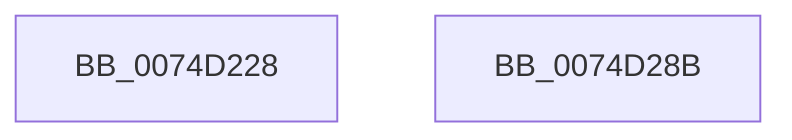

# AlpcpLogUnwait

- RVA: `0x0074D228`–`0x0074D28C` (길이 `100` bytes)
- VA: `0x000000014074D228`
- 실행 섹션: `PAGE`
- PDB 이름 있음: `예`; PDB Function 태그: `아니요`
- unwind 정보 RVA: `0x00060904`
- 디코드: `21`개 명령, `100/100` bytes 표시
- 미해석 바이트: `0` (있으면 어셈블리에 `.byte`로 보존)

> 이 문서는 커널 이미지의 기계어와 PDB 기호를 분석해 생성했습니다. 4번과 5번은 함수 원형과 자료형을 바이너리 사용 방식에서 추정한 C 해석이며 원본 소스 복구 결과는 아닙니다.

## 1. Dependencies

- 직접 호출 지점: **2**; 고유 호출 대상: **2**
- 직접 호출자로 확인된 함수: **3**
- RIP 상대 이미지 참조: **1**

### Outgoing calls
- `0x0074D274` → [AlpcpInvokeLogCallbacks](../AC/AlpcpInvokeLogCallbacks_function_00AC40D0.md) (function, `0x00AC40D0`)
- `0x0074D281` → [_security_check_cookie](../../text/6A/_security_check_cookie_function_006AC640.md) (function, `0x006AC640`)

### Direct callers
- [AlpcpSignalAndWait](../../text/2F/AlpcpSignalAndWait_function_002F9620.md) at `0x002F9AF7`
- [AlpcpWaitForSingleObject](../../text/43/AlpcpWaitForSingleObject_function_0043F680.md) at `0x0043F701`
- [AlpcpReceiveMessagePort](../89/AlpcpReceiveMessagePort_function_00896B40.md) at `0x008973BD`
- [AlpcpReceiveMessagePort](../89/AlpcpReceiveMessagePort_function_00896B40.md) at `0x008973D6`
- [AlpcpReceiveMessagePort](../89/AlpcpReceiveMessagePort_function_00896B40.md) at `0x008973E2`

### Static image references
- `0x0074D22C` → RVA `0x00E0A740` (`.data`; read)

## 2. Other-region calls and transfers

- 다른 실행 섹션으로 향하는 call: **1**
  - `0x0074D281` → [_security_check_cookie](../../text/6A/_security_check_cookie_function_006AC640.md) (`PAGE` → `.text`)
- 별도 외부 분기/꼬리 이동을 확인하지 못했습니다.

## 3. Assembly (complete function range)

```asm
0074D228  48 83 EC 58                     sub rsp, 0x58
0074D22C  48 8B 05 0D D5 6B 00            mov rax, qword ptr [rip + 0x6bd50d]
0074D233  48 33 C4                        xor rax, rsp
0074D236  48 89 44 24 40                  mov qword ptr [rsp + 0x40], rax
0074D23B  0F 57 C0                        xorps xmm0, xmm0
0074D23E  BA 20 00 00 00                  mov edx, 0x20
0074D243  0F 11 44 24 30                  movups xmmword ptr [rsp + 0x30], xmm0
0074D248  0F 11 44 24 20                  movups xmmword ptr [rsp + 0x20], xmm0
0074D24D  65 48 8B 04 25 88 01 00 00      mov rax, qword ptr gs:[0x188]
0074D256  0F 10 80 08 05 00 00            movups xmm0, xmmword ptr [rax + 0x508]
0074D25D  89 4C 24 38                     mov dword ptr [rsp + 0x38], ecx
0074D261  48 8D 4C 24 20                  lea rcx, [rsp + 0x20]
0074D266  C7 44 24 30 05 00 00 00         mov dword ptr [rsp + 0x30], 5
0074D26E  F3 0F 7F 44 24 20               movdqu xmmword ptr [rsp + 0x20], xmm0
0074D274  E8 57 6E 37 00                  call 0x140ac40d0
0074D279  48 8B 4C 24 40                  mov rcx, qword ptr [rsp + 0x40]
0074D27E  48 33 CC                        xor rcx, rsp
0074D281  E8 BA F3 F5 FF                  call 0x1406ac640
0074D286  48 83 C4 58                     add rsp, 0x58
0074D28A  C3                              ret
0074D28B  CC                              int3
```

## 4. C-style interpretation (structured pseudocode)

```c
__int64 __fastcall AlpcpLogUnwait(int a1)
{
    __int64 result;
    __int64 v_rsp;
    unsigned __int64 v_stack_m18;
    unsigned int v_stack_m20;
    unsigned __int64 v_stack_m28;
    unsigned __int64 v_stack_m38;

    v_rsp = (v_rsp) - (88);
    result = (*(unsigned __int64 *)(v_rip + 7066893)) ^ (v_rsp);
    v_stack_m18 = result;
    v_stack_m28 = v_xmm0;
    v_stack_m38 = v_xmm0;
    v_stack_m20 = a1;
    v_stack_m28 = 5;
    v_stack_m38 = v_xmm0;
    result = AlpcpInvokeLogCallbacks(v_stack_m38, 32, a3, a4);
    a1 = (v_stack_m18) ^ (v_rsp);
    result = _security_check_cookie(a1, 32, a3, a4);
    v_rsp = (v_rsp) + (88);
    return result;
}
```

## 5. (Beta) C Style

```c
int64_t AlpcpLogUnwait(int32_t Arg1)
{
    int64_t result;
    int64_t local_rsp;
    uint64_t v_stack_m18;
    uint32_t v_stack_m20;
    uint64_t v_stack_m28;
    uint64_t v_stack_m38;

    local_rsp = (local_rsp) - (88);
    result = (*(uint64_t *)(v_rip + 0x6BD50D)) ^ (local_rsp);
    v_stack_m18 = result;
    v_stack_m28 = v_xmm0;
    v_stack_m38 = v_xmm0;
    v_stack_m20 = Arg1;
    v_stack_m28 = 5;
    v_stack_m38 = v_xmm0;
    result = AlpcpInvokeLogCallbacks(v_stack_m38, 32, a3, a4);
    Arg1 = (v_stack_m18) ^ (local_rsp);
    result = _security_check_cookie(Arg1, 32, a3, a4);
    local_rsp = (local_rsp) + (88);
    return result;
}
```

## 6. Execution-region graph

[열기: 2D/3D 그래프와 함수 탐색 컨트롤 패널](../../../control-panel.html?section=page&rva=0x0074D228&view=graph)

- 2D 그래프는 위에서 아래로 흐르고, 3D 그래프는 빈 공간을 드래그해 회전합니다. Shift+드래그는 이동, 휠은 확대·축소, 함수 노드 선택은 대상 보고서 이동입니다.

### Static fallback


