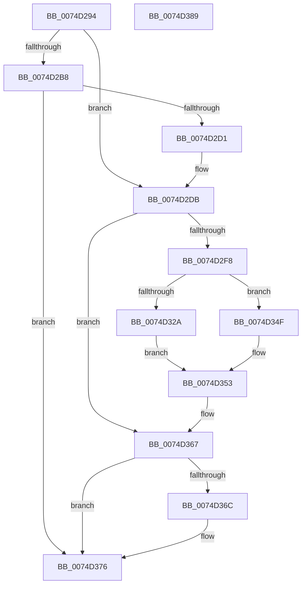

# AlpcpLogWaitForNewMessage

- RVA: `0x0074D294`–`0x0074D38A` (길이 `246` bytes)
- VA: `0x000000014074D294`
- 실행 섹션: `PAGE`
- PDB 이름 있음: `예`; PDB Function 태그: `아니요`
- unwind 정보 RVA: `0x000CB744`
- 디코드: `72`개 명령, `246/246` bytes 표시
- 미해석 바이트: `0` (있으면 어셈블리에 `.byte`로 보존)

> 이 문서는 커널 이미지의 기계어와 PDB 기호를 분석해 생성했습니다. 4번과 5번은 함수 원형과 자료형을 바이너리 사용 방식에서 추정한 C 해석이며 원본 소스 복구 결과는 아닙니다.

## 1. Dependencies

- 직접 호출 지점: **7**; 고유 호출 대상: **6**
- 직접 호출자로 확인된 함수: **1**
- RIP 상대 이미지 참조: **0**

### Outgoing calls
- `0x0074D2C4` → [AlpcpGetPortNameInformation](AlpcpGetPortNameInformation_function_0074C6CC.md) (function, `0x0074C6CC`)
- `0x0074D2EB` → [ExAllocatePool2](../../poolcode/B8/ExAllocatePool2_function_00B820F0.md) (function, `0x00B820F0`)
- `0x0074D300` → [memset](../../text/6C/memset_function_006C6C40.md) (function, `0x006C6C40`)
- `0x0074D348` → [memcpy](../../text/6C/memcpy_function_006C6840.md) (function, `0x006C6840`)
- `0x0074D358` → [AlpcpInvokeLogCallbacks](../AC/AlpcpInvokeLogCallbacks_function_00AC40D0.md) (function, `0x00AC40D0`)
- `0x0074D362` → [ExFreePoolWithTag](../../poolcode/B8/ExFreePoolWithTag_function_00B82870.md) (function, `0x00B82870`)
- `0x0074D371` → [ExFreePoolWithTag](../../poolcode/B8/ExFreePoolWithTag_function_00B82870.md) (function, `0x00B82870`)

### Direct callers
- [AlpcpReceiveMessagePort](../89/AlpcpReceiveMessagePort_function_00896B40.md) at `0x008973B1`
- [AlpcpReceiveMessagePort](../89/AlpcpReceiveMessagePort_function_00896B40.md) at `0x008973CA`

### Static image references
- 디코드된 RIP-relative 메모리 참조가 없습니다.

## 2. Other-region calls and transfers

- 다른 실행 섹션으로 향하는 call: **5**
  - `0x0074D2EB` → [ExAllocatePool2](../../poolcode/B8/ExAllocatePool2_function_00B820F0.md) (`PAGE` → `POOLCODE`)
  - `0x0074D300` → [memset](../../text/6C/memset_function_006C6C40.md) (`PAGE` → `.text`)
  - `0x0074D348` → [memcpy](../../text/6C/memcpy_function_006C6840.md) (`PAGE` → `.text`)
  - `0x0074D362` → [ExFreePoolWithTag](../../poolcode/B8/ExFreePoolWithTag_function_00B82870.md) (`PAGE` → `POOLCODE`)
  - `0x0074D371` → [ExFreePoolWithTag](../../poolcode/B8/ExFreePoolWithTag_function_00B82870.md) (`PAGE` → `POOLCODE`)
- 별도 외부 분기/꼬리 이동을 확인하지 못했습니다.

## 3. Assembly (complete function range)

```asm
0074D294  48 8B C4                        mov rax, rsp
0074D297  48 89 58 18                     mov qword ptr [rax + 0x18], rbx
0074D29B  48 89 68 20                     mov qword ptr [rax + 0x20], rbp
0074D29F  56                              push rsi
0074D2A0  57                              push rdi
0074D2A1  41 56                           push r14
0074D2A3  48 83 EC 20                     sub rsp, 0x20
0074D2A7  33 DB                           xor ebx, ebx
0074D2A9  48 8B E9                        mov rbp, rcx
0074D2AC  48 89 58 10                     mov qword ptr [rax + 0x10], rbx
0074D2B0  8D 73 1E                        lea esi, [rbx + 0x1e]
0074D2B3  48 85 C9                        test rcx, rcx
0074D2B6  74 23                           je 0x14074d2db
0074D2B8  83 48 08 FF                     or dword ptr [rax + 8], 0xffffffff
0074D2BC  4C 8D 40 08                     lea r8, [rax + 8]
0074D2C0  48 8D 50 10                     lea rdx, [rax + 0x10]
0074D2C4  E8 03 F4 FF FF                  call 0x14074c6cc
0074D2C9  85 C0                           test eax, eax
0074D2CB  0F 88 A5 00 00 00               js 0x14074d376
0074D2D1  48 8B 5C 24 48                  mov rbx, qword ptr [rsp + 0x48]
0074D2D6  0F B7 03                        movzx eax, word ptr [rbx]
0074D2D9  03 F0                           add esi, eax
0074D2DB  41 B8 41 6C 4C 65               mov r8d, 0x654c6c41
0074D2E1  8B D6                           mov edx, esi
0074D2E3  B9 00 01 00 00                  mov ecx, 0x100
0074D2E8  44 8B F6                        mov r14d, esi
0074D2EB  E8 00 4E 43 00                  call 0x140b820f0
0074D2F0  48 8B F8                        mov rdi, rax
0074D2F3  48 85 C0                        test rax, rax
0074D2F6  74 6F                           je 0x14074d367
0074D2F8  45 8B C6                        mov r8d, r14d
0074D2FB  33 D2                           xor edx, edx
0074D2FD  48 8B C8                        mov rcx, rax
0074D300  E8 3B 99 F7 FF                  call 0x1406c6c40
0074D305  65 48 8B 04 25 88 01 00 00      mov rax, qword ptr gs:[0x188]
0074D30E  48 8B 5C 24 48                  mov rbx, qword ptr [rsp + 0x48]
0074D313  0F 10 80 08 05 00 00            movups xmm0, xmmword ptr [rax + 0x508]
0074D31A  C7 47 10 04 00 00 00            mov dword ptr [rdi + 0x10], 4
0074D321  F3 0F 7F 07                     movdqu xmmword ptr [rdi], xmm0
0074D325  48 85 ED                        test rbp, rbp
0074D328  74 25                           je 0x14074d34f
0074D32A  8B 85 A0 01 00 00               mov eax, dword ptr [rbp + 0x1a0]
0074D330  33 C9                           xor ecx, ecx
0074D332  24 06                           and al, 6
0074D334  3C 02                           cmp al, 2
0074D336  0F 94 C1                        sete cl
0074D339  89 4F 18                        mov dword ptr [rdi + 0x18], ecx
0074D33C  48 8D 4F 1C                     lea rcx, [rdi + 0x1c]
0074D340  44 0F B7 03                     movzx r8d, word ptr [rbx]
0074D344  48 8B 53 08                     mov rdx, qword ptr [rbx + 8]
0074D348  E8 F3 94 F7 FF                  call 0x1406c6840
0074D34D  EB 04                           jmp 0x14074d353
0074D34F  83 67 18 00                     and dword ptr [rdi + 0x18], 0
0074D353  8B D6                           mov edx, esi
0074D355  48 8B CF                        mov rcx, rdi
0074D358  E8 73 6D 37 00                  call 0x140ac40d0
0074D35D  33 D2                           xor edx, edx
0074D35F  48 8B CF                        mov rcx, rdi
0074D362  E8 09 55 43 00                  call 0x140b82870
0074D367  48 85 DB                        test rbx, rbx
0074D36A  74 0A                           je 0x14074d376
0074D36C  33 D2                           xor edx, edx
0074D36E  48 8B CB                        mov rcx, rbx
0074D371  E8 FA 54 43 00                  call 0x140b82870
0074D376  48 8B 5C 24 50                  mov rbx, qword ptr [rsp + 0x50]
0074D37B  48 8B 6C 24 58                  mov rbp, qword ptr [rsp + 0x58]
0074D380  48 83 C4 20                     add rsp, 0x20
0074D384  41 5E                           pop r14
0074D386  5F                              pop rdi
0074D387  5E                              pop rsi
0074D388  C3                              ret
0074D389  CC                              int3
```

## 4. C-style interpretation (structured pseudocode)

```c
__int64 __fastcall AlpcpLogWaitForNewMessage(__int64 a1)
{
    __int64 result;
    __int64 v_rbx;
    __int64 v_rsi;
    __int64 v_rsp;
    unsigned __int64 v_stack_p10;
    unsigned __int64 v_stack_p18;
    unsigned __int64 v_stack_p20;

    *(unsigned __int64 *)(v_rsp + 24) = v_rbx;
    *(unsigned __int64 *)(v_rsp + 32) = v_rbp;
    v_rsp = (v_rsp) - (32);
    v_rbx = 0;
    *(unsigned __int64 *)(v_rsp + 16) = 0;
    if (a1 == 0) goto loc_0074D2DB;
    result = AlpcpGetPortNameInformation(a1, v_rsp + 16, v_rsp + 8, a4);
    if (sign_flag) goto loc_0074D376;
    v_rsi = (unsigned int)((v_rbx + 30) + ((unsigned int)(*(unsigned __int16 *)(v_stack_p10))));
loc_0074D2DB:
    result = ExAllocatePool2(256, (unsigned int)((unsigned int)(v_rsi)), (unsigned int)(0x654C6C41ULL), a4);
    if (result == 0) goto loc_0074D367;
    a2 = 0;
    result = memset(result, a2, (unsigned int)((unsigned int)((unsigned int)((unsigned int)(v_rsi)))), a4);
    *(unsigned int *)(result + 16) = 4;
    *(unsigned __int64 *)(result) = v_xmm0;
    if (a1 == 0) goto loc_0074D34F;
    a1 = 0;
    result = (unsigned __int8)(((unsigned int)(*(unsigned int *)(a1 + 416))) & (6));
    a1 = (((unsigned __int8)(result)) == 2) ? 1 : 0;
    *(unsigned int *)(result + 24) = (unsigned int)(a1);
    result = memcpy(result + 28, *(unsigned __int64 *)(v_stack_p10 + 8), *(unsigned __int16 *)(v_stack_p10), a4);
    goto loc_0074D353;
loc_0074D34F:
loc_0074D353:
    result = AlpcpInvokeLogCallbacks(result, (unsigned int)((unsigned int)(v_rsi)), *(unsigned __int16 *)(v_stack_p10), a4);
    a2 = 0;
    result = ExFreePoolWithTag(result, a2, *(unsigned __int16 *)(v_stack_p10), a4);
loc_0074D367:
    if (v_stack_p10 != 0) {
        a2 = 0;
        a1 = v_stack_p10;
        result = ExFreePoolWithTag(a1, a2, *(unsigned __int16 *)(v_stack_p10), a4);
    }
    v_rsp = (v_rsp) + (32);
    return result;
}
```

## 5. (Beta) C Style

```c
int64_t AlpcpLogWaitForNewMessage(int64_t Arg1)
{
    int64_t result;
    int64_t local_rbx;
    int64_t local_rsi;
    int64_t local_rsp;
    uint64_t v_stack_p10;
    uint64_t v_stack_p18;
    uint64_t v_stack_p20;

    *(uint64_t *)(local_rsp + 0x18) = local_rbx;
    *(uint64_t *)(local_rsp + 0x20) = local_rbp;
    local_rsp = (local_rsp) - (32);
    local_rbx = 0;
    *(uint64_t *)(local_rsp + 0x10) = 0;
    if (Arg1 == 0) goto loc_0074D2DB;
    result = AlpcpGetPortNameInformation(Arg1, local_rsp + 16, local_rsp + 8, a4);
    if (sign_flag) goto loc_0074D376;
    local_rsi = (uint32_t)((local_rbx + 30) + ((uint32_t)(*(uint16_t *)(v_stack_p10))));
loc_0074D2DB:
    result = ExAllocatePool2(256, (uint32_t)((uint32_t)(local_rsi)), (uint32_t)(0x654C6C41ULL), a4);
    if (result == 0) goto loc_0074D367;
    a2 = 0;
    result = memset(result, a2, (uint32_t)((uint32_t)((uint32_t)((uint32_t)(local_rsi)))), a4);
    *(uint32_t *)(result + 0x10) = 4;
    *(uint64_t *)(result) = v_xmm0;
    if (Arg1 == 0) goto loc_0074D34F;
    Arg1 = 0;
    result = (uint8_t)(((uint32_t)(*(uint32_t *)(Arg1 + 0x1A0))) & (6));
    Arg1 = (((uint8_t)(result)) == 2) ? 1 : 0;
    *(uint32_t *)(result + 0x18) = (uint32_t)(Arg1);
    result = memcpy(result + 28, *(uint64_t *)(v_stack_p10 + 0x8), *(uint16_t *)(v_stack_p10), a4);
    goto loc_0074D353;
loc_0074D34F:
loc_0074D353:
    result = AlpcpInvokeLogCallbacks(result, (uint32_t)((uint32_t)(local_rsi)), *(uint16_t *)(v_stack_p10), a4);
    a2 = 0;
    result = ExFreePoolWithTag(result, a2, *(uint16_t *)(v_stack_p10), a4);
loc_0074D367:
    if (v_stack_p10 != 0) {
        a2 = 0;
        Arg1 = v_stack_p10;
        result = ExFreePoolWithTag(Arg1, a2, *(uint16_t *)(v_stack_p10), a4);
    }
    local_rsp = (local_rsp) + (32);
    return result;
}
```

## 6. Execution-region graph

[열기: 2D/3D 그래프와 함수 탐색 컨트롤 패널](../../../control-panel.html?section=page&rva=0x0074D294&view=graph)

- 2D 그래프는 위에서 아래로 흐르고, 3D 그래프는 빈 공간을 드래그해 회전합니다. Shift+드래그는 이동, 휠은 확대·축소, 함수 노드 선택은 대상 보고서 이동입니다.

### Static fallback


