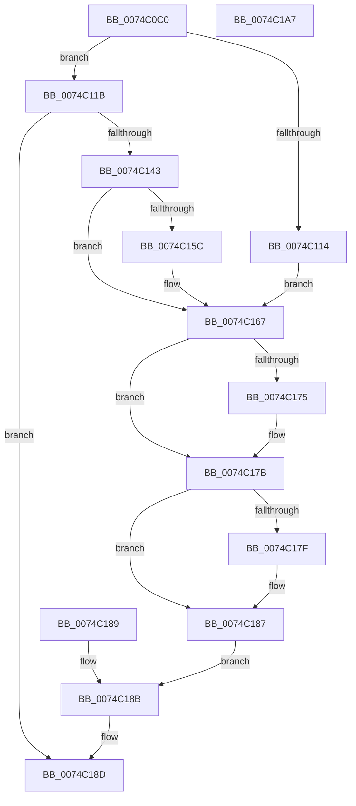

# AlpcpQueryTokenModifiedIdMessage

- RVA: `0x0074C0C0`–`0x0074C1A8` (길이 `232` bytes)
- VA: `0x000000014074C0C0`
- 실행 섹션: `PAGE`
- PDB 이름 있음: `예`; PDB Function 태그: `아니요`
- unwind 정보 RVA: `0x000CB694`
- 디코드: `62`개 명령, `232/232` bytes 표시
- 미해석 바이트: `0` (있으면 어셈블리에 `.byte`로 보존)

> 이 문서는 커널 이미지의 기계어와 PDB 기호를 분석해 생성했습니다. 4번과 5번은 함수 원형과 자료형을 바이너리 사용 방식에서 추정한 C 해석이며 원본 소스 복구 결과는 아닙니다.

## 1. Dependencies

- 직접 호출 지점: **4**; 고유 호출 대상: **4**
- 직접 호출자로 확인된 함수: **1**
- RIP 상대 이미지 참조: **0**

### Outgoing calls
- `0x0074C0F4` → [memset](../../text/6C/memset_function_006C6C40.md) (function, `0x006C6C40`)
- `0x0074C138` → [AlpcpGetEffectiveTokenMessage](../89/AlpcpGetEffectiveTokenMessage_function_00891980.md) (function, `0x00891980`)
- `0x0074C14D` → [SeGetTokenControlInformation](../9E/SeGetTokenControlInformation_function_009E47E0.md) (function, `0x009E47E0`)
- `0x0074C161` → [SeDeleteClientSecurity](../92/SeDeleteClientSecurity_function_00923F90.md) (function, `0x00923F90`)

### Direct callers
- [NtAlpcQueryInformationMessage](../89/NtAlpcQueryInformationMessage_function_00894700.md) at `0x008949E6`

### Static image references
- 디코드된 RIP-relative 메모리 참조가 없습니다.

## 2. Other-region calls and transfers

- 다른 실행 섹션으로 향하는 call: **1**
  - `0x0074C0F4` → [memset](../../text/6C/memset_function_006C6C40.md) (`PAGE` → `.text`)
- 별도 외부 분기/꼬리 이동을 확인하지 못했습니다.

## 3. Assembly (complete function range)

```asm
0074C0C0  4C 8B DC                        mov r11, rsp
0074C0C3  49 89 5B 08                     mov qword ptr [r11 + 8], rbx
0074C0C7  49 89 73 10                     mov qword ptr [r11 + 0x10], rsi
0074C0CB  49 89 7B 18                     mov qword ptr [r11 + 0x18], rdi
0074C0CF  41 56                           push r14
0074C0D1  48 81 EC B0 00 00 00            sub rsp, 0xb0
0074C0D8  41 8B D9                        mov ebx, r9d
0074C0DB  49 8B F8                        mov rdi, r8
0074C0DE  48 8B F2                        mov rsi, rdx
0074C0E1  4C 8B F1                        mov r14, rcx
0074C0E4  33 C0                           xor eax, eax
0074C0E6  89 44 24 6C                     mov dword ptr [rsp + 0x6c], eax
0074C0EA  33 D2                           xor edx, edx
0074C0EC  44 8D 40 44                     lea r8d, [rax + 0x44]
0074C0F0  49 8D 4B A8                     lea rcx, [r11 - 0x58]
0074C0F4  E8 47 AB F7 FF                  call 0x1406c6c40
0074C0F9  C6 84 24 D8 00 00 00 00         mov byte ptr [rsp + 0xd8], 0
0074C101  48 83 64 24 30 00               and qword ptr [rsp + 0x30], 0
0074C107  0F 57 C0                        xorps xmm0, xmm0
0074C10A  0F 11 44 24 48                  movups xmmword ptr [rsp + 0x48], xmm0
0074C10F  83 FB 08                        cmp ebx, 8
0074C112  73 07                           jae 0x14074c11b
0074C114  BB 23 00 00 C0                  mov ebx, 0xc0000023
0074C119  EB 4C                           jmp 0x14074c167
0074C11B  48 8D 84 24 D8 00 00 00         lea rax, [rsp + 0xd8]
0074C123  48 89 44 24 20                  mov qword ptr [rsp + 0x20], rax
0074C128  4C 8D 4C 24 60                  lea r9, [rsp + 0x60]
0074C12D  4C 8D 44 24 30                  lea r8, [rsp + 0x30]
0074C132  48 8B D6                        mov rdx, rsi
0074C135  49 8B CE                        mov rcx, r14
0074C138  E8 43 58 14 00                  call 0x140891980
0074C13D  8B D8                           mov ebx, eax
0074C13F  85 C0                           test eax, eax
0074C141  78 4A                           js 0x14074c18d
0074C143  48 8D 54 24 38                  lea rdx, [rsp + 0x38]
0074C148  48 8B 4C 24 30                  mov rcx, qword ptr [rsp + 0x30]
0074C14D  E8 8E 86 29 00                  call 0x1409e47e0
0074C152  80 BC 24 D8 00 00 00 00         cmp byte ptr [rsp + 0xd8], 0
0074C15A  74 0B                           je 0x14074c167
0074C15C  48 8D 4C 24 60                  lea rcx, [rsp + 0x60]
0074C161  E8 2A 7E 1D 00                  call 0x140923f90
0074C166  90                              nop
0074C167  90                              nop
0074C168  48 8B 84 24 E0 00 00 00         mov rax, qword ptr [rsp + 0xe0]
0074C170  48 85 C0                        test rax, rax
0074C173  74 06                           je 0x14074c17b
0074C175  C7 00 08 00 00 00               mov dword ptr [rax], 8
0074C17B  85 DB                           test ebx, ebx
0074C17D  78 08                           js 0x14074c187
0074C17F  48 8B 44 24 48                  mov rax, qword ptr [rsp + 0x48]
0074C184  48 89 07                        mov qword ptr [rdi], rax
0074C187  EB 02                           jmp 0x14074c18b
0074C189  8B D8                           mov ebx, eax
0074C18B  8B C3                           mov eax, ebx
0074C18D  4C 8D 9C 24 B0 00 00 00         lea r11, [rsp + 0xb0]
0074C195  49 8B 5B 10                     mov rbx, qword ptr [r11 + 0x10]
0074C199  49 8B 73 18                     mov rsi, qword ptr [r11 + 0x18]
0074C19D  49 8B 7B 20                     mov rdi, qword ptr [r11 + 0x20]
0074C1A1  49 8B E3                        mov rsp, r11
0074C1A4  41 5E                           pop r14
0074C1A6  C3                              ret
0074C1A7  CC                              int3
```

## 4. C-style interpretation (structured pseudocode)

```c
__int64 __fastcall AlpcpQueryTokenModifiedIdMessage(__int64 a1, __int64 a2, __int64 a3, int a4, __int64 a5)
{
    __int64 result;
    __int64 v_rsp;
    unsigned int v_stack_m4C;
    unsigned __int64 v_stack_m58;
    unsigned __int64 v_stack_m70;
    unsigned __int64 v_stack_m8;
    unsigned __int64 v_stack_m80;
    unsigned __int64 v_stack_m88;
    unsigned __int64 v_stack_m98;
    unsigned __int8 v_stack_p20;

    *(unsigned __int64 *)(v_rsp + 8) = v_rbx;
    *(unsigned __int64 *)(v_rsp + 16) = v_rsi;
    *(unsigned __int64 *)(v_rsp + 24) = v_rdi;
    v_rsp = (v_rsp) - (176);
    result = 0;
    v_stack_m4C = 0;
    a2 = 0;
    result = memset(v_rsp - 88, a2, result + 68, a4);
    v_stack_p20 = 0;
    v_stack_m70 = v_xmm0;
    if (((unsigned int)((unsigned int)(a4))) >= 8) goto loc_0074C11B;
    goto loc_0074C167;
loc_0074C11B:
    v_stack_m98 = v_stack_p20;
    result = AlpcpGetEffectiveTokenMessage(a1, 0, v_stack_m88, v_stack_m58);
    if (sign_flag) goto loc_0074C18D;
    result = SeGetTokenControlInformation(v_stack_m88, v_stack_m80, v_stack_m88, v_stack_m58);
    if (v_stack_p20 != 0) {
        a1 = v_stack_m58;
        result = SeDeleteClientSecurity(a1, v_stack_m80, v_stack_m88, v_stack_m58);
    }
    if (a5 != 0) {
        *(unsigned int *)(a5) = 8;
    }
    result = a5;
    if (!(sign_flag)) {
        result = v_stack_m70;
        *(unsigned __int64 *)(a3) = result;
    }
    goto loc_0074C18B;
loc_0074C18B:
loc_0074C18D:
    return (unsigned int)((unsigned int)((unsigned int)((unsigned int)(result))));
}
```

## 5. (Beta) C Style

```c
int64_t AlpcpQueryTokenModifiedIdMessage(int64_t Arg1, int64_t Arg2, void *Arg3, int32_t Arg4, int64_t Arg5)
{
    uint8_t *arg3 = (uint8_t *)Arg3;

    int64_t result;
    int64_t local_rsp;
    uint32_t v_stack_m4C;
    uint64_t v_stack_m58;
    uint64_t v_stack_m70;
    uint64_t v_stack_m8;
    uint64_t v_stack_m80;
    uint64_t v_stack_m88;
    uint64_t v_stack_m98;
    uint8_t v_stack_p20;

    *(uint64_t *)(local_rsp + 0x8) = local_rbx;
    *(uint64_t *)(local_rsp + 0x10) = local_rsi;
    *(uint64_t *)(local_rsp + 0x18) = local_rdi;
    local_rsp = (local_rsp) - (176);
    result = 0;
    v_stack_m4C = 0;
    Arg2 = 0;
    result = memset(local_rsp - 88, Arg2, result + 68, Arg4);
    v_stack_p20 = 0;
    v_stack_m70 = v_xmm0;
    if (((uint32_t)((uint32_t)(Arg4))) >= 8) goto loc_0074C11B;
    goto loc_0074C167;
loc_0074C11B:
    v_stack_m98 = v_stack_p20;
    result = AlpcpGetEffectiveTokenMessage(Arg1, 0, v_stack_m88, v_stack_m58);
    if (sign_flag) goto loc_0074C18D;
    result = SeGetTokenControlInformation(v_stack_m88, v_stack_m80, v_stack_m88, v_stack_m58);
    if (v_stack_p20 != 0) {
        Arg1 = v_stack_m58;
        result = SeDeleteClientSecurity(Arg1, v_stack_m80, v_stack_m88, v_stack_m58);
    }
    if (Arg5 != 0) {
        *(uint32_t *)(Arg5) = 8;
    }
    result = Arg5;
    if (!(sign_flag)) {
        result = v_stack_m70;
        *(uint64_t *)(arg3) = result;
    }
    goto loc_0074C18B;
loc_0074C18B:
loc_0074C18D:
    return (uint32_t)((uint32_t)((uint32_t)((uint32_t)(result))));
}
```

### 관측된 메모리 오프셋

구조체 형식이 확인되지 않은 접근은 인자 기준의 오프셋으로만 기록했습니다.

| 기준 인자 | 오프셋 표현 | 폭 (bit) | 접근 |
|---|---:|---:|---|
| `Arg3` | `+ 0x0` | `64` | `W` |

## 6. Execution-region graph

[열기: 2D/3D 그래프와 함수 탐색 컨트롤 패널](../../../control-panel.html?section=page&rva=0x0074C0C0&view=graph)

- 2D 그래프는 위에서 아래로 흐르고, 3D 그래프는 빈 공간을 드래그해 회전합니다. Shift+드래그는 이동, 휠은 확대·축소, 함수 노드 선택은 대상 보고서 이동입니다.

### Static fallback


