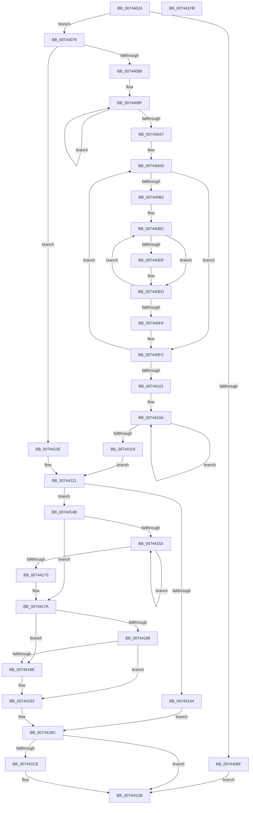

# IopExecuteHardwareProfileChange

- RVA: `0x00744024`–`0x007441FC` (길이 `472` bytes)
- VA: `0x0000000140744024`
- 실행 섹션: `PAGE`
- PDB 이름 있음: `예`; PDB Function 태그: `아니요`
- unwind 정보 RVA: `0x000C6A34`
- 디코드: `138`개 명령, `472/472` bytes 표시
- 미해석 바이트: `0` (있으면 어셈블리에 `.byte`로 보존)

> 이 문서는 커널 이미지의 기계어와 PDB 기호를 분석해 생성했습니다. 4번과 5번은 함수 원형과 자료형을 바이너리 사용 방식에서 추정한 C 해석이며 원본 소스 복구 결과는 아닙니다.

## 1. Dependencies

- 직접 호출 지점: **8**; 고유 호출 대상: **6**
- 직접 호출자로 확인된 함수: **1**
- RIP 상대 이미지 참조: **1**

### Outgoing calls
- `0x0074405B` → [ExAllocatePool2](../../poolcode/B8/ExAllocatePool2_function_00B820F0.md) (function, `0x00B820F0`)
- `0x00744095` → [RtlInitUnicodeString](../../text/42/RtlInitUnicodeString_function_0042A780.md) (function, `0x0042A780`)
- `0x007440D6` → [RtlCompareUnicodeStrings](../97/RtlCompareUnicodeStrings_function_009727E0.md) (function, `0x009727E0`)
- `0x00744137` → [ExAllocatePool2](../../poolcode/B8/ExAllocatePool2_function_00B820F0.md) (function, `0x00B820F0`)
- `0x00744162` → [memcpy](../../text/6C/memcpy_function_006C6840.md) (function, `0x006C6840`)
- `0x007441B5` → [CmSetAcpiHwProfile](../7E/CmSetAcpiHwProfile_function_007E2584.md) (function, `0x007E2584`)
- `0x007441C4` → [ExFreePoolWithTag](../../poolcode/B8/ExFreePoolWithTag_function_00B82870.md) (function, `0x00B82870`)
- `0x007441D6` → [ExFreePoolWithTag](../../poolcode/B8/ExFreePoolWithTag_function_00B82870.md) (function, `0x00B82870`)

### Direct callers
- [PnpProfileUpdateHardwareProfile](../73/PnpProfileUpdateHardwareProfile_function_0073773C.md) at `0x0073789D`

### Static image references
- `0x0074419B` → RVA `0x00744210` (`IopExecuteHwpDefaultSelect`; read)

## 2. Other-region calls and transfers

- 다른 실행 섹션으로 향하는 call: **6**
  - `0x0074405B` → [ExAllocatePool2](../../poolcode/B8/ExAllocatePool2_function_00B820F0.md) (`PAGE` → `POOLCODE`)
  - `0x00744095` → [RtlInitUnicodeString](../../text/42/RtlInitUnicodeString_function_0042A780.md) (`PAGE` → `.text`)
  - `0x00744137` → [ExAllocatePool2](../../poolcode/B8/ExAllocatePool2_function_00B820F0.md) (`PAGE` → `POOLCODE`)
  - `0x00744162` → [memcpy](../../text/6C/memcpy_function_006C6840.md) (`PAGE` → `.text`)
  - `0x007441C4` → [ExFreePoolWithTag](../../poolcode/B8/ExFreePoolWithTag_function_00B82870.md) (`PAGE` → `POOLCODE`)
  - `0x007441D6` → [ExFreePoolWithTag](../../poolcode/B8/ExFreePoolWithTag_function_00B82870.md) (`PAGE` → `POOLCODE`)
- 별도 외부 분기/꼬리 이동을 확인하지 못했습니다.

## 3. Assembly (complete function range)

```asm
00744024  48 8B C4                        mov rax, rsp
00744027  48 89 58 08                     mov qword ptr [rax + 8], rbx
0074402B  48 89 68 10                     mov qword ptr [rax + 0x10], rbp
0074402F  48 89 70 18                     mov qword ptr [rax + 0x18], rsi
00744033  4C 89 48 20                     mov qword ptr [rax + 0x20], r9
00744037  57                              push rdi
00744038  41 54                           push r12
0074403A  41 55                           push r13
0074403C  41 56                           push r14
0074403E  41 57                           push r15
00744040  48 83 EC 40                     sub rsp, 0x40
00744044  48 8B FA                        mov rdi, rdx
00744047  41 8B E8                        mov ebp, r8d
0074404A  41 8B D0                        mov edx, r8d
0074404D  B9 40 00 00 00                  mov ecx, 0x40
00744052  C1 E2 04                        shl edx, 4
00744055  41 B8 50 6E 70 33               mov r8d, 0x33706e50
0074405B  E8 90 E0 43 00                  call 0x140b820f0
00744060  33 DB                           xor ebx, ebx
00744062  48 89 44 24 38                  mov qword ptr [rsp + 0x38], rax
00744067  4C 8B E8                        mov r13, rax
0074406A  48 85 C0                        test rax, rax
0074406D  75 0A                           jne 0x140744079
0074406F  BB 9A 00 00 C0                  mov ebx, 0xc000009a
00744074  E9 62 01 00 00                  jmp 0x1407441db
00744079  4C 8B FD                        mov r15, rbp
0074407C  BE 01 00 00 00                  mov esi, 1
00744081  85 ED                           test ebp, ebp
00744083  0F 84 95 00 00 00               je 0x14074411e
00744089  49 8B DD                        mov rbx, r13
0074408C  4C 8B F5                        mov r14, rbp
0074408F  48 8B 17                        mov rdx, qword ptr [rdi]
00744092  48 8B CB                        mov rcx, rbx
00744095  E8 E6 66 CE FF                  call 0x14042a780
0074409A  48 83 C3 10                     add rbx, 0x10
0074409E  48 8D 7F 08                     lea rdi, [rdi + 8]
007440A2  4C 2B F6                        sub r14, rsi
007440A5  75 E8                           jne 0x14074408f
007440A7  44 8D 65 FF                     lea r12d, [rbp - 1]
007440AB  33 DB                           xor ebx, ebx
007440AD  45 85 E4                        test r12d, r12d
007440B0  74 4A                           je 0x1407440fc
007440B2  49 8B DD                        mov rbx, r13
007440B5  45 8B F4                        mov r14d, r12d
007440B8  49 8D 7D 10                     lea rdi, [r13 + 0x10]
007440BC  44 0F B7 0F                     movzx r9d, word ptr [rdi]
007440C0  0F B7 13                        movzx edx, word ptr [rbx]
007440C3  4C 8B 47 08                     mov r8, qword ptr [rdi + 8]
007440C7  48 8B 4B 08                     mov rcx, qword ptr [rbx + 8]
007440CB  49 D1 E9                        shr r9, 1
007440CE  48 D1 EA                        shr rdx, 1
007440D1  C6 44 24 20 00                  mov byte ptr [rsp + 0x20], 0
007440D6  E8 05 E7 22 00                  call 0x1409727e0
007440DB  85 C0                           test eax, eax
007440DD  7E 0E                           jle 0x1407440ed
007440DF  0F 10 0B                        movups xmm1, xmmword ptr [rbx]
007440E2  0F 10 07                        movups xmm0, xmmword ptr [rdi]
007440E5  F3 0F 7F 0F                     movdqu xmmword ptr [rdi], xmm1
007440E9  F3 0F 7F 03                     movdqu xmmword ptr [rbx], xmm0
007440ED  48 83 C7 10                     add rdi, 0x10
007440F1  48 83 C3 10                     add rbx, 0x10
007440F5  4C 2B F6                        sub r14, rsi
007440F8  75 C2                           jne 0x1407440bc
007440FA  33 DB                           xor ebx, ebx
007440FC  4C 2B FE                        sub r15, rsi
007440FF  75 AC                           jne 0x1407440ad
00744101  48 8B D5                        mov rdx, rbp
00744104  44 8B F3                        mov r14d, ebx
00744107  49 8B CD                        mov rcx, r13
0074410A  0F B7 01                        movzx eax, word ptr [rcx]
0074410D  48 8D 49 10                     lea rcx, [rcx + 0x10]
00744111  44 03 F0                        add r14d, eax
00744114  48 2B D6                        sub rdx, rsi
00744117  75 F1                           jne 0x14074410a
00744119  4C 8B FD                        mov r15, rbp
0074411C  EB 03                           jmp 0x140744121
0074411E  44 8B F3                        mov r14d, ebx
00744121  41 83 C6 02                     add r14d, 2
00744125  B9 40 00 00 00                  mov ecx, 0x40
0074412A  41 8B D6                        mov edx, r14d
0074412D  41 B8 50 6E 70 33               mov r8d, 0x33706e50
00744133  48 83 C2 06                     add rdx, 6
00744137  E8 B4 DF 43 00                  call 0x140b820f0
0074413C  48 8B F8                        mov rdi, rax
0074413F  48 85 C0                        test rax, rax
00744142  75 07                           jne 0x14074414b
00744144  BB 9A 00 00 C0                  mov ebx, 0xc000009a
00744149  EB 71                           jmp 0x1407441bc
0074414B  4C 8D 60 04                     lea r12, [rax + 4]
0074414F  85 ED                           test ebp, ebp
00744151  74 27                           je 0x14074417a
00744153  41 0F B7 5D 00                  movzx ebx, word ptr [r13]
00744158  49 8B CC                        mov rcx, r12
0074415B  49 8B 55 08                     mov rdx, qword ptr [r13 + 8]
0074415F  44 8B C3                        mov r8d, ebx
00744162  E8 D9 26 F8 FF                  call 0x1406c6840
00744167  4C 03 E3                        add r12, rbx
0074416A  4D 8D 6D 10                     lea r13, [r13 + 0x10]
0074416E  4C 2B FE                        sub r15, rsi
00744171  75 E0                           jne 0x140744153
00744173  4C 8B 6C 24 38                  mov r13, qword ptr [rsp + 0x38]
00744178  33 DB                           xor ebx, ebx
0074417A  66 41 89 1C 24                  mov word ptr [r12], bx
0074417F  66 44 89 77 02                  mov word ptr [rdi + 2], r14w
00744184  3B EE                           cmp ebp, esi
00744186  77 06                           ja 0x14074418e
00744188  66 3B 5F 04                     cmp bx, word ptr [rdi + 4]
0074418C  74 05                           je 0x140744193
0074418E  BE 02 00 00 00                  mov esi, 2
00744193  48 8B 84 24 90 00 00 00         mov rax, qword ptr [rsp + 0x90]
0074419B  48 8D 15 6E 00 00 00            lea rdx, [rip + 0x6e]
007441A2  66 89 37                        mov word ptr [rdi], si
007441A5  48 8B CF                        mov rcx, rdi
007441A8  4C 8B 8C 24 88 00 00 00         mov r9, qword ptr [rsp + 0x88]
007441B0  48 89 44 24 20                  mov qword ptr [rsp + 0x20], rax
007441B5  E8 CA E3 09 00                  call 0x1407e2584
007441BA  8B D8                           mov ebx, eax
007441BC  BA 50 6E 70 33                  mov edx, 0x33706e50
007441C1  49 8B CD                        mov rcx, r13
007441C4  E8 A7 E6 43 00                  call 0x140b82870
007441C9  48 85 FF                        test rdi, rdi
007441CC  74 0D                           je 0x1407441db
007441CE  BA 50 6E 70 33                  mov edx, 0x33706e50
007441D3  48 8B CF                        mov rcx, rdi
007441D6  E8 95 E6 43 00                  call 0x140b82870
007441DB  4C 8D 5C 24 40                  lea r11, [rsp + 0x40]
007441E0  8B C3                           mov eax, ebx
007441E2  49 8B 5B 30                     mov rbx, qword ptr [r11 + 0x30]
007441E6  49 8B 6B 38                     mov rbp, qword ptr [r11 + 0x38]
007441EA  49 8B 73 40                     mov rsi, qword ptr [r11 + 0x40]
007441EE  49 8B E3                        mov rsp, r11
007441F1  41 5F                           pop r15
007441F3  41 5E                           pop r14
007441F5  41 5D                           pop r13
007441F7  41 5C                           pop r12
007441F9  5F                              pop rdi
007441FA  C3                              ret
007441FB  CC                              int3
```

## 4. C-style interpretation (structured pseudocode)

```c
__int64 __fastcall IopExecuteHardwareProfileChange(__int64 a1, __int64 a2, int a3, __int64 a4, __int64 a5)
{
    __int64 result;
    __int64 v_r12;
    __int64 v_r14;
    __int64 v_r15;
    __int64 v_rbx;
    __int64 v_rdi;
    __int64 v_rsi;
    __int64 v_rsp;
    unsigned __int64 v_stack_m28;
    unsigned __int64 v_stack_m30;
    unsigned __int8 v_stack_m48;
    unsigned __int64 v_stack_p20;

    *(unsigned __int64 *)(v_rsp + 8) = v_rbx;
    *(unsigned __int64 *)(v_rsp + 16) = v_rbp;
    *(unsigned __int64 *)(v_rsp + 24) = v_rsi;
    *(unsigned __int64 *)(v_rsp + 32) = a4;
    v_rsp = (v_rsp) - (64);
    a2 = (unsigned int)(((unsigned int)(a3)) << (4));
    result = ExAllocatePool2(64, a2, (unsigned int)(0x33706E50ULL), a4);
    v_rbx = 0;
    v_stack_m30 = result;
    if (result != 0) goto loc_00744079;
    goto loc_007441DB;
loc_00744079:
    if ((unsigned int)((unsigned int)(a3)) == 0) goto loc_0074411E;
loc_0074408F:
    result = RtlInitUnicodeString(result, *(unsigned __int64 *)(a2), (unsigned int)(0x33706E50ULL), a4);
    v_rbx = (result) + (16);
    v_r14 = ((unsigned int)(a3)) - (1);
    if (condition_is_not_equal) goto loc_0074408F;
    v_rbx = 0;
loc_007440AD:
    if ((unsigned int)((unsigned int)(a3) - 1) == 0) goto loc_007440FC;
loc_007440BC:
    a4 = (*(unsigned __int16 *)(result + 16)) >> (1);
    a2 = (*(unsigned __int16 *)(result)) >> (1);
    v_stack_m48 = 0;
    result = RtlCompareUnicodeStrings(*(unsigned __int64 *)(result + 8), a2, *(unsigned __int64 *)(result + 16 + 8), a4);
    if (!(condition_is_less_or_equal)) {
        *(unsigned __int64 *)(result + 16) = v_xmm1;
        *(unsigned __int64 *)(result) = v_xmm0;
    }
    v_rdi = (result + 16) + (16);
    v_rbx = (result) + (16);
    v_r14 = ((unsigned int)((unsigned int)((unsigned int)(a3) - 1))) - (1);
    if (condition_is_not_equal) goto loc_007440BC;
    v_rbx = 0;
loc_007440FC:
    v_r15 = ((unsigned int)(a3)) - (1);
    if (condition_is_not_equal) goto loc_007440AD;
loc_0074410A:
    v_r14 = (unsigned int)((0) + ((unsigned int)(*(unsigned __int16 *)(result))));
    a2 = ((unsigned int)(a3)) - (1);
    if (condition_is_not_equal) goto loc_0074410A;
    goto loc_00744121;
loc_0074411E:
loc_00744121:
    v_r14 = (unsigned int)((0) + (2));
    a2 = ((unsigned int)((unsigned int)(v_r14))) + (6);
    result = ExAllocatePool2(64, a2, (unsigned int)(0x33706E50ULL), a4);
    if (result != 0) goto loc_0074414B;
    goto loc_007441BC;
loc_0074414B:
    if ((unsigned int)((unsigned int)(a3)) == 0) goto loc_0074417A;
loc_00744153:
    result = memcpy(result + 4, *(unsigned __int64 *)(result + 8), (unsigned int)((unsigned int)(*(unsigned __int16 *)(result))), a4);
    v_r12 = (result + 4) + (*(unsigned __int16 *)(result));
    v_r15 = ((unsigned int)(a3)) - (1);
    if (condition_is_not_equal) goto loc_00744153;
    v_rbx = 0;
loc_0074417A:
    *(unsigned __int16 *)(v_r12) = 0;
    *(unsigned __int16 *)(result + 2) = (unsigned __int16)(v_r14);
    if (((unsigned int)((unsigned int)(a3))) > 1) goto loc_0074418E;
    v_rsi = 1;
    if (0 != (*(unsigned __int16 *)(result + 4))) {
        v_rsi = 2;
    }
    *(unsigned __int16 *)(result) = (unsigned __int16)(v_rsi);
    v_stack_m48 = a5;
    result = CmSetAcpiHwProfile(result, v_rip + 110, (unsigned int)((unsigned int)(*(unsigned __int16 *)(result))), v_stack_p20);
loc_007441BC:
    result = ExFreePoolWithTag(v_stack_m30, (unsigned int)(0x33706E50ULL), (unsigned int)((unsigned int)(*(unsigned __int16 *)(result))), v_stack_p20);
    if (result != 0) {
        a2 = 0x33706E50ULL;
        a1 = result;
        result = ExFreePoolWithTag(a1, a2, (unsigned int)((unsigned int)(*(unsigned __int16 *)(result))), v_stack_p20);
    }
    return (unsigned int)((unsigned int)((unsigned int)((unsigned int)(result))));
}
```

## 5. (Beta) C Style

```c
int64_t IopExecuteHardwareProfileChange(int64_t Arg1, void *Arg2, int32_t Arg3, int64_t Arg4, int64_t Arg5)
{
    uint8_t *arg2 = (uint8_t *)Arg2;

    int64_t result;
    int64_t local_r12;
    int64_t local_r14;
    int64_t local_r15;
    int64_t local_rbx;
    int64_t local_rdi;
    int64_t local_rsi;
    int64_t local_rsp;
    uint64_t v_stack_m28;
    uint64_t v_stack_m30;
    uint8_t v_stack_m48;
    uint64_t v_stack_p20;

    *(uint64_t *)(local_rsp + 0x8) = local_rbx;
    *(uint64_t *)(local_rsp + 0x10) = local_rbp;
    *(uint64_t *)(local_rsp + 0x18) = local_rsi;
    *(uint64_t *)(local_rsp + 0x20) = Arg4;
    local_rsp = (local_rsp) - (64);
    Arg2 = (uint32_t)(((uint32_t)(Arg3)) << (4));
    result = ExAllocatePool2(64, Arg2, (uint32_t)(0x33706E50ULL), Arg4);
    local_rbx = 0;
    v_stack_m30 = result;
    if (result != 0) goto loc_00744079;
    goto loc_007441DB;
loc_00744079:
    if ((uint32_t)((uint32_t)(Arg3)) == 0) goto loc_0074411E;
loc_0074408F:
    result = RtlInitUnicodeString(result, *(uint64_t *)(arg2), (uint32_t)(0x33706E50ULL), Arg4);
    local_rbx = (result) + (16);
    local_r14 = ((uint32_t)(Arg3)) - (1);
    if (condition_is_not_equal) goto loc_0074408F;
    local_rbx = 0;
loc_007440AD:
    if ((uint32_t)((uint32_t)(Arg3) - 1) == 0) goto loc_007440FC;
loc_007440BC:
    Arg4 = (*(uint16_t *)(result + 0x10)) >> (1);
    Arg2 = (*(uint16_t *)(result)) >> (1);
    v_stack_m48 = 0;
    result = RtlCompareUnicodeStrings(*(uint64_t *)(result + 0x8), Arg2, *(uint64_t *)(result + 0x10 + 0x8), Arg4);
    if (!(condition_is_less_or_equal)) {
        *(uint64_t *)(result + 0x10) = v_xmm1;
        *(uint64_t *)(result) = v_xmm0;
    }
    local_rdi = (result + 16) + (16);
    local_rbx = (result) + (16);
    local_r14 = ((uint32_t)((uint32_t)((uint32_t)(Arg3) - 1))) - (1);
    if (condition_is_not_equal) goto loc_007440BC;
    local_rbx = 0;
loc_007440FC:
    local_r15 = ((uint32_t)(Arg3)) - (1);
    if (condition_is_not_equal) goto loc_007440AD;
loc_0074410A:
    local_r14 = (uint32_t)((0) + ((uint32_t)(*(uint16_t *)(result))));
    Arg2 = ((uint32_t)(Arg3)) - (1);
    if (condition_is_not_equal) goto loc_0074410A;
    goto loc_00744121;
loc_0074411E:
loc_00744121:
    local_r14 = (uint32_t)((0) + (2));
    Arg2 = ((uint32_t)((uint32_t)(local_r14))) + (6);
    result = ExAllocatePool2(64, Arg2, (uint32_t)(0x33706E50ULL), Arg4);
    if (result != 0) goto loc_0074414B;
    goto loc_007441BC;
loc_0074414B:
    if ((uint32_t)((uint32_t)(Arg3)) == 0) goto loc_0074417A;
loc_00744153:
    result = memcpy(result + 4, *(uint64_t *)(result + 0x8), (uint32_t)((uint32_t)(*(uint16_t *)(result))), Arg4);
    local_r12 = (result + 4) + (*(uint16_t *)(result));
    local_r15 = ((uint32_t)(Arg3)) - (1);
    if (condition_is_not_equal) goto loc_00744153;
    local_rbx = 0;
loc_0074417A:
    *(uint16_t *)(local_r12) = 0;
    *(uint16_t *)(result + 0x2) = (uint16_t)(local_r14);
    if (((uint32_t)((uint32_t)(Arg3))) > 1) goto loc_0074418E;
    local_rsi = 1;
    if (0 != (*(uint16_t *)(result + 0x4))) {
        local_rsi = 2;
    }
    *(uint16_t *)(result) = (uint16_t)(local_rsi);
    v_stack_m48 = Arg5;
    result = CmSetAcpiHwProfile(result, v_rip + 110, (uint32_t)((uint32_t)(*(uint16_t *)(result))), v_stack_p20);
loc_007441BC:
    result = ExFreePoolWithTag(v_stack_m30, (uint32_t)(0x33706E50ULL), (uint32_t)((uint32_t)(*(uint16_t *)(result))), v_stack_p20);
    if (result != 0) {
        Arg2 = 0x33706E50ULL;
        Arg1 = result;
        result = ExFreePoolWithTag(Arg1, Arg2, (uint32_t)((uint32_t)(*(uint16_t *)(result))), v_stack_p20);
    }
    return (uint32_t)((uint32_t)((uint32_t)((uint32_t)(result))));
}
```

### 관측된 메모리 오프셋

구조체 형식이 확인되지 않은 접근은 인자 기준의 오프셋으로만 기록했습니다.

| 기준 인자 | 오프셋 표현 | 폭 (bit) | 접근 |
|---|---:|---:|---|
| `Arg2` | `+ 0x0` | `64` | `R` |
| `Arg2` | `+ 0x8` | `64` | `R` |

## 6. Execution-region graph

[열기: 2D/3D 그래프와 함수 탐색 컨트롤 패널](../../../control-panel.html?section=page&rva=0x00744024&view=graph)

- 2D 그래프는 위에서 아래로 흐르고, 3D 그래프는 빈 공간을 드래그해 회전합니다. Shift+드래그는 이동, 휠은 확대·축소, 함수 노드 선택은 대상 보고서 이동입니다.

### Static fallback


