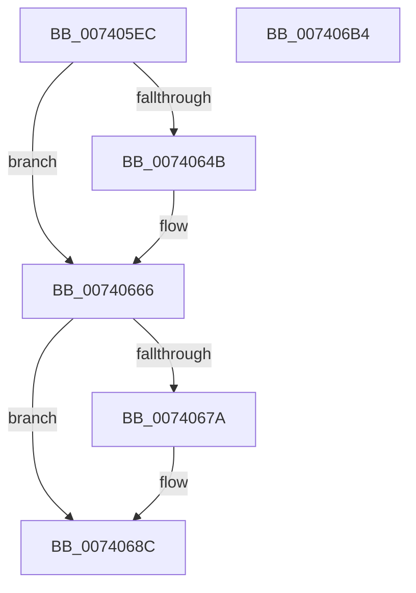

# IopWarmEjectDevice

- RVA: `0x007405EC`–`0x007406B5` (길이 `201` bytes)
- VA: `0x00000001407405EC`
- 실행 섹션: `PAGE`
- PDB 이름 있음: `예`; PDB Function 태그: `아니요`
- unwind 정보 RVA: `0x0006E5F8`
- 디코드: `49`개 명령, `201/201` bytes 표시
- 미해석 바이트: `0` (있으면 어셈블리에 `.byte`로 보존)

> 이 문서는 커널 이미지의 기계어와 PDB 기호를 분석해 생성했습니다. 4번과 5번은 함수 원형과 자료형을 바이너리 사용 방식에서 추정한 C 해석이며 원본 소스 복구 결과는 아닙니다.

## 1. Dependencies

- 직접 호출 지점: **8**; 고유 호출 대상: **6**
- 직접 호출자로 확인된 함수: **1**
- RIP 상대 이미지 참조: **4**

### Outgoing calls
- `0x00740610` → [KeWaitForSingleObject](../../text/20/KeWaitForSingleObject_function_0020E6B0.md) (function, `0x0020E6B0`)
- `0x0074061A` → [PpDevNodeLockTree](../A1/PpDevNodeLockTree_function_00A19310.md) (function, `0x00A19310`)
- `0x0074062B` → [PpDevNodeUnlockTree](../A2/PpDevNodeUnlockTree_function_00A21290.md) (function, `0x00A21290`)
- `0x0074063D` → [NtInitiatePowerAction](../75/NtInitiatePowerAction_function_0075FCB0.md) (function, `0x0075FCB0`)
- `0x00740661` → [PnpSetPowerVetoEvent](../73/PnpSetPowerVetoEvent_function_007383E4.md) (function, `0x007383E4`)
- `0x0074066B` → [PpDevNodeLockTree](../A1/PpDevNodeLockTree_function_00A19310.md) (function, `0x00A19310`)
- `0x00740691` → [PpDevNodeUnlockTree](../A2/PpDevNodeUnlockTree_function_00A21290.md) (function, `0x00A21290`)
- `0x007406A2` → [KeSetEvent](../../text/33/KeSetEvent_function_0033F310.md) (function, `0x0033F310`)

### Direct callers
- [PnpProcessCompletedEject](../72/PnpProcessCompletedEject_function_0072D090.md) at `0x0072D0B4`

### Static image references
- `0x00740603` → RVA `0x00F8C420` (`.data`; read)
- `0x00740624` → RVA `0x00F8C418` (`.data`; write)
- `0x00740670` → RVA `0x00F8C418` (`.data`; read)
- `0x00740684` → RVA `0x00F8C418` (`.data`; read/write)

## 2. Other-region calls and transfers

- 다른 실행 섹션으로 향하는 call: **2**
  - `0x00740610` → [KeWaitForSingleObject](../../text/20/KeWaitForSingleObject_function_0020E6B0.md) (`PAGE` → `.text`)
  - `0x007406A2` → [KeSetEvent](../../text/33/KeSetEvent_function_0033F310.md) (`PAGE` → `.text`)
- 별도 외부 분기/꼬리 이동을 확인하지 못했습니다.

## 3. Assembly (complete function range)

```asm
007405EC  48 89 5C 24 08                  mov qword ptr [rsp + 8], rbx
007405F1  57                              push rdi
007405F2  48 83 EC 30                     sub rsp, 0x30
007405F6  48 83 64 24 20 00               and qword ptr [rsp + 0x20], 0
007405FC  8B DA                           mov ebx, edx
007405FE  48 8B F9                        mov rdi, rcx
00740601  33 D2                           xor edx, edx
00740603  48 8D 0D 16 BE 84 00            lea rcx, [rip + 0x84be16]
0074060A  45 33 C9                        xor r9d, r9d
0074060D  45 33 C0                        xor r8d, r8d
00740610  E8 9B E0 AC FF                  call 0x14020e6b0
00740615  B9 01 00 00 00                  mov ecx, 1
0074061A  E8 F1 8C 2D 00                  call 0x140a19310
0074061F  B9 01 00 00 00                  mov ecx, 1
00740624  48 89 3D ED BD 84 00            mov qword ptr [rip + 0x84bded], rdi
0074062B  E8 60 0C 2E 00                  call 0x140a21290
00740630  45 33 C9                        xor r9d, r9d
00740633  8B D3                           mov edx, ebx
00740635  45 8D 41 03                     lea r8d, [r9 + 3]
00740639  41 8D 49 07                     lea ecx, [r9 + 7]
0074063D  E8 6E F6 01 00                  call 0x14075fcb0
00740642  8B D8                           mov ebx, eax
00740644  3D 61 00 00 C0                  cmp eax, 0xc0000061
00740649  75 1B                           jne 0x140740666
0074064B  48 83 64 24 28 00               and qword ptr [rsp + 0x28], 0
00740651  4C 8B CF                        mov r9, rdi
00740654  B9 07 00 00 00                  mov ecx, 7
00740659  C7 44 24 20 0C 00 00 00         mov dword ptr [rsp + 0x20], 0xc
00740661  E8 7E 7D FF FF                  call 0x1407383e4
00740666  B9 01 00 00 00                  mov ecx, 1
0074066B  E8 A0 8C 2D 00                  call 0x140a19310
00740670  48 83 3D A0 BD 84 00 00         cmp qword ptr [rip + 0x84bda0], 0
00740678  74 12                           je 0x14074068c
0074067A  85 DB                           test ebx, ebx
0074067C  B8 01 00 00 C0                  mov eax, 0xc0000001
00740681  0F 49 D8                        cmovns ebx, eax
00740684  48 83 25 8C BD 84 00 00         and qword ptr [rip + 0x84bd8c], 0
0074068C  B9 01 00 00 00                  mov ecx, 1
00740691  E8 FA 0B 2E 00                  call 0x140a21290
00740696  45 33 C0                        xor r8d, r8d
00740699  48 8D 0D 80 BD 84 00            lea rcx, [rip + 0x84bd80]
007406A0  33 D2                           xor edx, edx
007406A2  E8 69 EC BF FF                  call 0x14033f310
007406A7  8B C3                           mov eax, ebx
007406A9  48 8B 5C 24 40                  mov rbx, qword ptr [rsp + 0x40]
007406AE  48 83 C4 30                     add rsp, 0x30
007406B2  5F                              pop rdi
007406B3  C3                              ret
007406B4  CC                              int3
```

## 4. C-style interpretation (structured pseudocode)

```c
__int64 __fastcall IopWarmEjectDevice(__int64 a1, int a2, int a3, int a4)
{
    __int64 result;
    __int64 v_rbx;
    __int64 v_rsp;
    unsigned __int64 v_stack_m10;
    unsigned __int64 v_stack_m18;
    unsigned __int64 v_stack_p8;

    v_stack_p8 = v_rbx;
    v_rsp = (v_rsp) - (48);
    a2 = 0;
    a4 = 0;
    a3 = 0;
    result = KeWaitForSingleObject(v_rip + 8699414, a2, a3, a4);
    result = PpDevNodeLockTree(1, a2, a3, a4);
    *(unsigned __int64 *)(v_rip + 8699373) = a1;
    result = PpDevNodeUnlockTree(1, a2, a3, a4);
    a4 = 0;
    result = NtInitiatePowerAction(a4 + 7, (unsigned int)((unsigned int)((unsigned int)(a2))), a4 + 3, a4);
    if (((unsigned int)(result)) == 0xC0000061ULL) {
        a4 = a1;
        a1 = 7;
        v_stack_m18 = 12;
        result = PnpSetPowerVetoEvent(a1, (unsigned int)((unsigned int)((unsigned int)(a2))), a4 + 3, a4);
    }
    result = PpDevNodeLockTree(1, (unsigned int)((unsigned int)((unsigned int)(a2))), a4 + 3, a4);
    v_rbx = (unsigned int)((unsigned int)(result));
    if ((*(unsigned __int64 *)(v_rip + 8699296)) != 0) {
        result = 0xC0000001ULL;
        v_rbx = (unsigned int)((unsigned int)(result));
        if (!sign_flag) { v_rbx = (unsigned int)(result); }
    }
    result = PpDevNodeUnlockTree(1, (unsigned int)((unsigned int)((unsigned int)(a2))), a4 + 3, a4);
    a3 = 0;
    a2 = 0;
    result = KeSetEvent(v_rip + 8699264, a2, a3, a4);
    v_rsp = (v_rsp) + (48);
    return (unsigned int)((unsigned int)(v_rbx));
}
```

## 5. (Beta) C Style

```c
int64_t IopWarmEjectDevice(int64_t Arg1, int32_t Arg2, int32_t Arg3, int32_t Arg4)
{
    int64_t result;
    int64_t local_rbx;
    int64_t local_rsp;
    uint64_t v_stack_m10;
    uint64_t v_stack_m18;
    uint64_t v_stack_p8;

    v_stack_p8 = local_rbx;
    local_rsp = (local_rsp) - (48);
    Arg2 = 0;
    Arg4 = 0;
    Arg3 = 0;
    result = KeWaitForSingleObject(v_rip + 8699414, Arg2, Arg3, Arg4);
    result = PpDevNodeLockTree(1, Arg2, Arg3, Arg4);
    *(uint64_t *)(v_rip + 0x84BDED) = Arg1;
    result = PpDevNodeUnlockTree(1, Arg2, Arg3, Arg4);
    Arg4 = 0;
    result = NtInitiatePowerAction(Arg4 + 7, (uint32_t)((uint32_t)((uint32_t)(Arg2))), Arg4 + 3, Arg4);
    if (((uint32_t)(result)) == 0xC0000061ULL) {
        Arg4 = Arg1;
        Arg1 = 7;
        v_stack_m18 = 12;
        result = PnpSetPowerVetoEvent(Arg1, (uint32_t)((uint32_t)((uint32_t)(Arg2))), Arg4 + 3, Arg4);
    }
    result = PpDevNodeLockTree(1, (uint32_t)((uint32_t)((uint32_t)(Arg2))), Arg4 + 3, Arg4);
    local_rbx = (uint32_t)((uint32_t)(result));
    if ((*(uint64_t *)(v_rip + 0x84BDA0)) != 0) {
        result = 0xC0000001ULL;
        local_rbx = (uint32_t)((uint32_t)(result));
        if (!sign_flag) { local_rbx = (uint32_t)(result); }
    }
    result = PpDevNodeUnlockTree(1, (uint32_t)((uint32_t)((uint32_t)(Arg2))), Arg4 + 3, Arg4);
    Arg3 = 0;
    Arg2 = 0;
    result = KeSetEvent(v_rip + 8699264, Arg2, Arg3, Arg4);
    local_rsp = (local_rsp) + (48);
    return (uint32_t)((uint32_t)(local_rbx));
}
```

## 6. Execution-region graph

[열기: 2D/3D 그래프와 함수 탐색 컨트롤 패널](../../../control-panel.html?section=page&rva=0x007405EC&view=graph)

- 2D 그래프는 위에서 아래로 흐르고, 3D 그래프는 빈 공간을 드래그해 회전합니다. Shift+드래그는 이동, 휠은 확대·축소, 함수 노드 선택은 대상 보고서 이동입니다.

### Static fallback


