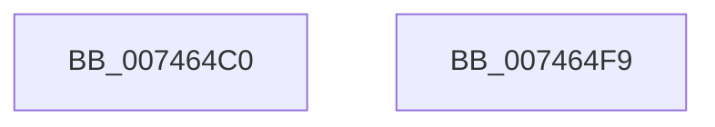

# KeAllocateCalloutStack

- RVA: `0x007464C0`–`0x007464FA` (길이 `58` bytes)
- VA: `0x00000001407464C0`
- 실행 섹션: `PAGE`
- PDB 이름 있음: `예`; PDB Function 태그: `아니요`
- unwind 정보 RVA: `0x0005CF00`
- 디코드: `20`개 명령, `58/58` bytes 표시
- 미해석 바이트: `0` (있으면 어셈블리에 `.byte`로 보존)

> 이 문서는 커널 이미지의 기계어와 PDB 기호를 분석해 생성했습니다. 4번과 5번은 함수 원형과 자료형을 바이너리 사용 방식에서 추정한 C 해석이며 원본 소스 복구 결과는 아닙니다.

## 1. Dependencies

- 직접 호출 지점: **1**; 고유 호출 대상: **1**
- 직접 호출자로 확인된 함수: **0**
- RIP 상대 이미지 참조: **0**

### Outgoing calls
- `0x007464E0` → [KeAllocateCalloutStackEx](../A7/KeAllocateCalloutStackEx_function_00A7F030.md) (function, `0x00A7F030`)

### Direct callers
- 이 함수 시작 RVA로 연결되는 직접 call은 확인되지 않았습니다. 간접 호출은 완전히 역산할 수 없습니다.

### Static image references
- 디코드된 RIP-relative 메모리 참조가 없습니다.

## 2. Other-region calls and transfers

- 다른 실행 섹션으로 향하는 call: **0**
- 별도 외부 분기/꼬리 이동을 확인하지 못했습니다.

## 3. Assembly (complete function range)

```asm
007464C0  40 53                           push rbx
007464C2  48 83 EC 20                     sub rsp, 0x20
007464C6  33 DB                           xor ebx, ebx
007464C8  4C 8D 4C 24 38                  lea r9, [rsp + 0x38]
007464CD  84 C9                           test cl, cl
007464CF  48 89 5C 24 38                  mov qword ptr [rsp + 0x38], rbx
007464D4  8B C3                           mov eax, ebx
007464D6  B2 01                           mov dl, 1
007464D8  0F 95 C0                        setne al
007464DB  45 33 C0                        xor r8d, r8d
007464DE  8B C8                           mov ecx, eax
007464E0  E8 4B 8B 33 00                  call 0x140a7f030
007464E5  48 8B 4C 24 38                  mov rcx, qword ptr [rsp + 0x38]
007464EA  85 C0                           test eax, eax
007464EC  48 0F 48 CB                     cmovs rcx, rbx
007464F0  48 8B C1                        mov rax, rcx
007464F3  48 83 C4 20                     add rsp, 0x20
007464F7  5B                              pop rbx
007464F8  C3                              ret
007464F9  CC                              int3
```

## 4. C-style interpretation (structured pseudocode)

```c
__int64 __fastcall KeAllocateCalloutStack(unsigned __int8 a1, __int64 a2, int a3)
{
    __int64 result;
    __int64 v_rbx;
    __int64 v_rsp;
    unsigned __int64 v_stack_p10;

    v_rsp = (v_rsp) - (32);
    v_rbx = 0;
    v_stack_p10 = 0;
    result = (a1 != 0) ? 1 : 0;
    a3 = 0;
    result = KeAllocateCalloutStackEx((unsigned int)((unsigned int)(result)), 1, a3, v_stack_p10);
    a1 = v_stack_p10;
    if (sign_flag) { a1 = 0; }
    v_rsp = (v_rsp) + (32);
    return a1;
}
```

## 5. (Beta) C Style

```c
int64_t KeAllocateCalloutStack(uint8_t Arg1, int64_t Arg2, int32_t Arg3)
{
    int64_t result;
    int64_t local_rbx;
    int64_t local_rsp;
    uint64_t v_stack_p10;

    local_rsp = (local_rsp) - (32);
    local_rbx = 0;
    v_stack_p10 = 0;
    result = (Arg1 != 0) ? 1 : 0;
    Arg3 = 0;
    result = KeAllocateCalloutStackEx((uint32_t)((uint32_t)(result)), 1, Arg3, v_stack_p10);
    Arg1 = v_stack_p10;
    if (sign_flag) { Arg1 = 0; }
    local_rsp = (local_rsp) + (32);
    return Arg1;
}
```

## 6. Execution-region graph

[열기: 2D/3D 그래프와 함수 탐색 컨트롤 패널](../../../control-panel.html?section=page&rva=0x007464C0&view=graph)

- 2D 그래프는 위에서 아래로 흐르고, 3D 그래프는 빈 공간을 드래그해 회전합니다. Shift+드래그는 이동, 휠은 확대·축소, 함수 노드 선택은 대상 보고서 이동입니다.

### Static fallback


