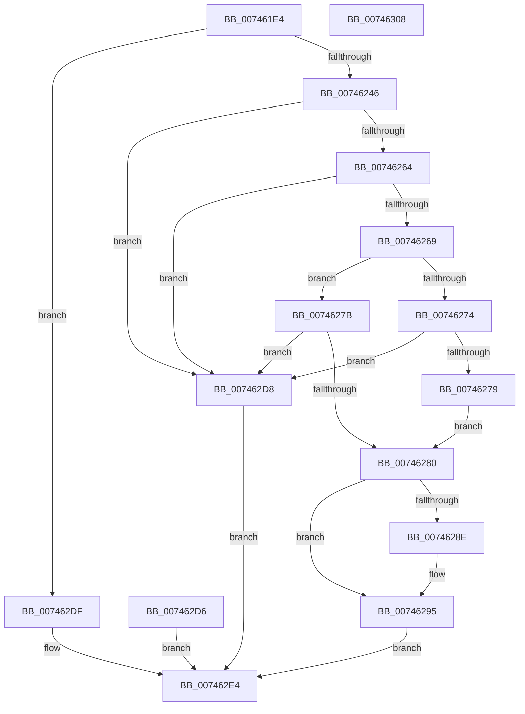

# KeCreateEnclave

- RVA: `0x007461E4`–`0x00746309` (길이 `293` bytes)
- VA: `0x00000001407461E4`
- 실행 섹션: `PAGE`
- PDB 이름 있음: `예`; PDB Function 태그: `아니요`
- unwind 정보 RVA: `0x000CA34C`
- 디코드: `72`개 명령, `293/293` bytes 표시
- 미해석 바이트: `0` (있으면 어셈블리에 `.byte`로 보존)

> 이 문서는 커널 이미지의 기계어와 PDB 기호를 분석해 생성했습니다. 4번과 5번은 함수 원형과 자료형을 바이너리 사용 방식에서 추정한 C 해석이며 원본 소스 복구 결과는 아닙니다.

## 1. Dependencies

- 직접 호출 지점: **3**; 고유 호출 대상: **3**
- 직접 호출자로 확인된 함수: **1**
- RIP 상대 이미지 참조: **2**

### Outgoing calls
- `0x0074629F` → [memset](../../text/6C/memset_function_006C6C40.md) (function, `0x006C6C40`)
- `0x007462CC` → [KiEncls](../../text/6B/KiEncls_function_006B1BE0.md) (function, `0x006B1BE0`)
- `0x007462EE` → [_security_check_cookie](../../text/6A/_security_check_cookie_function_006AC640.md) (function, `0x006AC640`)

### Direct callers
- [MiCreateHardwareEnclave](../80/MiCreateHardwareEnclave_function_00808500.md) at `0x00808864`

### Static image references
- `0x007461FF` → RVA `0x00E0A740` (`.data`; read)
- `0x00746233` → RVA `0x00FC6B30` (`ALMOSTRO`; read)

## 2. Other-region calls and transfers

- 다른 실행 섹션으로 향하는 call: **3**
  - `0x0074629F` → [memset](../../text/6C/memset_function_006C6C40.md) (`PAGE` → `.text`)
  - `0x007462CC` → [KiEncls](../../text/6B/KiEncls_function_006B1BE0.md) (`PAGE` → `.text`)
  - `0x007462EE` → [_security_check_cookie](../../text/6A/_security_check_cookie_function_006AC640.md) (`PAGE` → `.text`)
- 별도 외부 분기/꼬리 이동을 확인하지 못했습니다.

## 3. Assembly (complete function range)

```asm
007461E4  48 89 5C 24 10                  mov qword ptr [rsp + 0x10], rbx
007461E9  48 89 7C 24 18                  mov qword ptr [rsp + 0x18], rdi
007461EE  55                              push rbp
007461EF  48 81 EC F0 00 00 00            sub rsp, 0xf0
007461F6  48 8D 6C 24 60                  lea rbp, [rsp + 0x60]
007461FB  48 83 E5 C0                     and rbp, 0xffffffffffffffc0
007461FF  48 8B 05 3A 45 6C 00            mov rax, qword ptr [rip + 0x6c453a]
00746206  48 33 C4                        xor rax, rsp
00746209  48 89 85 80 00 00 00            mov qword ptr [rbp + 0x80], rax
00746210  49 8B D9                        mov rbx, r9
00746213  4C 8B D2                        mov r10, rdx
00746216  48 8B F9                        mov rdi, rcx
00746219  4C 8B 8C 24 30 01 00 00         mov r9, qword ptr [rsp + 0x130]
00746221  48 8B 8C 24 38 01 00 00         mov rcx, qword ptr [rsp + 0x138]
00746229  48 BA 00 00 00 00 00 01 00 00   movabs rdx, 0x10000000000
00746233  48 85 15 F6 08 88 00            test qword ptr [rip + 0x8808f6], rdx
0074623A  C7 01 00 00 00 00               mov dword ptr [rcx], 0
00746240  0F 84 99 00 00 00               je 0x1407462df
00746246  48 0F BA 25 E1 08 88 00 2B      bt qword ptr [rip + 0x8808e1], 0x2b
0074624F  0F 93 C1                        setae cl
00746252  8B 94 24 28 01 00 00            mov edx, dword ptr [rsp + 0x128]
00746259  0F BA E2 08                     bt edx, 8
0074625D  0F 92 C0                        setb al
00746260  84 C8                           test al, cl
00746262  75 74                           jne 0x1407462d8
00746264  4C 39 03                        cmp qword ptr [rbx], r8
00746267  75 6F                           jne 0x1407462d8
00746269  8B 43 30                        mov eax, dword ptr [rbx + 0x30]
0074626C  83 E0 04                        and eax, 4
0074626F  F6 C2 01                        test dl, 1
00746272  74 07                           je 0x14074627b
00746274  48 85 C0                        test rax, rax
00746277  74 5F                           je 0x1407462d8
00746279  EB 05                           jmp 0x140746280
0074627B  48 85 C0                        test rax, rax
0074627E  75 58                           jne 0x1407462d8
00746280  4C 89 53 08                     mov qword ptr [rbx + 8], r10
00746284  41 83 21 00                     and dword ptr [r9], 0
00746288  F6 43 30 02                     test byte ptr [rbx + 0x30], 2
0074628C  74 07                           je 0x140746295
0074628E  41 C7 01 02 00 00 00            mov dword ptr [r9], 2
00746295  33 D2                           xor edx, edx
00746297  44 8D 42 40                     lea r8d, [rdx + 0x40]
0074629B  48 8D 4D 40                     lea rcx, [rbp + 0x40]
0074629F  E8 9C 09 F8 FF                  call 0x1406c6c40
007462A4  48 8D 45 40                     lea rax, [rbp + 0x40]
007462A8  48 89 45 30                     mov qword ptr [rbp + 0x30], rax
007462AC  48 C7 45 20 00 00 00 00         mov qword ptr [rbp + 0x20], 0
007462B4  48 89 5D 28                     mov qword ptr [rbp + 0x28], rbx
007462B8  48 C7 45 38 00 00 00 00         mov qword ptr [rbp + 0x38], 0
007462C0  45 33 C9                        xor r9d, r9d
007462C3  4C 8B C7                        mov r8, rdi
007462C6  48 8D 55 20                     lea rdx, [rbp + 0x20]
007462CA  33 C9                           xor ecx, ecx
007462CC  E8 0F B9 F6 FF                  call 0x1406b1be0
007462D1  90                              nop
007462D2  33 C0                           xor eax, eax
007462D4  EB 0E                           jmp 0x1407462e4
007462D6  EB 0C                           jmp 0x1407462e4
007462D8  B8 0D 00 00 C0                  mov eax, 0xc000000d
007462DD  EB 05                           jmp 0x1407462e4
007462DF  B8 BB 00 00 C0                  mov eax, 0xc00000bb
007462E4  48 8B 8D 80 00 00 00            mov rcx, qword ptr [rbp + 0x80]
007462EB  48 33 CC                        xor rcx, rsp
007462EE  E8 4D 63 F6 FF                  call 0x1406ac640
007462F3  4C 8D 9C 24 F0 00 00 00         lea r11, [rsp + 0xf0]
007462FB  49 8B 5B 18                     mov rbx, qword ptr [r11 + 0x18]
007462FF  49 8B 7B 20                     mov rdi, qword ptr [r11 + 0x20]
00746303  49 8B E3                        mov rsp, r11
00746306  5D                              pop rbp
00746307  C3                              ret
00746308  CC                              int3
```

## 4. C-style interpretation (structured pseudocode)

```c
__int64 __fastcall KeCreateEnclave(__int64 a1, __int64 a2, __int64 a3, __int64 a4, __int64 a5, unsigned int a6, __int64 a7, __int64 a8)
{
    __int64 result;
    __int64 v_rbp;
    __int64 v_rsp;
    unsigned __int64 v_stack_m18;
    unsigned __int64 v_stack_m58;
    unsigned __int64 v_stack_m60;
    unsigned __int64 v_stack_m68;
    unsigned __int64 v_stack_m70;
    unsigned __int64 v_stack_m78;
    unsigned __int64 v_stack_m8;
    unsigned __int64 v_stack_m98;
    unsigned __int64 v_stack_p10;
    unsigned __int64 v_stack_p18;

    v_stack_p10 = v_rbx;
    v_stack_p18 = v_rdi;
    v_rsp = (v_rsp) - (240);
    v_rbp = (v_stack_m98) & (-64);
    result = (*(unsigned __int64 *)(v_rip + 7095610)) ^ (v_rsp);
    v_stack_m18 = result;
    *(unsigned int *)(a8) = 0;
    if (((*(unsigned __int64 *)(v_rip + 8915190)) & (a2)) == 0) goto loc_007462DF;
    a1 = (condition_is_above_or_equal) ? 1 : 0;
    result = (condition_is_below) ? 1 : 0;
    if ((((unsigned __int8)(result)) & ((unsigned __int8)(a1))) != 0) goto loc_007462D8;
    if ((*(unsigned __int64 *)(a4)) != a3) goto loc_007462D8;
    result = (unsigned int)(((unsigned int)(*(unsigned int *)(a4 + 48))) & (4));
    if ((((unsigned __int8)((unsigned int)(a6))) & (1)) == 0) goto loc_0074627B;
    if (result == 0) goto loc_007462D8;
    goto loc_00746280;
loc_0074627B:
    if (result != 0) goto loc_007462D8;
loc_00746280:
    *(unsigned __int64 *)(a4 + 8) = a2;
    if (((*(unsigned __int8 *)(a4 + 48)) & (2)) != 0) {
        *(unsigned int *)(a7) = 2;
    }
    a2 = 0;
    result = memset(v_stack_m58, a2, a2 + 64, a7);
    v_stack_m68 = v_stack_m58;
    v_stack_m78 = 0;
    v_stack_m70 = a4;
    v_stack_m60 = 0;
    a4 = 0;
    a1 = 0;
    result = KiEncls(a1, v_stack_m78, a1, a4);
    result = 0;
    goto loc_007462E4;
loc_007462D8:
    goto loc_007462E4;
loc_007462DF:
loc_007462E4:
    a1 = (v_stack_m18) ^ (v_rsp);
    result = _security_check_cookie(a1, v_stack_m78, a1, a4);
    return result;
}
```

## 5. (Beta) C Style

```c
int64_t KeCreateEnclave(int64_t Arg1, int64_t Arg2, int64_t Arg3, void *Arg4, uint64_t Arg5, uint32_t Arg6, void *Arg7, void *Arg8)
{
    uint8_t *arg4 = (uint8_t *)Arg4;
    uint8_t *arg7 = (uint8_t *)Arg7;
    uint8_t *arg8 = (uint8_t *)Arg8;

    int64_t result;
    int64_t local_rbp;
    int64_t local_rsp;
    uint64_t v_stack_m18;
    uint64_t v_stack_m58;
    uint64_t v_stack_m60;
    uint64_t v_stack_m68;
    uint64_t v_stack_m70;
    uint64_t v_stack_m78;
    uint64_t v_stack_m8;
    uint64_t v_stack_m98;
    uint64_t v_stack_p10;
    uint64_t v_stack_p18;

    v_stack_p10 = local_rbx;
    v_stack_p18 = local_rdi;
    local_rsp = (local_rsp) - (240);
    local_rbp = (v_stack_m98) & (-64);
    result = (*(uint64_t *)(v_rip + 0x6C453A)) ^ (local_rsp);
    v_stack_m18 = result;
    *(uint32_t *)(arg8) = 0;
    if (((*(uint64_t *)(v_rip + 0x8808F6)) & (Arg2)) == 0) goto loc_007462DF;
    Arg1 = (condition_is_above_or_equal) ? 1 : 0;
    result = (condition_is_below) ? 1 : 0;
    if ((((uint8_t)(result)) & ((uint8_t)(Arg1))) != 0) goto loc_007462D8;
    if ((*(uint64_t *)(arg4)) != Arg3) goto loc_007462D8;
    result = (uint32_t)(((uint32_t)(*(uint32_t *)(arg4 + 0x30))) & (4));
    if ((((uint8_t)((uint32_t)(Arg6))) & (1)) == 0) goto loc_0074627B;
    if (result == 0) goto loc_007462D8;
    goto loc_00746280;
loc_0074627B:
    if (result != 0) goto loc_007462D8;
loc_00746280:
    *(uint64_t *)(arg4 + 0x8) = Arg2;
    if (((*(uint8_t *)(arg4 + 0x30)) & (2)) != 0) {
        *(uint32_t *)(arg7) = 2;
    }
    Arg2 = 0;
    result = memset(v_stack_m58, Arg2, Arg2 + 64, Arg7);
    v_stack_m68 = v_stack_m58;
    v_stack_m78 = 0;
    v_stack_m70 = Arg4;
    v_stack_m60 = 0;
    Arg4 = 0;
    Arg1 = 0;
    result = KiEncls(Arg1, v_stack_m78, Arg1, Arg4);
    result = 0;
    goto loc_007462E4;
loc_007462D8:
    goto loc_007462E4;
loc_007462DF:
loc_007462E4:
    Arg1 = (v_stack_m18) ^ (local_rsp);
    result = _security_check_cookie(Arg1, v_stack_m78, Arg1, Arg4);
    return result;
}
```

### 관측된 메모리 오프셋

구조체 형식이 확인되지 않은 접근은 인자 기준의 오프셋으로만 기록했습니다.

| 기준 인자 | 오프셋 표현 | 폭 (bit) | 접근 |
|---|---:|---:|---|
| `Arg4` | `+ 0x0` | `64` | `R` |
| `Arg4` | `+ 0x8` | `64` | `W` |
| `Arg4` | `+ 0x30` | `8` | `R` |
| `Arg4` | `+ 0x30` | `32` | `R` |
| `Arg7` | `+ 0x0` | `32` | `R/W` |
| `Arg7` | `+ 0x0` | `32` | `W` |
| `Arg8` | `+ 0x0` | `32` | `W` |

## 6. Execution-region graph

[열기: 2D/3D 그래프와 함수 탐색 컨트롤 패널](../../../control-panel.html?section=page&rva=0x007461E4&view=graph)

- 2D 그래프는 위에서 아래로 흐르고, 3D 그래프는 빈 공간을 드래그해 회전합니다. Shift+드래그는 이동, 휠은 확대·축소, 함수 노드 선택은 대상 보고서 이동입니다.

### Static fallback


