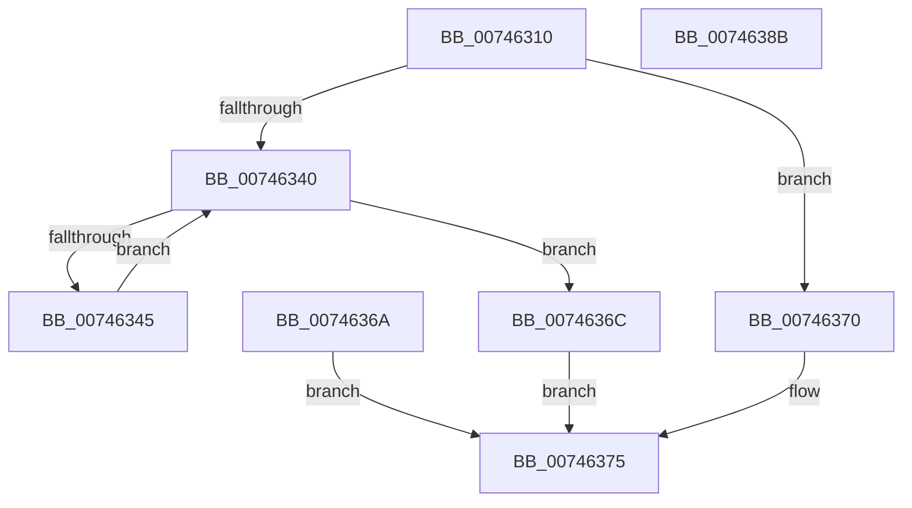

# KeDebugWriteEnclaveMemory

- RVA: `0x00746310`–`0x0074638C` (길이 `124` bytes)
- VA: `0x0000000140746310`
- 실행 섹션: `PAGE`
- PDB 이름 있음: `예`; PDB Function 태그: `아니요`
- unwind 정보 RVA: `0x000CA278`
- 디코드: `36`개 명령, `124/124` bytes 표시
- 미해석 바이트: `0` (있으면 어셈블리에 `.byte`로 보존)

> 이 문서는 커널 이미지의 기계어와 PDB 기호를 분석해 생성했습니다. 4번과 5번은 함수 원형과 자료형을 바이너리 사용 방식에서 추정한 C 해석이며 원본 소스 복구 결과는 아닙니다.

## 1. Dependencies

- 직접 호출 지점: **1**; 고유 호출 대상: **1**
- 직접 호출자로 확인된 함수: **2**
- RIP 상대 이미지 참조: **1**

### Outgoing calls
- `0x00746352` → [KiEncls](../../text/6B/KiEncls_function_006B1BE0.md) (function, `0x006B1BE0`)

### Direct callers
- [MiDbgReadWriteEnclave](../9B/MiDbgReadWriteEnclave_function_009BC580.md) at `0x009BC605`
- [MiDbgReadWriteEnclaveUnaligned](../9B/MiDbgReadWriteEnclaveUnaligned_function_009BC7CC.md) at `0x009BC84B`

### Static image references
- `0x00746335` → RVA `0x00FC6B30` (`ALMOSTRO`; read)

## 2. Other-region calls and transfers

- 다른 실행 섹션으로 향하는 call: **1**
  - `0x00746352` → [KiEncls](../../text/6B/KiEncls_function_006B1BE0.md) (`PAGE` → `.text`)
- 별도 외부 분기/꼬리 이동을 확인하지 못했습니다.

## 3. Assembly (complete function range)

```asm
00746310  48 89 5C 24 08                  mov qword ptr [rsp + 8], rbx
00746315  48 89 74 24 10                  mov qword ptr [rsp + 0x10], rsi
0074631A  48 89 7C 24 18                  mov qword ptr [rsp + 0x18], rdi
0074631F  41 56                           push r14
00746321  48 83 EC 20                     sub rsp, 0x20
00746325  4D 8B F1                        mov r14, r9
00746328  49 8B D8                        mov rbx, r8
0074632B  48 8B FA                        mov rdi, rdx
0074632E  48 8B F1                        mov rsi, rcx
00746331  49 83 21 00                     and qword ptr [r9], 0
00746335  48 0F BA 25 F2 07 88 00 28      bt qword ptr [rip + 0x8807f2], 0x28
0074633E  73 30                           jae 0x140746370
00746340  48 85 DB                        test rbx, rbx
00746343  74 27                           je 0x14074636c
00746345  48 8B 17                        mov rdx, qword ptr [rdi]
00746348  45 33 C9                        xor r9d, r9d
0074634B  4C 8B C6                        mov r8, rsi
0074634E  41 8D 49 05                     lea ecx, [r9 + 5]
00746352  E8 89 B8 F6 FF                  call 0x1406b1be0
00746357  90                              nop
00746358  48 83 C6 08                     add rsi, 8
0074635C  48 83 C7 08                     add rdi, 8
00746360  48 83 EB 08                     sub rbx, 8
00746364  49 83 06 08                     add qword ptr [r14], 8
00746368  EB D6                           jmp 0x140746340
0074636A  EB 09                           jmp 0x140746375
0074636C  33 C0                           xor eax, eax
0074636E  EB 05                           jmp 0x140746375
00746370  B8 BB 00 00 C0                  mov eax, 0xc00000bb
00746375  48 8B 5C 24 30                  mov rbx, qword ptr [rsp + 0x30]
0074637A  48 8B 74 24 38                  mov rsi, qword ptr [rsp + 0x38]
0074637F  48 8B 7C 24 40                  mov rdi, qword ptr [rsp + 0x40]
00746384  48 83 C4 20                     add rsp, 0x20
00746388  41 5E                           pop r14
0074638A  C3                              ret
0074638B  CC                              int3
```

## 4. C-style interpretation (structured pseudocode)

```c
__int64 __fastcall KeDebugWriteEnclaveMemory(__int64 a1, __int64 a2, __int64 a3, __int64 a4)
{
    __int64 result;
    __int64 v_rbx;
    __int64 v_rdi;
    __int64 v_rsi;
    __int64 v_rsp;
    unsigned __int64 v_stack_p10;
    unsigned __int64 v_stack_p18;
    unsigned __int64 v_stack_p8;

    v_stack_p8 = v_rbx;
    v_stack_p10 = v_rsi;
    v_stack_p18 = v_rdi;
    v_rsp = (v_rsp) - (32);
    if (condition_is_above_or_equal) goto loc_00746370;
loc_00746340:
    if (a3 == 0) goto loc_0074636C;
    a4 = 0;
    result = KiEncls(a4 + 5, *(unsigned __int64 *)(a2), a1, a4);
    v_rsi = (a1) + (8);
    v_rdi = (a2) + (8);
    v_rbx = (a3) - (8);
    goto loc_00746340;
loc_0074636C:
    result = 0;
    goto loc_00746375;
loc_00746370:
loc_00746375:
    v_rsp = (v_rsp) + (32);
    return (unsigned int)(0xC00000BBULL);
}
```

## 5. (Beta) C Style

```c
int64_t KeDebugWriteEnclaveMemory(int64_t Arg1, void *Arg2, int64_t Arg3, void *Arg4)
{
    uint8_t *arg2 = (uint8_t *)Arg2;
    uint8_t *arg4 = (uint8_t *)Arg4;

    int64_t result;
    int64_t local_rbx;
    int64_t local_rdi;
    int64_t local_rsi;
    int64_t local_rsp;
    uint64_t v_stack_p10;
    uint64_t v_stack_p18;
    uint64_t v_stack_p8;

    v_stack_p8 = local_rbx;
    v_stack_p10 = local_rsi;
    v_stack_p18 = local_rdi;
    local_rsp = (local_rsp) - (32);
    if (condition_is_above_or_equal) goto loc_00746370;
loc_00746340:
    if (Arg3 == 0) goto loc_0074636C;
    Arg4 = 0;
    result = KiEncls(Arg4 + 5, *(uint64_t *)(arg2), Arg1, Arg4);
    local_rsi = (Arg1) + (8);
    local_rdi = (Arg2) + (8);
    local_rbx = (Arg3) - (8);
    goto loc_00746340;
loc_0074636C:
    result = 0;
    goto loc_00746375;
loc_00746370:
loc_00746375:
    local_rsp = (local_rsp) + (32);
    return (uint32_t)(0xC00000BBULL);
}
```

### 관측된 메모리 오프셋

구조체 형식이 확인되지 않은 접근은 인자 기준의 오프셋으로만 기록했습니다.

| 기준 인자 | 오프셋 표현 | 폭 (bit) | 접근 |
|---|---:|---:|---|
| `Arg2` | `+ 0x0` | `64` | `R` |
| `Arg4` | `+ 0x0` | `64` | `R/W` |

## 6. Execution-region graph

[열기: 2D/3D 그래프와 함수 탐색 컨트롤 패널](../../../control-panel.html?section=page&rva=0x00746310&view=graph)

- 2D 그래프는 위에서 아래로 흐르고, 3D 그래프는 빈 공간을 드래그해 회전합니다. Shift+드래그는 이동, 휠은 확대·축소, 함수 노드 선택은 대상 보고서 이동입니다.

### Static fallback


