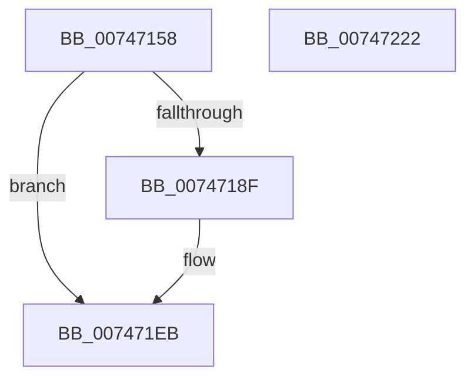

# KeDeleteCpuPartition

- RVA: `0x00747158`–`0x00747223` (길이 `203` bytes)
- VA: `0x0000000140747158`
- 실행 섹션: `PAGE`
- PDB 이름 있음: `예`; PDB Function 태그: `아니요`
- unwind 정보 RVA: `0x000CA6F0`
- 디코드: `50`개 명령, `203/203` bytes 표시
- 미해석 바이트: `0` (있으면 어셈블리에 `.byte`로 보존)

> 이 문서는 커널 이미지의 기계어와 PDB 기호를 분석해 생성했습니다. 4번과 5번은 함수 원형과 자료형을 바이너리 사용 방식에서 추정한 C 해석이며 원본 소스 복구 결과는 아닙니다.

## 1. Dependencies

- 직접 호출 지점: **8**; 고유 호출 대상: **7**
- 직접 호출자로 확인된 함수: **1**
- RIP 상대 이미지 참조: **1**

### Outgoing calls
- `0x00747186` → [KeIsEmptyAffinityEx](../../text/2D/KeIsEmptyAffinityEx_function_002D1580.md) (function, `0x002D1580`)
- `0x0074719C` → [memset](../../text/6C/memset_function_006C6C40.md) (function, `0x006C6C40`)
- `0x007471C1` → [memset](../../text/6C/memset_function_006C6C40.md) (function, `0x006C6C40`)
- `0x007471D3` → [KiCopyAffinityEx](../../text/2C/KiCopyAffinityEx_function_002CE860.md) (function, `0x002CE860`)
- `0x007471E6` → [KeCpuPartitionMoveCpus](../../text/5C/KeCpuPartitionMoveCpus_function_005C0B70.md) (function, `0x005C0B70`)
- `0x007471EF` → [KiRundownAvailableCpusWorkItem](../../text/43/KiRundownAvailableCpusWorkItem_function_0043FA78.md) (function, `0x0043FA78`)
- `0x007471F9` → [ExFreePoolWithTag](../../poolcode/B8/ExFreePoolWithTag_function_00B82870.md) (function, `0x00B82870`)
- `0x00747209` → [_security_check_cookie](../../text/6A/_security_check_cookie_function_006AC640.md) (function, `0x006AC640`)

### Direct callers
- [PspDeleteCpuPartition](../78/PspDeleteCpuPartition_function_00784310.md) at `0x00784331`

### Static image references
- `0x00747168` → RVA `0x00E0A740` (`.data`; read)

## 2. Other-region calls and transfers

- 다른 실행 섹션으로 향하는 call: **8**
  - `0x00747186` → [KeIsEmptyAffinityEx](../../text/2D/KeIsEmptyAffinityEx_function_002D1580.md) (`PAGE` → `.text`)
  - `0x0074719C` → [memset](../../text/6C/memset_function_006C6C40.md) (`PAGE` → `.text`)
  - `0x007471C1` → [memset](../../text/6C/memset_function_006C6C40.md) (`PAGE` → `.text`)
  - `0x007471D3` → [KiCopyAffinityEx](../../text/2C/KiCopyAffinityEx_function_002CE860.md) (`PAGE` → `.text`)
  - `0x007471E6` → [KeCpuPartitionMoveCpus](../../text/5C/KeCpuPartitionMoveCpus_function_005C0B70.md) (`PAGE` → `.text`)
  - `0x007471EF` → [KiRundownAvailableCpusWorkItem](../../text/43/KiRundownAvailableCpusWorkItem_function_0043FA78.md) (`PAGE` → `.text`)
  - `0x007471F9` → [ExFreePoolWithTag](../../poolcode/B8/ExFreePoolWithTag_function_00B82870.md) (`PAGE` → `POOLCODE`)
  - `0x00747209` → [_security_check_cookie](../../text/6A/_security_check_cookie_function_006AC640.md) (`PAGE` → `.text`)
- 별도 외부 분기/꼬리 이동을 확인하지 못했습니다.

## 3. Assembly (complete function range)

```asm
00747158  48 89 5C 24 18                  mov qword ptr [rsp + 0x18], rbx
0074715D  56                              push rsi
0074715E  57                              push rdi
0074715F  41 56                           push r14
00747161  48 81 EC 40 01 00 00            sub rsp, 0x140
00747168  48 8B 05 D1 35 6C 00            mov rax, qword ptr [rip + 0x6c35d1]
0074716F  48 33 C4                        xor rax, rsp
00747172  48 89 84 24 30 01 00 00         mov qword ptr [rsp + 0x130], rax
0074717A  48 8B 39                        mov rdi, qword ptr [rcx]
0074717D  48 8B D9                        mov rbx, rcx
00747180  48 8B CF                        mov rcx, rdi
00747183  48 8B F2                        mov rsi, rdx
00747186  E8 F5 A3 B8 FF                  call 0x1402d1580
0074718B  85 C0                           test eax, eax
0074718D  75 5C                           jne 0x1407471eb
0074718F  33 D2                           xor edx, edx
00747191  48 8D 4C 24 28                  lea rcx, [rsp + 0x28]
00747196  41 B8 00 01 00 00               mov r8d, 0x100
0074719C  E8 9F FA F7 FF                  call 0x1406c6c40
007471A1  83 64 24 24 00                  and dword ptr [rsp + 0x24], 0
007471A6  48 8D 4C 24 28                  lea rcx, [rsp + 0x28]
007471AB  33 D2                           xor edx, edx
007471AD  C7 44 24 20 01 00 20 00         mov dword ptr [rsp + 0x20], 0x200001
007471B5  41 B8 00 01 00 00               mov r8d, 0x100
007471BB  41 BE 01 00 00 00               mov r14d, 1
007471C1  E8 7A FA F7 FF                  call 0x1406c6c40
007471C6  0F B7 54 24 22                  movzx edx, word ptr [rsp + 0x22]
007471CB  48 8D 4C 24 20                  lea rcx, [rsp + 0x20]
007471D0  4C 8B C7                        mov r8, rdi
007471D3  E8 88 76 B8 FF                  call 0x1402ce860
007471D8  45 8A CE                        mov r9b, r14b
007471DB  4C 8D 44 24 20                  lea r8, [rsp + 0x20]
007471E0  48 8B D3                        mov rdx, rbx
007471E3  48 8B CE                        mov rcx, rsi
007471E6  E8 85 99 E7 FF                  call 0x1405c0b70
007471EB  48 8D 4B 28                     lea rcx, [rbx + 0x28]
007471EF  E8 84 88 CF FF                  call 0x14043fa78
007471F4  33 D2                           xor edx, edx
007471F6  48 8B CB                        mov rcx, rbx
007471F9  E8 72 B6 43 00                  call 0x140b82870
007471FE  48 8B 8C 24 30 01 00 00         mov rcx, qword ptr [rsp + 0x130]
00747206  48 33 CC                        xor rcx, rsp
00747209  E8 32 54 F6 FF                  call 0x1406ac640
0074720E  48 8B 9C 24 70 01 00 00         mov rbx, qword ptr [rsp + 0x170]
00747216  48 81 C4 40 01 00 00            add rsp, 0x140
0074721D  41 5E                           pop r14
0074721F  5F                              pop rdi
00747220  5E                              pop rsi
00747221  C3                              ret
00747222  CC                              int3
```

## 4. C-style interpretation (structured pseudocode)

```c
__int64 __fastcall KeDeleteCpuPartition(__int64 a1, __int64 a2)
{
    __int64 result;
    __int64 v_r14;
    __int64 v_rsp;
    unsigned __int64 v_stack_m130;
    unsigned int v_stack_m134;
    unsigned __int16 v_stack_m136;
    unsigned int v_stack_m138;
    unsigned __int64 v_stack_m28;
    unsigned __int64 v_stack_p18;

    v_stack_p18 = v_rbx;
    v_rsp = (v_rsp) - (320);
    result = (*(unsigned __int64 *)(v_rip + 7091665)) ^ (v_rsp);
    v_stack_m28 = result;
    result = KeIsEmptyAffinityEx(*(unsigned __int64 *)(a1), a2, a3, a4);
    if ((unsigned int)(result) == 0) {
        a2 = 0;
        a1 = v_stack_m130;
        a3 = 256;
        result = memset(a1, a2, a3, a4);
        a1 = v_stack_m130;
        a2 = 0;
        v_stack_m138 = 0x200001ULL;
        a3 = 256;
        v_r14 = 1;
        result = memset(a1, a2, a3, a4);
        a2 = v_stack_m136;
        a1 = v_stack_m138;
        a3 = *(unsigned __int64 *)(a1);
        result = KiCopyAffinityEx(a1, a2, a3, a4);
        a4 = (unsigned __int8)(v_r14);
        a3 = v_stack_m138;
        a2 = a1;
        a1 = a2;
        result = KeCpuPartitionMoveCpus(a1, a2, a3, a4);
    }
    result = KiRundownAvailableCpusWorkItem(a1 + 40, a2, a3, a4);
    a2 = 0;
    result = ExFreePoolWithTag(a1, a2, a3, a4);
    a1 = (v_stack_m28) ^ (v_rsp);
    result = _security_check_cookie(a1, a2, a3, a4);
    v_rsp = (v_rsp) + (320);
    return result;
}
```

## 5. (Beta) C Style

```c
int64_t KeDeleteCpuPartition(void *Arg1, int64_t Arg2)
{
    uint8_t *arg1 = (uint8_t *)Arg1;

    int64_t result;
    int64_t local_r14;
    int64_t local_rsp;
    uint64_t v_stack_m130;
    uint32_t v_stack_m134;
    uint16_t v_stack_m136;
    uint32_t v_stack_m138;
    uint64_t v_stack_m28;
    uint64_t v_stack_p18;

    v_stack_p18 = local_rbx;
    local_rsp = (local_rsp) - (320);
    result = (*(uint64_t *)(v_rip + 0x6C35D1)) ^ (local_rsp);
    v_stack_m28 = result;
    result = KeIsEmptyAffinityEx(*(uint64_t *)(arg1), Arg2, a3, a4);
    if ((uint32_t)(result) == 0) {
        Arg2 = 0;
        Arg1 = v_stack_m130;
        a3 = 256;
        result = memset(Arg1, Arg2, a3, a4);
        Arg1 = v_stack_m130;
        Arg2 = 0;
        v_stack_m138 = 0x200001ULL;
        a3 = 256;
        local_r14 = 1;
        result = memset(Arg1, Arg2, a3, a4);
        Arg2 = v_stack_m136;
        Arg1 = v_stack_m138;
        a3 = *(uint64_t *)(arg1);
        result = KiCopyAffinityEx(Arg1, Arg2, a3, a4);
        a4 = (uint8_t)(local_r14);
        a3 = v_stack_m138;
        Arg2 = Arg1;
        Arg1 = Arg2;
        result = KeCpuPartitionMoveCpus(Arg1, Arg2, a3, a4);
    }
    result = KiRundownAvailableCpusWorkItem(Arg1 + 40, Arg2, a3, a4);
    Arg2 = 0;
    result = ExFreePoolWithTag(Arg1, Arg2, a3, a4);
    Arg1 = (v_stack_m28) ^ (local_rsp);
    result = _security_check_cookie(Arg1, Arg2, a3, a4);
    local_rsp = (local_rsp) + (320);
    return result;
}
```

### 관측된 메모리 오프셋

구조체 형식이 확인되지 않은 접근은 인자 기준의 오프셋으로만 기록했습니다.

| 기준 인자 | 오프셋 표현 | 폭 (bit) | 접근 |
|---|---:|---:|---|
| `Arg1` | `+ 0x0` | `64` | `R` |
| `Arg1` | `+ 0x28` | `64` | `R` |

## 6. Execution-region graph

[열기: 2D/3D 그래프와 함수 탐색 컨트롤 패널](../../../control-panel.html?section=page&rva=0x00747158&view=graph)

- 2D 그래프는 위에서 아래로 흐르고, 3D 그래프는 빈 공간을 드래그해 회전합니다. Shift+드래그는 이동, 휠은 확대·축소, 함수 노드 선택은 대상 보고서 이동입니다.

### Static fallback


