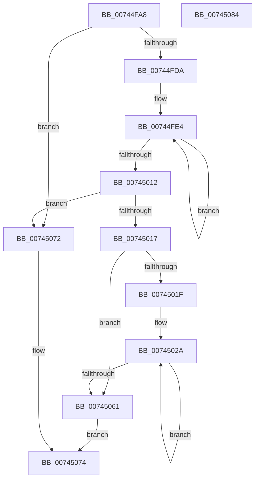

# KeDetectHeterogeneousSets

- RVA: `0x00744FA8`–`0x00745085` (길이 `221` bytes)
- VA: `0x0000000140744FA8`
- 실행 섹션: `PAGE`
- PDB 이름 있음: `예`; PDB Function 태그: `아니요`
- unwind 정보 RVA: `0x00069588`
- 디코드: `56`개 명령, `221/221` bytes 표시
- 미해석 바이트: `0` (있으면 어셈블리에 `.byte`로 보존)

> 이 문서는 커널 이미지의 기계어와 PDB 기호를 분석해 생성했습니다. 4번과 5번은 함수 원형과 자료형을 바이너리 사용 방식에서 추정한 C 해석이며 원본 소스 복구 결과는 아닙니다.

## 1. Dependencies

- 직접 호출 지점: **0**; 고유 호출 대상: **0**
- 직접 호출자로 확인된 함수: **2**
- RIP 상대 이미지 참조: **4**

### Outgoing calls
- 직접 디코드된 call 명령이 없습니다.

### Direct callers
- [KiAssignSubNodeSharedReadyQueues](../../text/5B/KiAssignSubNodeSharedReadyQueues_function_005B737C.md) at `0x005B73D2`
- [PopInitializeHeteroProcessors](../A5/PopInitializeHeteroProcessors_function_00A53570.md) at `0x00A5369E`

### Static image references
- `0x00744FB7` → RVA `0x00FC6A80` (`ALMOSTRO`; read)
- `0x00744FC0` → RVA `0x00FC8C40` (`ALMOSTRO`; read)
- `0x00744FDA` → RVA `0x00FC8C48` (`ALMOSTRO`; read)
- `0x00745061` → RVA `0x00FC6D60` (`ALMOSTRO`; write)

## 2. Other-region calls and transfers

- 다른 실행 섹션으로 향하는 call: **0**
- 별도 외부 분기/꼬리 이동을 확인하지 못했습니다.

## 3. Assembly (complete function range)

```asm
00744FA8  48 89 5C 24 08                  mov qword ptr [rsp + 8], rbx
00744FAD  48 89 74 24 10                  mov qword ptr [rsp + 0x10], rsi
00744FB2  48 89 7C 24 18                  mov qword ptr [rsp + 0x18], rdi
00744FB7  8B 1D C3 1A 88 00               mov ebx, dword ptr [rip + 0x881ac3]
00744FBD  4C 8B D9                        mov r11, rcx
00744FC0  48 8B 05 79 3C 88 00            mov rax, qword ptr [rip + 0x883c79]
00744FC7  44 8A 80 08 8A 00 00            mov r8b, byte ptr [rax + 0x8a08]
00744FCE  45 8A C8                        mov r9b, r8b
00744FD1  83 FB 01                        cmp ebx, 1
00744FD4  0F 86 98 00 00 00               jbe 0x140745072
00744FDA  4C 8D 15 67 3C 88 00            lea r10, [rip + 0x883c67]
00744FE1  8D 7B FF                        lea edi, [rbx - 1]
00744FE4  49 8B 02                        mov rax, qword ptr [r10]
00744FE7  4D 8D 52 08                     lea r10, [r10 + 8]
00744FEB  41 0F B6 D1                     movzx edx, r9b
00744FEF  41 0F B6 C8                     movzx ecx, r8b
00744FF3  44 0F B6 88 08 8A 00 00         movzx r9d, byte ptr [rax + 0x8a08]
00744FFB  41 3A C9                        cmp cl, r9b
00744FFE  45 8B C1                        mov r8d, r9d
00745001  44 0F 42 C1                     cmovb r8d, ecx
00745005  41 3A D1                        cmp dl, r9b
00745008  44 0F 47 CA                     cmova r9d, edx
0074500C  48 83 EF 01                     sub rdi, 1
00745010  75 D2                           jne 0x140744fe4
00745012  45 3A C1                        cmp r8b, r9b
00745015  74 5B                           je 0x140745072
00745017  45 33 D2                        xor r10d, r10d
0074501A  4D 85 DB                        test r11, r11
0074501D  74 42                           je 0x140745061
0074501F  48 8D 35 1A 3C 88 00            lea rsi, [rip + 0x883c1a]
00745026  49 8D 7B 18                     lea rdi, [r11 + 0x18]
0074502A  48 8B 06                        mov rax, qword ptr [rsi]
0074502D  41 8A C9                        mov cl, r9b
00745030  4D 8B 43 08                     mov r8, qword ptr [r11 + 8]
00745034  48 8D 76 08                     lea rsi, [rsi + 8]
00745038  8A 90 08 8A 00 00               mov dl, byte ptr [rax + 0x8a08]
0074503E  88 57 01                        mov byte ptr [rdi + 1], dl
00745041  2A CA                           sub cl, dl
00745043  88 0F                           mov byte ptr [rdi], cl
00745045  48 8D 7F 04                     lea rdi, [rdi + 4]
00745049  43 88 14 02                     mov byte ptr [r10 + r8], dl
0074504D  49 FF C2                        inc r10
00745050  49 8B 4B 10                     mov rcx, qword ptr [r11 + 0x10]
00745054  44 88 09                        mov byte ptr [rcx], r9b
00745057  44 88 49 01                     mov byte ptr [rcx + 1], r9b
0074505B  48 83 EB 01                     sub rbx, 1
0074505F  75 C9                           jne 0x14074502a
00745061  C7 05 F5 1C 88 00 01 00 00 00   mov dword ptr [rip + 0x881cf5], 1
0074506B  B8 01 00 00 00                  mov eax, 1
00745070  EB 02                           jmp 0x140745074
00745072  33 C0                           xor eax, eax
00745074  48 8B 5C 24 08                  mov rbx, qword ptr [rsp + 8]
00745079  48 8B 74 24 10                  mov rsi, qword ptr [rsp + 0x10]
0074507E  48 8B 7C 24 18                  mov rdi, qword ptr [rsp + 0x18]
00745083  C3                              ret
00745084  CC                              int3
```

## 4. C-style interpretation (structured pseudocode)

```c
__int64 __fastcall KeDetectHeterogeneousSets(__int64 a1)
{
    __int64 result;
    __int64 v_r10;
    __int64 v_rbx;
    __int64 v_rdi;
    unsigned __int64 v_stack_p10;
    unsigned __int64 v_stack_p18;
    unsigned __int64 v_stack_p8;

    v_stack_p8 = v_rbx;
    v_stack_p10 = v_rsi;
    v_stack_p18 = v_rdi;
    if (((unsigned int)((unsigned int)(*(unsigned int *)(v_rip + 8919747)))) <= 1) goto loc_00745072;
loc_00744FE4:
    a3 = (unsigned int)((unsigned int)(*(unsigned __int8 *)(*(unsigned __int64 *)(v_rip + 8928359) + 35336)));
    if (((unsigned __int8)((unsigned __int8)(*(unsigned __int8 *)(*(unsigned __int64 *)(v_rip + 8928377) + 35336)))) < ((unsigned __int8)(*(unsigned __int8 *)(*(unsigned __int64 *)(v_rip + 8928359) + 35336)))) { a3 = (unsigned int)((unsigned __int8)(*(unsigned __int8 *)(*(unsigned __int64 *)(v_rip + 8928377) + 35336))); }
    a4 = *(unsigned __int8 *)(*(unsigned __int64 *)(v_rip + 8928359) + 35336);
    if (((unsigned __int8)((unsigned __int8)((unsigned __int8)(*(unsigned __int8 *)(*(unsigned __int64 *)(v_rip + 8928377) + 35336))))) > ((unsigned __int8)(*(unsigned __int8 *)(*(unsigned __int64 *)(v_rip + 8928359) + 35336)))) { a4 = (unsigned int)((unsigned __int8)((unsigned __int8)(*(unsigned __int8 *)(*(unsigned __int64 *)(v_rip + 8928377) + 35336)))); }
    v_rdi = ((unsigned int)(*(unsigned int *)(v_rip + 8919747)) - 1) - (1);
    if (condition_is_not_equal) goto loc_00744FE4;
    if (((unsigned __int8)(a3)) == ((unsigned __int8)(a4))) goto loc_00745072;
    v_r10 = 0;
    if (a1 == 0) goto loc_00745061;
loc_0074502A:
    *(unsigned __int8 *)(a1 + 24 + 1) = (unsigned __int8)(*(unsigned __int8 *)(*(unsigned __int64 *)(v_rip + 8928282) + 35336));
    a1 = (unsigned __int8)(((unsigned __int8)(a4)) - ((unsigned __int8)(*(unsigned __int8 *)(*(unsigned __int64 *)(v_rip + 8928282) + 35336))));
    *(unsigned __int8 *)(a1 + 24) = (unsigned __int8)(a1);
    *(unsigned __int8 *)(v_r10 + *(unsigned __int64 *)(a1 + 8) * 1) = (unsigned __int8)(*(unsigned __int8 *)(*(unsigned __int64 *)(v_rip + 8928282) + 35336));
    v_r10 = (v_r10) + 1;
    *(unsigned __int8 *)(*(unsigned __int64 *)(a1 + 16)) = (unsigned __int8)(a4);
    *(unsigned __int8 *)(*(unsigned __int64 *)(a1 + 16) + 1) = (unsigned __int8)(a4);
    v_rbx = ((unsigned int)(*(unsigned int *)(v_rip + 8919747))) - (1);
    if (condition_is_not_equal) goto loc_0074502A;
loc_00745061:
    *(unsigned int *)(v_rip + 8920309) = 1;
    goto loc_00745074;
loc_00745072:
    result = 0;
loc_00745074:
    return result;
}
```

## 5. (Beta) C Style

```c
int64_t KeDetectHeterogeneousSets(int64_t Arg1)
{
    int64_t result;
    int64_t local_r10;
    int64_t local_rbx;
    int64_t local_rdi;
    uint64_t v_stack_p10;
    uint64_t v_stack_p18;
    uint64_t v_stack_p8;

    v_stack_p8 = local_rbx;
    v_stack_p10 = local_rsi;
    v_stack_p18 = local_rdi;
    if (((uint32_t)((uint32_t)(*(uint32_t *)(v_rip + 0x881AC3)))) <= 1) goto loc_00745072;
loc_00744FE4:
    a3 = (uint32_t)((uint32_t)(*(uint8_t *)(*(uint64_t *)(v_rip + 0x883C67) + 0x8A08)));
    if (((uint8_t)((uint8_t)(*(uint8_t *)(*(uint64_t *)(v_rip + 0x883C79) + 0x8A08)))) < ((uint8_t)(*(uint8_t *)(*(uint64_t *)(v_rip + 0x883C67) + 0x8A08)))) { a3 = (uint32_t)((uint8_t)(*(uint8_t *)(*(uint64_t *)(v_rip + 0x883C79) + 0x8A08))); }
    a4 = *(uint8_t *)(*(uint64_t *)(v_rip + 0x883C67) + 0x8A08);
    if (((uint8_t)((uint8_t)((uint8_t)(*(uint8_t *)(*(uint64_t *)(v_rip + 0x883C79) + 0x8A08))))) > ((uint8_t)(*(uint8_t *)(*(uint64_t *)(v_rip + 0x883C67) + 0x8A08)))) { a4 = (uint32_t)((uint8_t)((uint8_t)(*(uint8_t *)(*(uint64_t *)(v_rip + 0x883C79) + 0x8A08)))); }
    local_rdi = ((uint32_t)(*(uint32_t *)(v_rip + 0x881AC3)) - 1) - (1);
    if (condition_is_not_equal) goto loc_00744FE4;
    if (((uint8_t)(a3)) == ((uint8_t)(a4))) goto loc_00745072;
    local_r10 = 0;
    if (Arg1 == 0) goto loc_00745061;
loc_0074502A:
    *(uint8_t *)(Arg1 + 0x18 + 0x1) = (uint8_t)(*(uint8_t *)(*(uint64_t *)(v_rip + 0x883C1A) + 0x8A08));
    Arg1 = (uint8_t)(((uint8_t)(a4)) - ((uint8_t)(*(uint8_t *)(*(uint64_t *)(v_rip + 0x883C1A) + 0x8A08))));
    *(uint8_t *)(Arg1 + 0x18) = (uint8_t)(Arg1);
    *(uint8_t *)(local_r10 + *(uint64_t *)(Arg1 + 0x8) * 1) = (uint8_t)(*(uint8_t *)(*(uint64_t *)(v_rip + 0x883C1A) + 0x8A08));
    local_r10 = (local_r10) + 1;
    *(uint8_t *)(*(uint64_t *)(Arg1 + 0x10)) = (uint8_t)(a4);
    *(uint8_t *)(*(uint64_t *)(Arg1 + 0x10) + 0x1) = (uint8_t)(a4);
    local_rbx = ((uint32_t)(*(uint32_t *)(v_rip + 0x881AC3))) - (1);
    if (condition_is_not_equal) goto loc_0074502A;
loc_00745061:
    *(uint32_t *)(v_rip + 0x881CF5) = 1;
    goto loc_00745074;
loc_00745072:
    result = 0;
loc_00745074:
    return result;
}
```

## 6. Execution-region graph

[열기: 2D/3D 그래프와 함수 탐색 컨트롤 패널](../../../control-panel.html?section=page&rva=0x00744FA8&view=graph)

- 2D 그래프는 위에서 아래로 흐르고, 3D 그래프는 빈 공간을 드래그해 회전합니다. Shift+드래그는 이동, 휠은 확대·축소, 함수 노드 선택은 대상 보고서 이동입니다.

### Static fallback


