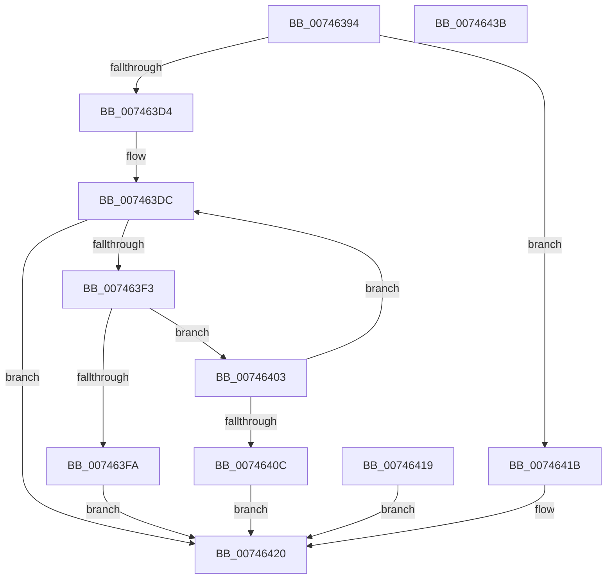

# KeInitializeEnclave

- RVA: `0x00746394`–`0x0074643C` (길이 `168` bytes)
- VA: `0x0000000140746394`
- 실행 섹션: `PAGE`
- PDB 이름 있음: `예`; PDB Function 태그: `아니요`
- unwind 정보 RVA: `0x000CA2F4`
- 디코드: `45`개 명령, `168/168` bytes 표시
- 미해석 바이트: `0` (있으면 어셈블리에 `.byte`로 보존)

> 이 문서는 커널 이미지의 기계어와 PDB 기호를 분석해 생성했습니다. 4번과 5번은 함수 원형과 자료형을 바이너리 사용 방식에서 추정한 C 해석이며 원본 소스 복구 결과는 아닙니다.

## 1. Dependencies

- 직접 호출 지점: **1**; 고유 호출 대상: **1**
- 직접 호출자로 확인된 함수: **1**
- RIP 상대 이미지 참조: **1**

### Outgoing calls
- `0x007463EA` → [KiEncls](../../text/6B/KiEncls_function_006B1BE0.md) (function, `0x006B1BE0`)

### Direct callers
- [MiInitializeEnclave](../80/MiInitializeEnclave_function_008089D8.md) at `0x00808A9C`

### Static image references
- `0x007463C0` → RVA `0x00FC6B30` (`ALMOSTRO`; read)

## 2. Other-region calls and transfers

- 다른 실행 섹션으로 향하는 call: **1**
  - `0x007463EA` → [KiEncls](../../text/6B/KiEncls_function_006B1BE0.md) (`PAGE` → `.text`)
- 별도 외부 분기/꼬리 이동을 확인하지 못했습니다.

## 3. Assembly (complete function range)

```asm
00746394  48 8B C4                        mov rax, rsp
00746397  48 89 58 08                     mov qword ptr [rax + 8], rbx
0074639B  48 89 70 10                     mov qword ptr [rax + 0x10], rsi
0074639F  48 89 78 18                     mov qword ptr [rax + 0x18], rdi
007463A3  4C 89 70 20                     mov qword ptr [rax + 0x20], r14
007463A7  41 57                           push r15
007463A9  48 83 EC 30                     sub rsp, 0x30
007463AD  49 8B F1                        mov rsi, r9
007463B0  4C 8B F2                        mov r14, rdx
007463B3  4C 8B F9                        mov r15, rcx
007463B6  48 B9 00 00 00 00 00 01 00 00   movabs rcx, 0x10000000000
007463C0  48 85 0D 69 07 88 00            test qword ptr [rip + 0x880769], rcx
007463C7  48 8B 7C 24 68                  mov rdi, qword ptr [rsp + 0x68]
007463CC  C7 07 00 00 00 00               mov dword ptr [rdi], 0
007463D2  74 47                           je 0x14074641b
007463D4  BB 10 00 00 00                  mov ebx, 0x10
007463D9  89 58 E8                        mov dword ptr [rax - 0x18], ebx
007463DC  4C 8B CE                        mov r9, rsi
007463DF  4D 8B C7                        mov r8, r15
007463E2  49 8B D6                        mov rdx, r14
007463E5  B9 02 00 00 00                  mov ecx, 2
007463EA  E8 F1 B7 F6 FF                  call 0x1406b1be0
007463EF  85 C0                           test eax, eax
007463F1  74 2D                           je 0x140746420
007463F3  3D 80 00 00 00                  cmp eax, 0x80
007463F8  74 09                           je 0x140746403
007463FA  89 07                           mov dword ptr [rdi], eax
007463FC  B8 8F 04 00 C0                  mov eax, 0xc000048f
00746401  EB 1D                           jmp 0x140746420
00746403  83 C3 FF                        add ebx, -1
00746406  89 5C 24 20                     mov dword ptr [rsp + 0x20], ebx
0074640A  75 D0                           jne 0x1407463dc
0074640C  C7 07 80 00 00 00               mov dword ptr [rdi], 0x80
00746412  B8 2D 02 00 C0                  mov eax, 0xc000022d
00746417  EB 07                           jmp 0x140746420
00746419  EB 05                           jmp 0x140746420
0074641B  B8 BB 00 00 C0                  mov eax, 0xc00000bb
00746420  48 8B 5C 24 40                  mov rbx, qword ptr [rsp + 0x40]
00746425  48 8B 74 24 48                  mov rsi, qword ptr [rsp + 0x48]
0074642A  48 8B 7C 24 50                  mov rdi, qword ptr [rsp + 0x50]
0074642F  4C 8B 74 24 58                  mov r14, qword ptr [rsp + 0x58]
00746434  48 83 C4 30                     add rsp, 0x30
00746438  41 5F                           pop r15
0074643A  C3                              ret
0074643B  CC                              int3
```

## 4. C-style interpretation (structured pseudocode)

```c
__int64 __fastcall KeInitializeEnclave(__int64 a1, __int64 a2, __int64 a3, __int64 a4, __int64 a5, __int64 a6)
{
    __int64 result;
    __int64 v_rbx;
    __int64 v_rsp;
    unsigned int v_stack_m18;
    unsigned __int64 v_stack_p10;
    unsigned __int64 v_stack_p18;
    unsigned __int64 v_stack_p20;
    unsigned __int64 v_stack_p8;

    *(unsigned __int64 *)(v_rsp + 8) = v_rbx;
    *(unsigned __int64 *)(v_rsp + 16) = v_rsi;
    *(unsigned __int64 *)(v_rsp + 24) = v_rdi;
    *(unsigned __int64 *)(v_rsp + 32) = v_r14;
    v_rsp = (v_rsp) - (48);
    *(unsigned int *)(a6) = 0;
    if (((*(unsigned __int64 *)(v_rip + 8914793)) & (a1)) == 0) goto loc_0074641B;
    *(unsigned int *)(v_rsp - 24) = 16;
loc_007463DC:
    result = KiEncls(2, a2, a1, a4);
    if ((unsigned int)(result) == 0) goto loc_00746420;
    if (((unsigned int)(result)) == 128) goto loc_00746403;
    *(unsigned int *)(a6) = (unsigned int)(result);
    goto loc_00746420;
loc_00746403:
    v_rbx = (unsigned int)((16) + (-1));
    v_stack_m18 = (unsigned int)(v_rbx);
    if (condition_is_not_equal) goto loc_007463DC;
    *(unsigned int *)(a6) = 128;
    goto loc_00746420;
loc_0074641B:
loc_00746420:
    v_rsp = (v_rsp) + (48);
    return (unsigned int)(0xC00000BBULL);
}
```

## 5. (Beta) C Style

```c
int64_t KeInitializeEnclave(int64_t Arg1, int64_t Arg2, int64_t Arg3, int64_t Arg4, uint64_t Arg5, void *Arg6)
{
    uint8_t *arg6 = (uint8_t *)Arg6;

    int64_t result;
    int64_t local_rbx;
    int64_t local_rsp;
    uint32_t v_stack_m18;
    uint64_t v_stack_p10;
    uint64_t v_stack_p18;
    uint64_t v_stack_p20;
    uint64_t v_stack_p8;

    *(uint64_t *)(local_rsp + 0x8) = local_rbx;
    *(uint64_t *)(local_rsp + 0x10) = local_rsi;
    *(uint64_t *)(local_rsp + 0x18) = local_rdi;
    *(uint64_t *)(local_rsp + 0x20) = local_r14;
    local_rsp = (local_rsp) - (48);
    *(uint32_t *)(arg6) = 0;
    if (((*(uint64_t *)(v_rip + 0x880769)) & (Arg1)) == 0) goto loc_0074641B;
    *(uint32_t *)(local_rsp - 0x18) = 16;
loc_007463DC:
    result = KiEncls(2, Arg2, Arg1, Arg4);
    if ((uint32_t)(result) == 0) goto loc_00746420;
    if (((uint32_t)(result)) == 128) goto loc_00746403;
    *(uint32_t *)(arg6) = (uint32_t)(result);
    goto loc_00746420;
loc_00746403:
    local_rbx = (uint32_t)((16) + (-1));
    v_stack_m18 = (uint32_t)(local_rbx);
    if (condition_is_not_equal) goto loc_007463DC;
    *(uint32_t *)(arg6) = 128;
    goto loc_00746420;
loc_0074641B:
loc_00746420:
    local_rsp = (local_rsp) + (48);
    return (uint32_t)(0xC00000BBULL);
}
```

### 관측된 메모리 오프셋

구조체 형식이 확인되지 않은 접근은 인자 기준의 오프셋으로만 기록했습니다.

| 기준 인자 | 오프셋 표현 | 폭 (bit) | 접근 |
|---|---:|---:|---|
| `Arg6` | `+ 0x0` | `32` | `W` |

## 6. Execution-region graph

[열기: 2D/3D 그래프와 함수 탐색 컨트롤 패널](../../../control-panel.html?section=page&rva=0x00746394&view=graph)

- 2D 그래프는 위에서 아래로 흐르고, 3D 그래프는 빈 공간을 드래그해 회전합니다. Shift+드래그는 이동, 휠은 확대·축소, 함수 노드 선택은 대상 보고서 이동입니다.

### Static fallback


