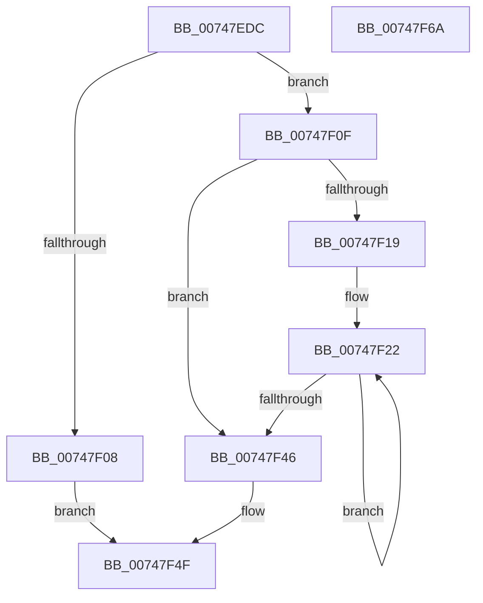

# KeInitializeEntropySystem

- RVA: `0x00747EDC`–`0x00747F6B` (길이 `143` bytes)
- VA: `0x0000000140747EDC`
- 실행 섹션: `PAGE`
- PDB 이름 있음: `예`; PDB Function 태그: `아니요`
- unwind 정보 RVA: `0x0005E6B4`
- 디코드: `38`개 명령, `143/143` bytes 표시
- 미해석 바이트: `0` (있으면 어셈블리에 `.byte`로 보존)

> 이 문서는 커널 이미지의 기계어와 PDB 기호를 분석해 생성했습니다. 4번과 5번은 함수 원형과 자료형을 바이너리 사용 방식에서 추정한 C 해석이며 원본 소스 복구 결과는 아닙니다.

## 1. Dependencies

- 직접 호출 지점: **1**; 고유 호출 대상: **1**
- 직접 호출자로 확인된 함수: **1**
- RIP 상대 이미지 참조: **4**

### Outgoing calls
- `0x00747F37` → [guard_dispatch_icall](../../text/6B/guard_dispatch_icall_function_006BAAD0.md) (function, `0x006BAAD0`)

### Direct callers
- [NtSetSystemInformation](../AF/NtSetSystemInformation_function_00AF4A60.md) at `0x00AF5B50`

### Static image references
- `0x00747EF5` → RVA `0x00FC7060` (`ALMOSTRO`; read)
- `0x00747F0F` → RVA `0x00FC6A80` (`ALMOSTRO`; read)
- `0x00747F19` → RVA `0x00FC8C40` (`ALMOSTRO`; read)
- `0x00747F46` → RVA `0x00FC7060` (`ALMOSTRO`; write)

## 2. Other-region calls and transfers

- 다른 실행 섹션으로 향하는 call: **1**
  - `0x00747F37` → [guard_dispatch_icall](../../text/6B/guard_dispatch_icall_function_006BAAD0.md) (`PAGE` → `.text`)
- 별도 외부 분기/꼬리 이동을 확인하지 못했습니다.

## 3. Assembly (complete function range)

```asm
00747EDC  48 8B C4                        mov rax, rsp
00747EDF  48 89 58 08                     mov qword ptr [rax + 8], rbx
00747EE3  48 89 68 10                     mov qword ptr [rax + 0x10], rbp
00747EE7  48 89 70 18                     mov qword ptr [rax + 0x18], rsi
00747EEB  48 89 78 20                     mov qword ptr [rax + 0x20], rdi
00747EEF  41 56                           push r14
00747EF1  48 83 EC 20                     sub rsp, 0x20
00747EF5  48 83 3D 63 F1 87 00 00         cmp qword ptr [rip + 0x87f163], 0
00747EFD  49 8B E8                        mov rbp, r8
00747F00  4C 8B F2                        mov r14, rdx
00747F03  48 8B F9                        mov rdi, rcx
00747F06  74 07                           je 0x140747f0f
00747F08  B8 0D 00 00 C0                  mov eax, 0xc000000d
00747F0D  EB 40                           jmp 0x140747f4f
00747F0F  8B 05 6B EB 87 00               mov eax, dword ptr [rip + 0x87eb6b]
00747F15  85 C0                           test eax, eax
00747F17  74 2D                           je 0x140747f46
00747F19  48 8D 1D 20 0D 88 00            lea rbx, [rip + 0x880d20]
00747F20  8B F0                           mov esi, eax
00747F22  48 8B 0B                        mov rcx, qword ptr [rbx]
00747F25  4C 8B C5                        mov r8, rbp
00747F28  48 81 C1 E4 8F 00 00            add rcx, 0x8fe4
00747F2F  BA 00 01 00 00                  mov edx, 0x100
00747F34  49 8B C6                        mov rax, r14
00747F37  E8 94 2B F7 FF                  call 0x1406baad0
00747F3C  48 8D 5B 08                     lea rbx, [rbx + 8]
00747F40  48 83 EE 01                     sub rsi, 1
00747F44  75 DC                           jne 0x140747f22
00747F46  48 89 3D 13 F1 87 00            mov qword ptr [rip + 0x87f113], rdi
00747F4D  33 C0                           xor eax, eax
00747F4F  48 8B 5C 24 30                  mov rbx, qword ptr [rsp + 0x30]
00747F54  48 8B 6C 24 38                  mov rbp, qword ptr [rsp + 0x38]
00747F59  48 8B 74 24 40                  mov rsi, qword ptr [rsp + 0x40]
00747F5E  48 8B 7C 24 48                  mov rdi, qword ptr [rsp + 0x48]
00747F63  48 83 C4 20                     add rsp, 0x20
00747F67  41 5E                           pop r14
00747F69  C3                              ret
00747F6A  CC                              int3
```

## 4. C-style interpretation (structured pseudocode)

```c
__int64 __fastcall KeInitializeEntropySystem(__int64 a1, __int64 a2, __int64 a3)
{
    __int64 result;
    __int64 v_rsi;
    __int64 v_rsp;
    unsigned __int64 v_stack_p10;
    unsigned __int64 v_stack_p18;
    unsigned __int64 v_stack_p20;
    unsigned __int64 v_stack_p8;

    *(unsigned __int64 *)(v_rsp + 8) = v_rbx;
    *(unsigned __int64 *)(v_rsp + 16) = v_rbp;
    *(unsigned __int64 *)(v_rsp + 24) = v_rsi;
    *(unsigned __int64 *)(v_rsp + 32) = v_rdi;
    v_rsp = (v_rsp) - (32);
    if ((*(unsigned __int64 *)(v_rip + 8909155)) == 0) goto loc_00747F0F;
    goto loc_00747F4F;
loc_00747F0F:
    if ((unsigned int)((unsigned int)(*(unsigned int *)(v_rip + 8907627))) == 0) goto loc_00747F46;
loc_00747F22:
    a1 = (*(unsigned __int64 *)(v_rip + 8916256)) + (0x8FE4ULL);
    result = guard_dispatch_icall(a1, 256, a3, a4);
    v_rsi = ((unsigned int)((unsigned int)((unsigned int)(*(unsigned int *)(v_rip + 8907627))))) - (1);
    if (condition_is_not_equal) goto loc_00747F22;
loc_00747F46:
    *(unsigned __int64 *)(v_rip + 8909075) = a1;
    result = 0;
loc_00747F4F:
    v_rsp = (v_rsp) + (32);
    return result;
}
```

## 5. (Beta) C Style

```c
int64_t KeInitializeEntropySystem(int64_t Arg1, int64_t Arg2, int64_t Arg3)
{
    int64_t result;
    int64_t local_rsi;
    int64_t local_rsp;
    uint64_t v_stack_p10;
    uint64_t v_stack_p18;
    uint64_t v_stack_p20;
    uint64_t v_stack_p8;

    *(uint64_t *)(local_rsp + 0x8) = local_rbx;
    *(uint64_t *)(local_rsp + 0x10) = local_rbp;
    *(uint64_t *)(local_rsp + 0x18) = local_rsi;
    *(uint64_t *)(local_rsp + 0x20) = local_rdi;
    local_rsp = (local_rsp) - (32);
    if ((*(uint64_t *)(v_rip + 0x87F163)) == 0) goto loc_00747F0F;
    goto loc_00747F4F;
loc_00747F0F:
    if ((uint32_t)((uint32_t)(*(uint32_t *)(v_rip + 0x87EB6B))) == 0) goto loc_00747F46;
loc_00747F22:
    Arg1 = (*(uint64_t *)(v_rip + 0x880D20)) + (0x8FE4ULL);
    result = guard_dispatch_icall(Arg1, 256, Arg3, a4);
    local_rsi = ((uint32_t)((uint32_t)((uint32_t)(*(uint32_t *)(v_rip + 0x87EB6B))))) - (1);
    if (condition_is_not_equal) goto loc_00747F22;
loc_00747F46:
    *(uint64_t *)(v_rip + 0x87F113) = Arg1;
    result = 0;
loc_00747F4F:
    local_rsp = (local_rsp) + (32);
    return result;
}
```

## 6. Execution-region graph

[열기: 2D/3D 그래프와 함수 탐색 컨트롤 패널](../../../control-panel.html?section=page&rva=0x00747EDC&view=graph)

- 2D 그래프는 위에서 아래로 흐르고, 3D 그래프는 빈 공간을 드래그해 회전합니다. Shift+드래그는 이동, 휠은 확대·축소, 함수 노드 선택은 대상 보고서 이동입니다.

### Static fallback


