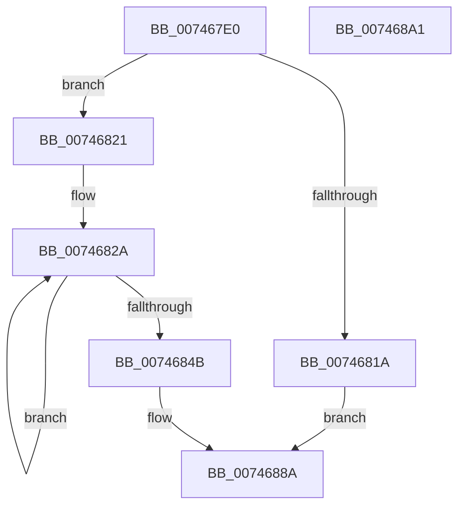

# KeInitializeSecondaryInterruptServices

- RVA: `0x007467E0`–`0x007468A2` (길이 `194` bytes)
- VA: `0x00000001407467E0`
- 실행 섹션: `PAGE`
- PDB 이름 있음: `예`; PDB Function 태그: `아니요`
- unwind 정보 RVA: `0x0005C954`
- 디코드: `45`개 명령, `194/194` bytes 표시
- 미해석 바이트: `0` (있으면 어셈블리에 `.byte`로 보존)

> 이 문서는 커널 이미지의 기계어와 PDB 기호를 분석해 생성했습니다. 4번과 5번은 함수 원형과 자료형을 바이너리 사용 방식에서 추정한 C 해석이며 원본 소스 복구 결과는 아닙니다.

## 1. Dependencies

- 직접 호출 지점: **3**; 고유 호출 대상: **3**
- 직접 호출자로 확인된 함수: **1**
- RIP 상대 이미지 참조: **9**

### Outgoing calls
- `0x00746804` → [ExAllocatePool2](../../poolcode/B8/ExAllocatePool2_function_00B820F0.md) (function, `0x00B820F0`)
- `0x00746838` → [KeInitializeEvent](../../text/40/KeInitializeEvent_function_0040DD10.md) (function, `0x0040DD10`)
- `0x00746871` → [KeInitializeDpc](../../text/45/KeInitializeDpc_function_0045BBD0.md) (function, `0x0045BBD0`)

### Direct callers
- [HalpAllocateGsivForSecondaryInterrupt](../../text/55/HalpAllocateGsivForSecondaryInterrupt_function_00556CE0.md) at `0x00556D19`

### Static image references
- `0x0074680B` → RVA `0x00F11028` (`.data`; write)
- `0x0074684B` → RVA `0x00F110A0` (`.data`; read)
- `0x00746855` → RVA `0x005BDA10` (`KiProcessSecondarySignalList`; read)
- `0x0074685C` → RVA `0x00F110A8` (`.data`; write)
- `0x00746863` → RVA `0x00F11060` (`.data`; read)
- `0x0074686A` → RVA `0x00F110A0` (`.data`; write)
- `0x00746876` → RVA `0x00F11038` (`.data`; write)
- `0x0074687D` → RVA `0x00F11040` (`.data`; write)
- `0x00746883` → RVA `0x00F11030` (`.data`; write)

## 2. Other-region calls and transfers

- 다른 실행 섹션으로 향하는 call: **3**
  - `0x00746804` → [ExAllocatePool2](../../poolcode/B8/ExAllocatePool2_function_00B820F0.md) (`PAGE` → `POOLCODE`)
  - `0x00746838` → [KeInitializeEvent](../../text/40/KeInitializeEvent_function_0040DD10.md) (`PAGE` → `.text`)
  - `0x00746871` → [KeInitializeDpc](../../text/45/KeInitializeDpc_function_0045BBD0.md) (`PAGE` → `.text`)
- 별도 외부 분기/꼬리 이동을 확인하지 못했습니다.

## 3. Assembly (complete function range)

```asm
007467E0  48 89 5C 24 08                  mov qword ptr [rsp + 8], rbx
007467E5  48 89 6C 24 10                  mov qword ptr [rsp + 0x10], rbp
007467EA  48 89 74 24 18                  mov qword ptr [rsp + 0x18], rsi
007467EF  57                              push rdi
007467F0  48 83 EC 20                     sub rsp, 0x20
007467F4  BA 00 30 00 00                  mov edx, 0x3000
007467F9  B9 40 00 00 00                  mov ecx, 0x40
007467FE  41 B8 4B 65 53 69               mov r8d, 0x6953654b
00746804  E8 E7 B8 43 00                  call 0x140b820f0
00746809  33 DB                           xor ebx, ebx
0074680B  48 89 05 16 A8 7C 00            mov qword ptr [rip + 0x7ca816], rax
00746812  48 8B F8                        mov rdi, rax
00746815  48 85 C0                        test rax, rax
00746818  75 07                           jne 0x140746821
0074681A  BB 9A 00 00 C0                  mov ebx, 0xc000009a
0074681F  EB 69                           jmp 0x14074688a
00746821  48 8D 70 08                     lea rsi, [rax + 8]
00746825  BD 00 01 00 00                  mov ebp, 0x100
0074682A  41 B0 01                        mov r8b, 1
0074682D  48 89 1F                        mov qword ptr [rdi], rbx
00746830  BA 01 00 00 00                  mov edx, 1
00746835  48 8B CE                        mov rcx, rsi
00746838  E8 D3 74 CC FF                  call 0x14040dd10
0074683D  48 83 C6 30                     add rsi, 0x30
00746841  48 8D 7F 30                     lea rdi, [rdi + 0x30]
00746845  48 83 ED 01                     sub rbp, 1
00746849  75 DF                           jne 0x14074682a
0074684B  48 8D 05 4E A8 7C 00            lea rax, [rip + 0x7ca84e]
00746852  45 33 C0                        xor r8d, r8d
00746855  48 8D 15 B4 71 E7 FF            lea rdx, [rip - 0x188e4c]
0074685C  48 89 05 45 A8 7C 00            mov qword ptr [rip + 0x7ca845], rax
00746863  48 8D 0D F6 A7 7C 00            lea rcx, [rip + 0x7ca7f6]
0074686A  48 89 05 2F A8 7C 00            mov qword ptr [rip + 0x7ca82f], rax
00746871  E8 5A 53 D1 FF                  call 0x14045bbd0
00746876  48 89 1D BB A7 7C 00            mov qword ptr [rip + 0x7ca7bb], rbx
0074687D  88 1D BD A7 7C 00               mov byte ptr [rip + 0x7ca7bd], bl
00746883  C6 05 A6 A7 7C 00 01            mov byte ptr [rip + 0x7ca7a6], 1
0074688A  48 8B 6C 24 38                  mov rbp, qword ptr [rsp + 0x38]
0074688F  8B C3                           mov eax, ebx
00746891  48 8B 5C 24 30                  mov rbx, qword ptr [rsp + 0x30]
00746896  48 8B 74 24 40                  mov rsi, qword ptr [rsp + 0x40]
0074689B  48 83 C4 20                     add rsp, 0x20
0074689F  5F                              pop rdi
007468A0  C3                              ret
007468A1  CC                              int3
```

## 4. C-style interpretation (structured pseudocode)

```c
__int64 __fastcall KeInitializeSecondaryInterruptServices(void)
{
    __int64 result;
    __int64 v_rbp;
    __int64 v_rbx;
    __int64 v_rsi;
    __int64 v_rsp;
    unsigned __int64 v_stack_p10;
    unsigned __int64 v_stack_p18;
    unsigned __int64 v_stack_p8;

    v_stack_p8 = v_rbx;
    v_stack_p10 = v_rbp;
    v_stack_p18 = v_rsi;
    v_rsp = (v_rsp) - (32);
    result = ExAllocatePool2(64, (unsigned int)(0x3000ULL), (unsigned int)(0x6953654BULL), a4);
    v_rbx = 0;
    *(unsigned __int64 *)(v_rip + 8169494) = result;
    if (result != 0) goto loc_00746821;
    goto loc_0074688A;
loc_00746821:
loc_0074682A:
    *(unsigned __int64 *)(result) = (unsigned int)(0xC000009AULL);
    result = KeInitializeEvent(result + 8, 1, 1, a4);
    v_rsi = (result + 8) + (48);
    v_rbp = (256) - (1);
    if (condition_is_not_equal) goto loc_0074682A;
    a3 = 0;
    *(unsigned __int64 *)(v_rip + 8169541) = v_rip + 8169550;
    *(unsigned __int64 *)(v_rip + 8169519) = v_rip + 8169550;
    result = KeInitializeDpc(v_rip + 8169462, v_rip - 1609292, a3, a4);
    *(unsigned __int64 *)(v_rip + 8169403) = (unsigned int)(0xC000009AULL);
    *(unsigned __int8 *)(v_rip + 8169405) = (unsigned __int8)((unsigned int)(0xC000009AULL));
    *(unsigned __int8 *)(v_rip + 8169382) = 1;
loc_0074688A:
    v_rsp = (v_rsp) + (32);
    return (unsigned int)((unsigned int)((unsigned int)(0xC000009AULL)));
}
```

## 5. (Beta) C Style

```c
void KeInitializeSecondaryInterruptServices(void)
{
    int64_t result;
    int64_t local_rbp;
    int64_t local_rbx;
    int64_t local_rsi;
    int64_t local_rsp;
    uint64_t v_stack_p10;
    uint64_t v_stack_p18;
    uint64_t v_stack_p8;

    v_stack_p8 = local_rbx;
    v_stack_p10 = local_rbp;
    v_stack_p18 = local_rsi;
    local_rsp = (local_rsp) - (32);
    result = ExAllocatePool2(64, (uint32_t)(0x3000ULL), (uint32_t)(0x6953654BULL), a4);
    local_rbx = 0;
    *(uint64_t *)(v_rip + 0x7CA816) = result;
    if (result != 0) goto loc_00746821;
    goto loc_0074688A;
loc_00746821:
loc_0074682A:
    *(uint64_t *)(result) = (uint32_t)(0xC000009AULL);
    result = KeInitializeEvent(result + 8, 1, 1, a4);
    local_rsi = (result + 8) + (48);
    local_rbp = (256) - (1);
    if (condition_is_not_equal) goto loc_0074682A;
    a3 = 0;
    *(uint64_t *)(v_rip + 0x7CA845) = v_rip + 8169550;
    *(uint64_t *)(v_rip + 0x7CA82F) = v_rip + 8169550;
    result = KeInitializeDpc(v_rip + 8169462, v_rip - 1609292, a3, a4);
    *(uint64_t *)(v_rip + 0x7CA7BB) = (uint32_t)(0xC000009AULL);
    *(uint8_t *)(v_rip + 0x7CA7BD) = (uint8_t)((uint32_t)(0xC000009AULL));
    *(uint8_t *)(v_rip + 0x7CA7A6) = 1;
loc_0074688A:
    local_rsp = (local_rsp) + (32);
    return (uint32_t)((uint32_t)((uint32_t)(0xC000009AULL)));
}
```

## 6. Execution-region graph

[열기: 2D/3D 그래프와 함수 탐색 컨트롤 패널](../../../control-panel.html?section=page&rva=0x007467E0&view=graph)

- 2D 그래프는 위에서 아래로 흐르고, 3D 그래프는 빈 공간을 드래그해 회전합니다. Shift+드래그는 이동, 휠은 확대·축소, 함수 노드 선택은 대상 보고서 이동입니다.

### Static fallback


