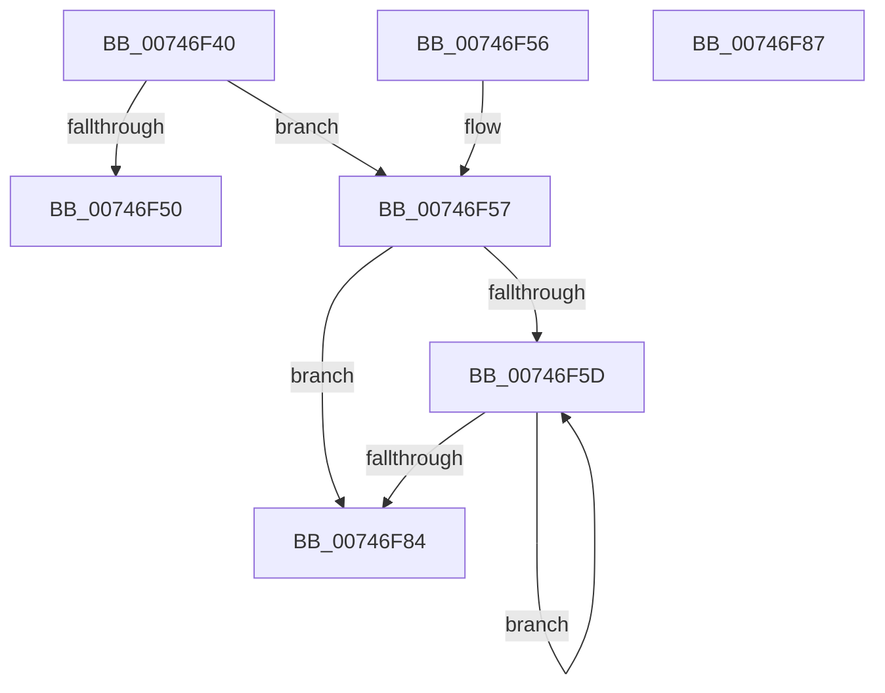

# KeQueryHardwareCounterConfiguration

- RVA: `0x00746F40`–`0x00746F88` (길이 `72` bytes)
- VA: `0x0000000140746F40`
- 실행 섹션: `PAGE`
- PDB 이름 있음: `예`; PDB Function 태그: `아니요`
- unwind 정보 RVA: `0x000DB714`
- 디코드: `24`개 명령, `72/72` bytes 표시
- 미해석 바이트: `0` (있으면 어셈블리에 `.byte`로 보존)

> 이 문서는 커널 이미지의 기계어와 PDB 기호를 분석해 생성했습니다. 4번과 5번은 함수 원형과 자료형을 바이너리 사용 방식에서 추정한 C 해석이며 원본 소스 복구 결과는 아닙니다.

## 1. Dependencies

- 직접 호출 지점: **0**; 고유 호출 대상: **0**
- 직접 호출자로 확인된 함수: **0**
- RIP 상대 이미지 참조: **2**

### Outgoing calls
- 직접 디코드된 call 명령이 없습니다.

### Direct callers
- 이 함수 시작 RVA로 연결되는 직접 call은 확인되지 않았습니다. 간접 호출은 완전히 역산할 수 없습니다.

### Static image references
- `0x00746F40` → RVA `0x00E66908` (`.data`; read)
- `0x00746F5F` → RVA `0x00F10E80` (`.data`; read)

## 2. Other-region calls and transfers

- 다른 실행 섹션으로 향하는 call: **0**
- 별도 외부 분기/꼬리 이동을 확인하지 못했습니다.

## 3. Assembly (complete function range)

```asm
00746F40  8B 05 C2 F9 71 00               mov eax, dword ptr [rip + 0x71f9c2]
00746F46  4C 8B C9                        mov r9, rcx
00746F49  41 89 00                        mov dword ptr [r8], eax
00746F4C  3B C2                           cmp eax, edx
00746F4E  76 07                           jbe 0x140746f57
00746F50  B8 23 00 00 C0                  mov eax, 0xc0000023
00746F55  C3                              ret
00746F56  CC                              int3
00746F57  33 D2                           xor edx, edx
00746F59  85 C0                           test eax, eax
00746F5B  74 27                           je 0x140746f84
00746F5D  8B CA                           mov ecx, edx
00746F5F  4C 8D 15 1A 9F 7C 00            lea r10, [rip + 0x7c9f1a]
00746F66  41 8B 04 92                     mov eax, dword ptr [r10 + rdx*4]
00746F6A  48 03 C9                        add rcx, rcx
00746F6D  FF C2                           inc edx
00746F6F  41 83 24 C9 00                  and dword ptr [r9 + rcx*8], 0
00746F74  41 83 64 C9 04 00               and dword ptr [r9 + rcx*8 + 4], 0
00746F7A  49 89 44 C9 08                  mov qword ptr [r9 + rcx*8 + 8], rax
00746F7F  41 3B 10                        cmp edx, dword ptr [r8]
00746F82  72 D9                           jb 0x140746f5d
00746F84  33 C0                           xor eax, eax
00746F86  C3                              ret
00746F87  CC                              int3
```

## 4. C-style interpretation (structured pseudocode)

```c
__int64 __fastcall KeQueryHardwareCounterConfiguration(__int64 a1, int a2, __int64 a3)
{
    __int64 result;

    *(unsigned int *)(a3) = (unsigned int)((unsigned int)(*(unsigned int *)(v_rip + 7469506)));
    if (((unsigned int)((unsigned int)(*(unsigned int *)(v_rip + 7469506)))) <= a2) goto loc_00746F57;
    return (unsigned int)(0xC0000023ULL);
loc_00746F57:
    a2 = 0;
    if ((unsigned int)((unsigned int)(0xC0000023ULL)) == 0) goto loc_00746F84;
loc_00746F5D:
    a1 = (0) + (0);
    a2 = (unsigned int)((a2) + 1);
    *(unsigned __int64 *)(a1 + a1 * 8 + 8) = (unsigned int)(*(unsigned int *)(v_rip + 8167194 + a2 * 4));
    if (a2 < (*(unsigned int *)(a3))) goto loc_00746F5D;
loc_00746F84:
    result = 0;
    return result;
}
```

## 5. (Beta) C Style

```c
int64_t KeQueryHardwareCounterConfiguration(void *Arg1, int32_t Arg2, void *Arg3)
{
    uint8_t *arg1 = (uint8_t *)Arg1;
    uint8_t *arg3 = (uint8_t *)Arg3;

    int64_t result;

    *(uint32_t *)(arg3) = (uint32_t)((uint32_t)(*(uint32_t *)(v_rip + 0x71F9C2)));
    if (((uint32_t)((uint32_t)(*(uint32_t *)(v_rip + 0x71F9C2)))) <= Arg2) goto loc_00746F57;
    return (uint32_t)(0xC0000023ULL);
loc_00746F57:
    Arg2 = 0;
    if ((uint32_t)((uint32_t)(0xC0000023ULL)) == 0) goto loc_00746F84;
loc_00746F5D:
    Arg1 = (0) + (0);
    Arg2 = (uint32_t)((Arg2) + 1);
    *(uint64_t *)(arg1 + arg1 * 8 + 0x8) = (uint32_t)(*(uint32_t *)(v_rip + 0x7C9F1A + Arg2 * 4));
    if (Arg2 < (*(uint32_t *)(arg3))) goto loc_00746F5D;
loc_00746F84:
    result = 0;
    return result;
}
```

### 관측된 메모리 오프셋

구조체 형식이 확인되지 않은 접근은 인자 기준의 오프셋으로만 기록했습니다.

| 기준 인자 | 오프셋 표현 | 폭 (bit) | 접근 |
|---|---:|---:|---|
| `Arg1` | `+ 0x0 + rcx*8` | `32` | `R/W` |
| `Arg1` | `+ 0x4 + rcx*8` | `32` | `R/W` |
| `Arg1` | `+ 0x8 + rcx*8` | `64` | `W` |
| `Arg3` | `+ 0x0` | `32` | `R` |
| `Arg3` | `+ 0x0` | `32` | `W` |

## 6. Execution-region graph

[열기: 2D/3D 그래프와 함수 탐색 컨트롤 패널](../../../control-panel.html?section=page&rva=0x00746F40&view=graph)

- 2D 그래프는 위에서 아래로 흐르고, 3D 그래프는 빈 공간을 드래그해 회전합니다. Shift+드래그는 이동, 휠은 확대·축소, 함수 노드 선택은 대상 보고서 이동입니다.

### Static fallback


