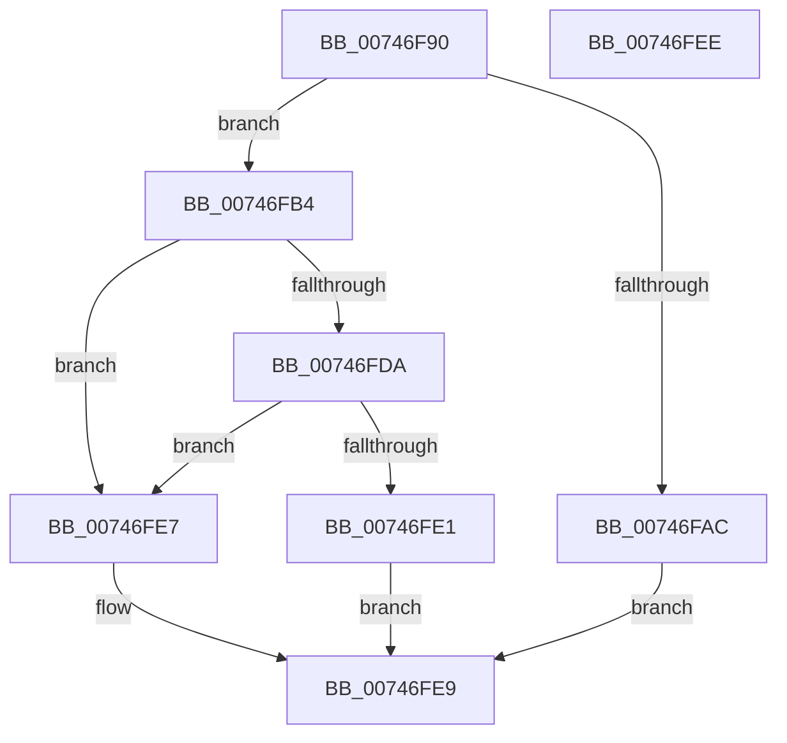

# KeQueryIntervalProfile

- RVA: `0x00746F90`–`0x00746FEF` (길이 `95` bytes)
- VA: `0x0000000140746F90`
- 실행 섹션: `PAGE`
- PDB 이름 있음: `예`; PDB Function 태그: `아니요`
- unwind 정보 RVA: `0x0006C2A4`
- 디코드: `27`개 명령, `95/95` bytes 표시
- 미해석 바이트: `0` (있으면 어셈블리에 `.byte`로 보존)

> 이 문서는 커널 이미지의 기계어와 PDB 기호를 분석해 생성했습니다. 4번과 5번은 함수 원형과 자료형을 바이너리 사용 방식에서 추정한 C 해석이며 원본 소스 복구 결과는 아닙니다.

## 1. Dependencies

- 직접 호출 지점: **1**; 고유 호출 대상: **1**
- 직접 호출자로 확인된 함수: **2**
- RIP 상대 이미지 참조: **2**

### Outgoing calls
- `0x00746FD1` → [guard_dispatch_icall](../../text/6B/guard_dispatch_icall_function_006BAAD0.md) (function, `0x006BAAD0`)

### Direct callers
- [NtQueryIntervalProfile](../7D/NtQueryIntervalProfile_function_007D21F0.md) at `0x007D222D`
- [KeSetIntervalProfile](../AD/KeSetIntervalProfile_function_00ADB5A8.md) at `0x00ADB5E0`
- [KeSetIntervalProfile](../AD/KeSetIntervalProfile_function_00ADB5A8.md) at `0x00ADB639`

### Static image references
- `0x00746FAC` → RVA `0x00F23430` (`.data`; read)
- `0x00746FB4` → RVA `0x00E00638` (`.data`; read)

## 2. Other-region calls and transfers

- 다른 실행 섹션으로 향하는 call: **1**
  - `0x00746FD1` → [guard_dispatch_icall](../../text/6B/guard_dispatch_icall_function_006BAAD0.md) (`PAGE` → `.text`)
- 별도 외부 분기/꼬리 이동을 확인하지 못했습니다.

## 3. Assembly (complete function range)

```asm
00746F90  48 83 EC 58                     sub rsp, 0x58
00746F94  33 C0                           xor eax, eax
00746F96  0F 57 C0                        xorps xmm0, xmm0
00746F99  21 44 24 60                     and dword ptr [rsp + 0x60], eax
00746F9D  48 89 44 24 40                  mov qword ptr [rsp + 0x40], rax
00746FA2  0F 11 44 24 30                  movups xmmword ptr [rsp + 0x30], xmm0
00746FA7  83 F9 01                        cmp ecx, 1
00746FAA  75 08                           jne 0x140746fb4
00746FAC  8B 05 7E C4 7D 00               mov eax, dword ptr [rip + 0x7dc47e]
00746FB2  EB 35                           jmp 0x140746fe9
00746FB4  48 8B 05 7D 96 6B 00            mov rax, qword ptr [rip + 0x6b967d]
00746FBB  4C 8D 4C 24 60                  lea r9, [rsp + 0x60]
00746FC0  BA 18 00 00 00                  mov edx, 0x18
00746FC5  89 4C 24 30                     mov dword ptr [rsp + 0x30], ecx
00746FC9  4C 8D 44 24 30                  lea r8, [rsp + 0x30]
00746FCE  8D 4A E9                        lea ecx, [rdx - 0x17]
00746FD1  E8 FA 3A F7 FF                  call 0x1406baad0
00746FD6  85 C0                           test eax, eax
00746FD8  78 0D                           js 0x140746fe7
00746FDA  80 7C 24 34 00                  cmp byte ptr [rsp + 0x34], 0
00746FDF  74 06                           je 0x140746fe7
00746FE1  8B 44 24 38                     mov eax, dword ptr [rsp + 0x38]
00746FE5  EB 02                           jmp 0x140746fe9
00746FE7  33 C0                           xor eax, eax
00746FE9  48 83 C4 58                     add rsp, 0x58
00746FED  C3                              ret
00746FEE  CC                              int3
```

## 4. C-style interpretation (structured pseudocode)

```c
__int64 __fastcall KeQueryIntervalProfile(int a1)
{
    __int64 result;
    __int64 v_rsp;
    unsigned __int64 v_stack_m18;
    unsigned int v_stack_m20;
    unsigned __int8 v_stack_m24;
    unsigned __int64 v_stack_m28;
    unsigned int v_stack_p8;

    v_rsp = (v_rsp) - (88);
    result = 0;
    v_stack_m18 = 0;
    v_stack_m28 = v_xmm0;
    if (a1 != 1) goto loc_00746FB4;
    goto loc_00746FE9;
loc_00746FB4:
    v_stack_m28 = a1;
    result = guard_dispatch_icall(24 - 23, 24, v_stack_m28, v_stack_p8);
    if (sign_flag) goto loc_00746FE7;
    if (v_stack_m24 == 0) goto loc_00746FE7;
    goto loc_00746FE9;
loc_00746FE7:
    result = 0;
loc_00746FE9:
    v_rsp = (v_rsp) + (88);
    return result;
}
```

## 5. (Beta) C Style

```c
int64_t KeQueryIntervalProfile(int32_t Arg1)
{
    int64_t result;
    int64_t local_rsp;
    uint64_t v_stack_m18;
    uint32_t v_stack_m20;
    uint8_t v_stack_m24;
    uint64_t v_stack_m28;
    uint32_t v_stack_p8;

    local_rsp = (local_rsp) - (88);
    result = 0;
    v_stack_m18 = 0;
    v_stack_m28 = v_xmm0;
    if (Arg1 != 1) goto loc_00746FB4;
    goto loc_00746FE9;
loc_00746FB4:
    v_stack_m28 = Arg1;
    result = guard_dispatch_icall(24 - 23, 24, v_stack_m28, v_stack_p8);
    if (sign_flag) goto loc_00746FE7;
    if (v_stack_m24 == 0) goto loc_00746FE7;
    goto loc_00746FE9;
loc_00746FE7:
    result = 0;
loc_00746FE9:
    local_rsp = (local_rsp) + (88);
    return result;
}
```

## 6. Execution-region graph

[열기: 2D/3D 그래프와 함수 탐색 컨트롤 패널](../../../control-panel.html?section=page&rva=0x00746F90&view=graph)

- 2D 그래프는 위에서 아래로 흐르고, 3D 그래프는 빈 공간을 드래그해 회전합니다. Shift+드래그는 이동, 휠은 확대·축소, 함수 노드 선택은 대상 보고서 이동입니다.

### Static fallback


