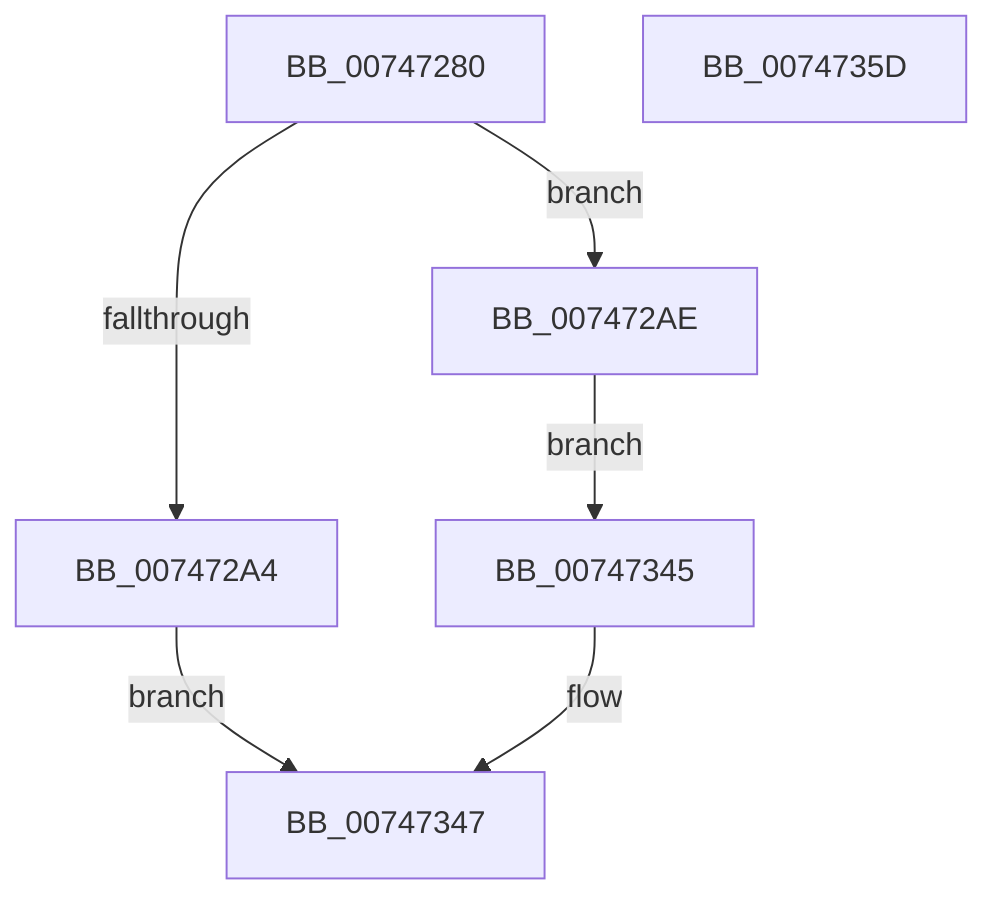

# KeQueryKvaShadowInformation

- RVA: `0x00747280`–`0x0074735E` (길이 `222` bytes)
- VA: `0x0000000140747280`
- 실행 섹션: `PAGE`
- PDB 이름 있음: `예`; PDB Function 태그: `아니요`
- unwind 정보 RVA: `0x000CAA40`
- 디코드: `68`개 명령, `222/222` bytes 표시
- 미해석 바이트: `0` (있으면 어셈블리에 `.byte`로 보존)

> 이 문서는 커널 이미지의 기계어와 PDB 기호를 분석해 생성했습니다. 4번과 5번은 함수 원형과 자료형을 바이너리 사용 방식에서 추정한 C 해석이며 원본 소스 복구 결과는 아닙니다.

## 1. Dependencies

- 직접 호출 지점: **3**; 고유 호출 대상: **3**
- 직접 호출자로 확인된 함수: **2**
- RIP 상대 이미지 참조: **3**

### Outgoing calls
- `0x007472AE` → [KeQueryImplementedPhysicalBits](../../text/5C/KeQueryImplementedPhysicalBits_function_005C4CC0.md) (function, `0x005C4CC0`)
- `0x007472D3` → [KeKvaShadowingActive](../../text/4B/KeKvaShadowingActive_function_004B2CA8.md) (function, `0x004B2CA8`)
- `0x00747309` → [SpcQueryKvaLeakagePresent](../../text/6A/SpcQueryKvaLeakagePresent_function_006A7948.md) (function, `0x006A7948`)

### Direct callers
- [ExpQuerySystemInformation](../A5/ExpQuerySystemInformation_function_00A57858.md) at `0x00A5ADE2`
- [VslpIumPhase0Initialize](../../init/C2/VslpIumPhase0Initialize_function_00C2A0A4.md) at `0x00C2A24E`

### Static image references
- `0x007472C6` → RVA `0x01201840` (`CFGRO`; read)
- `0x007472E8` → RVA `0x00FC6A87` (`ALMOSTRO`; read)
- `0x00747332` → RVA `0x00FC6B60` (`ALMOSTRO`; read)

## 2. Other-region calls and transfers

- 다른 실행 섹션으로 향하는 call: **3**
  - `0x007472AE` → [KeQueryImplementedPhysicalBits](../../text/5C/KeQueryImplementedPhysicalBits_function_005C4CC0.md) (`PAGE` → `.text`)
  - `0x007472D3` → [KeKvaShadowingActive](../../text/4B/KeKvaShadowingActive_function_004B2CA8.md) (`PAGE` → `.text`)
  - `0x00747309` → [SpcQueryKvaLeakagePresent](../../text/6A/SpcQueryKvaLeakagePresent_function_006A7948.md) (`PAGE` → `.text`)
- 별도 외부 분기/꼬리 이동을 확인하지 못했습니다.

## 3. Assembly (complete function range)

```asm
00747280  48 89 5C 24 08                  mov qword ptr [rsp + 8], rbx
00747285  48 89 74 24 10                  mov qword ptr [rsp + 0x10], rsi
0074728A  48 89 7C 24 18                  mov qword ptr [rsp + 0x18], rdi
0074728F  41 56                           push r14
00747291  48 83 EC 30                     sub rsp, 0x30
00747295  4C 8B F1                        mov r14, rcx
00747298  41 C7 00 04 00 00 00            mov dword ptr [r8], 4
0074729F  83 FA 04                        cmp edx, 4
007472A2  73 0A                           jae 0x1407472ae
007472A4  B8 04 00 00 C0                  mov eax, 0xc0000004
007472A9  E9 99 00 00 00                  jmp 0x140747347
007472AE  E8 0D DA E7 FF                  call 0x1405c4cc0
007472B3  8D 48 FF                        lea ecx, [rax - 1]
007472B6  33 FF                           xor edi, edi
007472B8  8B F7                           mov esi, edi
007472BA  85 C0                           test eax, eax
007472BC  0F 4F F1                        cmovg esi, ecx
007472BF  33 C0                           xor eax, eax
007472C1  41 89 06                        mov dword ptr [r14], eax
007472C4  8B DF                           mov ebx, edi
007472C6  40 38 3D 73 A5 AB 00            cmp byte ptr [rip + 0xaba573], dil
007472CD  0F 95 C3                        setne bl
007472D0  41 89 1E                        mov dword ptr [r14], ebx
007472D3  E8 D0 B9 D6 FF                  call 0x1404b2ca8
007472D8  44 8D 47 02                     lea r8d, [rdi + 2]
007472DC  41 3B C0                        cmp eax, r8d
007472DF  41 0F 44 F8                     cmove edi, r8d
007472E3  0B FB                           or edi, ebx
007472E5  41 89 3E                        mov dword ptr [r14], edi
007472E8  0F B6 05 98 F7 87 00            movzx eax, byte ptr [rip + 0x87f798]
007472EF  8B C8                           mov ecx, eax
007472F1  83 E1 01                        and ecx, 1
007472F4  C1 E1 02                        shl ecx, 2
007472F7  0B CF                           or ecx, edi
007472F9  41 89 0E                        mov dword ptr [r14], ecx
007472FC  8B D0                           mov edx, eax
007472FE  41 23 D0                        and edx, r8d
00747301  C1 E2 02                        shl edx, 2
00747304  0B D1                           or edx, ecx
00747306  41 89 16                        mov dword ptr [r14], edx
00747309  E8 3A 06 F6 FF                  call 0x1406a7948
0074730E  F7 D8                           neg eax
00747310  1B C9                           sbb ecx, ecx
00747312  83 E1 10                        and ecx, 0x10
00747315  0B CA                           or ecx, edx
00747317  41 89 0E                        mov dword ptr [r14], ecx
0074731A  83 C9 20                        or ecx, 0x20
0074731D  41 89 0E                        mov dword ptr [r14], ecx
00747320  0F BA E9 0D                     bts ecx, 0xd
00747324  41 89 0E                        mov dword ptr [r14], ecx
00747327  83 E6 3F                        and esi, 0x3f
0074732A  C1 E6 06                        shl esi, 6
0074732D  0B F1                           or esi, ecx
0074732F  41 89 36                        mov dword ptr [r14], esi
00747332  8B 05 28 F8 87 00               mov eax, dword ptr [rip + 0x87f828]
00747338  83 E0 01                        and eax, 1
0074733B  C1 E0 0C                        shl eax, 0xc
0074733E  0B C6                           or eax, esi
00747340  41 89 06                        mov dword ptr [r14], eax
00747343  EB 00                           jmp 0x140747345
00747345  33 C0                           xor eax, eax
00747347  48 8B 5C 24 40                  mov rbx, qword ptr [rsp + 0x40]
0074734C  48 8B 74 24 48                  mov rsi, qword ptr [rsp + 0x48]
00747351  48 8B 7C 24 50                  mov rdi, qword ptr [rsp + 0x50]
00747356  48 83 C4 30                     add rsp, 0x30
0074735A  41 5E                           pop r14
0074735C  C3                              ret
0074735D  CC                              int3
```

## 4. C-style interpretation (structured pseudocode)

```c
__int64 __fastcall KeQueryKvaShadowInformation(__int64 a1, int a2, __int64 a3)
{
    __int64 result;
    __int64 v_rbx;
    __int64 v_rdi;
    __int64 v_rsi;
    __int64 v_rsp;
    unsigned __int64 v_stack_p10;
    unsigned __int64 v_stack_p18;
    unsigned __int64 v_stack_p8;

    v_stack_p8 = v_rbx;
    v_stack_p10 = v_rsi;
    v_stack_p18 = v_rdi;
    v_rsp = (v_rsp) - (48);
    *(unsigned int *)(a3) = 4;
    if (a2 >= 4) goto loc_007472AE;
    goto loc_00747347;
loc_007472AE:
    result = KeQueryImplementedPhysicalBits(a1, a2, a3, a4);
    v_rdi = 0;
    v_rsi = 0;
    if (condition_is_greater) { v_rsi = (unsigned int)(result - 1); }
    result = 0;
    *(unsigned int *)(a1) = 0;
    v_rbx = ((*(unsigned __int8 *)(v_rip + 11249011)) != 0) ? 1 : 0;
    *(unsigned int *)(a1) = (unsigned int)(v_rbx);
    result = KeKvaShadowingActive(result - 1, a2, a3, a4);
    if (((unsigned int)(result)) == ((unsigned int)(v_rdi + 2))) { v_rdi = (unsigned int)(v_rdi + 2); }
    v_rdi = (unsigned int)((v_rdi) | ((unsigned int)(v_rbx)));
    *(unsigned int *)(a1) = (unsigned int)(v_rdi);
    a1 = (unsigned int)(((unsigned int)((unsigned int)(*(unsigned __int8 *)(v_rip + 8910744)))) & (1));
    a1 = (unsigned int)((a1) << (2));
    a1 = (unsigned int)((a1) | ((unsigned int)(v_rdi)));
    *(unsigned int *)(a1) = (unsigned int)(a1);
    a2 = (unsigned int)(((unsigned int)((unsigned int)(*(unsigned __int8 *)(v_rip + 8910744)))) & ((unsigned int)(v_rdi + 2)));
    a2 = (unsigned int)((a2) << (2));
    a2 = (unsigned int)((a2) | ((unsigned int)(a1)));
    *(unsigned int *)(a1) = a2;
    result = SpcQueryKvaLeakagePresent(a1, a2, v_rdi + 2, a4);
    result = (unsigned int)(-(result));
    a1 = (unsigned int)((a1) & (16));
    a1 = (unsigned int)((a1) | (a2));
    *(unsigned int *)(a1) = (unsigned int)(a1);
    a1 = (unsigned int)((a1) | (32));
    *(unsigned int *)(a1) = (unsigned int)(a1);
    *(unsigned int *)(a1) = (unsigned int)(a1);
    v_rsi = (unsigned int)((v_rsi) & (63));
    v_rsi = (unsigned int)((v_rsi) << (6));
    v_rsi = (unsigned int)((v_rsi) | ((unsigned int)(a1)));
    *(unsigned int *)(a1) = (unsigned int)(v_rsi);
    result = (unsigned int)(((unsigned int)(*(unsigned int *)(v_rip + 8910888))) & (1));
    result = (unsigned int)((result) << (12));
    result = (unsigned int)((result) | ((unsigned int)(v_rsi)));
    *(unsigned int *)(a1) = (unsigned int)(result);
    goto loc_00747345;
loc_00747345:
    result = 0;
loc_00747347:
    v_rsp = (v_rsp) + (48);
    return result;
}
```

## 5. (Beta) C Style

```c
int64_t KeQueryKvaShadowInformation(void *Arg1, int32_t Arg2, void *Arg3)
{
    uint8_t *arg1 = (uint8_t *)Arg1;
    uint8_t *arg3 = (uint8_t *)Arg3;

    int64_t result;
    int64_t local_rbx;
    int64_t local_rdi;
    int64_t local_rsi;
    int64_t local_rsp;
    uint64_t v_stack_p10;
    uint64_t v_stack_p18;
    uint64_t v_stack_p8;

    v_stack_p8 = local_rbx;
    v_stack_p10 = local_rsi;
    v_stack_p18 = local_rdi;
    local_rsp = (local_rsp) - (48);
    *(uint32_t *)(arg3) = 4;
    if (Arg2 >= 4) goto loc_007472AE;
    goto loc_00747347;
loc_007472AE:
    result = KeQueryImplementedPhysicalBits(Arg1, Arg2, Arg3, a4);
    local_rdi = 0;
    local_rsi = 0;
    if (condition_is_greater) { local_rsi = (uint32_t)(result - 1); }
    result = 0;
    *(uint32_t *)(arg1) = 0;
    local_rbx = ((*(uint8_t *)(v_rip + 0xABA573)) != 0) ? 1 : 0;
    *(uint32_t *)(arg1) = (uint32_t)(local_rbx);
    result = KeKvaShadowingActive(result - 1, Arg2, Arg3, a4);
    if (((uint32_t)(result)) == ((uint32_t)(local_rdi + 2))) { local_rdi = (uint32_t)(local_rdi + 2); }
    local_rdi = (uint32_t)((local_rdi) | ((uint32_t)(local_rbx)));
    *(uint32_t *)(arg1) = (uint32_t)(local_rdi);
    Arg1 = (uint32_t)(((uint32_t)((uint32_t)(*(uint8_t *)(v_rip + 0x87F798)))) & (1));
    Arg1 = (uint32_t)((Arg1) << (2));
    Arg1 = (uint32_t)((Arg1) | ((uint32_t)(local_rdi)));
    *(uint32_t *)(arg1) = (uint32_t)(Arg1);
    Arg2 = (uint32_t)(((uint32_t)((uint32_t)(*(uint8_t *)(v_rip + 0x87F798)))) & ((uint32_t)(local_rdi + 2)));
    Arg2 = (uint32_t)((Arg2) << (2));
    Arg2 = (uint32_t)((Arg2) | ((uint32_t)(Arg1)));
    *(uint32_t *)(arg1) = Arg2;
    result = SpcQueryKvaLeakagePresent(Arg1, Arg2, local_rdi + 2, a4);
    result = (uint32_t)(-(result));
    Arg1 = (uint32_t)((Arg1) & (16));
    Arg1 = (uint32_t)((Arg1) | (Arg2));
    *(uint32_t *)(arg1) = (uint32_t)(Arg1);
    Arg1 = (uint32_t)((Arg1) | (32));
    *(uint32_t *)(arg1) = (uint32_t)(Arg1);
    *(uint32_t *)(arg1) = (uint32_t)(Arg1);
    local_rsi = (uint32_t)((local_rsi) & (63));
    local_rsi = (uint32_t)((local_rsi) << (6));
    local_rsi = (uint32_t)((local_rsi) | ((uint32_t)(Arg1)));
    *(uint32_t *)(arg1) = (uint32_t)(local_rsi);
    result = (uint32_t)(((uint32_t)(*(uint32_t *)(v_rip + 0x87F828))) & (1));
    result = (uint32_t)((result) << (12));
    result = (uint32_t)((result) | ((uint32_t)(local_rsi)));
    *(uint32_t *)(arg1) = (uint32_t)(result);
    goto loc_00747345;
loc_00747345:
    result = 0;
loc_00747347:
    local_rsp = (local_rsp) + (48);
    return result;
}
```

### 관측된 메모리 오프셋

구조체 형식이 확인되지 않은 접근은 인자 기준의 오프셋으로만 기록했습니다.

| 기준 인자 | 오프셋 표현 | 폭 (bit) | 접근 |
|---|---:|---:|---|
| `Arg1` | `+ 0x0` | `32` | `W` |
| `Arg3` | `+ 0x0` | `32` | `W` |

## 6. Execution-region graph

[열기: 2D/3D 그래프와 함수 탐색 컨트롤 패널](../../../control-panel.html?section=page&rva=0x00747280&view=graph)

- 2D 그래프는 위에서 아래로 흐르고, 3D 그래프는 빈 공간을 드래그해 회전합니다. Shift+드래그는 이동, 휠은 확대·축소, 함수 노드 선택은 대상 보고서 이동입니다.

### Static fallback


