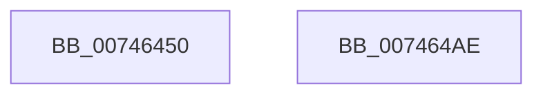

# KeRcuSynchronize

- RVA: `0x00746450`–`0x007464AF` (길이 `95` bytes)
- VA: `0x0000000140746450`
- 실행 섹션: `PAGE`
- PDB 이름 있음: `예`; PDB Function 태그: `아니요`
- unwind 정보 RVA: `0x0006C9B8`
- 디코드: `24`개 명령, `95/95` bytes 표시
- 미해석 바이트: `0` (있으면 어셈블리에 `.byte`로 보존)

> 이 문서는 커널 이미지의 기계어와 PDB 기호를 분석해 생성했습니다. 4번과 5번은 함수 원형과 자료형을 바이너리 사용 방식에서 추정한 C 해석이며 원본 소스 복구 결과는 아닙니다.

## 1. Dependencies

- 직접 호출 지점: **3**; 고유 호출 대상: **3**
- 직접 호출자로 확인된 함수: **0**
- RIP 상대 이미지 참조: **0**

### Outgoing calls
- `0x00746489` → [KeInitializeGate](../../text/49/KeInitializeGate_function_004953F8.md) (function, `0x004953F8`)
- `0x00746493` → [KiRcuStartGracePeriod](../../text/5B/KiRcuStartGracePeriod_function_005BD2F4.md) (function, `0x005BD2F4`)
- `0x007464A4` → [KeWaitForGate](../../text/2C/KeWaitForGate_function_002CA794.md) (function, `0x002CA794`)

### Direct callers
- 이 함수 시작 RVA로 연결되는 직접 call은 확인되지 않았습니다. 간접 호출은 완전히 역산할 수 없습니다.

### Static image references
- 디코드된 RIP-relative 메모리 참조가 없습니다.

## 2. Other-region calls and transfers

- 다른 실행 섹션으로 향하는 call: **3**
  - `0x00746489` → [KeInitializeGate](../../text/49/KeInitializeGate_function_004953F8.md) (`PAGE` → `.text`)
  - `0x00746493` → [KiRcuStartGracePeriod](../../text/5B/KiRcuStartGracePeriod_function_005BD2F4.md) (`PAGE` → `.text`)
  - `0x007464A4` → [KeWaitForGate](../../text/2C/KeWaitForGate_function_002CA794.md) (`PAGE` → `.text`)
- 별도 외부 분기/꼬리 이동을 확인하지 못했습니다.

## 3. Assembly (complete function range)

```asm
00746450  4C 8B DC                        mov r11, rsp
00746453  48 83 EC 78                     sub rsp, 0x78
00746457  33 C0                           xor eax, eax
00746459  49 8D 4B A8                     lea rcx, [r11 - 0x58]
0074645D  49 21 43 C0                     and qword ptr [r11 - 0x40], rax
00746461  0F 57 C0                        xorps xmm0, xmm0
00746464  F3 0F 7F 44 24 40               movdqu xmmword ptr [rsp + 0x40], xmm0
0074646A  49 21 43 E8                     and qword ptr [r11 - 0x18], rax
0074646E  33 D2                           xor edx, edx
00746470  0F 11 44 24 20                  movups xmmword ptr [rsp + 0x20], xmm0
00746475  49 89 43 B8                     mov qword ptr [r11 - 0x48], rax
00746479  49 8D 43 A8                     lea rax, [r11 - 0x58]
0074647D  49 89 43 E0                     mov qword ptr [r11 - 0x20], rax
00746481  49 C7 43 D8 06 00 00 00         mov qword ptr [r11 - 0x28], 6
00746489  E8 6A EF D4 FF                  call 0x1404953f8
0074648E  48 8D 4C 24 38                  lea rcx, [rsp + 0x38]
00746493  E8 5C 6E E7 FF                  call 0x1405bd2f4
00746498  45 33 C0                        xor r8d, r8d
0074649B  48 8D 4C 24 20                  lea rcx, [rsp + 0x20]
007464A0  41 8D 50 2A                     lea edx, [r8 + 0x2a]
007464A4  E8 EB 42 B8 FF                  call 0x1402ca794
007464A9  48 83 C4 78                     add rsp, 0x78
007464AD  C3                              ret
007464AE  CC                              int3
```

## 4. C-style interpretation (structured pseudocode)

```c
__int64 __fastcall KeRcuSynchronize(__int64 a1, int a2, int a3)
{
    __int64 result;
    __int64 v_rsp;
    unsigned __int64 v_stack_m38;
    unsigned __int64 v_stack_m40;
    unsigned __int64 v_stack_m58;

    v_rsp = (v_rsp) - (120);
    result = 0;
    v_stack_m38 = v_xmm0;
    a2 = 0;
    v_stack_m58 = v_xmm0;
    *(unsigned __int64 *)(v_rsp - 72) = 0;
    *(unsigned __int64 *)(v_rsp - 32) = v_rsp - 88;
    *(unsigned __int64 *)(v_rsp - 40) = 6;
    result = KeInitializeGate(v_rsp - 88, a2, a3, a4);
    result = KiRcuStartGracePeriod(v_stack_m40, a2, a3, a4);
    a3 = 0;
    result = KeWaitForGate(v_stack_m58, a3 + 42, a3, a4);
    v_rsp = (v_rsp) + (120);
    return result;
}
```

## 5. (Beta) C Style

```c
int64_t KeRcuSynchronize(int64_t Arg1, int32_t Arg2, int32_t Arg3)
{
    int64_t result;
    int64_t local_rsp;
    uint64_t v_stack_m38;
    uint64_t v_stack_m40;
    uint64_t v_stack_m58;

    local_rsp = (local_rsp) - (120);
    result = 0;
    v_stack_m38 = v_xmm0;
    Arg2 = 0;
    v_stack_m58 = v_xmm0;
    *(uint64_t *)(local_rsp - 0x48) = 0;
    *(uint64_t *)(local_rsp - 0x20) = local_rsp - 88;
    *(uint64_t *)(local_rsp - 0x28) = 6;
    result = KeInitializeGate(local_rsp - 88, Arg2, Arg3, a4);
    result = KiRcuStartGracePeriod(v_stack_m40, Arg2, Arg3, a4);
    Arg3 = 0;
    result = KeWaitForGate(v_stack_m58, Arg3 + 42, Arg3, a4);
    local_rsp = (local_rsp) + (120);
    return result;
}
```

## 6. Execution-region graph

[열기: 2D/3D 그래프와 함수 탐색 컨트롤 패널](../../../control-panel.html?section=page&rva=0x00746450&view=graph)

- 2D 그래프는 위에서 아래로 흐르고, 3D 그래프는 빈 공간을 드래그해 회전합니다. Shift+드래그는 이동, 휠은 확대·축소, 함수 노드 선택은 대상 보고서 이동입니다.

### Static fallback


