# KeRegisterAvailableCpusChangeNotification

- RVA: `0x00745D7C`–`0x00745FAC` (길이 `560` bytes)
- VA: `0x0000000140745D7C`
- 실행 섹션: `PAGE`
- PDB 이름 있음: `예`; PDB Function 태그: `아니요`
- unwind 정보 RVA: `0x00075C18`
- 디코드: `147`개 명령, `560/560` bytes 표시
- 미해석 바이트: `0` (있으면 어셈블리에 `.byte`로 보존)

> 이 문서는 커널 이미지의 기계어와 PDB 기호를 분석해 생성했습니다. 4번과 5번은 함수 원형과 자료형을 바이너리 사용 방식에서 추정한 C 해석이며 원본 소스 복구 결과는 아닙니다.

## 1. Dependencies

- 직접 호출 지점: **14**; 고유 호출 대상: **10**
- 직접 호출자로 확인된 함수: **2**
- RIP 상대 이미지 참조: **8**

### Outgoing calls
- `0x00745DB5` → [ExAllocatePool2](../../poolcode/B8/ExAllocatePool2_function_00B820F0.md) (function, `0x00B820F0`)
- `0x00745DD8` → [KiInitializeAvailableCpusWorkItem](../../text/4C/KiInitializeAvailableCpusWorkItem_function_004C240C.md) (function, `0x004C240C`)
- `0x00745E01` → [ObfReferenceObjectWithTag](../../text/21/ObfReferenceObjectWithTag_function_00210710.md) (function, `0x00210710`)
- `0x00745E19` → [KeAbPreAcquire](../../text/21/KeAbPreAcquire_function_00210230.md) (function, `0x00210230`)
- `0x00745E33` → [ExfAcquirePushLockExclusiveEx](../../text/20/ExfAcquirePushLockExclusiveEx_function_0020FC90.md) (function, `0x0020FC90`)
- `0x00745E89` → [ExfTryToWakePushLock](../../text/26/ExfTryToWakePushLock_function_00265DD0.md) (function, `0x00265DD0`)
- `0x00745E92` → [KeAbPostRelease](../../text/2E/KeAbPostRelease_function_002E1600.md) (function, `0x002E1600`)
- `0x00745EA6` → [KeAbPreAcquire](../../text/21/KeAbPreAcquire_function_00210230.md) (function, `0x00210230`)
- `0x00745EBF` → [ExfAcquirePushLockExclusiveEx](../../text/20/ExfAcquirePushLockExclusiveEx_function_0020FC90.md) (function, `0x0020FC90`)
- `0x00745F10` → [ExfTryToWakePushLock](../../text/26/ExfTryToWakePushLock_function_00265DD0.md) (function, `0x00265DD0`)
- `0x00745F18` → [KeAbPostRelease](../../text/2E/KeAbPostRelease_function_002E1600.md) (function, `0x002E1600`)
- `0x00745F1D` → [KeLeaveCriticalRegion](../../text/25/KeLeaveCriticalRegion_function_0025D8B0.md) (function, `0x0025D8B0`)
- `0x00745F66` → [KiUpdateProcessAvailableCpuState](../../text/3C/KiUpdateProcessAvailableCpuState_function_003C00B4.md) (function, `0x003C00B4`)
- `0x00745F7F` → [KiAvailableCpusSubscriptionQueueWorkItem](../../text/4F/KiAvailableCpusSubscriptionQueueWorkItem_function_004FCE5C.md) (function, `0x004FCE5C`)

### Direct callers
- [PsRegisterProcessAvailableCpusChangeNotification](../78/PsRegisterProcessAvailableCpusChangeNotification_function_00781B70.md) at `0x00781B7E`
- [PsRegisterSystemAvailableCpusChangeNotification](../78/PsRegisterSystemAvailableCpusChangeNotification_function_00781B90.md) at `0x00781BA4`

### Static image references
- `0x00745E97` → RVA `0x00F22FA8` (`.data`; read)
- `0x00745ECD` → RVA `0x00F22FB8` (`.data`; read)
- `0x00745ED4` → RVA `0x00F22FB0` (`.data`; read)
- `0x00745EF5` → RVA `0x00F22FB8` (`.data`; write)
- `0x00745EFC` → RVA `0x00F22FA8` (`.data`; read/write)
- `0x00745F30` → RVA `0x00F23460` (`.data`; read)
- `0x00745F39` → RVA `0x00FC6BF8` (`ALMOSTRO`; read)
- `0x00745F4D` → RVA `0x00F23458` (`.data`; read)

## 2. Other-region calls and transfers

- 다른 실행 섹션으로 향하는 call: **14**
  - `0x00745DB5` → [ExAllocatePool2](../../poolcode/B8/ExAllocatePool2_function_00B820F0.md) (`PAGE` → `POOLCODE`)
  - `0x00745DD8` → [KiInitializeAvailableCpusWorkItem](../../text/4C/KiInitializeAvailableCpusWorkItem_function_004C240C.md) (`PAGE` → `.text`)
  - `0x00745E01` → [ObfReferenceObjectWithTag](../../text/21/ObfReferenceObjectWithTag_function_00210710.md) (`PAGE` → `.text`)
  - `0x00745E19` → [KeAbPreAcquire](../../text/21/KeAbPreAcquire_function_00210230.md) (`PAGE` → `.text`)
  - `0x00745E33` → [ExfAcquirePushLockExclusiveEx](../../text/20/ExfAcquirePushLockExclusiveEx_function_0020FC90.md) (`PAGE` → `.text`)
  - `0x00745E89` → [ExfTryToWakePushLock](../../text/26/ExfTryToWakePushLock_function_00265DD0.md) (`PAGE` → `.text`)
  - `0x00745E92` → [KeAbPostRelease](../../text/2E/KeAbPostRelease_function_002E1600.md) (`PAGE` → `.text`)
  - `0x00745EA6` → [KeAbPreAcquire](../../text/21/KeAbPreAcquire_function_00210230.md) (`PAGE` → `.text`)
  - `0x00745EBF` → [ExfAcquirePushLockExclusiveEx](../../text/20/ExfAcquirePushLockExclusiveEx_function_0020FC90.md) (`PAGE` → `.text`)
  - `0x00745F10` → [ExfTryToWakePushLock](../../text/26/ExfTryToWakePushLock_function_00265DD0.md) (`PAGE` → `.text`)
  - `0x00745F18` → [KeAbPostRelease](../../text/2E/KeAbPostRelease_function_002E1600.md) (`PAGE` → `.text`)
  - `0x00745F1D` → [KeLeaveCriticalRegion](../../text/25/KeLeaveCriticalRegion_function_0025D8B0.md) (`PAGE` → `.text`)
  - `0x00745F66` → [KiUpdateProcessAvailableCpuState](../../text/3C/KiUpdateProcessAvailableCpuState_function_003C00B4.md) (`PAGE` → `.text`)
  - `0x00745F7F` → [KiAvailableCpusSubscriptionQueueWorkItem](../../text/4F/KiAvailableCpusSubscriptionQueueWorkItem_function_004FCE5C.md) (`PAGE` → `.text`)
- 별도 외부 분기/꼬리 이동을 확인하지 못했습니다.

## 3. Assembly (complete function range)

```asm
00745D7C  48 89 5C 24 08                  mov qword ptr [rsp + 8], rbx
00745D81  48 89 6C 24 10                  mov qword ptr [rsp + 0x10], rbp
00745D86  48 89 74 24 18                  mov qword ptr [rsp + 0x18], rsi
00745D8B  57                              push rdi
00745D8C  41 54                           push r12
00745D8E  41 55                           push r13
00745D90  41 56                           push r14
00745D92  41 57                           push r15
00745D94  48 83 EC 20                     sub rsp, 0x20
00745D98  48 8B EA                        mov rbp, rdx
00745D9B  49 8B D8                        mov rbx, r8
00745D9E  BA 68 00 00 00                  mov edx, 0x68
00745DA3  48 8B F1                        mov rsi, rcx
00745DA6  41 BF 4B 69 41 76               mov r15d, 0x7641694b
00745DAC  4D 8B E1                        mov r12, r9
00745DAF  45 8B C7                        mov r8d, r15d
00745DB2  8D 4A D8                        lea ecx, [rdx - 0x28]
00745DB5  E8 36 C3 43 00                  call 0x140b820f0
00745DBA  33 FF                           xor edi, edi
00745DBC  4C 8B F0                        mov r14, rax
00745DBF  48 85 C0                        test rax, rax
00745DC2  75 0A                           jne 0x140745dce
00745DC4  BF 9A 00 00 C0                  mov edi, 0xc000009a
00745DC9  E9 BE 01 00 00                  jmp 0x140745f8c
00745DCE  4C 8B C3                        mov r8, rbx
00745DD1  48 8D 48 28                     lea rcx, [rax + 0x28]
00745DD5  48 8B D5                        mov rdx, rbp
00745DD8  E8 2F C6 D7 FF                  call 0x1404c240c
00745DDD  65 48 8B 0C 25 88 01 00 00      mov rcx, qword ptr gs:[0x188]
00745DE6  48 83 CB FF                     or rbx, 0xffffffffffffffff
00745DEA  66 01 99 E4 01 00 00            add word ptr [rcx + 0x1e4], bx
00745DF1  90                              nop
00745DF2  48 85 F6                        test rsi, rsi
00745DF5  0F 84 9C 00 00 00               je 0x140745e97
00745DFB  41 8B D7                        mov edx, r15d
00745DFE  48 8B CE                        mov rcx, rsi
00745E01  E8 0A A9 AC FF                  call 0x140210710
00745E06  48 8B AE C0 01 00 00            mov rbp, qword ptr [rsi + 0x1c0]
00745E0D  45 33 C0                        xor r8d, r8d
00745E10  48 83 C5 20                     add rbp, 0x20
00745E14  33 D2                           xor edx, edx
00745E16  48 8B CD                        mov rcx, rbp
00745E19  E8 12 A4 AC FF                  call 0x140210230
00745E1E  F0 48 0F BA 6D 00 00            lock bts qword ptr [rbp], 0
00745E25  4C 8B F8                        mov r15, rax
00745E28  73 0E                           jae 0x140745e38
00745E2A  4C 8B C5                        mov r8, rbp
00745E2D  48 8B D0                        mov rdx, rax
00745E30  48 8B CD                        mov rcx, rbp
00745E33  E8 58 9E AC FF                  call 0x14020fc90
00745E38  4D 85 FF                        test r15, r15
00745E3B  74 05                           je 0x140745e42
00745E3D  41 C6 47 0A 01                  mov byte ptr [r15 + 0xa], 1
00745E42  49 89 36                        mov qword ptr [r14], rsi
00745E45  49 8D 4E 08                     lea rcx, [r14 + 8]
00745E49  48 8B 86 C0 01 00 00            mov rax, qword ptr [rsi + 0x1c0]
00745E50  48 83 C0 28                     add rax, 0x28
00745E54  48 8B 50 08                     mov rdx, qword ptr [rax + 8]
00745E58  48 39 02                        cmp qword ptr [rdx], rax
00745E5B  0F 85 83 00 00 00               jne 0x140745ee4
00745E61  48 89 01                        mov qword ptr [rcx], rax
00745E64  48 89 51 08                     mov qword ptr [rcx + 8], rdx
00745E68  48 89 0A                        mov qword ptr [rdx], rcx
00745E6B  48 89 48 08                     mov qword ptr [rax + 8], rcx
00745E6F  48 8B C3                        mov rax, rbx
00745E72  48 8B AE C0 01 00 00            mov rbp, qword ptr [rsi + 0x1c0]
00745E79  F0 48 0F C1 45 20               lock xadd qword ptr [rbp + 0x20], rax
00745E7F  24 06                           and al, 6
00745E81  3C 02                           cmp al, 2
00745E83  75 09                           jne 0x140745e8e
00745E85  48 8D 4D 20                     lea rcx, [rbp + 0x20]
00745E89  E8 42 FF B1 FF                  call 0x140265dd0
00745E8E  48 8D 4D 20                     lea rcx, [rbp + 0x20]
00745E92  E8 69 B7 B9 FF                  call 0x1402e1600
00745E97  4C 8D 3D 0A D1 7D 00            lea r15, [rip + 0x7dd10a]
00745E9E  45 33 C0                        xor r8d, r8d
00745EA1  49 8B CF                        mov rcx, r15
00745EA4  33 D2                           xor edx, edx
00745EA6  E8 85 A3 AC FF                  call 0x140210230
00745EAB  F0 49 0F BA 2F 00               lock bts qword ptr [r15], 0
00745EB1  48 8B E8                        mov rbp, rax
00745EB4  73 0E                           jae 0x140745ec4
00745EB6  4D 8B C7                        mov r8, r15
00745EB9  48 8B D0                        mov rdx, rax
00745EBC  49 8B CF                        mov rcx, r15
00745EBF  E8 CC 9D AC FF                  call 0x14020fc90
00745EC4  48 85 ED                        test rbp, rbp
00745EC7  74 04                           je 0x140745ecd
00745EC9  C6 45 0A 01                     mov byte ptr [rbp + 0xa], 1
00745ECD  48 8B 0D E4 D0 7D 00            mov rcx, qword ptr [rip + 0x7dd0e4]
00745ED4  48 8D 15 D5 D0 7D 00            lea rdx, [rip + 0x7dd0d5]
00745EDB  49 8D 46 18                     lea rax, [r14 + 0x18]
00745EDF  48 39 11                        cmp qword ptr [rcx], rdx
00745EE2  74 07                           je 0x140745eeb
00745EE4  B9 03 00 00 00                  mov ecx, 3
00745EE9  CD 29                           int 0x29
00745EEB  48 89 10                        mov qword ptr [rax], rdx
00745EEE  48 89 48 08                     mov qword ptr [rax + 8], rcx
00745EF2  48 89 01                        mov qword ptr [rcx], rax
00745EF5  48 89 05 BC D0 7D 00            mov qword ptr [rip + 0x7dd0bc], rax
00745EFC  F0 48 0F C1 1D A3 D0 7D 00      lock xadd qword ptr [rip + 0x7dd0a3], rbx
00745F05  80 E3 06                        and bl, 6
00745F08  80 FB 02                        cmp bl, 2
00745F0B  75 08                           jne 0x140745f15
00745F0D  49 8B CF                        mov rcx, r15
00745F10  E8 BB FE B1 FF                  call 0x140265dd0
00745F15  49 8B CF                        mov rcx, r15
00745F18  E8 E3 B6 B9 FF                  call 0x1402e1600
00745F1D  E8 8E 79 B1 FF                  call 0x14025d8b0
00745F22  4D 85 E4                        test r12, r12
00745F25  74 5D                           je 0x140745f84
00745F27  F0 09 3C 24                     lock or dword ptr [rsp], edi
00745F2B  48 85 F6                        test rsi, rsi
00745F2E  75 09                           jne 0x140745f39
00745F30  48 8B 05 29 D5 7D 00            mov rax, qword ptr [rip + 0x7dd529]
00745F37  EB 3C                           jmp 0x140745f75
00745F39  48 8B 0D B8 0C 88 00            mov rcx, qword ptr [rip + 0x880cb8]
00745F40  48 8B 86 C0 01 00 00            mov rax, qword ptr [rsi + 0x1c0]
00745F47  48 39 48 08                     cmp qword ptr [rax + 8], rcx
00745F4B  75 14                           jne 0x140745f61
00745F4D  48 8B 0D 04 D5 7D 00            mov rcx, qword ptr [rip + 0x7dd504]
00745F54  48 8B 86 C0 01 00 00            mov rax, qword ptr [rsi + 0x1c0]
00745F5B  48 39 48 10                     cmp qword ptr [rax + 0x10], rcx
00745F5F  74 0A                           je 0x140745f6b
00745F61  33 D2                           xor edx, edx
00745F63  48 8B CE                        mov rcx, rsi
00745F66  E8 49 A1 C7 FF                  call 0x1403c00b4
00745F6B  48 8B 86 C0 01 00 00            mov rax, qword ptr [rsi + 0x1c0]
00745F72  48 8B 00                        mov rax, qword ptr [rax]
00745F75  49 39 04 24                     cmp qword ptr [r12], rax
00745F79  74 09                           je 0x140745f84
00745F7B  49 8D 4E 28                     lea rcx, [r14 + 0x28]
00745F7F  E8 D8 6E DB FF                  call 0x1404fce5c
00745F84  48 8B 4C 24 70                  mov rcx, qword ptr [rsp + 0x70]
00745F89  4C 89 31                        mov qword ptr [rcx], r14
00745F8C  48 8B 5C 24 50                  mov rbx, qword ptr [rsp + 0x50]
00745F91  8B C7                           mov eax, edi
00745F93  48 8B 6C 24 58                  mov rbp, qword ptr [rsp + 0x58]
00745F98  48 8B 74 24 60                  mov rsi, qword ptr [rsp + 0x60]
00745F9D  48 83 C4 20                     add rsp, 0x20
00745FA1  41 5F                           pop r15
00745FA3  41 5E                           pop r14
00745FA5  41 5D                           pop r13
00745FA7  41 5C                           pop r12
00745FA9  5F                              pop rdi
00745FAA  C3                              ret
00745FAB  CC                              int3
```

## 4. C-style interpretation (structured pseudocode)

```c
__int64 __fastcall KeRegisterAvailableCpusChangeNotification(__int64 a1, __int64 a2, __int64 a3, __int64 a4, __int64 a5)
{
    __int64 result;
    __int64 v_rbp;
    __int64 v_rbx;
    __int64 v_rdi;
    __int64 v_rsp;
    unsigned int v_stack_m48;
    unsigned __int64 v_stack_p10;
    unsigned __int64 v_stack_p18;
    unsigned __int64 v_stack_p8;

    v_stack_p8 = v_rbx;
    v_stack_p10 = v_rbp;
    v_stack_p18 = v_rsi;
    v_rsp = (v_rsp) - (32);
    result = ExAllocatePool2(104 - 40, 104, (unsigned int)((unsigned int)((unsigned int)(0x7641694BULL))), a4);
    v_rdi = 0;
    if (result != 0) goto loc_00745DCE;
    goto loc_00745F8C;
loc_00745DCE:
    result = KiInitializeAvailableCpusWorkItem(result + 40, a2, a3, a4);
    v_rbx = (a3) | (-1);
    if (a1 == 0) goto loc_00745E97;
    result = ObfReferenceObjectWithTag(a1, (unsigned int)((unsigned int)((unsigned int)(0x7641694BULL))), a3, a4);
    a3 = 0;
    v_rbp = (*(unsigned __int64 *)(a1 + 448)) + (32);
    a2 = 0;
    result = KeAbPreAcquire(v_rbp, a2, a3, a4);
    if (!(condition_is_above_or_equal)) {
        a3 = v_rbp;
        a2 = result;
        a1 = v_rbp;
        result = ExfAcquirePushLockExclusiveEx(a1, a2, a3, a4);
    }
    if (result != 0) {
        *(unsigned __int8 *)(result + 10) = 1;
    }
    *(unsigned __int64 *)(result) = a1;
    result = (*(unsigned __int64 *)(a1 + 448)) + (40);
    if ((*(unsigned __int64 *)(*(unsigned __int64 *)(result + 8))) != result) goto loc_00745EE4;
    *(unsigned __int64 *)(result + 8) = result;
    *(unsigned __int64 *)(result + 8 + 8) = *(unsigned __int64 *)(result + 8);
    *(unsigned __int64 *)(*(unsigned __int64 *)(result + 8)) = result + 8;
    *(unsigned __int64 *)(result + 8) = result + 8;
    result = (unsigned __int8)((v_rbx) & (6));
    if (((unsigned __int8)(result)) == 2) {
        a1 = *(unsigned __int64 *)(a1 + 448) + 32;
        result = ExfTryToWakePushLock(a1, *(unsigned __int64 *)(result + 8), a3, a4);
    }
    result = KeAbPostRelease(*(unsigned __int64 *)(a1 + 448) + 32, *(unsigned __int64 *)(result + 8), a3, a4);
loc_00745E97:
    a3 = 0;
    a2 = 0;
    result = KeAbPreAcquire(v_rip + 8245514, a2, a3, a4);
    if (!(condition_is_above_or_equal)) {
        a3 = v_rip + 8245514;
        a2 = result;
        a1 = v_rip + 8245514;
        result = ExfAcquirePushLockExclusiveEx(a1, a2, a3, a4);
    }
    if (result != 0) {
        *(unsigned __int8 *)(result + 10) = 1;
    }
    if ((*(unsigned __int64 *)(*(unsigned __int64 *)(v_rip + 8245476))) != (v_rip + 8245461)) {
        a1 = 3;
    }
    *(unsigned __int64 *)(result + 24) = v_rip + 8245461;
    *(unsigned __int64 *)(result + 24 + 8) = a1;
    *(unsigned __int64 *)(a1) = result + 24;
    *(unsigned __int64 *)(v_rip + 8245436) = result + 24;
    v_rbx = (unsigned __int8)((v_rbx) & (6));
    result = result + 24;
    if (((unsigned __int8)(v_rbx)) == 2) {
        a1 = v_rip + 8245514;
        result = ExfTryToWakePushLock(a1, v_rip + 8245461, a3, a4);
    }
    result = KeAbPostRelease(v_rip + 8245514, v_rip + 8245461, a3, a4);
    result = KeLeaveCriticalRegion(v_rip + 8245514, v_rip + 8245461, a3, a4);
    if (a4 == 0) goto loc_00745F84;
    if (a1 != 0) goto loc_00745F39;
    goto loc_00745F75;
loc_00745F39:
    if ((*(unsigned __int64 *)(*(unsigned __int64 *)(a1 + 448) + 8)) != (*(unsigned __int64 *)(v_rip + 8916152))) goto loc_00745F61;
    result = *(unsigned __int64 *)(a1 + 448);
    if ((*(unsigned __int64 *)(*(unsigned __int64 *)(a1 + 448) + 16)) != (*(unsigned __int64 *)(v_rip + 8246532))) {
        a2 = 0;
        a1 = a1;
        result = KiUpdateProcessAvailableCpuState(a1, a2, a3, a4);
    }
loc_00745F75:
    result = *(unsigned __int64 *)(*(unsigned __int64 *)(a1 + 448));
    if ((*(unsigned __int64 *)(a4)) != (*(unsigned __int64 *)(*(unsigned __int64 *)(a1 + 448)))) {
        a1 = result + 40;
        result = KiAvailableCpusSubscriptionQueueWorkItem(a1, a2, a3, a4);
    }
    *(unsigned __int64 *)(a5) = result;
loc_00745F8C:
    v_rsp = (v_rsp) + (32);
    return (unsigned int)((unsigned int)((unsigned int)(0xC000009AULL)));
}
```

## 5. (Beta) C Style

```c
int64_t KeRegisterAvailableCpusChangeNotification(int64_t Arg1, int64_t Arg2, int64_t Arg3, int64_t Arg4, void *Arg5)
{
    uint8_t *arg5 = (uint8_t *)Arg5;

    int64_t result;
    int64_t local_rbp;
    int64_t local_rbx;
    int64_t local_rdi;
    int64_t local_rsp;
    uint32_t v_stack_m48;
    uint64_t v_stack_p10;
    uint64_t v_stack_p18;
    uint64_t v_stack_p8;

    v_stack_p8 = local_rbx;
    v_stack_p10 = local_rbp;
    v_stack_p18 = local_rsi;
    local_rsp = (local_rsp) - (32);
    result = ExAllocatePool2(104 - 40, 104, (uint32_t)((uint32_t)((uint32_t)(0x7641694BULL))), Arg4);
    local_rdi = 0;
    if (result != 0) goto loc_00745DCE;
    goto loc_00745F8C;
loc_00745DCE:
    result = KiInitializeAvailableCpusWorkItem(result + 40, Arg2, Arg3, Arg4);
    local_rbx = (Arg3) | (-1);
    if (Arg1 == 0) goto loc_00745E97;
    result = ObfReferenceObjectWithTag(Arg1, (uint32_t)((uint32_t)((uint32_t)(0x7641694BULL))), Arg3, Arg4);
    Arg3 = 0;
    local_rbp = (*(uint64_t *)(Arg1 + 0x1C0)) + (32);
    Arg2 = 0;
    result = KeAbPreAcquire(local_rbp, Arg2, Arg3, Arg4);
    if (!(condition_is_above_or_equal)) {
        Arg3 = local_rbp;
        Arg2 = result;
        Arg1 = local_rbp;
        result = ExfAcquirePushLockExclusiveEx(Arg1, Arg2, Arg3, Arg4);
    }
    if (result != 0) {
        *(uint8_t *)(result + 0xA) = 1;
    }
    *(uint64_t *)(result) = Arg1;
    result = (*(uint64_t *)(Arg1 + 0x1C0)) + (40);
    if ((*(uint64_t *)(*(uint64_t *)(result + 0x8))) != result) goto loc_00745EE4;
    *(uint64_t *)(result + 0x8) = result;
    *(uint64_t *)(result + 0x8 + 0x8) = *(uint64_t *)(result + 0x8);
    *(uint64_t *)(*(uint64_t *)(result + 0x8)) = result + 8;
    *(uint64_t *)(result + 0x8) = result + 8;
    result = (uint8_t)((local_rbx) & (6));
    if (((uint8_t)(result)) == 2) {
        Arg1 = *(uint64_t *)(Arg1 + 0x1C0) + 32;
        result = ExfTryToWakePushLock(Arg1, *(uint64_t *)(result + 0x8), Arg3, Arg4);
    }
    result = KeAbPostRelease(*(uint64_t *)(Arg1 + 0x1C0) + 32, *(uint64_t *)(result + 0x8), Arg3, Arg4);
loc_00745E97:
    Arg3 = 0;
    Arg2 = 0;
    result = KeAbPreAcquire(v_rip + 8245514, Arg2, Arg3, Arg4);
    if (!(condition_is_above_or_equal)) {
        Arg3 = v_rip + 8245514;
        Arg2 = result;
        Arg1 = v_rip + 8245514;
        result = ExfAcquirePushLockExclusiveEx(Arg1, Arg2, Arg3, Arg4);
    }
    if (result != 0) {
        *(uint8_t *)(result + 0xA) = 1;
    }
    if ((*(uint64_t *)(*(uint64_t *)(v_rip + 0x7DD0E4))) != (v_rip + 8245461)) {
        Arg1 = 3;
    }
    *(uint64_t *)(result + 0x18) = v_rip + 8245461;
    *(uint64_t *)(result + 0x18 + 0x8) = Arg1;
    *(uint64_t *)(Arg1) = result + 24;
    *(uint64_t *)(v_rip + 0x7DD0BC) = result + 24;
    local_rbx = (uint8_t)((local_rbx) & (6));
    result = result + 24;
    if (((uint8_t)(local_rbx)) == 2) {
        Arg1 = v_rip + 8245514;
        result = ExfTryToWakePushLock(Arg1, v_rip + 8245461, Arg3, Arg4);
    }
    result = KeAbPostRelease(v_rip + 8245514, v_rip + 8245461, Arg3, Arg4);
    result = KeLeaveCriticalRegion(v_rip + 8245514, v_rip + 8245461, Arg3, Arg4);
    if (Arg4 == 0) goto loc_00745F84;
    if (Arg1 != 0) goto loc_00745F39;
    goto loc_00745F75;
loc_00745F39:
    if ((*(uint64_t *)(*(uint64_t *)(Arg1 + 0x1C0) + 0x8)) != (*(uint64_t *)(v_rip + 0x880CB8))) goto loc_00745F61;
    result = *(uint64_t *)(Arg1 + 0x1C0);
    if ((*(uint64_t *)(*(uint64_t *)(Arg1 + 0x1C0) + 0x10)) != (*(uint64_t *)(v_rip + 0x7DD504))) {
        Arg2 = 0;
        Arg1 = Arg1;
        result = KiUpdateProcessAvailableCpuState(Arg1, Arg2, Arg3, Arg4);
    }
loc_00745F75:
    result = *(uint64_t *)(*(uint64_t *)(Arg1 + 0x1C0));
    if ((*(uint64_t *)(Arg4)) != (*(uint64_t *)(*(uint64_t *)(Arg1 + 0x1C0)))) {
        Arg1 = result + 40;
        result = KiAvailableCpusSubscriptionQueueWorkItem(Arg1, Arg2, Arg3, Arg4);
    }
    *(uint64_t *)(arg5) = result;
loc_00745F8C:
    local_rsp = (local_rsp) + (32);
    return (uint32_t)((uint32_t)((uint32_t)(0xC000009AULL)));
}
```

### 관측된 메모리 오프셋

구조체 형식이 확인되지 않은 접근은 인자 기준의 오프셋으로만 기록했습니다.

| 기준 인자 | 오프셋 표현 | 폭 (bit) | 접근 |
|---|---:|---:|---|
| `Arg5` | `+ 0x0` | `64` | `W` |

## 6. Execution-region graph

[열기: 2D/3D 그래프와 함수 탐색 컨트롤 패널](../../../control-panel.html?section=page&rva=0x00745D7C&view=graph)

- 2D 그래프는 위에서 아래로 흐르고, 3D 그래프는 빈 공간을 드래그해 회전합니다. Shift+드래그는 이동, 휠은 확대·축소, 함수 노드 선택은 대상 보고서 이동입니다.

### Static fallback

```mermaid
flowchart TD
  bb_00745D7C[BB_00745D7C]
  bb_00745DC4[BB_00745DC4]
  bb_00745DCE[BB_00745DCE]
  bb_00745DFB[BB_00745DFB]
  bb_00745E2A[BB_00745E2A]
  bb_00745E38[BB_00745E38]
  bb_00745E3D[BB_00745E3D]
  bb_00745E42[BB_00745E42]
  bb_00745E61[BB_00745E61]
  bb_00745E85[BB_00745E85]
  bb_00745E8E[BB_00745E8E]
  bb_00745E97[BB_00745E97]
  bb_00745EB6[BB_00745EB6]
  bb_00745EC4[BB_00745EC4]
  bb_00745EC9[BB_00745EC9]
  bb_00745ECD[BB_00745ECD]
  bb_00745EE4[BB_00745EE4]
  bb_00745EEB[BB_00745EEB]
  bb_00745F0D[BB_00745F0D]
  bb_00745F15[BB_00745F15]
  bb_00745F27[BB_00745F27]
  bb_00745F30[BB_00745F30]
  bb_00745F39[BB_00745F39]
  bb_00745F4D[BB_00745F4D]
  bb_00745F61[BB_00745F61]
  bb_00745F6B[BB_00745F6B]
  bb_00745F75[BB_00745F75]
  bb_00745F7B[BB_00745F7B]
  bb_00745F84[BB_00745F84]
  bb_00745F8C[BB_00745F8C]
  bb_00745FAB[BB_00745FAB]
  bb_00745D7C -->|branch| bb_00745DCE
  bb_00745D7C -->|fallthrough| bb_00745DC4
  bb_00745DC4 -->|branch| bb_00745F8C
  bb_00745DCE -->|branch| bb_00745E97
  bb_00745DCE -->|fallthrough| bb_00745DFB
  bb_00745DFB -->|branch| bb_00745E38
  bb_00745DFB -->|fallthrough| bb_00745E2A
  bb_00745E2A -->|flow| bb_00745E38
  bb_00745E38 -->|branch| bb_00745E42
  bb_00745E38 -->|fallthrough| bb_00745E3D
  bb_00745E3D -->|flow| bb_00745E42
  bb_00745E42 -->|branch| bb_00745EE4
  bb_00745E42 -->|fallthrough| bb_00745E61
  bb_00745E61 -->|branch| bb_00745E8E
  bb_00745E61 -->|fallthrough| bb_00745E85
  bb_00745E85 -->|flow| bb_00745E8E
  bb_00745E8E -->|flow| bb_00745E97
  bb_00745E97 -->|branch| bb_00745EC4
  bb_00745E97 -->|fallthrough| bb_00745EB6
  bb_00745EB6 -->|flow| bb_00745EC4
  bb_00745EC4 -->|branch| bb_00745ECD
  bb_00745EC4 -->|fallthrough| bb_00745EC9
  bb_00745EC9 -->|flow| bb_00745ECD
  bb_00745ECD -->|branch| bb_00745EEB
  bb_00745ECD -->|fallthrough| bb_00745EE4
  bb_00745EE4 -->|flow| bb_00745EEB
  bb_00745EEB -->|branch| bb_00745F15
  bb_00745EEB -->|fallthrough| bb_00745F0D
  bb_00745F0D -->|flow| bb_00745F15
  bb_00745F15 -->|branch| bb_00745F84
  bb_00745F15 -->|fallthrough| bb_00745F27
  bb_00745F27 -->|branch| bb_00745F39
  bb_00745F27 -->|fallthrough| bb_00745F30
  bb_00745F30 -->|branch| bb_00745F75
  bb_00745F39 -->|branch| bb_00745F61
  bb_00745F39 -->|fallthrough| bb_00745F4D
  bb_00745F4D -->|branch| bb_00745F6B
  bb_00745F4D -->|fallthrough| bb_00745F61
  bb_00745F61 -->|flow| bb_00745F6B
  bb_00745F6B -->|flow| bb_00745F75
  bb_00745F75 -->|branch| bb_00745F84
  bb_00745F75 -->|fallthrough| bb_00745F7B
  bb_00745F7B -->|flow| bb_00745F84
  bb_00745F84 -->|flow| bb_00745F8C
```


