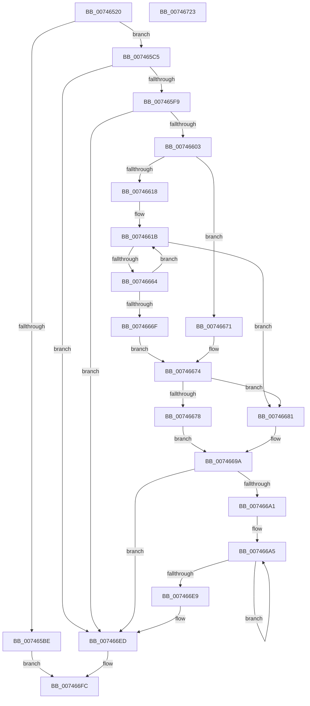

# KeRegisterProcessorChangeCallback

- RVA: `0x00746520`–`0x00746724` (길이 `516` bytes)
- VA: `0x0000000140746520`
- 실행 섹션: `PAGE`
- PDB 이름 있음: `예`; PDB Function 태그: `아니요`
- unwind 정보 RVA: `0x000BE45C`
- 디코드: `141`개 명령, `516/516` bytes 표시
- 미해석 바이트: `0` (있으면 어셈블리에 `.byte`로 보존)

> 이 문서는 커널 이미지의 기계어와 PDB 기호를 분석해 생성했습니다. 4번과 5번은 함수 원형과 자료형을 바이너리 사용 방식에서 추정한 C 해석이며 원본 소스 복구 결과는 아닙니다.

## 1. Dependencies

- 직접 호출 지점: **12**; 고유 호출 대상: **10**
- 직접 호출자로 확인된 함수: **1**
- RIP 상대 이미지 참조: **5**

### Outgoing calls
- `0x0074658B` → [RtlInitUnicodeString](../../text/42/RtlInitUnicodeString_function_0042A780.md) (function, `0x0042A780`)
- `0x007465B2` → [ExCreateCallback](../A7/ExCreateCallback_function_00A7B9D0.md) (function, `0x00A7B9D0`)
- `0x007465CC` → [ExAcquireFastMutex](../../text/20/ExAcquireFastMutex_function_0020E5A0.md) (function, `0x0020E5A0`)
- `0x007465DB` → [ExRegisterCallback](../../text/4B/ExRegisterCallback_function_004BDFC0.md) (function, `0x004BDFC0`)
- `0x007465EB` → [ObfDereferenceObject](../../text/2F/ObfDereferenceObject_function_002F9350.md) (function, `0x002F9350`)
- `0x0074663E` → [HalGetProcessorIdByNtNumber](../../text/2D/HalGetProcessorIdByNtNumber_function_002D5560.md) (function, `0x002D5560`)
- `0x00746658` → [guard_dispatch_icall](../../text/6B/guard_dispatch_icall_function_006BAAD0.md) (function, `0x006BAAD0`)
- `0x0074668B` → [ExUnregisterCallback](../../text/4B/ExUnregisterCallback_function_004B7F80.md) (function, `0x004B7F80`)
- `0x007466C6` → [HalGetProcessorIdByNtNumber](../../text/2D/HalGetProcessorIdByNtNumber_function_002D5560.md) (function, `0x002D5560`)
- `0x007466D9` → [guard_dispatch_icall](../../text/6B/guard_dispatch_icall_function_006BAAD0.md) (function, `0x006BAAD0`)
- `0x007466F4` → [ExReleaseFastMutex](../../text/25/ExReleaseFastMutex_function_002519C0.md) (function, `0x002519C0`)
- `0x00746703` → [_security_check_cookie](../../text/6A/_security_check_cookie_function_006AC640.md) (function, `0x006AC640`)

### Direct callers
- [PoInitSystem](../../init/C7/PoInitSystem_function_00C72358.md) at `0x00C72E02`

### Static image references
- `0x0074653C` → RVA `0x00E0A740` (`.data`; read)
- `0x0074656F` → RVA `0x00B006B0` (` ?? ::NNGAKEGL::`string'`; read)
- `0x007465C5` → RVA `0x00F22B80` (`.data`; read)
- `0x00746603` → RVA `0x00FC6A80` (`ALMOSTRO`; read)
- `0x0074660A` → RVA `0x00FC8C40` (`ALMOSTRO`; read)

## 2. Other-region calls and transfers

- 다른 실행 섹션으로 향하는 call: **11**
  - `0x0074658B` → [RtlInitUnicodeString](../../text/42/RtlInitUnicodeString_function_0042A780.md) (`PAGE` → `.text`)
  - `0x007465CC` → [ExAcquireFastMutex](../../text/20/ExAcquireFastMutex_function_0020E5A0.md) (`PAGE` → `.text`)
  - `0x007465DB` → [ExRegisterCallback](../../text/4B/ExRegisterCallback_function_004BDFC0.md) (`PAGE` → `.text`)
  - `0x007465EB` → [ObfDereferenceObject](../../text/2F/ObfDereferenceObject_function_002F9350.md) (`PAGE` → `.text`)
  - `0x0074663E` → [HalGetProcessorIdByNtNumber](../../text/2D/HalGetProcessorIdByNtNumber_function_002D5560.md) (`PAGE` → `.text`)
  - `0x00746658` → [guard_dispatch_icall](../../text/6B/guard_dispatch_icall_function_006BAAD0.md) (`PAGE` → `.text`)
  - `0x0074668B` → [ExUnregisterCallback](../../text/4B/ExUnregisterCallback_function_004B7F80.md) (`PAGE` → `.text`)
  - `0x007466C6` → [HalGetProcessorIdByNtNumber](../../text/2D/HalGetProcessorIdByNtNumber_function_002D5560.md) (`PAGE` → `.text`)
  - `0x007466D9` → [guard_dispatch_icall](../../text/6B/guard_dispatch_icall_function_006BAAD0.md) (`PAGE` → `.text`)
  - `0x007466F4` → [ExReleaseFastMutex](../../text/25/ExReleaseFastMutex_function_002519C0.md) (`PAGE` → `.text`)
  - `0x00746703` → [_security_check_cookie](../../text/6A/_security_check_cookie_function_006AC640.md) (`PAGE` → `.text`)
- 별도 외부 분기/꼬리 이동을 확인하지 못했습니다.

## 3. Assembly (complete function range)

```asm
00746520  48 89 5C 24 18                  mov qword ptr [rsp + 0x18], rbx
00746525  55                              push rbp
00746526  56                              push rsi
00746527  57                              push rdi
00746528  41 54                           push r12
0074652A  41 55                           push r13
0074652C  41 56                           push r14
0074652E  41 57                           push r15
00746530  48 8D 6C 24 D9                  lea rbp, [rsp - 0x27]
00746535  48 81 EC A0 00 00 00            sub rsp, 0xa0
0074653C  48 8B 05 FD 41 6C 00            mov rax, qword ptr [rip + 0x6c41fd]
00746543  48 33 C4                        xor rax, rsp
00746546  48 89 45 1F                     mov qword ptr [rbp + 0x1f], rax
0074654A  48 8B F2                        mov rsi, rdx
0074654D  48 89 55 B7                     mov qword ptr [rbp - 0x49], rdx
00746551  4C 8B E9                        mov r13, rcx
00746554  48 C7 45 D7 30 00 00 00         mov qword ptr [rbp - 0x29], 0x30
0074655C  33 C0                           xor eax, eax
0074655E  48 C7 45 EF 40 02 00 00         mov qword ptr [rbp - 0x11], 0x240
00746566  0F 57 C0                        xorps xmm0, xmm0
00746569  89 45 17                        mov dword ptr [rbp + 0x17], eax
0074656C  0F 57 C9                        xorps xmm1, xmm1
0074656F  48 8D 15 3A A1 3B 00            lea rdx, [rip + 0x3ba13a]
00746576  33 DB                           xor ebx, ebx
00746578  48 8D 4D C7                     lea rcx, [rbp - 0x39]
0074657C  48 89 5D AF                     mov qword ptr [rbp - 0x51], rbx
00746580  41 8B F8                        mov edi, r8d
00746583  0F 11 45 C7                     movups xmmword ptr [rbp - 0x39], xmm0
00746587  0F 11 4D 07                     movups xmmword ptr [rbp + 7], xmm1
0074658B  E8 F0 41 CE FF                  call 0x14042a780
00746590  48 8D 45 C7                     lea rax, [rbp - 0x39]
00746594  48 89 5D DF                     mov qword ptr [rbp - 0x21], rbx
00746598  0F 57 C0                        xorps xmm0, xmm0
0074659B  48 89 45 E7                     mov qword ptr [rbp - 0x19], rax
0074659F  45 33 C9                        xor r9d, r9d
007465A2  48 8D 55 D7                     lea rdx, [rbp - 0x29]
007465A6  45 33 C0                        xor r8d, r8d
007465A9  48 8D 4D AF                     lea rcx, [rbp - 0x51]
007465AD  F3 0F 7F 45 F7                  movdqu xmmword ptr [rbp - 9], xmm0
007465B2  E8 19 54 33 00                  call 0x140a7b9d0
007465B7  89 45 A7                        mov dword ptr [rbp - 0x59], eax
007465BA  85 C0                           test eax, eax
007465BC  79 07                           jns 0x1407465c5
007465BE  33 C0                           xor eax, eax
007465C0  E9 37 01 00 00                  jmp 0x1407466fc
007465C5  48 8D 0D B4 C5 7D 00            lea rcx, [rip + 0x7dc5b4]
007465CC  E8 CF 7F AC FF                  call 0x14020e5a0
007465D1  48 8B 4D AF                     mov rcx, qword ptr [rbp - 0x51]
007465D5  4C 8B C6                        mov r8, rsi
007465D8  49 8B D5                        mov rdx, r13
007465DB  E8 E0 79 D7 FF                  call 0x1404bdfc0
007465E0  48 8B 4D AF                     mov rcx, qword ptr [rbp - 0x51]
007465E4  48 8B F0                        mov rsi, rax
007465E7  48 89 45 BF                     mov qword ptr [rbp - 0x41], rax
007465EB  E8 60 2D BB FF                  call 0x1402f9350
007465F0  48 85 F6                        test rsi, rsi
007465F3  0F 84 F4 00 00 00               je 0x1407466ed
007465F9  40 F6 C7 01                     test dil, 1
007465FD  0F 84 EA 00 00 00               je 0x1407466ed
00746603  44 8B 3D 76 04 88 00            mov r15d, dword ptr [rip + 0x880476]
0074660A  4C 8D 25 2F 26 88 00            lea r12, [rip + 0x88262f]
00746611  8B FB                           mov edi, ebx
00746613  45 85 FF                        test r15d, r15d
00746616  74 59                           je 0x140746671
00746618  4D 8B F4                        mov r14, r12
0074661B  49 8B 0E                        mov rcx, qword ptr [r14]
0074661E  48 8D 55 17                     lea rdx, [rbp + 0x17]
00746622  89 7D 0B                        mov dword ptr [rbp + 0xb], edi
00746625  0F B6 81 D0 00 00 00            movzx eax, byte ptr [rcx + 0xd0]
0074662C  66 89 45 13                     mov word ptr [rbp + 0x13], ax
00746630  8A 81 D1 00 00 00               mov al, byte ptr [rcx + 0xd1]
00746636  8B CF                           mov ecx, edi
00746638  88 45 15                        mov byte ptr [rbp + 0x15], al
0074663B  89 5D 0F                        mov dword ptr [rbp + 0xf], ebx
0074663E  E8 1D EF B8 FF                  call 0x1402d5560
00746643  48 8B 4D B7                     mov rcx, qword ptr [rbp - 0x49]
00746647  4C 8D 45 A7                     lea r8, [rbp - 0x59]
0074664B  48 8D 55 07                     lea rdx, [rbp + 7]
0074664F  89 5D 07                        mov dword ptr [rbp + 7], ebx
00746652  49 8B C5                        mov rax, r13
00746655  89 5D A7                        mov dword ptr [rbp - 0x59], ebx
00746658  E8 73 44 F7 FF                  call 0x1406baad0
0074665D  8B 45 A7                        mov eax, dword ptr [rbp - 0x59]
00746660  85 C0                           test eax, eax
00746662  78 1D                           js 0x140746681
00746664  FF C7                           inc edi
00746666  49 83 C6 08                     add r14, 8
0074666A  41 3B FF                        cmp edi, r15d
0074666D  72 AC                           jb 0x14074661b
0074666F  EB 03                           jmp 0x140746674
00746671  8B 45 A7                        mov eax, dword ptr [rbp - 0x59]
00746674  85 C0                           test eax, eax
00746676  78 09                           js 0x140746681
00746678  C7 45 07 01 00 00 00            mov dword ptr [rbp + 7], 1
0074667F  EB 19                           jmp 0x14074669a
00746681  48 8B CE                        mov rcx, rsi
00746684  C7 45 07 02 00 00 00            mov dword ptr [rbp + 7], 2
0074668B  E8 F0 18 D7 FF                  call 0x1404b7f80
00746690  8B 45 A7                        mov eax, dword ptr [rbp - 0x59]
00746693  48 8B F3                        mov rsi, rbx
00746696  48 89 5D BF                     mov qword ptr [rbp - 0x41], rbx
0074669A  89 45 0F                        mov dword ptr [rbp + 0xf], eax
0074669D  85 FF                           test edi, edi
0074669F  74 4C                           je 0x1407466ed
007466A1  48 8B 75 B7                     mov rsi, qword ptr [rbp - 0x49]
007466A5  49 8B 0C 24                     mov rcx, qword ptr [r12]
007466A9  48 8D 55 17                     lea rdx, [rbp + 0x17]
007466AD  89 5D 0B                        mov dword ptr [rbp + 0xb], ebx
007466B0  0F B6 81 D0 00 00 00            movzx eax, byte ptr [rcx + 0xd0]
007466B7  66 89 45 13                     mov word ptr [rbp + 0x13], ax
007466BB  8A 81 D1 00 00 00               mov al, byte ptr [rcx + 0xd1]
007466C1  8B CB                           mov ecx, ebx
007466C3  88 45 15                        mov byte ptr [rbp + 0x15], al
007466C6  E8 95 EE B8 FF                  call 0x1402d5560
007466CB  4C 8D 45 A7                     lea r8, [rbp - 0x59]
007466CF  48 8B CE                        mov rcx, rsi
007466D2  48 8D 55 07                     lea rdx, [rbp + 7]
007466D6  49 8B C5                        mov rax, r13
007466D9  E8 F2 43 F7 FF                  call 0x1406baad0
007466DE  FF C3                           inc ebx
007466E0  4D 8D 64 24 08                  lea r12, [r12 + 8]
007466E5  3B DF                           cmp ebx, edi
007466E7  72 BC                           jb 0x1407466a5
007466E9  48 8B 75 BF                     mov rsi, qword ptr [rbp - 0x41]
007466ED  48 8D 0D 8C C4 7D 00            lea rcx, [rip + 0x7dc48c]
007466F4  E8 C7 B2 B0 FF                  call 0x1402519c0
007466F9  48 8B C6                        mov rax, rsi
007466FC  48 8B 4D 1F                     mov rcx, qword ptr [rbp + 0x1f]
00746700  48 33 CC                        xor rcx, rsp
00746703  E8 38 5F F6 FF                  call 0x1406ac640
00746708  48 8B 9C 24 F0 00 00 00         mov rbx, qword ptr [rsp + 0xf0]
00746710  48 81 C4 A0 00 00 00            add rsp, 0xa0
00746717  41 5F                           pop r15
00746719  41 5E                           pop r14
0074671B  41 5D                           pop r13
0074671D  41 5C                           pop r12
0074671F  5F                              pop rdi
00746720  5E                              pop rsi
00746721  5D                              pop rbp
00746722  C3                              ret
00746723  CC                              int3
```

## 4. C-style interpretation (structured pseudocode)

```c
__int64 __fastcall KeRegisterProcessorChangeCallback(__int64 a1, __int64 a2, int a3, int a4)
{
    __int64 result;
    __int64 v_r14;
    __int64 v_rbx;
    __int64 v_rdi;
    __int64 v_rsp;
    unsigned __int64 v_stack_m40;
    unsigned int v_stack_m48;
    unsigned __int8 v_stack_m4A;
    unsigned __int16 v_stack_m4C;
    unsigned int v_stack_m50;
    unsigned int v_stack_m54;
    unsigned __int64 v_stack_m58;
    unsigned __int64 v_stack_m5F;
    unsigned __int64 v_stack_m68;
    unsigned __int64 v_stack_m70;
    unsigned __int64 v_stack_m78;
    unsigned __int64 v_stack_m80;
    unsigned __int64 v_stack_m88;
    unsigned __int64 v_stack_m98;
    unsigned __int64 v_stack_mA0;
    unsigned __int64 v_stack_mA8;
    unsigned __int64 v_stack_mB0;
    unsigned int v_stack_mB8;
    unsigned __int64 v_stack_p18;

    v_stack_p18 = v_rbx;
    v_rsp = (v_rsp) - (160);
    result = (*(unsigned __int64 *)(v_rip + 7094781)) ^ (v_rsp);
    v_stack_m40 = result;
    v_stack_mA8 = a2;
    v_stack_m88 = 48;
    result = 0;
    v_stack_m70 = 576;
    v_stack_m48 = 0;
    v_rbx = 0;
    v_stack_mB0 = 0;
    v_stack_m98 = v_xmm0;
    v_stack_m58 = v_xmm1;
    result = RtlInitUnicodeString(v_stack_m98, v_rip + 3907898, a3, a4);
    v_stack_m80 = 0;
    v_stack_m78 = v_stack_m98;
    a4 = 0;
    a3 = 0;
    v_stack_m68 = v_xmm0;
    result = ExCreateCallback(v_stack_mB0, v_stack_m88, a3, a4);
    v_stack_mB8 = (unsigned int)(result);
    if (!sign_flag) goto loc_007465C5;
    result = 0;
    goto loc_007466FC;
loc_007465C5:
    result = ExAcquireFastMutex(v_rip + 8242612, v_stack_m88, a3, a4);
    result = ExRegisterCallback(v_stack_mB0, a1, a2, a4);
    v_stack_mA0 = result;
    result = ObfDereferenceObject(v_stack_mB0, a1, a2, a4);
    if (result == 0) goto loc_007466ED;
    if ((((unsigned __int8)((unsigned int)(a3))) & (1)) == 0) goto loc_007466ED;
    if ((unsigned int)((unsigned int)(*(unsigned int *)(v_rip + 8914038))) == 0) goto loc_00746671;
loc_0074661B:
    v_stack_m54 = 0;
    v_stack_m4C = (unsigned __int16)(*(unsigned __int8 *)(*(unsigned __int64 *)(v_rip + 8922671) + 208));
    v_stack_m4A = (unsigned __int8)(*(unsigned __int8 *)(*(unsigned __int64 *)(v_rip + 8922671) + 209));
    v_stack_m50 = 0;
    result = HalGetProcessorIdByNtNumber(0, v_stack_m48, a2, a4);
    v_stack_m58 = 0;
    v_stack_mB8 = 0;
    result = guard_dispatch_icall(v_stack_mA8, v_stack_m58, v_stack_mB8, a4);
    if (sign_flag) goto loc_00746681;
    v_rdi = (unsigned int)((0) + 1);
    v_r14 = (v_rip + 8922671) + (8);
    if (((unsigned int)(v_rdi)) < ((unsigned int)((unsigned int)(*(unsigned int *)(v_rip + 8914038))))) goto loc_0074661B;
    goto loc_00746674;
loc_00746671:
loc_00746674:
    if (sign_flag) goto loc_00746681;
    v_stack_m58 = 1;
    goto loc_0074669A;
loc_00746681:
    v_stack_m58 = 2;
    result = ExUnregisterCallback(result, v_stack_m58, v_stack_mB8, a4);
    v_stack_mA0 = 0;
loc_0074669A:
    v_stack_m50 = (unsigned int)((unsigned int)(v_stack_mB8));
    if ((unsigned int)(v_rdi) == 0) goto loc_007466ED;
loc_007466A5:
    v_stack_m54 = 0;
    v_stack_m4C = (unsigned __int16)(*(unsigned __int8 *)(*(unsigned __int64 *)(v_rip + 8922671) + 208));
    v_stack_m4A = (unsigned __int8)(*(unsigned __int8 *)(*(unsigned __int64 *)(v_rip + 8922671) + 209));
    result = HalGetProcessorIdByNtNumber(0, v_stack_m48, v_stack_mB8, a4);
    result = guard_dispatch_icall(v_stack_mA8, v_stack_m58, v_stack_mB8, a4);
    v_rbx = (unsigned int)((v_rbx) + 1);
    if (((unsigned int)(v_rbx)) < ((unsigned int)(v_rdi))) goto loc_007466A5;
loc_007466ED:
    result = ExReleaseFastMutex(v_rip + 8242316, v_stack_m58, v_stack_mB8, a4);
loc_007466FC:
    a1 = (v_stack_m40) ^ (v_rsp);
    result = _security_check_cookie(a1, v_stack_m58, v_stack_mB8, a4);
    v_rsp = (v_rsp) + (160);
    return result;
}
```

## 5. (Beta) C Style

```c
int64_t KeRegisterProcessorChangeCallback(int64_t Arg1, int64_t Arg2, int32_t Arg3, int32_t Arg4)
{
    int64_t result;
    int64_t local_r14;
    int64_t local_rbx;
    int64_t local_rdi;
    int64_t local_rsp;
    uint64_t v_stack_m40;
    uint32_t v_stack_m48;
    uint8_t v_stack_m4A;
    uint16_t v_stack_m4C;
    uint32_t v_stack_m50;
    uint32_t v_stack_m54;
    uint64_t v_stack_m58;
    uint64_t v_stack_m5F;
    uint64_t v_stack_m68;
    uint64_t v_stack_m70;
    uint64_t v_stack_m78;
    uint64_t v_stack_m80;
    uint64_t v_stack_m88;
    uint64_t v_stack_m98;
    uint64_t v_stack_mA0;
    uint64_t v_stack_mA8;
    uint64_t v_stack_mB0;
    uint32_t v_stack_mB8;
    uint64_t v_stack_p18;

    v_stack_p18 = local_rbx;
    local_rsp = (local_rsp) - (160);
    result = (*(uint64_t *)(v_rip + 0x6C41FD)) ^ (local_rsp);
    v_stack_m40 = result;
    v_stack_mA8 = Arg2;
    v_stack_m88 = 48;
    result = 0;
    v_stack_m70 = 576;
    v_stack_m48 = 0;
    local_rbx = 0;
    v_stack_mB0 = 0;
    v_stack_m98 = v_xmm0;
    v_stack_m58 = v_xmm1;
    result = RtlInitUnicodeString(v_stack_m98, v_rip + 3907898, Arg3, Arg4);
    v_stack_m80 = 0;
    v_stack_m78 = v_stack_m98;
    Arg4 = 0;
    Arg3 = 0;
    v_stack_m68 = v_xmm0;
    result = ExCreateCallback(v_stack_mB0, v_stack_m88, Arg3, Arg4);
    v_stack_mB8 = (uint32_t)(result);
    if (!sign_flag) goto loc_007465C5;
    result = 0;
    goto loc_007466FC;
loc_007465C5:
    result = ExAcquireFastMutex(v_rip + 8242612, v_stack_m88, Arg3, Arg4);
    result = ExRegisterCallback(v_stack_mB0, Arg1, Arg2, Arg4);
    v_stack_mA0 = result;
    result = ObfDereferenceObject(v_stack_mB0, Arg1, Arg2, Arg4);
    if (result == 0) goto loc_007466ED;
    if ((((uint8_t)((uint32_t)(Arg3))) & (1)) == 0) goto loc_007466ED;
    if ((uint32_t)((uint32_t)(*(uint32_t *)(v_rip + 0x880476))) == 0) goto loc_00746671;
loc_0074661B:
    v_stack_m54 = 0;
    v_stack_m4C = (uint16_t)(*(uint8_t *)(*(uint64_t *)(v_rip + 0x88262F) + 0xD0));
    v_stack_m4A = (uint8_t)(*(uint8_t *)(*(uint64_t *)(v_rip + 0x88262F) + 0xD1));
    v_stack_m50 = 0;
    result = HalGetProcessorIdByNtNumber(0, v_stack_m48, Arg2, Arg4);
    v_stack_m58 = 0;
    v_stack_mB8 = 0;
    result = guard_dispatch_icall(v_stack_mA8, v_stack_m58, v_stack_mB8, Arg4);
    if (sign_flag) goto loc_00746681;
    local_rdi = (uint32_t)((0) + 1);
    local_r14 = (v_rip + 8922671) + (8);
    if (((uint32_t)(local_rdi)) < ((uint32_t)((uint32_t)(*(uint32_t *)(v_rip + 0x880476))))) goto loc_0074661B;
    goto loc_00746674;
loc_00746671:
loc_00746674:
    if (sign_flag) goto loc_00746681;
    v_stack_m58 = 1;
    goto loc_0074669A;
loc_00746681:
    v_stack_m58 = 2;
    result = ExUnregisterCallback(result, v_stack_m58, v_stack_mB8, Arg4);
    v_stack_mA0 = 0;
loc_0074669A:
    v_stack_m50 = (uint32_t)((uint32_t)(v_stack_mB8));
    if ((uint32_t)(local_rdi) == 0) goto loc_007466ED;
loc_007466A5:
    v_stack_m54 = 0;
    v_stack_m4C = (uint16_t)(*(uint8_t *)(*(uint64_t *)(v_rip + 0x88262F) + 0xD0));
    v_stack_m4A = (uint8_t)(*(uint8_t *)(*(uint64_t *)(v_rip + 0x88262F) + 0xD1));
    result = HalGetProcessorIdByNtNumber(0, v_stack_m48, v_stack_mB8, Arg4);
    result = guard_dispatch_icall(v_stack_mA8, v_stack_m58, v_stack_mB8, Arg4);
    local_rbx = (uint32_t)((local_rbx) + 1);
    if (((uint32_t)(local_rbx)) < ((uint32_t)(local_rdi))) goto loc_007466A5;
loc_007466ED:
    result = ExReleaseFastMutex(v_rip + 8242316, v_stack_m58, v_stack_mB8, Arg4);
loc_007466FC:
    Arg1 = (v_stack_m40) ^ (local_rsp);
    result = _security_check_cookie(Arg1, v_stack_m58, v_stack_mB8, Arg4);
    local_rsp = (local_rsp) + (160);
    return result;
}
```

## 6. Execution-region graph

[열기: 2D/3D 그래프와 함수 탐색 컨트롤 패널](../../../control-panel.html?section=page&rva=0x00746520&view=graph)

- 2D 그래프는 위에서 아래로 흐르고, 3D 그래프는 빈 공간을 드래그해 회전합니다. Shift+드래그는 이동, 휠은 확대·축소, 함수 노드 선택은 대상 보고서 이동입니다.

### Static fallback


