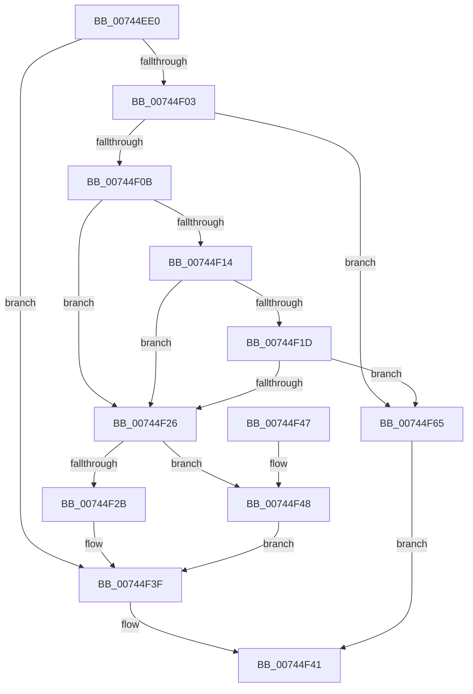

# KeRemoveSystemServiceTable

- RVA: `0x00744EE0`–`0x00744F69` (길이 `137` bytes)
- VA: `0x0000000140744EE0`
- 실행 섹션: `PAGE`
- PDB 이름 있음: `예`; PDB Function 태그: `아니요`
- unwind 정보 RVA: `0x000ABD54`
- 디코드: `37`개 명령, `137/137` bytes 표시
- 미해석 바이트: `0` (있으면 어셈블리에 `.byte`로 보존)

> 이 문서는 커널 이미지의 기계어와 PDB 기호를 분석해 생성했습니다. 4번과 5번은 함수 원형과 자료형을 바이너리 사용 방식에서 추정한 C 해석이며 원본 소스 복구 결과는 아닙니다.

## 1. Dependencies

- 직접 호출 지점: **1**; 고유 호출 대상: **1**
- 직접 호출자로 확인된 함수: **0**
- RIP 상대 이미지 참조: **7**

### Outgoing calls
- `0x00744EF8` → [PsGetProcessSessionIdEx](../../text/22/PsGetProcessSessionIdEx_function_0022F8F0.md) (function, `0x0022F8F0`)

### Direct callers
- 이 함수 시작 RVA로 연결되는 직접 call은 확인되지 않았습니다. 간접 호출은 완전히 역산할 수 없습니다.

### Static image references
- `0x00744F0B` → RVA `0x012018E0` (`CFGRO`; read)
- `0x00744F14` → RVA `0x00FC72A0` (`ALMOSTRO`; read)
- `0x00744F1D` → RVA `0x00FC73E0` (`ALMOSTRO`; read)
- `0x00744F2B` → RVA `0x00FC72A0` (`ALMOSTRO`; write)
- `0x00744F32` → RVA `0x00FC72B0` (`ALMOSTRO`; write)
- `0x00744F38` → RVA `0x00FC72B8` (`ALMOSTRO`; write)
- `0x00744F48` → RVA `0x00FC73C0` (`ALMOSTRO`; read)

## 2. Other-region calls and transfers

- 다른 실행 섹션으로 향하는 call: **1**
  - `0x00744EF8` → [PsGetProcessSessionIdEx](../../text/22/PsGetProcessSessionIdEx_function_0022F8F0.md) (`PAGE` → `.text`)
- 별도 외부 분기/꼬리 이동을 확인하지 못했습니다.

## 3. Assembly (complete function range)

```asm
00744EE0  40 53                           push rbx
00744EE2  48 83 EC 20                     sub rsp, 0x20
00744EE6  8B D9                           mov ebx, ecx
00744EE8  65 48 8B 0C 25 88 01 00 00      mov rcx, qword ptr gs:[0x188]
00744EF1  48 8B 89 B8 00 00 00            mov rcx, qword ptr [rcx + 0xb8]
00744EF8  E8 F3 A9 AE FF                  call 0x14022f8f0
00744EFD  33 D2                           xor edx, edx
00744EFF  85 C0                           test eax, eax
00744F01  75 3C                           jne 0x140744f3f
00744F03  8D 43 FF                        lea eax, [rbx - 1]
00744F06  83 F8 01                        cmp eax, 1
00744F09  77 5A                           ja 0x140744f65
00744F0B  48 39 15 CE C9 AB 00            cmp qword ptr [rip + 0xabc9ce], rdx
00744F12  75 12                           jne 0x140744f26
00744F14  48 39 15 85 23 88 00            cmp qword ptr [rip + 0x882385], rdx
00744F1B  75 09                           jne 0x140744f26
00744F1D  48 39 15 BC 24 88 00            cmp qword ptr [rip + 0x8824bc], rdx
00744F24  74 3F                           je 0x140744f65
00744F26  83 FB 01                        cmp ebx, 1
00744F29  75 1D                           jne 0x140744f48
00744F2B  48 89 15 6E 23 88 00            mov qword ptr [rip + 0x88236e], rdx
00744F32  89 15 78 23 88 00               mov dword ptr [rip + 0x882378], edx
00744F38  48 89 15 79 23 88 00            mov qword ptr [rip + 0x882379], rdx
00744F3F  B0 01                           mov al, 1
00744F41  48 83 C4 20                     add rsp, 0x20
00744F45  5B                              pop rbx
00744F46  C3                              ret
00744F47  CC                              int3
00744F48  48 8D 05 71 24 88 00            lea rax, [rip + 0x882471]
00744F4F  8D 4B FF                        lea ecx, [rbx - 1]
00744F52  48 C1 E1 05                     shl rcx, 5
00744F56  48 89 14 01                     mov qword ptr [rcx + rax], rdx
00744F5A  89 54 01 10                     mov dword ptr [rcx + rax + 0x10], edx
00744F5E  48 89 54 01 18                  mov qword ptr [rcx + rax + 0x18], rdx
00744F63  EB DA                           jmp 0x140744f3f
00744F65  32 C0                           xor al, al
00744F67  EB D8                           jmp 0x140744f41
```

## 4. C-style interpretation (structured pseudocode)

```c
__int64 __fastcall KeRemoveSystemServiceTable(int a1, int a2)
{
    __int64 result;
    __int64 v_rsp;

    v_rsp = (v_rsp) - (32);
    result = PsGetProcessSessionIdEx(*(unsigned __int64 *)(*(unsigned __int64 *)(gs_base + (0 + 392)) + 184), a2, a3, a4);
    a2 = 0;
    if ((unsigned int)(result) != 0) goto loc_00744F3F;
    if (((unsigned int)((unsigned int)(a1) - 1)) > 1) goto loc_00744F65;
    if ((*(unsigned __int64 *)(v_rip + 11258318)) != 0) goto loc_00744F26;
    if ((*(unsigned __int64 *)(v_rip + 8921989)) != 0) goto loc_00744F26;
    if ((*(unsigned __int64 *)(v_rip + 8922300)) == 0) goto loc_00744F65;
loc_00744F26:
    if (((unsigned int)((unsigned int)(a1))) != 1) goto loc_00744F48;
    *(unsigned __int64 *)(v_rip + 8921966) = 0;
    *(unsigned int *)(v_rip + 8921976) = 0;
    *(unsigned __int64 *)(v_rip + 8921977) = 0;
loc_00744F3F:
loc_00744F41:
    v_rsp = (v_rsp) + (32);
    return 1;
loc_00744F48:
    a1 = ((unsigned int)(a1) - 1) << (5);
    *(unsigned __int64 *)(a1 + v_rip + 8922225 * 1) = 0;
    *(unsigned int *)(a1 + v_rip + 8922225 * 1 + 16) = 0;
    *(unsigned __int64 *)(a1 + v_rip + 8922225 * 1 + 24) = 0;
    goto loc_00744F3F;
loc_00744F65:
    result = 0;
    goto loc_00744F41;
}
```

## 5. (Beta) C Style

```c
int64_t KeRemoveSystemServiceTable(void *Arg1, int32_t Arg2)
{
    uint8_t *arg1 = (uint8_t *)Arg1;

    int64_t result;
    int64_t local_rsp;

    local_rsp = (local_rsp) - (32);
    result = PsGetProcessSessionIdEx(*(uint64_t *)(*(uint64_t *)(gs_base + (0 + 0x188)) + 0xB8), Arg2, a3, a4);
    Arg2 = 0;
    if ((uint32_t)(result) != 0) goto loc_00744F3F;
    if (((uint32_t)((uint32_t)(Arg1) - 1)) > 1) goto loc_00744F65;
    if ((*(uint64_t *)(v_rip + 0xABC9CE)) != 0) goto loc_00744F26;
    if ((*(uint64_t *)(v_rip + 0x882385)) != 0) goto loc_00744F26;
    if ((*(uint64_t *)(v_rip + 0x8824BC)) == 0) goto loc_00744F65;
loc_00744F26:
    if (((uint32_t)((uint32_t)(Arg1))) != 1) goto loc_00744F48;
    *(uint64_t *)(v_rip + 0x88236E) = 0;
    *(uint32_t *)(v_rip + 0x882378) = 0;
    *(uint64_t *)(v_rip + 0x882379) = 0;
loc_00744F3F:
loc_00744F41:
    local_rsp = (local_rsp) + (32);
    return 1;
loc_00744F48:
    Arg1 = ((uint32_t)(Arg1) - 1) << (5);
    *(uint64_t *)(arg1 + v_rip + 0x882471 * 1) = 0;
    *(uint32_t *)(arg1 + v_rip + 0x882471 * 1 + 0x10) = 0;
    *(uint64_t *)(arg1 + v_rip + 0x882471 * 1 + 0x18) = 0;
    goto loc_00744F3F;
loc_00744F65:
    result = 0;
    goto loc_00744F41;
}
```

### 관측된 메모리 오프셋

구조체 형식이 확인되지 않은 접근은 인자 기준의 오프셋으로만 기록했습니다.

| 기준 인자 | 오프셋 표현 | 폭 (bit) | 접근 |
|---|---:|---:|---|
| `Arg1` | `- 0x1` | `32` | `R` |

## 6. Execution-region graph

[열기: 2D/3D 그래프와 함수 탐색 컨트롤 패널](../../../control-panel.html?section=page&rva=0x00744EE0&view=graph)

- 2D 그래프는 위에서 아래로 흐르고, 3D 그래프는 빈 공간을 드래그해 회전합니다. Shift+드래그는 이동, 휠은 확대·축소, 함수 노드 선택은 대상 보고서 이동입니다.

### Static fallback


