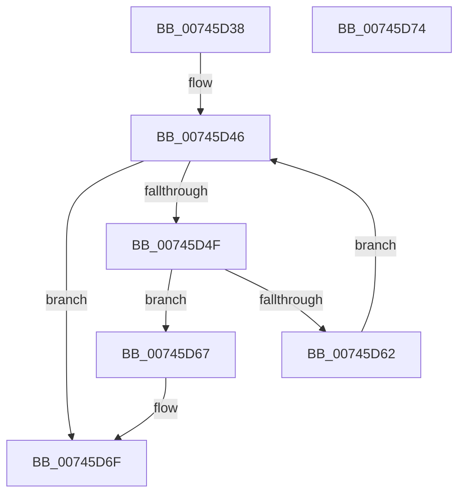

# KeRequestTerminationProcess

- RVA: `0x00745D38`–`0x00745D75` (길이 `61` bytes)
- VA: `0x0000000140745D38`
- 실행 섹션: `PAGE`
- PDB 이름 있음: `예`; PDB Function 태그: `아니요`
- unwind 정보 RVA: `0x0005C788`
- 디코드: `19`개 명령, `61/61` bytes 표시
- 미해석 바이트: `0` (있으면 어셈블리에 `.byte`로 보존)

> 이 문서는 커널 이미지의 기계어와 PDB 기호를 분석해 생성했습니다. 4번과 5번은 함수 원형과 자료형을 바이너리 사용 방식에서 추정한 C 해석이며 원본 소스 복구 결과는 아닙니다.

## 1. Dependencies

- 직접 호출 지점: **1**; 고유 호출 대상: **1**
- 직접 호출자로 확인된 함수: **2**
- RIP 상대 이미지 참조: **0**

### Outgoing calls
- `0x00745D6A` → [KeRequestTerminationThread](../../text/48/KeRequestTerminationThread_function_00489A58.md) (function, `0x00489A58`)

### Direct callers
- [MiCommitRequestFailed](../AC/MiCommitRequestFailed_function_00AC41E0.md) at `0x00AC4226`
- [MiForceCrashForInvalidAccess](../AC/MiForceCrashForInvalidAccess_function_00ACEFA4.md) at `0x00ACF009`
- [MiForceCrashForInvalidAccess](../AC/MiForceCrashForInvalidAccess_function_00ACEFA4.md) at `0x00ACF17D`

### Static image references
- 디코드된 RIP-relative 메모리 참조가 없습니다.

## 2. Other-region calls and transfers

- 다른 실행 섹션으로 향하는 call: **1**
  - `0x00745D6A` → [KeRequestTerminationThread](../../text/48/KeRequestTerminationThread_function_00489A58.md) (`PAGE` → `.text`)
- 별도 외부 분기/꼬리 이동을 확인하지 못했습니다.

## 3. Assembly (complete function range)

```asm
00745D38  48 83 EC 28                     sub rsp, 0x28
00745D3C  44 8B 41 78                     mov r8d, dword ptr [rcx + 0x78]
00745D40  4C 8B C9                        mov r9, rcx
00745D43  C1 E2 12                        shl edx, 0x12
00745D46  41 F7 C0 00 00 0C 00            test r8d, 0xc0000
00745D4D  75 20                           jne 0x140745d6f
00745D4F  41 8B C8                        mov ecx, r8d
00745D52  41 8B C0                        mov eax, r8d
00745D55  0B CA                           or ecx, edx
00745D57  F0 41 0F B1 49 78               lock cmpxchg dword ptr [r9 + 0x78], ecx
00745D5D  44 3B C0                        cmp r8d, eax
00745D60  74 05                           je 0x140745d67
00745D62  44 8B C0                        mov r8d, eax
00745D65  EB DF                           jmp 0x140745d46
00745D67  49 8B C9                        mov rcx, r9
00745D6A  E8 E9 3C D4 FF                  call 0x140489a58
00745D6F  48 83 C4 28                     add rsp, 0x28
00745D73  C3                              ret
00745D74  CC                              int3
```

## 4. C-style interpretation (structured pseudocode)

```c
__int64 __fastcall KeRequestTerminationProcess(__int64 a1, int a2)
{
    __int64 result;
    __int64 v_rsp;

    v_rsp = (v_rsp) - (40);
    a2 = (unsigned int)((a2) << (18));
loc_00745D46:
    if ((((unsigned int)((unsigned int)(*(unsigned int *)(a1 + 120)))) & (0xC0000ULL)) != 0) goto loc_00745D6F;
    a1 = (unsigned int)(((unsigned int)((unsigned int)((unsigned int)(*(unsigned int *)(a1 + 120))))) | (a2));
    if (((unsigned int)((unsigned int)(*(unsigned int *)(a1 + 120)))) == ((unsigned int)((unsigned int)((unsigned int)((unsigned int)(*(unsigned int *)(a1 + 120))))))) goto loc_00745D67;
    goto loc_00745D46;
loc_00745D67:
    result = KeRequestTerminationThread(a1, a2, (unsigned int)((unsigned int)((unsigned int)((unsigned int)((unsigned int)(*(unsigned int *)(a1 + 120)))))), a1);
loc_00745D6F:
    v_rsp = (v_rsp) + (40);
    return result;
}
```

## 5. (Beta) C Style

```c
int64_t KeRequestTerminationProcess(void *Arg1, int32_t Arg2)
{
    uint8_t *arg1 = (uint8_t *)Arg1;

    int64_t result;
    int64_t local_rsp;

    local_rsp = (local_rsp) - (40);
    Arg2 = (uint32_t)((Arg2) << (18));
loc_00745D46:
    if ((((uint32_t)((uint32_t)(*(uint32_t *)(arg1 + 0x78)))) & (0xC0000ULL)) != 0) goto loc_00745D6F;
    Arg1 = (uint32_t)(((uint32_t)((uint32_t)((uint32_t)(*(uint32_t *)(arg1 + 0x78))))) | (Arg2));
    if (((uint32_t)((uint32_t)(*(uint32_t *)(arg1 + 0x78)))) == ((uint32_t)((uint32_t)((uint32_t)((uint32_t)(*(uint32_t *)(arg1 + 0x78))))))) goto loc_00745D67;
    goto loc_00745D46;
loc_00745D67:
    result = KeRequestTerminationThread(Arg1, Arg2, (uint32_t)((uint32_t)((uint32_t)((uint32_t)((uint32_t)(*(uint32_t *)(arg1 + 0x78)))))), Arg1);
loc_00745D6F:
    local_rsp = (local_rsp) + (40);
    return result;
}
```

### 관측된 메모리 오프셋

구조체 형식이 확인되지 않은 접근은 인자 기준의 오프셋으로만 기록했습니다.

| 기준 인자 | 오프셋 표현 | 폭 (bit) | 접근 |
|---|---:|---:|---|
| `Arg1` | `+ 0x78` | `32` | `R` |

## 6. Execution-region graph

[열기: 2D/3D 그래프와 함수 탐색 컨트롤 패널](../../../control-panel.html?section=page&rva=0x00745D38&view=graph)

- 2D 그래프는 위에서 아래로 흐르고, 3D 그래프는 빈 공간을 드래그해 회전합니다. Shift+드래그는 이동, 휠은 확대·축소, 함수 노드 선택은 대상 보고서 이동입니다.

### Static fallback


