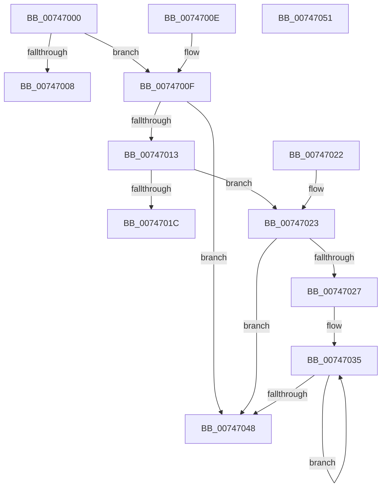

# KeSetHardwareCounterConfiguration

- RVA: `0x00747000`–`0x00747052` (길이 `82` bytes)
- VA: `0x0000000140747000`
- 실행 섹션: `PAGE`
- PDB 이름 있음: `예`; PDB Function 태그: `아니요`
- unwind 정보 RVA: `0x000DB714`
- 디코드: `28`개 명령, `82/82` bytes 표시
- 미해석 바이트: `0` (있으면 어셈블리에 `.byte`로 보존)

> 이 문서는 커널 이미지의 기계어와 PDB 기호를 분석해 생성했습니다. 4번과 5번은 함수 원형과 자료형을 바이너리 사용 방식에서 추정한 C 해석이며 원본 소스 복구 결과는 아닙니다.

## 1. Dependencies

- 직접 호출 지점: **0**; 고유 호출 대상: **0**
- 직접 호출자로 확인된 함수: **0**
- RIP 상대 이미지 참조: **3**

### Outgoing calls
- 직접 디코드된 call 명령이 없습니다.

### Direct callers
- 이 함수 시작 RVA로 연결되는 직접 call은 확인되지 않았습니다. 간접 호출은 완전히 역산할 수 없습니다.

### Static image references
- `0x00747013` → RVA `0x00E66908` (`.data`; read)
- `0x00747027` → RVA `0x00F10E80` (`.data`; read)
- `0x00747048` → RVA `0x00E66908` (`.data`; write)

## 2. Other-region calls and transfers

- 다른 실행 섹션으로 향하는 call: **0**
- 별도 외부 분기/꼬리 이동을 확인하지 못했습니다.

## 3. Assembly (complete function range)

```asm
00747000  4C 8B C1                        mov r8, rcx
00747003  83 FA 10                        cmp edx, 0x10
00747006  76 07                           jbe 0x14074700f
00747008  B8 0D 00 00 C0                  mov eax, 0xc000000d
0074700D  C3                              ret
0074700E  CC                              int3
0074700F  85 D2                           test edx, edx
00747011  74 35                           je 0x140747048
00747013  83 3D EE F8 71 00 00            cmp dword ptr [rip + 0x71f8ee], 0
0074701A  74 07                           je 0x140747023
0074701C  B8 03 03 00 C0                  mov eax, 0xc0000303
00747021  C3                              ret
00747022  CC                              int3
00747023  85 D2                           test edx, edx
00747025  74 21                           je 0x140747048
00747027  48 8D 0D 52 9E 7C 00            lea rcx, [rip + 0x7c9e52]
0074702E  44 8B CA                        mov r9d, edx
00747031  49 83 C0 08                     add r8, 8
00747035  41 8B 00                        mov eax, dword ptr [r8]
00747038  4D 8D 40 10                     lea r8, [r8 + 0x10]
0074703C  89 01                           mov dword ptr [rcx], eax
0074703E  48 8D 49 04                     lea rcx, [rcx + 4]
00747042  49 83 E9 01                     sub r9, 1
00747046  75 ED                           jne 0x140747035
00747048  89 15 BA F8 71 00               mov dword ptr [rip + 0x71f8ba], edx
0074704E  33 C0                           xor eax, eax
00747050  C3                              ret
00747051  CC                              int3
```

## 4. C-style interpretation (structured pseudocode)

```c
__int64 __fastcall KeSetHardwareCounterConfiguration(__int64 a1, int a2)
{
    __int64 result;

    if (a2 <= 16) goto loc_0074700F;
    return (unsigned int)(0xC000000DULL);
loc_0074700F:
    if (a2 == 0) goto loc_00747048;
    if ((*(unsigned int *)(v_rip + 7469294)) == 0) goto loc_00747023;
    return (unsigned int)(0xC0000303ULL);
loc_00747023:
    if (a2 == 0) goto loc_00747048;
    a3 = (a1) + (8);
loc_00747035:
    *(unsigned int *)(v_rip + 8166994) = (unsigned int)((unsigned int)(*(unsigned int *)(a3)));
    a4 = ((unsigned int)(a2)) - (1);
    if (condition_is_not_equal) goto loc_00747035;
loc_00747048:
    *(unsigned int *)(v_rip + 7469242) = a2;
    result = 0;
    return result;
}
```

## 5. (Beta) C Style

```c
int64_t KeSetHardwareCounterConfiguration(void *Arg1, int32_t Arg2)
{
    uint8_t *arg1 = (uint8_t *)Arg1;

    int64_t result;

    if (Arg2 <= 16) goto loc_0074700F;
    return (uint32_t)(0xC000000DULL);
loc_0074700F:
    if (Arg2 == 0) goto loc_00747048;
    if ((*(uint32_t *)(v_rip + 0x71F8EE)) == 0) goto loc_00747023;
    return (uint32_t)(0xC0000303ULL);
loc_00747023:
    if (Arg2 == 0) goto loc_00747048;
    a3 = (Arg1) + (8);
loc_00747035:
    *(uint32_t *)(v_rip + 0x7C9E52) = (uint32_t)((uint32_t)(*(uint32_t *)(a3)));
    a4 = ((uint32_t)(Arg2)) - (1);
    if (condition_is_not_equal) goto loc_00747035;
loc_00747048:
    *(uint32_t *)(v_rip + 0x71F8BA) = Arg2;
    result = 0;
    return result;
}
```

### 관측된 메모리 오프셋

구조체 형식이 확인되지 않은 접근은 인자 기준의 오프셋으로만 기록했습니다.

| 기준 인자 | 오프셋 표현 | 폭 (bit) | 접근 |
|---|---:|---:|---|
| `Arg1` | `+ 0x0` | `32` | `R` |
| `Arg1` | `+ 0x10` | `64` | `R` |

## 6. Execution-region graph

[열기: 2D/3D 그래프와 함수 탐색 컨트롤 패널](../../../control-panel.html?section=page&rva=0x00747000&view=graph)

- 2D 그래프는 위에서 아래로 흐르고, 3D 그래프는 빈 공간을 드래그해 회전합니다. Shift+드래그는 이동, 휠은 확대·축소, 함수 노드 선택은 대상 보고서 이동입니다.

### Static fallback


