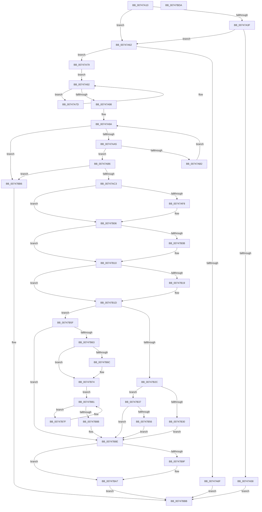

# KeSetSystemServiceCallback

- RVA: `0x00747A10`–`0x00747BDB` (길이 `459` bytes)
- VA: `0x0000000140747A10`
- 실행 섹션: `PAGE`
- PDB 이름 있음: `예`; PDB Function 태그: `아니요`
- unwind 정보 RVA: `0x00075C18`
- 디코드: `133`개 명령, `459/459` bytes 표시
- 미해석 바이트: `0` (있으면 어셈블리에 `.byte`로 보존)

> 이 문서는 커널 이미지의 기계어와 PDB 기호를 분석해 생성했습니다. 4번과 5번은 함수 원형과 자료형을 바이너리 사용 방식에서 추정한 C 해석이며 원본 소스 복구 결과는 아닙니다.

## 1. Dependencies

- 직접 호출 지점: **6**; 고유 호출 대상: **6**
- 직접 호출자로 확인된 함수: **0**
- RIP 상대 이미지 참조: **8**

### Outgoing calls
- `0x00747A62` → [KiGetSystemServiceTraceTable](KiGetSystemServiceTraceTable_function_00747BE4.md) (function, `0x00747BE4`)
- `0x00747AE7` → [KeAbPreAcquire](../../text/21/KeAbPreAcquire_function_00210230.md) (function, `0x00210230`)
- `0x00747B01` → [ExfAcquirePushLockExclusiveEx](../../text/20/ExfAcquirePushLockExclusiveEx_function_0020FC90.md) (function, `0x0020FC90`)
- `0x00747BA2` → [ExfTryToWakePushLock](../../text/26/ExfTryToWakePushLock_function_00265DD0.md) (function, `0x00265DD0`)
- `0x00747BAA` → [KeAbPostRelease](../../text/2E/KeAbPostRelease_function_002E1600.md) (function, `0x002E1600`)
- `0x00747BAF` → [KeLeaveCriticalRegion](../../text/25/KeLeaveCriticalRegion_function_0025D8B0.md) (function, `0x0025D8B0`)

### Direct callers
- 이 함수 시작 RVA로 연결되는 직접 call은 확인되지 않았습니다. 간접 호출은 완전히 역산할 수 없습니다.

### Static image references
- `0x00747A43` → RVA `0x00FC7400` (`ALMOSTRO`; read)
- `0x00747ACC` → RVA `0x00FDA020` (`PAGEDATA`; read)
- `0x00747B43` → RVA `0x00FD9BC0` (`PAGEDATA`; read)
- `0x00747B4B` → RVA `0x00FD9BC0` (`PAGEDATA`; write)
- `0x00747B56` → RVA `0x00FC6D00` (`ALMOSTRO`; read/write)
- `0x00747B63` → RVA `0x00FD9BC0` (`PAGEDATA`; read/write)
- `0x00747B81` → RVA `0x00FD9B1C` (`PAGEDATA`; read)
- `0x00747B8E` → RVA `0x00FDA020` (`PAGEDATA`; read/write)

## 2. Other-region calls and transfers

- 다른 실행 섹션으로 향하는 call: **5**
  - `0x00747AE7` → [KeAbPreAcquire](../../text/21/KeAbPreAcquire_function_00210230.md) (`PAGE` → `.text`)
  - `0x00747B01` → [ExfAcquirePushLockExclusiveEx](../../text/20/ExfAcquirePushLockExclusiveEx_function_0020FC90.md) (`PAGE` → `.text`)
  - `0x00747BA2` → [ExfTryToWakePushLock](../../text/26/ExfTryToWakePushLock_function_00265DD0.md) (`PAGE` → `.text`)
  - `0x00747BAA` → [KeAbPostRelease](../../text/2E/KeAbPostRelease_function_002E1600.md) (`PAGE` → `.text`)
  - `0x00747BAF` → [KeLeaveCriticalRegion](../../text/25/KeLeaveCriticalRegion_function_0025D8B0.md) (`PAGE` → `.text`)
- 별도 외부 분기/꼬리 이동을 확인하지 못했습니다.

## 3. Assembly (complete function range)

```asm
00747A10  48 89 5C 24 08                  mov qword ptr [rsp + 8], rbx
00747A15  48 89 6C 24 10                  mov qword ptr [rsp + 0x10], rbp
00747A1A  48 89 74 24 18                  mov qword ptr [rsp + 0x18], rsi
00747A1F  57                              push rdi
00747A20  41 54                           push r12
00747A22  41 55                           push r13
00747A24  41 56                           push r14
00747A26  41 57                           push r15
00747A28  48 83 EC 20                     sub rsp, 0x20
00747A2C  33 FF                           xor edi, edi
00747A2E  4D 8B E1                        mov r12, r9
00747A31  4D 8B F8                        mov r15, r8
00747A34  40 8A EA                        mov bpl, dl
00747A37  48 8B D9                        mov rbx, rcx
00747A3A  4D 85 C0                        test r8, r8
00747A3D  74 23                           je 0x140747a62
00747A3F  8A C2                           mov al, dl
00747A41  F6 D8                           neg al
00747A43  48 8D 05 B6 F9 87 00            lea rax, [rip + 0x87f9b6]
00747A4A  4D 1B D2                        sbb r10, r10
00747A4D  49 83 E2 F8                     and r10, 0xfffffffffffffff8
00747A51  4D 3B 44 02 18                  cmp r8, qword ptr [r10 + rax + 0x18]
00747A56  74 0A                           je 0x140747a62
00747A58  BF 22 00 00 C0                  mov edi, 0xc0000022
00747A5D  E9 59 01 00 00                  jmp 0x140747bbb
00747A62  E8 7D 01 00 00                  call 0x140747be4
00747A67  4C 8B C0                        mov r8, rax
00747A6A  48 85 C0                        test rax, rax
00747A6D  75 0A                           jne 0x140747a79
00747A6F  BF 9A 00 00 C0                  mov edi, 0xc000009a
00747A74  E9 42 01 00 00                  jmp 0x140747bbb
00747A79  8B D7                           mov edx, edi
00747A7B  EB 15                           jmp 0x140747a92
00747A7D  0F BE C0                        movsx eax, al
00747A80  03 C2                           add eax, edx
00747A82  69 D0 01 04 00 00               imul edx, eax, 0x401
00747A88  8B C2                           mov eax, edx
00747A8A  C1 E8 06                        shr eax, 6
00747A8D  33 D0                           xor edx, eax
00747A8F  48 FF C3                        inc rbx
00747A92  8A 03                           mov al, byte ptr [rbx]
00747A94  84 C0                           test al, al
00747A96  75 E5                           jne 0x140747a7d
00747A98  8B C7                           mov eax, edi
00747A9A  3D EA 01 00 00                  cmp eax, 0x1ea
00747A9F  0F 83 11 01 00 00               jae 0x140747bb6
00747AA5  8B C8                           mov ecx, eax
00747AA7  48 C1 E1 06                     shl rcx, 6
00747AAB  42 3B 54 01 34                  cmp edx, dword ptr [rcx + r8 + 0x34]
00747AB0  74 04                           je 0x140747ab6
00747AB2  FF C0                           inc eax
00747AB4  EB E4                           jmp 0x140747a9a
00747AB6  49 8D 70 10                     lea rsi, [r8 + 0x10]
00747ABA  48 03 F1                        add rsi, rcx
00747ABD  0F 84 F3 00 00 00               je 0x140747bb6
00747AC3  65 48 8B 04 25 88 01 00 00      mov rax, qword ptr gs:[0x188]
00747ACC  4C 8D 2D 4D 25 89 00            lea r13, [rip + 0x89254d]
00747AD3  48 83 CB FF                     or rbx, 0xffffffffffffffff
00747AD7  45 33 C0                        xor r8d, r8d
00747ADA  33 D2                           xor edx, edx
00747ADC  49 8B CD                        mov rcx, r13
00747ADF  66 01 98 E4 01 00 00            add word ptr [rax + 0x1e4], bx
00747AE6  90                              nop
00747AE7  E8 44 87 AC FF                  call 0x140210230
00747AEC  F0 49 0F BA 6D 00 00            lock bts qword ptr [r13], 0
00747AF3  4C 8B F0                        mov r14, rax
00747AF6  73 0E                           jae 0x140747b06
00747AF8  4D 8B C5                        mov r8, r13
00747AFB  48 8B D0                        mov rdx, rax
00747AFE  49 8B CD                        mov rcx, r13
00747B01  E8 8A 81 AC FF                  call 0x14020fc90
00747B06  4D 85 F6                        test r14, r14
00747B09  74 05                           je 0x140747b10
00747B0B  41 C6 46 0A 01                  mov byte ptr [r14 + 0xa], 1
00747B10  48 8D 4E 30                     lea rcx, [rsi + 0x30]
00747B14  40 84 ED                        test bpl, bpl
00747B17  75 04                           jne 0x140747b1d
00747B19  48 8D 4E 38                     lea rcx, [rsi + 0x38]
00747B1D  40 F6 DD                        neg bpl
00747B20  48 1B C0                        sbb rax, rax
00747B23  8A 54 30 29                     mov dl, byte ptr [rax + rsi + 0x29]
00747B27  4D 85 FF                        test r15, r15
00747B2A  74 33                           je 0x140747b5f
00747B2C  84 D2                           test dl, dl
00747B2E  74 07                           je 0x140747b37
00747B30  BF 18 07 00 C0                  mov edi, 0xc0000718
00747B35  EB 57                           jmp 0x140747b8e
00747B37  4C 89 21                        mov qword ptr [rcx], r12
00747B3A  F0 09 3C 24                     lock or dword ptr [rsp], edi
00747B3E  C6 44 30 29 01                  mov byte ptr [rax + rsi + 0x29], 1
00747B43  8B 05 77 20 89 00               mov eax, dword ptr [rip + 0x892077]
00747B49  FF C0                           inc eax
00747B4B  89 05 6F 20 89 00               mov dword ptr [rip + 0x89206f], eax
00747B51  83 F8 01                        cmp eax, 1
00747B54  75 38                           jne 0x140747b8e
00747B56  F0 09 05 A3 F1 87 00            lock or dword ptr [rip + 0x87f1a3], eax
00747B5D  EB 2F                           jmp 0x140747b8e
00747B5F  84 D2                           test dl, dl
00747B61  74 2B                           je 0x140747b8e
00747B63  83 2D 56 20 89 00 01            sub dword ptr [rip + 0x892056], 1
00747B6A  75 08                           jne 0x140747b74
00747B6C  F0 83 25 8C F1 87 00 FE         lock and dword ptr [rip + 0x87f18c], 0xfffffffe
00747B74  40 88 7C 30 29                  mov byte ptr [rax + rsi + 0x29], dil
00747B79  F0 09 3C 24                     lock or dword ptr [rsp], edi
00747B7D  EB 02                           jmp 0x140747b81
00747B7F  F3 90                           pause
00747B81  8B 05 95 1F 89 00               mov eax, dword ptr [rip + 0x891f95]
00747B87  85 C0                           test eax, eax
00747B89  75 F4                           jne 0x140747b7f
00747B8B  48 89 39                        mov qword ptr [rcx], rdi
00747B8E  F0 48 0F C1 1D 89 24 89 00      lock xadd qword ptr [rip + 0x892489], rbx
00747B97  80 E3 06                        and bl, 6
00747B9A  80 FB 02                        cmp bl, 2
00747B9D  75 08                           jne 0x140747ba7
00747B9F  49 8B CD                        mov rcx, r13
00747BA2  E8 29 E2 B1 FF                  call 0x140265dd0
00747BA7  49 8B CD                        mov rcx, r13
00747BAA  E8 51 9A B9 FF                  call 0x1402e1600
00747BAF  E8 FC 5C B1 FF                  call 0x14025d8b0
00747BB4  EB 05                           jmp 0x140747bbb
00747BB6  BF 25 02 00 C0                  mov edi, 0xc0000225
00747BBB  48 8B 5C 24 50                  mov rbx, qword ptr [rsp + 0x50]
00747BC0  8B C7                           mov eax, edi
00747BC2  48 8B 6C 24 58                  mov rbp, qword ptr [rsp + 0x58]
00747BC7  48 8B 74 24 60                  mov rsi, qword ptr [rsp + 0x60]
00747BCC  48 83 C4 20                     add rsp, 0x20
00747BD0  41 5F                           pop r15
00747BD2  41 5E                           pop r14
00747BD4  41 5D                           pop r13
00747BD6  41 5C                           pop r12
00747BD8  5F                              pop rdi
00747BD9  C3                              ret
00747BDA  CC                              int3
```

## 4. C-style interpretation (structured pseudocode)

```c
__int64 __fastcall KeSetSystemServiceCallback(__int64 a1, unsigned __int8 a2, __int64 a3, __int64 a4)
{
    __int64 result;
    __int64 v_r10;
    __int64 v_rbp;
    __int64 v_rbx;
    __int64 v_rdi;
    __int64 v_rsi;
    __int64 v_rsp;
    unsigned int v_stack_m48;
    unsigned __int64 v_stack_p10;
    unsigned __int64 v_stack_p18;
    unsigned __int64 v_stack_p8;

    v_stack_p8 = v_rbx;
    v_stack_p10 = v_rbp;
    v_stack_p18 = v_rsi;
    v_rsp = (v_rsp) - (32);
    v_rdi = 0;
    if (a3 == 0) goto loc_00747A62;
    result = (unsigned __int8)(-(a2));
    v_r10 = (v_r10) & (-8);
    if (a3 == (*(unsigned __int64 *)(v_r10 + v_rip + 8911286 * 1 + 24))) goto loc_00747A62;
    goto loc_00747BBB;
loc_00747A62:
    result = KiGetSystemServiceTraceTable(a1, a2, a3, a4);
    if (result != 0) goto loc_00747A79;
    goto loc_00747BBB;
loc_00747A79:
    goto loc_00747A92;
loc_00747A7D:
    result = (unsigned int)(((__int8)((unsigned __int8)(result))) + ((unsigned int)((unsigned int)((unsigned int)((unsigned int)(0xC000009AULL))))));
    a2 = (unsigned int)(((unsigned int)((unsigned int)((unsigned int)(0xC000009AULL)))) * ((unsigned int)(result)));
    result = (unsigned int)(((unsigned int)(a2)) >> (6));
    a2 = (unsigned int)((a2) ^ ((unsigned int)(result)));
    v_rbx = (a1) + 1;
loc_00747A92:
    if ((unsigned __int8)(*(unsigned __int8 *)(v_rbx)) != 0) goto loc_00747A7D;
loc_00747A9A:
    if (((unsigned int)((unsigned int)((unsigned int)((unsigned int)(0xC000009AULL))))) >= 490) goto loc_00747BB6;
    a1 = ((unsigned int)((unsigned int)((unsigned int)((unsigned int)((unsigned int)(0xC000009AULL)))))) << (6);
    if (a2 == (*(unsigned int *)(a1 + result * 1 + 52))) goto loc_00747AB6;
    result = (unsigned int)(((unsigned int)((unsigned int)((unsigned int)(0xC000009AULL)))) + 1);
    goto loc_00747A9A;
loc_00747AB6:
    v_rsi = (result + 16) + (a1);
    if (condition_is_equal) goto loc_00747BB6;
    v_rbx = (v_rbx) | (-1);
    a3 = 0;
    a2 = 0;
    result = KeAbPreAcquire(v_rip + 8987981, a2, a3, a4);
    if (!(condition_is_above_or_equal)) {
        a3 = v_rip + 8987981;
        a2 = result;
        a1 = v_rip + 8987981;
        result = ExfAcquirePushLockExclusiveEx(a1, a2, a3, a4);
    }
    if (result != 0) {
        *(unsigned __int8 *)(result + 10) = 1;
    }
    if (a2 == 0) {
        a1 = v_rsi + 56;
    }
    v_rbp = (unsigned __int8)(-(a2));
    if (a3 == 0) goto loc_00747B5F;
    if ((unsigned __int8)(*(unsigned __int8 *)(result + v_rsi * 1 + 41)) == 0) goto loc_00747B37;
    goto loc_00747B8E;
loc_00747B37:
    *(unsigned __int64 *)(a1) = a4;
    *(unsigned __int8 *)(result + v_rsi * 1 + 41) = 1;
    result = (unsigned int)(((unsigned int)(*(unsigned int *)(v_rip + 8986743))) + 1);
    *(unsigned int *)(v_rip + 8986735) = (unsigned int)(result);
    if (((unsigned int)(result)) != 1) goto loc_00747B8E;
    goto loc_00747B8E;
loc_00747B5F:
    if ((unsigned __int8)(*(unsigned __int8 *)(result + v_rsi * 1 + 41)) == 0) goto loc_00747B8E;
    if ((unsigned __int8)(*(unsigned __int8 *)(result + v_rsi * 1 + 41)) == 0) {
    }
    *(unsigned __int8 *)(result + v_rsi * 1 + 41) = (unsigned __int8)((unsigned int)(0xC0000718ULL));
    goto loc_00747B81;
loc_00747B7F:
loc_00747B81:
    if ((unsigned int)((unsigned int)(*(unsigned int *)(v_rip + 8986517))) != 0) goto loc_00747B7F;
    *(unsigned __int64 *)(a1) = (unsigned int)(0xC0000718ULL);
loc_00747B8E:
    v_rbx = (unsigned __int8)((v_rbx) & (6));
    result = (unsigned int)(*(unsigned int *)(v_rip + 8986517));
    if (((unsigned __int8)(v_rbx)) == 2) {
        a1 = v_rip + 8987981;
        result = ExfTryToWakePushLock(a1, *(unsigned __int8 *)(result + v_rsi * 1 + 41), a3, a4);
    }
    result = KeAbPostRelease(v_rip + 8987981, *(unsigned __int8 *)(result + v_rsi * 1 + 41), a3, a4);
    result = KeLeaveCriticalRegion(v_rip + 8987981, *(unsigned __int8 *)(result + v_rsi * 1 + 41), a3, a4);
    goto loc_00747BBB;
loc_00747BB6:
loc_00747BBB:
    v_rsp = (v_rsp) + (32);
    return (unsigned int)((unsigned int)((unsigned int)(0xC0000225ULL)));
}
```

## 5. (Beta) C Style

```c
int64_t KeSetSystemServiceCallback(int64_t Arg1, uint8_t Arg2, int64_t Arg3, int64_t Arg4)
{
    int64_t result;
    int64_t local_r10;
    int64_t local_rbp;
    int64_t local_rbx;
    int64_t local_rdi;
    int64_t local_rsi;
    int64_t local_rsp;
    uint32_t v_stack_m48;
    uint64_t v_stack_p10;
    uint64_t v_stack_p18;
    uint64_t v_stack_p8;

    v_stack_p8 = local_rbx;
    v_stack_p10 = local_rbp;
    v_stack_p18 = local_rsi;
    local_rsp = (local_rsp) - (32);
    local_rdi = 0;
    if (Arg3 == 0) goto loc_00747A62;
    result = (uint8_t)(-(Arg2));
    local_r10 = (local_r10) & (-8);
    if (Arg3 == (*(uint64_t *)(local_r10 + v_rip + 0x87F9B6 * 1 + 0x18))) goto loc_00747A62;
    goto loc_00747BBB;
loc_00747A62:
    result = KiGetSystemServiceTraceTable(Arg1, Arg2, Arg3, Arg4);
    if (result != 0) goto loc_00747A79;
    goto loc_00747BBB;
loc_00747A79:
    goto loc_00747A92;
loc_00747A7D:
    result = (uint32_t)(((int8_t)((uint8_t)(result))) + ((uint32_t)((uint32_t)((uint32_t)((uint32_t)(0xC000009AULL))))));
    Arg2 = (uint32_t)(((uint32_t)((uint32_t)((uint32_t)(0xC000009AULL)))) * ((uint32_t)(result)));
    result = (uint32_t)(((uint32_t)(Arg2)) >> (6));
    Arg2 = (uint32_t)((Arg2) ^ ((uint32_t)(result)));
    local_rbx = (Arg1) + 1;
loc_00747A92:
    if ((uint8_t)(*(uint8_t *)(local_rbx)) != 0) goto loc_00747A7D;
loc_00747A9A:
    if (((uint32_t)((uint32_t)((uint32_t)((uint32_t)(0xC000009AULL))))) >= 490) goto loc_00747BB6;
    Arg1 = ((uint32_t)((uint32_t)((uint32_t)((uint32_t)((uint32_t)(0xC000009AULL)))))) << (6);
    if (Arg2 == (*(uint32_t *)(Arg1 + result * 1 + 0x34))) goto loc_00747AB6;
    result = (uint32_t)(((uint32_t)((uint32_t)((uint32_t)(0xC000009AULL)))) + 1);
    goto loc_00747A9A;
loc_00747AB6:
    local_rsi = (result + 16) + (Arg1);
    if (condition_is_equal) goto loc_00747BB6;
    local_rbx = (local_rbx) | (-1);
    Arg3 = 0;
    Arg2 = 0;
    result = KeAbPreAcquire(v_rip + 8987981, Arg2, Arg3, Arg4);
    if (!(condition_is_above_or_equal)) {
        Arg3 = v_rip + 8987981;
        Arg2 = result;
        Arg1 = v_rip + 8987981;
        result = ExfAcquirePushLockExclusiveEx(Arg1, Arg2, Arg3, Arg4);
    }
    if (result != 0) {
        *(uint8_t *)(result + 0xA) = 1;
    }
    if (Arg2 == 0) {
        Arg1 = local_rsi + 56;
    }
    local_rbp = (uint8_t)(-(Arg2));
    if (Arg3 == 0) goto loc_00747B5F;
    if ((uint8_t)(*(uint8_t *)(result + local_rsi * 1 + 0x29)) == 0) goto loc_00747B37;
    goto loc_00747B8E;
loc_00747B37:
    *(uint64_t *)(Arg1) = Arg4;
    *(uint8_t *)(result + local_rsi * 1 + 0x29) = 1;
    result = (uint32_t)(((uint32_t)(*(uint32_t *)(v_rip + 0x892077))) + 1);
    *(uint32_t *)(v_rip + 0x89206F) = (uint32_t)(result);
    if (((uint32_t)(result)) != 1) goto loc_00747B8E;
    goto loc_00747B8E;
loc_00747B5F:
    if ((uint8_t)(*(uint8_t *)(result + local_rsi * 1 + 0x29)) == 0) goto loc_00747B8E;
    if ((uint8_t)(*(uint8_t *)(result + local_rsi * 1 + 0x29)) == 0) {
    }
    *(uint8_t *)(result + local_rsi * 1 + 0x29) = (uint8_t)((uint32_t)(0xC0000718ULL));
    goto loc_00747B81;
loc_00747B7F:
loc_00747B81:
    if ((uint32_t)((uint32_t)(*(uint32_t *)(v_rip + 0x891F95))) != 0) goto loc_00747B7F;
    *(uint64_t *)(Arg1) = (uint32_t)(0xC0000718ULL);
loc_00747B8E:
    local_rbx = (uint8_t)((local_rbx) & (6));
    result = (uint32_t)(*(uint32_t *)(v_rip + 0x891F95));
    if (((uint8_t)(local_rbx)) == 2) {
        Arg1 = v_rip + 8987981;
        result = ExfTryToWakePushLock(Arg1, *(uint8_t *)(result + local_rsi * 1 + 0x29), Arg3, Arg4);
    }
    result = KeAbPostRelease(v_rip + 8987981, *(uint8_t *)(result + local_rsi * 1 + 0x29), Arg3, Arg4);
    result = KeLeaveCriticalRegion(v_rip + 8987981, *(uint8_t *)(result + local_rsi * 1 + 0x29), Arg3, Arg4);
    goto loc_00747BBB;
loc_00747BB6:
loc_00747BBB:
    local_rsp = (local_rsp) + (32);
    return (uint32_t)((uint32_t)((uint32_t)(0xC0000225ULL)));
}
```

## 6. Execution-region graph

[열기: 2D/3D 그래프와 함수 탐색 컨트롤 패널](../../../control-panel.html?section=page&rva=0x00747A10&view=graph)

- 2D 그래프는 위에서 아래로 흐르고, 3D 그래프는 빈 공간을 드래그해 회전합니다. Shift+드래그는 이동, 휠은 확대·축소, 함수 노드 선택은 대상 보고서 이동입니다.

### Static fallback


