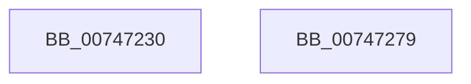

# KeSrcuSynchronize

- RVA: `0x00747230`–`0x0074727A` (길이 `74` bytes)
- VA: `0x0000000140747230`
- 실행 섹션: `PAGE`
- PDB 이름 있음: `예`; PDB Function 태그: `아니요`
- unwind 정보 RVA: `0x000AF0B0`
- 디코드: `22`개 명령, `74/74` bytes 표시
- 미해석 바이트: `0` (있으면 어셈블리에 `.byte`로 보존)

> 이 문서는 커널 이미지의 기계어와 PDB 기호를 분석해 생성했습니다. 4번과 5번은 함수 원형과 자료형을 바이너리 사용 방식에서 추정한 C 해석이며 원본 소스 복구 결과는 아닙니다.

## 1. Dependencies

- 직접 호출 지점: **3**; 고유 호출 대상: **3**
- 직접 호출자로 확인된 함수: **0**
- RIP 상대 이미지 참조: **0**

### Outgoing calls
- `0x00747250` → [KeInitializeGate](../../text/49/KeInitializeGate_function_004953F8.md) (function, `0x004953F8`)
- `0x0074725D` → [KiSrcuStartGracePeriod](../../text/5C/KiSrcuStartGracePeriod_function_005C2E3C.md) (function, `0x005C2E3C`)
- `0x0074726E` → [KeWaitForGate](../../text/2C/KeWaitForGate_function_002CA794.md) (function, `0x002CA794`)

### Direct callers
- 이 함수 시작 RVA로 연결되는 직접 call은 확인되지 않았습니다. 간접 호출은 완전히 역산할 수 없습니다.

### Static image references
- 디코드된 RIP-relative 메모리 참조가 없습니다.

## 2. Other-region calls and transfers

- 다른 실행 섹션으로 향하는 call: **3**
  - `0x00747250` → [KeInitializeGate](../../text/49/KeInitializeGate_function_004953F8.md) (`PAGE` → `.text`)
  - `0x0074725D` → [KiSrcuStartGracePeriod](../../text/5C/KiSrcuStartGracePeriod_function_005C2E3C.md) (`PAGE` → `.text`)
  - `0x0074726E` → [KeWaitForGate](../../text/2C/KeWaitForGate_function_002CA794.md) (`PAGE` → `.text`)
- 별도 외부 분기/꼬리 이동을 확인하지 못했습니다.

## 3. Assembly (complete function range)

```asm
00747230  48 8B C4                        mov rax, rsp
00747233  53                              push rbx
00747234  48 83 EC 50                     sub rsp, 0x50
00747238  0F 57 C0                        xorps xmm0, xmm0
0074723B  48 8B D9                        mov rbx, rcx
0074723E  48 8D 48 E0                     lea rcx, [rax - 0x20]
00747242  33 D2                           xor edx, edx
00747244  0F 11 40 C8                     movups xmmword ptr [rax - 0x38], xmm0
00747248  0F 11 40 D8                     movups xmmword ptr [rax - 0x28], xmm0
0074724C  0F 11 40 E8                     movups xmmword ptr [rax - 0x18], xmm0
00747250  E8 A3 E1 D4 FF                  call 0x1404953f8
00747255  48 8D 54 24 20                  lea rdx, [rsp + 0x20]
0074725A  48 8B CB                        mov rcx, rbx
0074725D  E8 DA BB E7 FF                  call 0x1405c2e3c
00747262  45 33 C0                        xor r8d, r8d
00747265  48 8D 4C 24 38                  lea rcx, [rsp + 0x38]
0074726A  41 8D 50 2A                     lea edx, [r8 + 0x2a]
0074726E  E8 21 35 B8 FF                  call 0x1402ca794
00747273  48 83 C4 50                     add rsp, 0x50
00747277  5B                              pop rbx
00747278  C3                              ret
00747279  CC                              int3
```

## 4. C-style interpretation (structured pseudocode)

```c
__int64 __fastcall KeSrcuSynchronize(__int64 a1, int a2, int a3)
{
    __int64 result;
    __int64 v_rsp;
    unsigned __int64 v_stack_m20;
    unsigned __int64 v_stack_m38;

    v_rsp = (v_rsp) - (80);
    a2 = 0;
    *(unsigned __int64 *)(v_rsp - 56) = v_xmm0;
    *(unsigned __int64 *)(v_rsp - 40) = v_xmm0;
    *(unsigned __int64 *)(v_rsp - 24) = v_xmm0;
    result = KeInitializeGate(v_rsp - 32, a2, a3, a4);
    result = KiSrcuStartGracePeriod(a1, v_stack_m38, a3, a4);
    a3 = 0;
    result = KeWaitForGate(v_stack_m20, a3 + 42, a3, a4);
    v_rsp = (v_rsp) + (80);
    return result;
}
```

## 5. (Beta) C Style

```c
int64_t KeSrcuSynchronize(int64_t Arg1, int32_t Arg2, int32_t Arg3)
{
    int64_t result;
    int64_t local_rsp;
    uint64_t v_stack_m20;
    uint64_t v_stack_m38;

    local_rsp = (local_rsp) - (80);
    Arg2 = 0;
    *(uint64_t *)(local_rsp - 0x38) = v_xmm0;
    *(uint64_t *)(local_rsp - 0x28) = v_xmm0;
    *(uint64_t *)(local_rsp - 0x18) = v_xmm0;
    result = KeInitializeGate(local_rsp - 32, Arg2, Arg3, a4);
    result = KiSrcuStartGracePeriod(Arg1, v_stack_m38, Arg3, a4);
    Arg3 = 0;
    result = KeWaitForGate(v_stack_m20, Arg3 + 42, Arg3, a4);
    local_rsp = (local_rsp) + (80);
    return result;
}
```

## 6. Execution-region graph

[열기: 2D/3D 그래프와 함수 탐색 컨트롤 패널](../../../control-panel.html?section=page&rva=0x00747230&view=graph)

- 2D 그래프는 위에서 아래로 흐르고, 3D 그래프는 빈 공간을 드래그해 회전합니다. Shift+드래그는 이동, 휠은 확대·축소, 함수 노드 선택은 대상 보고서 이동입니다.

### Static fallback


