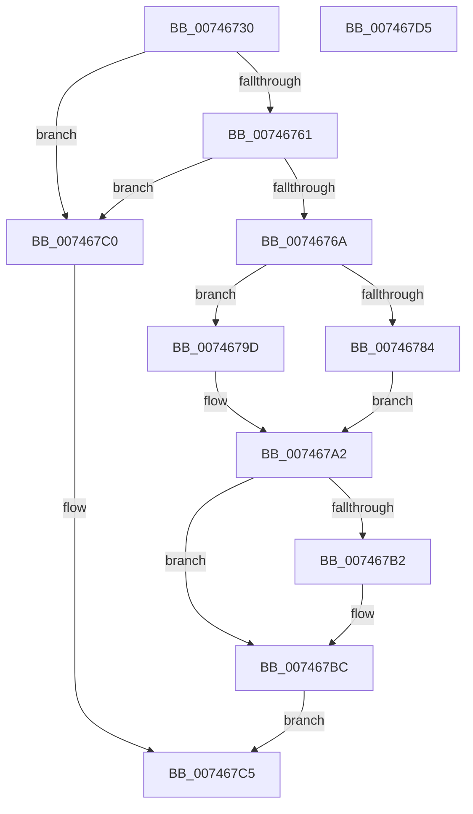

# KeStartDynamicProcessor

- RVA: `0x00746730`–`0x007467D6` (길이 `166` bytes)
- VA: `0x0000000140746730`
- 실행 섹션: `PAGE`
- PDB 이름 있음: `예`; PDB Function 태그: `아니요`
- unwind 정보 RVA: `0x00060BC4`
- 디코드: `41`개 명령, `166/166` bytes 표시
- 미해석 바이트: `0` (있으면 어셈블리에 `.byte`로 보존)

> 이 문서는 커널 이미지의 기계어와 PDB 기호를 분석해 생성했습니다. 4번과 5번은 함수 원형과 자료형을 바이너리 사용 방식에서 추정한 C 해석이며 원본 소스 복구 결과는 아닙니다.

## 1. Dependencies

- 직접 호출 지점: **5**; 고유 호출 대상: **5**
- 직접 호출자로 확인된 함수: **0**
- RIP 상대 이미지 참조: **5**

### Outgoing calls
- `0x00746771` → [ExAcquireFastMutexUnsafe](../../text/3F/ExAcquireFastMutexUnsafe_function_003F3720.md) (function, `0x003F3720`)
- `0x00746794` → [KiStartDynamicProcessor](KiStartDynamicProcessor_function_007456C8.md) (function, `0x007456C8`)
- `0x007467A9` → [ExReleaseFastMutexUnsafe](../../text/25/ExReleaseFastMutexUnsafe_function_002503A0.md) (function, `0x002503A0`)
- `0x007467B2` → [PnpInitializeProcessor](../../text/5A/PnpInitializeProcessor_function_005A4ECC.md) (function, `0x005A4ECC`)
- `0x007467B7` → [PsUpdateActiveProcessAffinity](../78/PsUpdateActiveProcessAffinity_function_00781DA8.md) (function, `0x00781DA8`)

### Direct callers
- 이 함수 시작 RVA로 연결되는 직접 call은 확인되지 않았습니다. 간접 호출은 완전히 역산할 수 없습니다.

### Static image references
- `0x00746758` → RVA `0x00FC6AB0` (`ALMOSTRO`; read)
- `0x00746761` → RVA `0x00FC6AA4` (`ALMOSTRO`; read)
- `0x0074676A` → RVA `0x00F22B80` (`.data`; read)
- `0x00746776` → RVA `0x00FC6A80` (`ALMOSTRO`; read)
- `0x0074677C` → RVA `0x00FC6AE8` (`ALMOSTRO`; read)

## 2. Other-region calls and transfers

- 다른 실행 섹션으로 향하는 call: **3**
  - `0x00746771` → [ExAcquireFastMutexUnsafe](../../text/3F/ExAcquireFastMutexUnsafe_function_003F3720.md) (`PAGE` → `.text`)
  - `0x007467A9` → [ExReleaseFastMutexUnsafe](../../text/25/ExReleaseFastMutexUnsafe_function_002503A0.md) (`PAGE` → `.text`)
  - `0x007467B2` → [PnpInitializeProcessor](../../text/5A/PnpInitializeProcessor_function_005A4ECC.md) (`PAGE` → `.text`)
- 별도 외부 분기/꼬리 이동을 확인하지 못했습니다.

## 3. Assembly (complete function range)

```asm
00746730  48 89 5C 24 08                  mov qword ptr [rsp + 8], rbx
00746735  48 89 74 24 10                  mov qword ptr [rsp + 0x10], rsi
0074673A  57                              push rdi
0074673B  48 83 EC 20                     sub rsp, 0x20
0074673F  65 48 8B 04 25 88 01 00 00      mov rax, qword ptr gs:[0x188]
00746748  49 8B D9                        mov rbx, r9
0074674B  41 0F B7 F8                     movzx edi, r8w
0074674F  8B F2                           mov esi, edx
00746751  48 8B 88 B8 00 00 00            mov rcx, qword ptr [rax + 0xb8]
00746758  48 3B 0D 51 03 88 00            cmp rcx, qword ptr [rip + 0x880351]
0074675F  75 5F                           jne 0x1407467c0
00746761  80 3D 3C 03 88 00 00            cmp byte ptr [rip + 0x88033c], 0
00746768  74 56                           je 0x1407467c0
0074676A  48 8D 0D 0F C4 7D 00            lea rcx, [rip + 0x7dc40f]
00746771  E8 AA CF CA FF                  call 0x1403f3720
00746776  8B 05 04 03 88 00               mov eax, dword ptr [rip + 0x880304]
0074677C  3B 05 66 03 88 00               cmp eax, dword ptr [rip + 0x880366]
00746782  73 19                           jae 0x14074679d
00746784  44 8B 0D F5 02 88 00            mov r9d, dword ptr [rip + 0x8802f5]
0074678B  44 0F B7 C7                     movzx r8d, di
0074678F  8B D6                           mov edx, esi
00746791  44 89 0B                        mov dword ptr [rbx], r9d
00746794  E8 2F EF FF FF                  call 0x1407456c8
00746799  8B D8                           mov ebx, eax
0074679B  EB 05                           jmp 0x1407467a2
0074679D  BB 59 02 00 C0                  mov ebx, 0xc0000259
007467A2  48 8D 0D D7 C3 7D 00            lea rcx, [rip + 0x7dc3d7]
007467A9  E8 F2 9B B0 FF                  call 0x1402503a0
007467AE  85 DB                           test ebx, ebx
007467B0  78 0A                           js 0x1407467bc
007467B2  E8 15 E7 E5 FF                  call 0x1405a4ecc
007467B7  E8 EC B5 03 00                  call 0x140781da8
007467BC  8B C3                           mov eax, ebx
007467BE  EB 05                           jmp 0x1407467c5
007467C0  B8 01 00 00 C0                  mov eax, 0xc0000001
007467C5  48 8B 5C 24 30                  mov rbx, qword ptr [rsp + 0x30]
007467CA  48 8B 74 24 38                  mov rsi, qword ptr [rsp + 0x38]
007467CF  48 83 C4 20                     add rsp, 0x20
007467D3  5F                              pop rdi
007467D4  C3                              ret
007467D5  CC                              int3
```

## 4. C-style interpretation (structured pseudocode)

```c
__int64 __fastcall KeStartDynamicProcessor(__int64 a1, int a2, unsigned __int16 a3, __int64 a4)
{
    __int64 result;
    __int64 v_rsp;
    unsigned __int64 v_stack_p10;
    unsigned __int64 v_stack_p8;

    v_stack_p8 = v_rbx;
    v_stack_p10 = v_rsi;
    v_rsp = (v_rsp) - (32);
    if ((*(unsigned __int64 *)(*(unsigned __int64 *)(gs_base + (0 + 392)) + 184)) != (*(unsigned __int64 *)(v_rip + 8913745))) goto loc_007467C0;
    if ((*(unsigned __int8 *)(v_rip + 8913724)) == 0) goto loc_007467C0;
    result = ExAcquireFastMutexUnsafe(v_rip + 8242191, a2, a3, a4);
    if (((unsigned int)((unsigned int)(*(unsigned int *)(v_rip + 8913668)))) >= (*(unsigned int *)(v_rip + 8913766))) goto loc_0074679D;
    *(unsigned int *)(a4) = (unsigned int)((unsigned int)(*(unsigned int *)(v_rip + 8913653)));
    result = KiStartDynamicProcessor(v_rip + 8242191, (unsigned int)((unsigned int)((unsigned int)(a2))), a3, (unsigned int)(*(unsigned int *)(v_rip + 8913653)));
    goto loc_007467A2;
loc_0074679D:
loc_007467A2:
    result = ExReleaseFastMutexUnsafe(v_rip + 8242135, (unsigned int)((unsigned int)((unsigned int)(a2))), a3, (unsigned int)(*(unsigned int *)(v_rip + 8913653)));
    if (!(sign_flag)) {
        result = PnpInitializeProcessor(v_rip + 8242135, (unsigned int)((unsigned int)((unsigned int)(a2))), a3, (unsigned int)(*(unsigned int *)(v_rip + 8913653)));
        result = PsUpdateActiveProcessAffinity(v_rip + 8242135, (unsigned int)((unsigned int)((unsigned int)(a2))), a3, (unsigned int)(*(unsigned int *)(v_rip + 8913653)));
    }
    goto loc_007467C5;
loc_007467C0:
loc_007467C5:
    v_rsp = (v_rsp) + (32);
    return (unsigned int)(0xC0000001ULL);
}
```

## 5. (Beta) C Style

```c
int64_t KeStartDynamicProcessor(int64_t Arg1, int32_t Arg2, uint16_t Arg3, void *Arg4)
{
    uint8_t *arg4 = (uint8_t *)Arg4;

    int64_t result;
    int64_t local_rsp;
    uint64_t v_stack_p10;
    uint64_t v_stack_p8;

    v_stack_p8 = local_rbx;
    v_stack_p10 = local_rsi;
    local_rsp = (local_rsp) - (32);
    if ((*(uint64_t *)(*(uint64_t *)(gs_base + (0 + 0x188)) + 0xB8)) != (*(uint64_t *)(v_rip + 0x880351))) goto loc_007467C0;
    if ((*(uint8_t *)(v_rip + 0x88033C)) == 0) goto loc_007467C0;
    result = ExAcquireFastMutexUnsafe(v_rip + 8242191, Arg2, Arg3, Arg4);
    if (((uint32_t)((uint32_t)(*(uint32_t *)(v_rip + 0x880304)))) >= (*(uint32_t *)(v_rip + 0x880366))) goto loc_0074679D;
    *(uint32_t *)(arg4) = (uint32_t)((uint32_t)(*(uint32_t *)(v_rip + 0x8802F5)));
    result = KiStartDynamicProcessor(v_rip + 8242191, (uint32_t)((uint32_t)((uint32_t)(Arg2))), Arg3, (uint32_t)(*(uint32_t *)(v_rip + 0x8802F5)));
    goto loc_007467A2;
loc_0074679D:
loc_007467A2:
    result = ExReleaseFastMutexUnsafe(v_rip + 8242135, (uint32_t)((uint32_t)((uint32_t)(Arg2))), Arg3, (uint32_t)(*(uint32_t *)(v_rip + 0x8802F5)));
    if (!(sign_flag)) {
        result = PnpInitializeProcessor(v_rip + 8242135, (uint32_t)((uint32_t)((uint32_t)(Arg2))), Arg3, (uint32_t)(*(uint32_t *)(v_rip + 0x8802F5)));
        result = PsUpdateActiveProcessAffinity(v_rip + 8242135, (uint32_t)((uint32_t)((uint32_t)(Arg2))), Arg3, (uint32_t)(*(uint32_t *)(v_rip + 0x8802F5)));
    }
    goto loc_007467C5;
loc_007467C0:
loc_007467C5:
    local_rsp = (local_rsp) + (32);
    return (uint32_t)(0xC0000001ULL);
}
```

### 관측된 메모리 오프셋

구조체 형식이 확인되지 않은 접근은 인자 기준의 오프셋으로만 기록했습니다.

| 기준 인자 | 오프셋 표현 | 폭 (bit) | 접근 |
|---|---:|---:|---|
| `Arg4` | `+ 0x0` | `32` | `W` |

## 6. Execution-region graph

[열기: 2D/3D 그래프와 함수 탐색 컨트롤 패널](../../../control-panel.html?section=page&rva=0x00746730&view=graph)

- 2D 그래프는 위에서 아래로 흐르고, 3D 그래프는 빈 공간을 드래그해 회전합니다. Shift+드래그는 이동, 휠은 확대·축소, 함수 노드 선택은 대상 보고서 이동입니다.

### Static fallback


