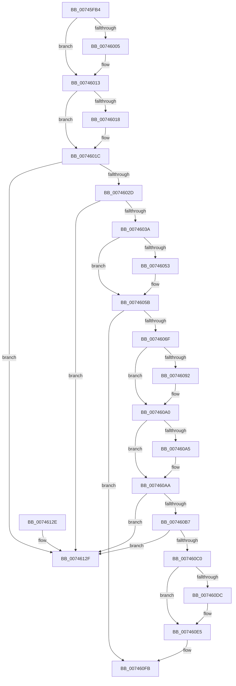

# KeUnregisterAvailableCpusChangeNotification

- RVA: `0x00745FB4`–`0x00746136` (길이 `386` bytes)
- VA: `0x0000000140745FB4`
- 실행 섹션: `PAGE`
- PDB 이름 있음: `예`; PDB Function 태그: `아니요`
- unwind 정보 RVA: `0x0006B020`
- 디코드: `101`개 명령, `386/386` bytes 표시
- 미해석 바이트: `0` (있으면 어셈블리에 `.byte`로 보존)

> 이 문서는 커널 이미지의 기계어와 PDB 기호를 분석해 생성했습니다. 4번과 5번은 함수 원형과 자료형을 바이너리 사용 방식에서 추정한 C 해석이며 원본 소스 복구 결과는 아닙니다.

## 1. Dependencies

- 직접 호출 지점: **12**; 고유 호출 대상: **8**
- 직접 호출자로 확인된 함수: **1**
- RIP 상대 이미지 참조: **2**

### Outgoing calls
- `0x00745FF4` → [KeAbPreAcquire](../../text/21/KeAbPreAcquire_function_00210230.md) (function, `0x00210230`)
- `0x0074600E` → [ExfAcquirePushLockExclusiveEx](../../text/20/ExfAcquirePushLockExclusiveEx_function_0020FC90.md) (function, `0x0020FC90`)
- `0x00746056` → [ExfTryToWakePushLock](../../text/26/ExfTryToWakePushLock_function_00265DD0.md) (function, `0x00265DD0`)
- `0x0074605E` → [KeAbPostRelease](../../text/2E/KeAbPostRelease_function_002E1600.md) (function, `0x002E1600`)
- `0x00746082` → [KeAbPreAcquire](../../text/21/KeAbPreAcquire_function_00210230.md) (function, `0x00210230`)
- `0x0074609B` → [ExfAcquirePushLockExclusiveEx](../../text/20/ExfAcquirePushLockExclusiveEx_function_0020FC90.md) (function, `0x0020FC90`)
- `0x007460E0` → [ExfTryToWakePushLock](../../text/26/ExfTryToWakePushLock_function_00265DD0.md) (function, `0x00265DD0`)
- `0x007460E9` → [KeAbPostRelease](../../text/2E/KeAbPostRelease_function_002E1600.md) (function, `0x002E1600`)
- `0x007460F6` → [ObfDereferenceObjectWithTag](../../text/2F/ObfDereferenceObjectWithTag_function_002F78E0.md) (function, `0x002F78E0`)
- `0x007460FB` → [KeLeaveCriticalRegion](../../text/25/KeLeaveCriticalRegion_function_0025D8B0.md) (function, `0x0025D8B0`)
- `0x00746104` → [KiRundownAvailableCpusWorkItem](../../text/43/KiRundownAvailableCpusWorkItem_function_0043FA78.md) (function, `0x0043FA78`)
- `0x0074610E` → [ExFreePoolWithTag](../../poolcode/B8/ExFreePoolWithTag_function_00B82870.md) (function, `0x00B82870`)

### Direct callers
- [PsUnregisterAvailableCpusChangeNotification](../78/PsUnregisterAvailableCpusChangeNotification_function_00781D90.md) at `0x00781D94`

### Static image references
- `0x00745FD6` → RVA `0x00F22FA8` (`.data`; read)
- `0x00746044` → RVA `0x00F22FA8` (`.data`; read/write)

## 2. Other-region calls and transfers

- 다른 실행 섹션으로 향하는 call: **12**
  - `0x00745FF4` → [KeAbPreAcquire](../../text/21/KeAbPreAcquire_function_00210230.md) (`PAGE` → `.text`)
  - `0x0074600E` → [ExfAcquirePushLockExclusiveEx](../../text/20/ExfAcquirePushLockExclusiveEx_function_0020FC90.md) (`PAGE` → `.text`)
  - `0x00746056` → [ExfTryToWakePushLock](../../text/26/ExfTryToWakePushLock_function_00265DD0.md) (`PAGE` → `.text`)
  - `0x0074605E` → [KeAbPostRelease](../../text/2E/KeAbPostRelease_function_002E1600.md) (`PAGE` → `.text`)
  - `0x00746082` → [KeAbPreAcquire](../../text/21/KeAbPreAcquire_function_00210230.md) (`PAGE` → `.text`)
  - `0x0074609B` → [ExfAcquirePushLockExclusiveEx](../../text/20/ExfAcquirePushLockExclusiveEx_function_0020FC90.md) (`PAGE` → `.text`)
  - `0x007460E0` → [ExfTryToWakePushLock](../../text/26/ExfTryToWakePushLock_function_00265DD0.md) (`PAGE` → `.text`)
  - `0x007460E9` → [KeAbPostRelease](../../text/2E/KeAbPostRelease_function_002E1600.md) (`PAGE` → `.text`)
  - `0x007460F6` → [ObfDereferenceObjectWithTag](../../text/2F/ObfDereferenceObjectWithTag_function_002F78E0.md) (`PAGE` → `.text`)
  - `0x007460FB` → [KeLeaveCriticalRegion](../../text/25/KeLeaveCriticalRegion_function_0025D8B0.md) (`PAGE` → `.text`)
  - `0x00746104` → [KiRundownAvailableCpusWorkItem](../../text/43/KiRundownAvailableCpusWorkItem_function_0043FA78.md) (`PAGE` → `.text`)
  - `0x0074610E` → [ExFreePoolWithTag](../../poolcode/B8/ExFreePoolWithTag_function_00B82870.md) (`PAGE` → `POOLCODE`)
- 별도 외부 분기/꼬리 이동을 확인하지 못했습니다.

## 3. Assembly (complete function range)

```asm
00745FB4  48 8B C4                        mov rax, rsp
00745FB7  48 89 58 08                     mov qword ptr [rax + 8], rbx
00745FBB  48 89 68 10                     mov qword ptr [rax + 0x10], rbp
00745FBF  48 89 70 18                     mov qword ptr [rax + 0x18], rsi
00745FC3  48 89 78 20                     mov qword ptr [rax + 0x20], rdi
00745FC7  41 56                           push r14
00745FC9  48 83 EC 20                     sub rsp, 0x20
00745FCD  65 48 8B 04 25 88 01 00 00      mov rax, qword ptr gs:[0x188]
00745FD6  48 8D 2D CB CF 7D 00            lea rbp, [rip + 0x7dcfcb]
00745FDD  48 8B F1                        mov rsi, rcx
00745FE0  48 83 CB FF                     or rbx, 0xffffffffffffffff
00745FE4  45 33 C0                        xor r8d, r8d
00745FE7  33 D2                           xor edx, edx
00745FE9  48 8B CD                        mov rcx, rbp
00745FEC  66 01 98 E4 01 00 00            add word ptr [rax + 0x1e4], bx
00745FF3  90                              nop
00745FF4  E8 37 A2 AC FF                  call 0x140210230
00745FF9  F0 48 0F BA 6D 00 00            lock bts qword ptr [rbp], 0
00746000  48 8B F8                        mov rdi, rax
00746003  73 0E                           jae 0x140746013
00746005  4C 8B C5                        mov r8, rbp
00746008  48 8B D0                        mov rdx, rax
0074600B  48 8B CD                        mov rcx, rbp
0074600E  E8 7D 9C AC FF                  call 0x14020fc90
00746013  48 85 FF                        test rdi, rdi
00746016  74 04                           je 0x14074601c
00746018  C6 47 0A 01                     mov byte ptr [rdi + 0xa], 1
0074601C  48 8D 46 18                     lea rax, [rsi + 0x18]
00746020  48 8B 10                        mov rdx, qword ptr [rax]
00746023  48 39 42 08                     cmp qword ptr [rdx + 8], rax
00746027  0F 85 02 01 00 00               jne 0x14074612f
0074602D  48 8B 48 08                     mov rcx, qword ptr [rax + 8]
00746031  48 39 01                        cmp qword ptr [rcx], rax
00746034  0F 85 F5 00 00 00               jne 0x14074612f
0074603A  48 89 11                        mov qword ptr [rcx], rdx
0074603D  48 8B C3                        mov rax, rbx
00746040  48 89 4A 08                     mov qword ptr [rdx + 8], rcx
00746044  F0 48 0F C1 05 5B CF 7D 00      lock xadd qword ptr [rip + 0x7dcf5b], rax
0074604D  24 06                           and al, 6
0074604F  3C 02                           cmp al, 2
00746051  75 08                           jne 0x14074605b
00746053  48 8B CD                        mov rcx, rbp
00746056  E8 75 FD B1 FF                  call 0x140265dd0
0074605B  48 8B CD                        mov rcx, rbp
0074605E  E8 9D B5 B9 FF                  call 0x1402e1600
00746063  48 8B 2E                        mov rbp, qword ptr [rsi]
00746066  48 85 ED                        test rbp, rbp
00746069  0F 84 8C 00 00 00               je 0x1407460fb
0074606F  48 8B BD C0 01 00 00            mov rdi, qword ptr [rbp + 0x1c0]
00746076  45 33 C0                        xor r8d, r8d
00746079  48 83 C7 20                     add rdi, 0x20
0074607D  33 D2                           xor edx, edx
0074607F  48 8B CF                        mov rcx, rdi
00746082  E8 A9 A1 AC FF                  call 0x140210230
00746087  F0 48 0F BA 2F 00               lock bts qword ptr [rdi], 0
0074608D  4C 8B F0                        mov r14, rax
00746090  73 0E                           jae 0x1407460a0
00746092  4C 8B C7                        mov r8, rdi
00746095  48 8B D0                        mov rdx, rax
00746098  48 8B CF                        mov rcx, rdi
0074609B  E8 F0 9B AC FF                  call 0x14020fc90
007460A0  4D 85 F6                        test r14, r14
007460A3  74 05                           je 0x1407460aa
007460A5  41 C6 46 0A 01                  mov byte ptr [r14 + 0xa], 1
007460AA  48 8D 46 08                     lea rax, [rsi + 8]
007460AE  48 8B 10                        mov rdx, qword ptr [rax]
007460B1  48 39 42 08                     cmp qword ptr [rdx + 8], rax
007460B5  75 78                           jne 0x14074612f
007460B7  48 8B 48 08                     mov rcx, qword ptr [rax + 8]
007460BB  48 39 01                        cmp qword ptr [rcx], rax
007460BE  75 6F                           jne 0x14074612f
007460C0  48 89 11                        mov qword ptr [rcx], rdx
007460C3  48 89 4A 08                     mov qword ptr [rdx + 8], rcx
007460C7  48 8B BD C0 01 00 00            mov rdi, qword ptr [rbp + 0x1c0]
007460CE  F0 48 0F C1 5F 20               lock xadd qword ptr [rdi + 0x20], rbx
007460D4  80 E3 06                        and bl, 6
007460D7  80 FB 02                        cmp bl, 2
007460DA  75 09                           jne 0x1407460e5
007460DC  48 8D 4F 20                     lea rcx, [rdi + 0x20]
007460E0  E8 EB FC B1 FF                  call 0x140265dd0
007460E5  48 8D 4F 20                     lea rcx, [rdi + 0x20]
007460E9  E8 12 B5 B9 FF                  call 0x1402e1600
007460EE  BA 4B 69 41 76                  mov edx, 0x7641694b
007460F3  48 8B CD                        mov rcx, rbp
007460F6  E8 E5 17 BB FF                  call 0x1402f78e0
007460FB  E8 B0 77 B1 FF                  call 0x14025d8b0
00746100  48 8D 4E 28                     lea rcx, [rsi + 0x28]
00746104  E8 6F 99 CF FF                  call 0x14043fa78
00746109  33 D2                           xor edx, edx
0074610B  48 8B CE                        mov rcx, rsi
0074610E  E8 5D C7 43 00                  call 0x140b82870
00746113  48 8B 5C 24 30                  mov rbx, qword ptr [rsp + 0x30]
00746118  48 8B 6C 24 38                  mov rbp, qword ptr [rsp + 0x38]
0074611D  48 8B 74 24 40                  mov rsi, qword ptr [rsp + 0x40]
00746122  48 8B 7C 24 48                  mov rdi, qword ptr [rsp + 0x48]
00746127  48 83 C4 20                     add rsp, 0x20
0074612B  41 5E                           pop r14
0074612D  C3                              ret
0074612E  CC                              int3
0074612F  B9 03 00 00 00                  mov ecx, 3
00746134  CD 29                           int 0x29
```

## 4. C-style interpretation (structured pseudocode)

```c
__int64 __fastcall KeUnregisterAvailableCpusChangeNotification(__int64 a1, int a2, int a3)
{
    __int64 result;
    __int64 v_rbx;
    __int64 v_rdi;
    __int64 v_rsp;
    unsigned __int64 v_stack_p10;
    unsigned __int64 v_stack_p18;
    unsigned __int64 v_stack_p20;
    unsigned __int64 v_stack_p8;

    *(unsigned __int64 *)(v_rsp + 8) = v_rbx;
    *(unsigned __int64 *)(v_rsp + 16) = v_rbp;
    *(unsigned __int64 *)(v_rsp + 24) = v_rsi;
    *(unsigned __int64 *)(v_rsp + 32) = v_rdi;
    v_rsp = (v_rsp) - (32);
    v_rbx = (v_rbx) | (-1);
    a3 = 0;
    a2 = 0;
    result = KeAbPreAcquire(v_rip + 8245195, a2, a3, a4);
    if (!(condition_is_above_or_equal)) {
        a3 = v_rip + 8245195;
        a2 = result;
        a1 = v_rip + 8245195;
        result = ExfAcquirePushLockExclusiveEx(a1, a2, a3, a4);
    }
    if (result != 0) {
        *(unsigned __int8 *)(result + 10) = 1;
    }
    if ((*(unsigned __int64 *)(*(unsigned __int64 *)(a1 + 24) + 8)) != (a1 + 24)) goto loc_0074612F;
    if ((*(unsigned __int64 *)(*(unsigned __int64 *)(a1 + 24 + 8))) != (a1 + 24)) goto loc_0074612F;
    *(unsigned __int64 *)(*(unsigned __int64 *)(a1 + 24 + 8)) = *(unsigned __int64 *)(a1 + 24);
    *(unsigned __int64 *)(*(unsigned __int64 *)(a1 + 24) + 8) = *(unsigned __int64 *)(a1 + 24 + 8);
    result = (unsigned __int8)((v_rbx) & (6));
    if (((unsigned __int8)(result)) == 2) {
        a1 = v_rip + 8245195;
        result = ExfTryToWakePushLock(a1, *(unsigned __int64 *)(a1 + 24), a3, a4);
    }
    result = KeAbPostRelease(v_rip + 8245195, *(unsigned __int64 *)(a1 + 24), a3, a4);
    if (*(unsigned __int64 *)(a1) == 0) goto loc_007460FB;
    a3 = 0;
    v_rdi = (*(unsigned __int64 *)(*(unsigned __int64 *)(a1) + 448)) + (32);
    a2 = 0;
    result = KeAbPreAcquire(v_rdi, a2, a3, a4);
    if (!(condition_is_above_or_equal)) {
        a3 = v_rdi;
        a2 = result;
        a1 = v_rdi;
        result = ExfAcquirePushLockExclusiveEx(a1, a2, a3, a4);
    }
    if (result != 0) {
        *(unsigned __int8 *)(result + 10) = 1;
    }
    if ((*(unsigned __int64 *)(*(unsigned __int64 *)(a1 + 8) + 8)) != (a1 + 8)) goto loc_0074612F;
    if ((*(unsigned __int64 *)(*(unsigned __int64 *)(a1 + 8 + 8))) != (a1 + 8)) goto loc_0074612F;
    *(unsigned __int64 *)(*(unsigned __int64 *)(a1 + 8 + 8)) = *(unsigned __int64 *)(a1 + 8);
    *(unsigned __int64 *)(*(unsigned __int64 *)(a1 + 8) + 8) = *(unsigned __int64 *)(a1 + 8 + 8);
    v_rbx = (unsigned __int8)((v_rbx) & (6));
    result = a1 + 8;
    if (((unsigned __int8)(v_rbx)) == 2) {
        a1 = *(unsigned __int64 *)(*(unsigned __int64 *)(a1) + 448) + 32;
        result = ExfTryToWakePushLock(a1, *(unsigned __int64 *)(a1 + 8), a3, a4);
    }
    result = KeAbPostRelease(*(unsigned __int64 *)(*(unsigned __int64 *)(a1) + 448) + 32, *(unsigned __int64 *)(a1 + 8), a3, a4);
    result = ObfDereferenceObjectWithTag(*(unsigned __int64 *)(a1), (unsigned int)(0x7641694BULL), a3, a4);
loc_007460FB:
    result = KeLeaveCriticalRegion(*(unsigned __int64 *)(a1), (unsigned int)(0x7641694BULL), a3, a4);
    result = KiRundownAvailableCpusWorkItem(a1 + 40, (unsigned int)(0x7641694BULL), a3, a4);
    a2 = 0;
    result = ExFreePoolWithTag(a1, a2, a3, a4);
    v_rsp = (v_rsp) + (32);
    return result;
loc_0074612F:
    return result;
}
```

## 5. (Beta) C Style

```c
int64_t KeUnregisterAvailableCpusChangeNotification(void *Arg1, int32_t Arg2, int32_t Arg3)
{
    uint8_t *arg1 = (uint8_t *)Arg1;

    int64_t result;
    int64_t local_rbx;
    int64_t local_rdi;
    int64_t local_rsp;
    uint64_t v_stack_p10;
    uint64_t v_stack_p18;
    uint64_t v_stack_p20;
    uint64_t v_stack_p8;

    *(uint64_t *)(local_rsp + 0x8) = local_rbx;
    *(uint64_t *)(local_rsp + 0x10) = local_rbp;
    *(uint64_t *)(local_rsp + 0x18) = local_rsi;
    *(uint64_t *)(local_rsp + 0x20) = local_rdi;
    local_rsp = (local_rsp) - (32);
    local_rbx = (local_rbx) | (-1);
    Arg3 = 0;
    Arg2 = 0;
    result = KeAbPreAcquire(v_rip + 8245195, Arg2, Arg3, a4);
    if (!(condition_is_above_or_equal)) {
        Arg3 = v_rip + 8245195;
        Arg2 = result;
        Arg1 = v_rip + 8245195;
        result = ExfAcquirePushLockExclusiveEx(Arg1, Arg2, Arg3, a4);
    }
    if (result != 0) {
        *(uint8_t *)(result + 0xA) = 1;
    }
    if ((*(uint64_t *)(*(uint64_t *)(arg1 + 0x18) + 0x8)) != (Arg1 + 24)) goto loc_0074612F;
    if ((*(uint64_t *)(*(uint64_t *)(arg1 + 0x18 + 0x8))) != (Arg1 + 24)) goto loc_0074612F;
    *(uint64_t *)(*(uint64_t *)(arg1 + 0x18 + 0x8)) = *(uint64_t *)(arg1 + 0x18);
    *(uint64_t *)(*(uint64_t *)(arg1 + 0x18) + 0x8) = *(uint64_t *)(arg1 + 0x18 + 0x8);
    result = (uint8_t)((local_rbx) & (6));
    if (((uint8_t)(result)) == 2) {
        Arg1 = v_rip + 8245195;
        result = ExfTryToWakePushLock(Arg1, *(uint64_t *)(arg1 + 0x18), Arg3, a4);
    }
    result = KeAbPostRelease(v_rip + 8245195, *(uint64_t *)(arg1 + 0x18), Arg3, a4);
    if (*(uint64_t *)(arg1) == 0) goto loc_007460FB;
    Arg3 = 0;
    local_rdi = (*(uint64_t *)(*(uint64_t *)(arg1) + 0x1C0)) + (32);
    Arg2 = 0;
    result = KeAbPreAcquire(local_rdi, Arg2, Arg3, a4);
    if (!(condition_is_above_or_equal)) {
        Arg3 = local_rdi;
        Arg2 = result;
        Arg1 = local_rdi;
        result = ExfAcquirePushLockExclusiveEx(Arg1, Arg2, Arg3, a4);
    }
    if (result != 0) {
        *(uint8_t *)(result + 0xA) = 1;
    }
    if ((*(uint64_t *)(*(uint64_t *)(arg1 + 0x8) + 0x8)) != (Arg1 + 8)) goto loc_0074612F;
    if ((*(uint64_t *)(*(uint64_t *)(arg1 + 0x8 + 0x8))) != (Arg1 + 8)) goto loc_0074612F;
    *(uint64_t *)(*(uint64_t *)(arg1 + 0x8 + 0x8)) = *(uint64_t *)(arg1 + 0x8);
    *(uint64_t *)(*(uint64_t *)(arg1 + 0x8) + 0x8) = *(uint64_t *)(arg1 + 0x8 + 0x8);
    local_rbx = (uint8_t)((local_rbx) & (6));
    result = Arg1 + 8;
    if (((uint8_t)(local_rbx)) == 2) {
        Arg1 = *(uint64_t *)(*(uint64_t *)(arg1) + 0x1C0) + 32;
        result = ExfTryToWakePushLock(Arg1, *(uint64_t *)(arg1 + 0x8), Arg3, a4);
    }
    result = KeAbPostRelease(*(uint64_t *)(*(uint64_t *)(arg1) + 0x1C0) + 32, *(uint64_t *)(arg1 + 0x8), Arg3, a4);
    result = ObfDereferenceObjectWithTag(*(uint64_t *)(arg1), (uint32_t)(0x7641694BULL), Arg3, a4);
loc_007460FB:
    result = KeLeaveCriticalRegion(*(uint64_t *)(arg1), (uint32_t)(0x7641694BULL), Arg3, a4);
    result = KiRundownAvailableCpusWorkItem(Arg1 + 40, (uint32_t)(0x7641694BULL), Arg3, a4);
    Arg2 = 0;
    result = ExFreePoolWithTag(Arg1, Arg2, Arg3, a4);
    local_rsp = (local_rsp) + (32);
    return result;
loc_0074612F:
    return result;
}
```

### 관측된 메모리 오프셋

구조체 형식이 확인되지 않은 접근은 인자 기준의 오프셋으로만 기록했습니다.

| 기준 인자 | 오프셋 표현 | 폭 (bit) | 접근 |
|---|---:|---:|---|
| `Arg1` | `+ 0x0` | `64` | `R` |
| `Arg1` | `+ 0x8` | `64` | `R` |
| `Arg1` | `+ 0x18` | `64` | `R` |
| `Arg1` | `+ 0x28` | `64` | `R` |

## 6. Execution-region graph

[열기: 2D/3D 그래프와 함수 탐색 컨트롤 패널](../../../control-panel.html?section=page&rva=0x00745FB4&view=graph)

- 2D 그래프는 위에서 아래로 흐르고, 3D 그래프는 빈 공간을 드래그해 회전합니다. Shift+드래그는 이동, 휠은 확대·축소, 함수 노드 선택은 대상 보고서 이동입니다.

### Static fallback


