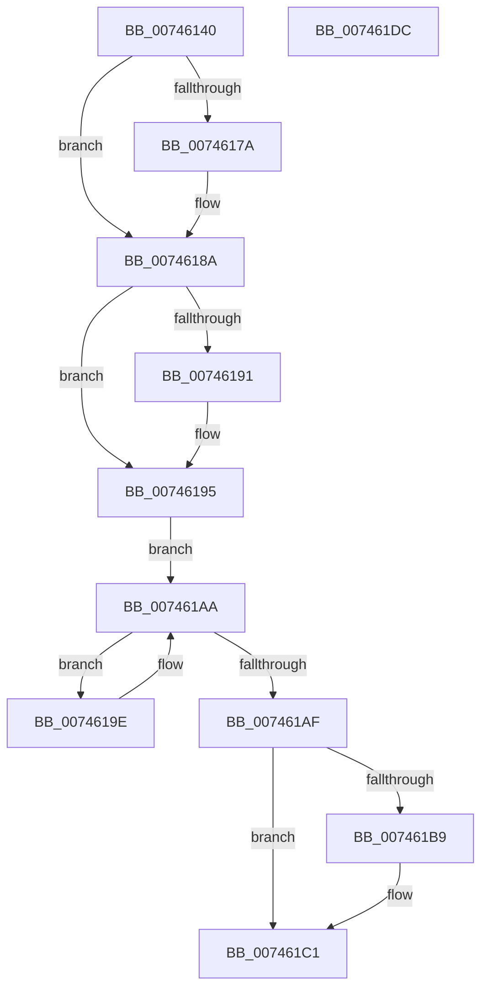

# KiAvailableCpusProcessWorkItemCallback

- RVA: `0x00746140`–`0x007461DD` (길이 `157` bytes)
- VA: `0x0000000140746140`
- 실행 섹션: `PAGE`
- PDB 이름 있음: `예`; PDB Function 태그: `아니요`
- unwind 정보 RVA: `0x000701D4`
- 디코드: `49`개 명령, `157/157` bytes 표시
- 미해석 바이트: `0` (있으면 어셈블리에 `.byte`로 보존)

> 이 문서는 커널 이미지의 기계어와 PDB 기호를 분석해 생성했습니다. 4번과 5번은 함수 원형과 자료형을 바이너리 사용 방식에서 추정한 C 해석이며 원본 소스 복구 결과는 아닙니다.

## 1. Dependencies

- 직접 호출 지점: **5**; 고유 호출 대상: **5**
- 직접 호출자로 확인된 함수: **0**
- RIP 상대 이미지 참조: **0**

### Outgoing calls
- `0x00746165` → [KeAbPreAcquire](../../text/21/KeAbPreAcquire_function_00210230.md) (function, `0x00210230`)
- `0x00746185` → [ExfAcquirePushLockSharedEx](../../text/21/ExfAcquirePushLockSharedEx_function_0021044C.md) (function, `0x0021044C`)
- `0x007461A2` → [KiAvailableCpusSubscriptionQueueWorkItem](../../text/4F/KiAvailableCpusSubscriptionQueueWorkItem_function_004FCE5C.md) (function, `0x004FCE5C`)
- `0x007461BC` → [ExfReleasePushLockShared](../../text/26/ExfReleasePushLockShared_function_00263440.md) (function, `0x00263440`)
- `0x007461C4` → [KeAbPostRelease](../../text/2E/KeAbPostRelease_function_002E1600.md) (function, `0x002E1600`)

### Direct callers
- 이 함수 시작 RVA로 연결되는 직접 call은 확인되지 않았습니다. 간접 호출은 완전히 역산할 수 없습니다.

### Static image references
- 디코드된 RIP-relative 메모리 참조가 없습니다.

## 2. Other-region calls and transfers

- 다른 실행 섹션으로 향하는 call: **5**
  - `0x00746165` → [KeAbPreAcquire](../../text/21/KeAbPreAcquire_function_00210230.md) (`PAGE` → `.text`)
  - `0x00746185` → [ExfAcquirePushLockSharedEx](../../text/21/ExfAcquirePushLockSharedEx_function_0021044C.md) (`PAGE` → `.text`)
  - `0x007461A2` → [KiAvailableCpusSubscriptionQueueWorkItem](../../text/4F/KiAvailableCpusSubscriptionQueueWorkItem_function_004FCE5C.md) (`PAGE` → `.text`)
  - `0x007461BC` → [ExfReleasePushLockShared](../../text/26/ExfReleasePushLockShared_function_00263440.md) (`PAGE` → `.text`)
  - `0x007461C4` → [KeAbPostRelease](../../text/2E/KeAbPostRelease_function_002E1600.md) (`PAGE` → `.text`)
- 별도 외부 분기/꼬리 이동을 확인하지 못했습니다.

## 3. Assembly (complete function range)

```asm
00746140  48 89 5C 24 10                  mov qword ptr [rsp + 0x10], rbx
00746145  48 89 6C 24 18                  mov qword ptr [rsp + 0x18], rbp
0074614A  56                              push rsi
0074614B  57                              push rdi
0074614C  41 56                           push r14
0074614E  48 83 EC 20                     sub rsp, 0x20
00746152  48 8B B1 C0 01 00 00            mov rsi, qword ptr [rcx + 0x1c0]
00746159  45 33 C0                        xor r8d, r8d
0074615C  33 D2                           xor edx, edx
0074615E  48 8D 5E 20                     lea rbx, [rsi + 0x20]
00746162  48 8B CB                        mov rcx, rbx
00746165  E8 C6 A0 AC FF                  call 0x140210230
0074616A  48 8B F8                        mov rdi, rax
0074616D  33 C0                           xor eax, eax
0074616F  44 8D 70 11                     lea r14d, [rax + 0x11]
00746173  F0 4C 0F B1 33                  lock cmpxchg qword ptr [rbx], r14
00746178  74 10                           je 0x14074618a
0074617A  4C 8B CB                        mov r9, rbx
0074617D  4C 8B C7                        mov r8, rdi
00746180  33 D2                           xor edx, edx
00746182  48 8B CB                        mov rcx, rbx
00746185  E8 C2 A2 AC FF                  call 0x14021044c
0074618A  33 ED                           xor ebp, ebp
0074618C  48 85 FF                        test rdi, rdi
0074618F  74 04                           je 0x140746195
00746191  C6 47 0A 01                     mov byte ptr [rdi + 0xa], 1
00746195  48 83 C6 28                     add rsi, 0x28
00746199  48 8B 3E                        mov rdi, qword ptr [rsi]
0074619C  EB 0C                           jmp 0x1407461aa
0074619E  48 8D 4F 20                     lea rcx, [rdi + 0x20]
007461A2  E8 B5 6C DB FF                  call 0x1404fce5c
007461A7  48 8B 3F                        mov rdi, qword ptr [rdi]
007461AA  48 3B FE                        cmp rdi, rsi
007461AD  75 EF                           jne 0x14074619e
007461AF  49 8B C6                        mov rax, r14
007461B2  F0 48 0F B1 2B                  lock cmpxchg qword ptr [rbx], rbp
007461B7  74 08                           je 0x1407461c1
007461B9  48 8B CB                        mov rcx, rbx
007461BC  E8 7F D2 B1 FF                  call 0x140263440
007461C1  48 8B CB                        mov rcx, rbx
007461C4  E8 37 B4 B9 FF                  call 0x1402e1600
007461C9  48 8B 5C 24 48                  mov rbx, qword ptr [rsp + 0x48]
007461CE  48 8B 6C 24 50                  mov rbp, qword ptr [rsp + 0x50]
007461D3  48 83 C4 20                     add rsp, 0x20
007461D7  41 5E                           pop r14
007461D9  5F                              pop rdi
007461DA  5E                              pop rsi
007461DB  C3                              ret
007461DC  CC                              int3
```

## 4. C-style interpretation (structured pseudocode)

```c
__int64 __fastcall KiAvailableCpusProcessWorkItemCallback(__int64 a1, int a2, int a3)
{
    __int64 result;
    __int64 v_rbp;
    __int64 v_rsi;
    __int64 v_rsp;
    unsigned __int64 v_stack_p10;
    unsigned __int64 v_stack_p18;

    v_stack_p10 = v_rbx;
    v_stack_p18 = v_rbp;
    v_rsp = (v_rsp) - (32);
    a3 = 0;
    a2 = 0;
    result = KeAbPreAcquire(*(unsigned __int64 *)(a1 + 448) + 32, a2, a3, a4);
    result = 0;
    if (!(condition_is_equal)) {
        a4 = *(unsigned __int64 *)(a1 + 448) + 32;
        a3 = 0;
        a2 = 0;
        a1 = *(unsigned __int64 *)(a1 + 448) + 32;
        result = ExfAcquirePushLockSharedEx(a1, a2, a3, a4);
    }
    v_rbp = 0;
    if (result != 0) {
        *(unsigned __int8 *)(result + 10) = 1;
    }
    v_rsi = (*(unsigned __int64 *)(a1 + 448)) + (40);
    goto loc_007461AA;
loc_0074619E:
    result = KiAvailableCpusSubscriptionQueueWorkItem(*(unsigned __int64 *)(v_rsi) + 32, a2, a3, a4);
loc_007461AA:
    if ((*(unsigned __int64 *)(*(unsigned __int64 *)(v_rsi))) != v_rsi) goto loc_0074619E;
    result = result + 17;
    if ((*(unsigned __int64 *)(*(unsigned __int64 *)(v_rsi))) != v_rsi) {
        a1 = *(unsigned __int64 *)(a1 + 448) + 32;
        result = ExfReleasePushLockShared(a1, a2, a3, a4);
    }
    result = KeAbPostRelease(*(unsigned __int64 *)(a1 + 448) + 32, a2, a3, a4);
    v_rsp = (v_rsp) + (32);
    return result;
}
```

## 5. (Beta) C Style

```c
int64_t KiAvailableCpusProcessWorkItemCallback(void *Arg1, int32_t Arg2, int32_t Arg3)
{
    uint8_t *arg1 = (uint8_t *)Arg1;

    int64_t result;
    int64_t local_rbp;
    int64_t local_rsi;
    int64_t local_rsp;
    uint64_t v_stack_p10;
    uint64_t v_stack_p18;

    v_stack_p10 = local_rbx;
    v_stack_p18 = local_rbp;
    local_rsp = (local_rsp) - (32);
    Arg3 = 0;
    Arg2 = 0;
    result = KeAbPreAcquire(*(uint64_t *)(arg1 + 0x1C0) + 32, Arg2, Arg3, a4);
    result = 0;
    if (!(condition_is_equal)) {
        a4 = *(uint64_t *)(arg1 + 0x1C0) + 32;
        Arg3 = 0;
        Arg2 = 0;
        Arg1 = *(uint64_t *)(arg1 + 0x1C0) + 32;
        result = ExfAcquirePushLockSharedEx(Arg1, Arg2, Arg3, a4);
    }
    local_rbp = 0;
    if (result != 0) {
        *(uint8_t *)(result + 0xA) = 1;
    }
    local_rsi = (*(uint64_t *)(arg1 + 0x1C0)) + (40);
    goto loc_007461AA;
loc_0074619E:
    result = KiAvailableCpusSubscriptionQueueWorkItem(*(uint64_t *)(local_rsi) + 32, Arg2, Arg3, a4);
loc_007461AA:
    if ((*(uint64_t *)(*(uint64_t *)(local_rsi))) != local_rsi) goto loc_0074619E;
    result = result + 17;
    if ((*(uint64_t *)(*(uint64_t *)(local_rsi))) != local_rsi) {
        Arg1 = *(uint64_t *)(arg1 + 0x1C0) + 32;
        result = ExfReleasePushLockShared(Arg1, Arg2, Arg3, a4);
    }
    result = KeAbPostRelease(*(uint64_t *)(arg1 + 0x1C0) + 32, Arg2, Arg3, a4);
    local_rsp = (local_rsp) + (32);
    return result;
}
```

### 관측된 메모리 오프셋

구조체 형식이 확인되지 않은 접근은 인자 기준의 오프셋으로만 기록했습니다.

| 기준 인자 | 오프셋 표현 | 폭 (bit) | 접근 |
|---|---:|---:|---|
| `Arg1` | `+ 0x1C0` | `64` | `R` |

## 6. Execution-region graph

[열기: 2D/3D 그래프와 함수 탐색 컨트롤 패널](../../../control-panel.html?section=page&rva=0x00746140&view=graph)

- 2D 그래프는 위에서 아래로 흐르고, 3D 그래프는 빈 공간을 드래그해 회전합니다. Shift+드래그는 이동, 휠은 확대·축소, 함수 노드 선택은 대상 보고서 이동입니다.

### Static fallback


