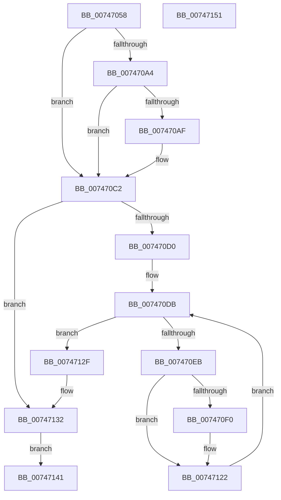

# KiCopyCountersWorker

- RVA: `0x00747058`–`0x00747152` (길이 `250` bytes)
- VA: `0x0000000140747058`
- 실행 섹션: `PAGE`
- PDB 이름 있음: `예`; PDB Function 태그: `아니요`
- unwind 정보 RVA: `0x000CA64C`
- 디코드: `67`개 명령, `250/250` bytes 표시
- 미해석 바이트: `0` (있으면 어셈블리에 `.byte`로 보존)

> 이 문서는 커널 이미지의 기계어와 PDB 기호를 분석해 생성했습니다. 4번과 5번은 함수 원형과 자료형을 바이너리 사용 방식에서 추정한 C 해석이며 원본 소스 복구 결과는 아닙니다.

## 1. Dependencies

- 직접 호출 지점: **1**; 고유 호출 대상: **1**
- 직접 호출자로 확인된 함수: **1**
- RIP 상대 이미지 참조: **2**

### Outgoing calls
- `0x00747075` → [KeGetCurrentProcessorNumberEx](../../text/40/KeGetCurrentProcessorNumberEx_function_00401690.md) (function, `0x00401690`)

### Direct callers
- [KiCopyCounters](../../text/5C/KiCopyCounters_function_005C0710.md) at `0x005C078A`

### Static image references
- `0x007470E0` → RVA `0x00E66908` (`.data`; read)
- `0x007470F7` → RVA `0x00F10E80` (`.data`; read)

## 2. Other-region calls and transfers

- 다른 실행 섹션으로 향하는 call: **1**
  - `0x00747075` → [KeGetCurrentProcessorNumberEx](../../text/40/KeGetCurrentProcessorNumberEx_function_00401690.md) (`PAGE` → `.text`)
- 별도 외부 분기/꼬리 이동을 확인하지 못했습니다.

## 3. Assembly (complete function range)

```asm
00747058  48 89 5C 24 08                  mov qword ptr [rsp + 8], rbx
0074705D  48 89 74 24 20                  mov qword ptr [rsp + 0x20], rsi
00747062  57                              push rdi
00747063  48 83 EC 30                     sub rsp, 0x30
00747067  48 8B FA                        mov rdi, rdx
0074706A  48 8B F1                        mov rsi, rcx
0074706D  48 8B 5A 08                     mov rbx, qword ptr [rdx + 8]
00747071  48 8D 4B 04                     lea rcx, [rbx + 4]
00747075  E8 16 A6 CB FF                  call 0x140401690
0074707A  48 8B 46 48                     mov rax, qword ptr [rsi + 0x48]
0074707E  48 2B 47 18                     sub rax, qword ptr [rdi + 0x18]
00747082  48 89 43 38                     mov qword ptr [rbx + 0x38], rax
00747086  65 48 8B 04 25 20 00 00 00      mov rax, qword ptr gs:[0x20]
0074708F  48 8B 88 80 86 00 00            mov rcx, qword ptr [rax + 0x8680]
00747096  48 89 4B 30                     mov qword ptr [rbx + 0x30], rcx
0074709A  8B 47 10                        mov eax, dword ptr [rdi + 0x10]
0074709D  45 33 C9                        xor r9d, r9d
007470A0  A8 01                           test al, 1
007470A2  74 1E                           je 0x1407470c2
007470A4  8B 47 14                        mov eax, dword ptr [rdi + 0x14]
007470A7  89 43 08                        mov dword ptr [rbx + 8], eax
007470AA  4C 39 0F                        cmp qword ptr [rdi], r9
007470AD  74 13                           je 0x1407470c2
007470AF  41 8B C1                        mov eax, r9d
007470B2  48 87 07                        xchg qword ptr [rdi], rax
007470B5  48 89 44 24 48                  mov qword ptr [rsp + 0x48], rax
007470BA  48 0B 43 18                     or rax, qword ptr [rbx + 0x18]
007470BE  48 89 43 18                     mov qword ptr [rbx + 0x18], rax
007470C2  4C 8B 5F 20                     mov r11, qword ptr [rdi + 0x20]
007470C6  4C 89 5C 24 50                  mov qword ptr [rsp + 0x50], r11
007470CB  4D 85 DB                        test r11, r11
007470CE  74 62                           je 0x140747132
007470D0  41 BA 01 00 00 00               mov r10d, 1
007470D6  4C 89 54 24 28                  mov qword ptr [rsp + 0x28], r10
007470DB  44 89 4C 24 20                  mov dword ptr [rsp + 0x20], r9d
007470E0  8B 05 22 F8 71 00               mov eax, dword ptr [rip + 0x71f822]
007470E6  44 3B C8                        cmp r9d, eax
007470E9  73 44                           jae 0x14074712f
007470EB  4D 85 DA                        test r10, r11
007470EE  74 32                           je 0x140747122
007470F0  41 8B D1                        mov edx, r9d
007470F3  4C 8D 04 52                     lea r8, [rdx + rdx*2]
007470F7  48 8D 05 82 9D 7C 00            lea rax, [rip + 0x7c9d82]
007470FE  8B 04 90                        mov eax, dword ptr [rax + rdx*4]
00747101  42 89 44 C3 44                  mov dword ptr [rbx + r8*8 + 0x44], eax
00747106  48 8D 04 52                     lea rax, [rdx + rdx*2]
0074710A  48 8B 4C C7 30                  mov rcx, qword ptr [rdi + rax*8 + 0x30]
0074710F  48 8D 04 52                     lea rax, [rdx + rdx*2]
00747113  48 89 4C C3 48                  mov qword ptr [rbx + rax*8 + 0x48], rcx
00747118  4A 8B 44 C7 38                  mov rax, qword ptr [rdi + r8*8 + 0x38]
0074711D  4A 89 44 C3 50                  mov qword ptr [rbx + r8*8 + 0x50], rax
00747122  4D 03 D2                        add r10, r10
00747125  4C 89 54 24 28                  mov qword ptr [rsp + 0x28], r10
0074712A  41 FF C1                        inc r9d
0074712D  EB AC                           jmp 0x1407470db
0074712F  89 43 0C                        mov dword ptr [rbx + 0xc], eax
00747132  48 8B 43 10                     mov rax, qword ptr [rbx + 0x10]
00747136  48 FF C0                        inc rax
00747139  48 89 43 10                     mov qword ptr [rbx + 0x10], rax
0074713D  33 C0                           xor eax, eax
0074713F  EB 00                           jmp 0x140747141
00747141  48 8B 5C 24 40                  mov rbx, qword ptr [rsp + 0x40]
00747146  48 8B 74 24 58                  mov rsi, qword ptr [rsp + 0x58]
0074714B  48 83 C4 30                     add rsp, 0x30
0074714F  5F                              pop rdi
00747150  C3                              ret
00747151  CC                              int3
```

## 4. C-style interpretation (structured pseudocode)

```c
__int64 __fastcall KiCopyCountersWorker(__int64 a1, __int64 a2, __int64 a3, int a4)
{
    __int64 result;
    __int64 v_r10;
    __int64 v_rsp;
    unsigned __int64 v_stack_m10;
    unsigned int v_stack_m18;
    unsigned __int64 v_stack_p10;
    unsigned __int64 v_stack_p18;
    unsigned __int64 v_stack_p20;
    unsigned __int64 v_stack_p8;

    v_stack_p8 = v_rbx;
    v_stack_p20 = v_rsi;
    v_rsp = (v_rsp) - (48);
    result = KeGetCurrentProcessorNumberEx(*(unsigned __int64 *)(a2 + 8) + 4, a2, a3, a4);
    result = (*(unsigned __int64 *)(a1 + 72)) - (*(unsigned __int64 *)(a2 + 24));
    *(unsigned __int64 *)(*(unsigned __int64 *)(a2 + 8) + 56) = result;
    *(unsigned __int64 *)(*(unsigned __int64 *)(a2 + 8) + 48) = *(unsigned __int64 *)(*(unsigned __int64 *)(gs_base + (0 + 32)) + 34432);
    a4 = 0;
    if ((((unsigned __int8)((unsigned int)(*(unsigned int *)(a2 + 16)))) & (1)) == 0) goto loc_007470C2;
    *(unsigned int *)(*(unsigned __int64 *)(a2 + 8) + 8) = (unsigned int)((unsigned int)(*(unsigned int *)(a2 + 20)));
    result = (unsigned int)(*(unsigned int *)(a2 + 20));
    if ((*(unsigned __int64 *)(a2)) != 0) {
        result = 0;
        v_stack_p10 = result;
        result = (result) | (*(unsigned __int64 *)(*(unsigned __int64 *)(a2 + 8) + 24));
        *(unsigned __int64 *)(*(unsigned __int64 *)(a2 + 8) + 24) = result;
    }
    v_stack_p18 = *(unsigned __int64 *)(a2 + 32);
    if (*(unsigned __int64 *)(a2 + 32) == 0) goto loc_00747132;
    v_stack_m10 = 1;
loc_007470DB:
    v_stack_m18 = 0;
    if (0 >= ((unsigned int)((unsigned int)(*(unsigned int *)(v_rip + 7469090))))) goto loc_0074712F;
    result = (unsigned int)(*(unsigned int *)(v_rip + 7469090));
    if (((1) & (*(unsigned __int64 *)(a2 + 32))) != 0) {
        a2 = 0;
        a3 = a2 + a2 * 2;
        result = v_rip + 8166786;
        result = *(unsigned int *)(result + a2 * 4);
        *(unsigned int *)(*(unsigned __int64 *)(a2 + 8) + a3 * 8 + 68) = (unsigned int)(result);
        result = a2 + a2 * 2;
        a1 = *(unsigned __int64 *)(a2 + result * 8 + 48);
        result = a2 + a2 * 2;
        *(unsigned __int64 *)(*(unsigned __int64 *)(a2 + 8) + result * 8 + 72) = a1;
        result = *(unsigned __int64 *)(a2 + a3 * 8 + 56);
        *(unsigned __int64 *)(*(unsigned __int64 *)(a2 + 8) + a3 * 8 + 80) = result;
    }
    v_r10 = (1) + (1);
    v_stack_m10 = v_r10;
    a4 = (unsigned int)((a4) + 1);
    goto loc_007470DB;
loc_0074712F:
    *(unsigned int *)(*(unsigned __int64 *)(a2 + 8) + 12) = (unsigned int)(result);
loc_00747132:
    result = (*(unsigned __int64 *)(*(unsigned __int64 *)(a2 + 8) + 16)) + 1;
    *(unsigned __int64 *)(*(unsigned __int64 *)(a2 + 8) + 16) = result;
    result = 0;
    goto loc_00747141;
loc_00747141:
    v_rsp = (v_rsp) + (48);
    return result;
}
```

## 5. (Beta) C Style

```c
int64_t KiCopyCountersWorker(void *Arg1, void *Arg2, int64_t Arg3, int32_t Arg4)
{
    uint8_t *arg1 = (uint8_t *)Arg1;
    uint8_t *arg2 = (uint8_t *)Arg2;

    int64_t result;
    int64_t local_r10;
    int64_t local_rsp;
    uint64_t v_stack_m10;
    uint32_t v_stack_m18;
    uint64_t v_stack_p10;
    uint64_t v_stack_p18;
    uint64_t v_stack_p20;
    uint64_t v_stack_p8;

    v_stack_p8 = local_rbx;
    v_stack_p20 = local_rsi;
    local_rsp = (local_rsp) - (48);
    result = KeGetCurrentProcessorNumberEx(*(uint64_t *)(arg2 + 0x8) + 4, Arg2, Arg3, Arg4);
    result = (*(uint64_t *)(arg1 + 0x48)) - (*(uint64_t *)(arg2 + 0x18));
    *(uint64_t *)(*(uint64_t *)(arg2 + 0x8) + 0x38) = result;
    *(uint64_t *)(*(uint64_t *)(arg2 + 0x8) + 0x30) = *(uint64_t *)(*(uint64_t *)(gs_base + (0 + 0x20)) + 0x8680);
    Arg4 = 0;
    if ((((uint8_t)((uint32_t)(*(uint32_t *)(arg2 + 0x10)))) & (1)) == 0) goto loc_007470C2;
    *(uint32_t *)(*(uint64_t *)(arg2 + 0x8) + 0x8) = (uint32_t)((uint32_t)(*(uint32_t *)(arg2 + 0x14)));
    result = (uint32_t)(*(uint32_t *)(arg2 + 0x14));
    if ((*(uint64_t *)(arg2)) != 0) {
        result = 0;
        v_stack_p10 = result;
        result = (result) | (*(uint64_t *)(*(uint64_t *)(arg2 + 0x8) + 0x18));
        *(uint64_t *)(*(uint64_t *)(arg2 + 0x8) + 0x18) = result;
    }
    v_stack_p18 = *(uint64_t *)(arg2 + 0x20);
    if (*(uint64_t *)(arg2 + 0x20) == 0) goto loc_00747132;
    v_stack_m10 = 1;
loc_007470DB:
    v_stack_m18 = 0;
    if (0 >= ((uint32_t)((uint32_t)(*(uint32_t *)(v_rip + 0x71F822))))) goto loc_0074712F;
    result = (uint32_t)(*(uint32_t *)(v_rip + 0x71F822));
    if (((1) & (*(uint64_t *)(arg2 + 0x20))) != 0) {
        Arg2 = 0;
        Arg3 = Arg2 + Arg2 * 2;
        result = v_rip + 8166786;
        result = *(uint32_t *)(result + arg2 * 4);
        *(uint32_t *)(*(uint64_t *)(arg2 + 0x8) + Arg3 * 8 + 0x44) = (uint32_t)(result);
        result = Arg2 + Arg2 * 2;
        Arg1 = *(uint64_t *)(arg2 + result * 8 + 0x30);
        result = Arg2 + Arg2 * 2;
        *(void **)(*(uint64_t *)(arg2 + 0x8) + result * 8 + 0x48) = Arg1;
        result = *(uint64_t *)(arg2 + Arg3 * 8 + 0x38);
        *(uint64_t *)(*(uint64_t *)(arg2 + 0x8) + Arg3 * 8 + 0x50) = result;
    }
    local_r10 = (1) + (1);
    v_stack_m10 = local_r10;
    Arg4 = (uint32_t)((Arg4) + 1);
    goto loc_007470DB;
loc_0074712F:
    *(uint32_t *)(*(uint64_t *)(arg2 + 0x8) + 0xC) = (uint32_t)(result);
loc_00747132:
    result = (*(uint64_t *)(*(uint64_t *)(arg2 + 0x8) + 0x10)) + 1;
    *(uint64_t *)(*(uint64_t *)(arg2 + 0x8) + 0x10) = result;
    result = 0;
    goto loc_00747141;
loc_00747141:
    local_rsp = (local_rsp) + (48);
    return result;
}
```

### 관측된 메모리 오프셋

구조체 형식이 확인되지 않은 접근은 인자 기준의 오프셋으로만 기록했습니다.

| 기준 인자 | 오프셋 표현 | 폭 (bit) | 접근 |
|---|---:|---:|---|
| `Arg1` | `+ 0x48` | `64` | `R` |
| `Arg2` | `+ 0x0` | `64` | `R` |
| `Arg2` | `+ 0x0` | `64` | `R/W` |
| `Arg2` | `+ 0x8` | `64` | `R` |
| `Arg2` | `+ 0x10` | `32` | `R` |
| `Arg2` | `+ 0x14` | `32` | `R` |
| `Arg2` | `+ 0x18` | `64` | `R` |
| `Arg2` | `+ 0x20` | `64` | `R` |
| `Arg2` | `+ 0x30 + rax*8` | `64` | `R` |
| `Arg2` | `+ 0x38 + r8*8` | `64` | `R` |

## 6. Execution-region graph

[열기: 2D/3D 그래프와 함수 탐색 컨트롤 패널](../../../control-panel.html?section=page&rva=0x00747058&view=graph)

- 2D 그래프는 위에서 아래로 흐르고, 3D 그래프는 빈 공간을 드래그해 회전합니다. Shift+드래그는 이동, 휠은 확대·축소, 함수 노드 선택은 대상 보고서 이동입니다.

### Static fallback


