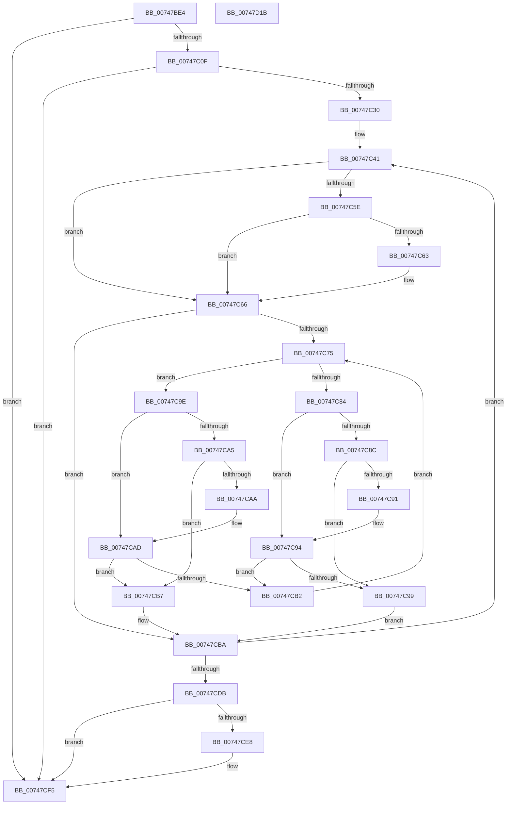

# KiGetSystemServiceTraceTable

- RVA: `0x00747BE4`–`0x00747D1C` (길이 `312` bytes)
- VA: `0x0000000140747BE4`
- 실행 섹션: `PAGE`
- PDB 이름 있음: `예`; PDB Function 태그: `아니요`
- unwind 정보 RVA: `0x0005FEF8`
- 디코드: `89`개 명령, `312/312` bytes 표시
- 미해석 바이트: `0` (있으면 어셈블리에 `.byte`로 보존)

> 이 문서는 커널 이미지의 기계어와 PDB 기호를 분석해 생성했습니다. 4번과 5번은 함수 원형과 자료형을 바이너리 사용 방식에서 추정한 C 해석이며 원본 소스 복구 결과는 아닙니다.

## 1. Dependencies

- 직접 호출 지점: **4**; 고유 호출 대상: **4**
- 직접 호출자로 확인된 함수: **1**
- RIP 상대 이미지 참조: **2**

### Outgoing calls
- `0x00747C1F` → [ExAllocatePool2](../../poolcode/B8/ExAllocatePool2_function_00B820F0.md) (function, `0x00B820F0`)
- `0x00747C7B` → [KiSystemServiceTraceTableCompareFunction](KiSystemServiceTraceTableCompareFunction_function_00747D24.md) (function, `0x00747D24`)
- `0x00747CC4` → [RtlRbInsertNodeEx](../../text/2E/RtlRbInsertNodeEx_function_002E4570.md) (function, `0x002E4570`)
- `0x00747CF0` → [ExFreePoolWithTag](../../poolcode/B8/ExFreePoolWithTag_function_00B82870.md) (function, `0x00B82870`)

### Direct callers
- [KeSetSystemServiceCallback](KeSetSystemServiceCallback_function_00747A10.md) at `0x00747A62`

### Static image references
- `0x00747C01` → RVA `0x00FD9EA0` (`PAGEDATA`; read)
- `0x00747C30` → RVA `0x00B51788` (`PAGE`; read)

## 2. Other-region calls and transfers

- 다른 실행 섹션으로 향하는 call: **3**
  - `0x00747C1F` → [ExAllocatePool2](../../poolcode/B8/ExAllocatePool2_function_00B820F0.md) (`PAGE` → `POOLCODE`)
  - `0x00747CC4` → [RtlRbInsertNodeEx](../../text/2E/RtlRbInsertNodeEx_function_002E4570.md) (`PAGE` → `.text`)
  - `0x00747CF0` → [ExFreePoolWithTag](../../poolcode/B8/ExFreePoolWithTag_function_00B82870.md) (`PAGE` → `POOLCODE`)
- 별도 외부 분기/꼬리 이동을 확인하지 못했습니다.

## 3. Assembly (complete function range)

```asm
00747BE4  48 8B C4                        mov rax, rsp
00747BE7  48 89 58 08                     mov qword ptr [rax + 8], rbx
00747BEB  48 89 68 10                     mov qword ptr [rax + 0x10], rbp
00747BEF  48 89 70 18                     mov qword ptr [rax + 0x18], rsi
00747BF3  48 89 78 20                     mov qword ptr [rax + 0x20], rdi
00747BF7  41 54                           push r12
00747BF9  41 56                           push r14
00747BFB  41 57                           push r15
00747BFD  48 83 EC 20                     sub rsp, 0x20
00747C01  48 83 3D 97 22 89 00 00         cmp qword ptr [rip + 0x892297], 0
00747C09  0F 85 E6 00 00 00               jne 0x140747cf5
00747C0F  BA 90 7A 00 00                  mov edx, 0x7a90
00747C14  B9 00 01 00 00                  mov ecx, 0x100
00747C19  41 B8 4B 69 54 74               mov r8d, 0x7454694b
00747C1F  E8 CC A4 43 00                  call 0x140b820f0
00747C24  48 8B F8                        mov rdi, rax
00747C27  48 85 C0                        test rax, rax
00747C2A  0F 84 C5 00 00 00               je 0x140747cf5
00747C30  4C 8D 35 51 9B 40 00            lea r14, [rip + 0x409b51]
00747C37  41 BC EA 01 00 00               mov r12d, 0x1ea
00747C3D  48 8D 70 28                     lea rsi, [rax + 0x28]
00747C41  41 8B 4E F8                     mov ecx, dword ptr [r14 - 8]
00747C45  89 4E 0C                        mov dword ptr [rsi + 0xc], ecx
00747C48  4D 8B 3E                        mov r15, qword ptr [r14]
00747C4B  4C 89 3E                        mov qword ptr [rsi], r15
00747C4E  41 8B 46 FC                     mov eax, dword ptr [r14 - 4]
00747C52  89 46 08                        mov dword ptr [rsi + 8], eax
00747C55  F6 47 08 01                     test byte ptr [rdi + 8], 1
00747C59  48 8B 1F                        mov rbx, qword ptr [rdi]
00747C5C  74 08                           je 0x140747c66
00747C5E  48 85 DB                        test rbx, rbx
00747C61  74 03                           je 0x140747c66
00747C63  48 33 DF                        xor rbx, rdi
00747C66  0F B6 6F 08                     movzx ebp, byte ptr [rdi + 8]
00747C6A  45 32 C0                        xor r8b, r8b
00747C6D  83 E5 01                        and ebp, 1
00747C70  48 85 DB                        test rbx, rbx
00747C73  74 45                           je 0x140747cba
00747C75  48 8B D3                        mov rdx, rbx
00747C78  49 8B CF                        mov rcx, r15
00747C7B  E8 A4 00 00 00                  call 0x140747d24
00747C80  85 C0                           test eax, eax
00747C82  78 1A                           js 0x140747c9e
00747C84  48 8B 43 08                     mov rax, qword ptr [rbx + 8]
00747C88  85 ED                           test ebp, ebp
00747C8A  74 08                           je 0x140747c94
00747C8C  48 85 C0                        test rax, rax
00747C8F  74 08                           je 0x140747c99
00747C91  48 33 C3                        xor rax, rbx
00747C94  48 85 C0                        test rax, rax
00747C97  75 19                           jne 0x140747cb2
00747C99  41 B0 01                        mov r8b, 1
00747C9C  EB 1C                           jmp 0x140747cba
00747C9E  48 8B 03                        mov rax, qword ptr [rbx]
00747CA1  85 ED                           test ebp, ebp
00747CA3  74 08                           je 0x140747cad
00747CA5  48 85 C0                        test rax, rax
00747CA8  74 0D                           je 0x140747cb7
00747CAA  48 33 C3                        xor rax, rbx
00747CAD  48 85 C0                        test rax, rax
00747CB0  74 05                           je 0x140747cb7
00747CB2  48 8B D8                        mov rbx, rax
00747CB5  EB BE                           jmp 0x140747c75
00747CB7  45 32 C0                        xor r8b, r8b
00747CBA  4C 8D 4E E8                     lea r9, [rsi - 0x18]
00747CBE  48 8B D3                        mov rdx, rbx
00747CC1  48 8B CF                        mov rcx, rdi
00747CC4  E8 A7 C8 B9 FF                  call 0x1402e4570
00747CC9  48 83 C6 40                     add rsi, 0x40
00747CCD  49 83 C6 10                     add r14, 0x10
00747CD1  49 83 EC 01                     sub r12, 1
00747CD5  0F 85 66 FF FF FF               jne 0x140747c41
00747CDB  33 C0                           xor eax, eax
00747CDD  F0 48 0F B1 3D BA 21 89 00      lock cmpxchg qword ptr [rip + 0x8921ba], rdi
00747CE6  74 0D                           je 0x140747cf5
00747CE8  BA 4B 69 54 74                  mov edx, 0x7454694b
00747CED  48 8B CF                        mov rcx, rdi
00747CF0  E8 7B AB 43 00                  call 0x140b82870
00747CF5  48 8B 05 A4 21 89 00            mov rax, qword ptr [rip + 0x8921a4]
00747CFC  48 8B 5C 24 40                  mov rbx, qword ptr [rsp + 0x40]
00747D01  48 8B 6C 24 48                  mov rbp, qword ptr [rsp + 0x48]
00747D06  48 8B 74 24 50                  mov rsi, qword ptr [rsp + 0x50]
00747D0B  48 8B 7C 24 58                  mov rdi, qword ptr [rsp + 0x58]
00747D10  48 83 C4 20                     add rsp, 0x20
00747D14  41 5F                           pop r15
00747D16  41 5E                           pop r14
00747D18  41 5C                           pop r12
00747D1A  C3                              ret
00747D1B  CC                              int3
```

## 4. C-style interpretation (structured pseudocode)

```c
__int64 __fastcall KiGetSystemServiceTraceTable(void)
{
    __int64 result;
    __int64 v_r12;
    __int64 v_r14;
    __int64 v_rbp;
    __int64 v_rbx;
    __int64 v_rsi;
    __int64 v_rsp;
    unsigned __int64 v_stack_p10;
    unsigned __int64 v_stack_p18;
    unsigned __int64 v_stack_p20;
    unsigned __int64 v_stack_p8;

    *(unsigned __int64 *)(v_rsp + 8) = v_rbx;
    *(unsigned __int64 *)(v_rsp + 16) = v_rbp;
    *(unsigned __int64 *)(v_rsp + 24) = v_rsi;
    *(unsigned __int64 *)(v_rsp + 32) = v_rdi;
    v_rsp = (v_rsp) - (32);
    if ((*(unsigned __int64 *)(v_rip + 8987287)) != 0) goto loc_00747CF5;
    result = ExAllocatePool2(256, (unsigned int)(0x7A90ULL), (unsigned int)(0x7454694BULL), a4);
    if (result == 0) goto loc_00747CF5;
loc_00747C41:
    *(unsigned int *)(result + 40 + 12) = (unsigned int)((unsigned int)(*(unsigned int *)(v_rip + 4234065 - 8)));
    *(unsigned __int64 *)(result + 40) = *(unsigned __int64 *)(v_rip + 4234065);
    *(unsigned int *)(result + 40 + 8) = (unsigned int)((unsigned int)(*(unsigned int *)(v_rip + 4234065 - 4)));
    if (((*(unsigned __int8 *)(result + 8)) & (1)) == 0) goto loc_00747C66;
    v_rbx = *(unsigned __int64 *)(result);
    if (*(unsigned __int64 *)(result) != 0) {
        v_rbx = (*(unsigned __int64 *)(result)) ^ (result);
    }
    a3 = 0;
    v_rbp = (unsigned int)((*(unsigned __int8 *)(result + 8)) & (1));
    if (v_rbx == 0) goto loc_00747CBA;
loc_00747C75:
    result = KiSystemServiceTraceTableCompareFunction(*(unsigned __int64 *)(v_rip + 4234065), v_rbx, a3, a4);
    if (sign_flag) goto loc_00747C9E;
    if ((unsigned int)(v_rbp) == 0) goto loc_00747C94;
    if (*(unsigned __int64 *)(v_rbx + 8) == 0) goto loc_00747C99;
    result = (*(unsigned __int64 *)(v_rbx + 8)) ^ (v_rbx);
loc_00747C94:
    if (result != 0) goto loc_00747CB2;
loc_00747C99:
    goto loc_00747CBA;
loc_00747C9E:
    if ((unsigned int)(v_rbp) == 0) goto loc_00747CAD;
    if (*(unsigned __int64 *)(v_rbx) == 0) goto loc_00747CB7;
    result = (*(unsigned __int64 *)(v_rbx)) ^ (v_rbx);
loc_00747CAD:
    if (result == 0) goto loc_00747CB7;
loc_00747CB2:
    goto loc_00747C75;
loc_00747CB7:
    a3 = 0;
loc_00747CBA:
    result = RtlRbInsertNodeEx(result, result, a3, result + 40 - 24);
    v_rsi = (result + 40) + (64);
    v_r14 = (v_rip + 4234065) + (16);
    v_r12 = (490) - (1);
    if (condition_is_not_equal) goto loc_00747C41;
    result = 0;
    if (!(condition_is_equal)) {
        a2 = 0x7454694BULL;
        a1 = 0;
        result = ExFreePoolWithTag(a1, a2, a3, result + 40 - 24);
    }
    v_rsp = (v_rsp) + (32);
    return *(unsigned __int64 *)(v_rip + 8987044);
}
```

## 5. (Beta) C Style

```c
void KiGetSystemServiceTraceTable(void)
{
    int64_t result;
    int64_t local_r12;
    int64_t local_r14;
    int64_t local_rbp;
    int64_t local_rbx;
    int64_t local_rsi;
    int64_t local_rsp;
    uint64_t v_stack_p10;
    uint64_t v_stack_p18;
    uint64_t v_stack_p20;
    uint64_t v_stack_p8;

    *(uint64_t *)(local_rsp + 0x8) = local_rbx;
    *(uint64_t *)(local_rsp + 0x10) = local_rbp;
    *(uint64_t *)(local_rsp + 0x18) = local_rsi;
    *(uint64_t *)(local_rsp + 0x20) = local_rdi;
    local_rsp = (local_rsp) - (32);
    if ((*(uint64_t *)(v_rip + 0x892297)) != 0) goto loc_00747CF5;
    result = ExAllocatePool2(256, (uint32_t)(0x7A90ULL), (uint32_t)(0x7454694BULL), a4);
    if (result == 0) goto loc_00747CF5;
loc_00747C41:
    *(uint32_t *)(result + 0x28 + 0xC) = (uint32_t)((uint32_t)(*(uint32_t *)(v_rip + 0x409B51 - 0x8)));
    *(uint64_t *)(result + 0x28) = *(uint64_t *)(v_rip + 0x409B51);
    *(uint32_t *)(result + 0x28 + 0x8) = (uint32_t)((uint32_t)(*(uint32_t *)(v_rip + 0x409B51 - 0x4)));
    if (((*(uint8_t *)(result + 0x8)) & (1)) == 0) goto loc_00747C66;
    local_rbx = *(uint64_t *)(result);
    if (*(uint64_t *)(result) != 0) {
        local_rbx = (*(uint64_t *)(result)) ^ (result);
    }
    a3 = 0;
    local_rbp = (uint32_t)((*(uint8_t *)(result + 0x8)) & (1));
    if (local_rbx == 0) goto loc_00747CBA;
loc_00747C75:
    result = KiSystemServiceTraceTableCompareFunction(*(uint64_t *)(v_rip + 0x409B51), local_rbx, a3, a4);
    if (sign_flag) goto loc_00747C9E;
    if ((uint32_t)(local_rbp) == 0) goto loc_00747C94;
    if (*(uint64_t *)(local_rbx + 0x8) == 0) goto loc_00747C99;
    result = (*(uint64_t *)(local_rbx + 0x8)) ^ (local_rbx);
loc_00747C94:
    if (result != 0) goto loc_00747CB2;
loc_00747C99:
    goto loc_00747CBA;
loc_00747C9E:
    if ((uint32_t)(local_rbp) == 0) goto loc_00747CAD;
    if (*(uint64_t *)(local_rbx) == 0) goto loc_00747CB7;
    result = (*(uint64_t *)(local_rbx)) ^ (local_rbx);
loc_00747CAD:
    if (result == 0) goto loc_00747CB7;
loc_00747CB2:
    goto loc_00747C75;
loc_00747CB7:
    a3 = 0;
loc_00747CBA:
    result = RtlRbInsertNodeEx(result, result, a3, result + 40 - 24);
    local_rsi = (result + 40) + (64);
    local_r14 = (v_rip + 4234065) + (16);
    local_r12 = (490) - (1);
    if (condition_is_not_equal) goto loc_00747C41;
    result = 0;
    if (!(condition_is_equal)) {
        a2 = 0x7454694BULL;
        a1 = 0;
        result = ExFreePoolWithTag(a1, a2, a3, result + 40 - 24);
    }
    local_rsp = (local_rsp) + (32);
    return *(uint64_t *)(v_rip + 0x8921A4);
}
```

## 6. Execution-region graph

[열기: 2D/3D 그래프와 함수 탐색 컨트롤 패널](../../../control-panel.html?section=page&rva=0x00747BE4&view=graph)

- 2D 그래프는 위에서 아래로 흐르고, 3D 그래프는 빈 공간을 드래그해 회전합니다. Shift+드래그는 이동, 휠은 확대·축소, 함수 노드 선택은 대상 보고서 이동입니다.

### Static fallback


