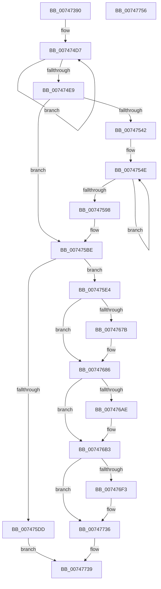

# KiInitializeProcessorState

- RVA: `0x00747390`–`0x00747757` (길이 `967` bytes)
- VA: `0x0000000140747390`
- 실행 섹션: `PAGE`
- PDB 이름 있음: `예`; PDB Function 태그: `아니요`
- unwind 정보 RVA: `0x00075C18`
- 디코드: `213`개 명령, `967/967` bytes 표시
- 미해석 바이트: `0` (있으면 어셈블리에 `.byte`로 보존)

> 이 문서는 커널 이미지의 기계어와 PDB 기호를 분석해 생성했습니다. 4번과 5번은 함수 원형과 자료형을 바이너리 사용 방식에서 추정한 C 해석이며 원본 소스 복구 결과는 아닙니다.

## 1. Dependencies

- 직접 호출 지점: **6**; 고유 호출 대상: **4**
- 직접 호출자로 확인된 함수: **2**
- RIP 상대 이미지 참조: **9**

### Outgoing calls
- `0x007473DA` → [memset](../../text/6C/memset_function_006C6C40.md) (function, `0x006C6C40`)
- `0x007473EE` → [memset](../../text/6C/memset_function_006C6C40.md) (function, `0x006C6C40`)
- `0x0074741F` → [memcpy](../../text/6C/memcpy_function_006C6840.md) (function, `0x006C6840`)
- `0x00747448` → [memcpy](../../text/6C/memcpy_function_006C6840.md) (function, `0x006C6840`)
- `0x007475D2` → [KiEnableKvaShadowing](../../pagelk/B6/KiEnableKvaShadowing_function_00B6ACBC.md) (function, `0x00B6ACBC`)
- `0x007475EE` → [KiAssignProcessorNumberToPrcb](../../text/5B/KiAssignProcessorNumberToPrcb_function_005BC510.md) (function, `0x005BC510`)

### Direct callers
- [KiStartDynamicProcessor](KiStartDynamicProcessor_function_007456C8.md) at `0x00745886`
- [KeStartAllProcessors](../../init/C3/KeStartAllProcessors_function_00C36F78.md) at `0x00C3724C`

### Static image references
- `0x0074742B` → RVA `0x00FD9EA8` (`PAGEDATA`; read)
- `0x00747441` → RVA `0x00E66960` (`.data`; read)
- `0x007474ED` → RVA `0x006B1BA0` (`KiExceptionDispatchOnExceptionStackContinue`; read)
- `0x0074751A` → RVA `0x00000000` (`image boundary/outside`; read)
- `0x0074762F` → RVA `0x00B5B3C0` (`KiSystemStartup`; read)
- `0x00747673` → RVA `0x00FC6BF0` (`ALMOSTRO`; read)
- `0x007476A5` → RVA `0x00FC6A84` (`ALMOSTRO`; read)
- `0x007476BB` → RVA `0x00FCFF00` (`CACHEALI`; read)
- `0x007476EA` → RVA `0x01201841` (`CFGRO`; read)

## 2. Other-region calls and transfers

- 다른 실행 섹션으로 향하는 call: **6**
  - `0x007473DA` → [memset](../../text/6C/memset_function_006C6C40.md) (`PAGE` → `.text`)
  - `0x007473EE` → [memset](../../text/6C/memset_function_006C6C40.md) (`PAGE` → `.text`)
  - `0x0074741F` → [memcpy](../../text/6C/memcpy_function_006C6840.md) (`PAGE` → `.text`)
  - `0x00747448` → [memcpy](../../text/6C/memcpy_function_006C6840.md) (`PAGE` → `.text`)
  - `0x007475D2` → [KiEnableKvaShadowing](../../pagelk/B6/KiEnableKvaShadowing_function_00B6ACBC.md) (`PAGE` → `PAGELK`)
  - `0x007475EE` → [KiAssignProcessorNumberToPrcb](../../text/5B/KiAssignProcessorNumberToPrcb_function_005BC510.md) (`PAGE` → `.text`)
- 별도 외부 분기/꼬리 이동을 확인하지 못했습니다.

## 3. Assembly (complete function range)

```asm
00747390  48 89 5C 24 08                  mov qword ptr [rsp + 8], rbx
00747395  48 89 6C 24 10                  mov qword ptr [rsp + 0x10], rbp
0074739A  48 89 74 24 18                  mov qword ptr [rsp + 0x18], rsi
0074739F  57                              push rdi
007473A0  41 54                           push r12
007473A2  41 55                           push r13
007473A4  41 56                           push r14
007473A6  41 57                           push r15
007473A8  48 83 EC 20                     sub rsp, 0x20
007473AC  41 8B 78 1C                     mov edi, dword ptr [r8 + 0x1c]
007473B0  49 8B F0                        mov rsi, r8
007473B3  65 48 8B 1C 25 18 00 00 00      mov rbx, qword ptr gs:[0x18]
007473BC  FF CF                           dec edi
007473BE  45 8B 40 10                     mov r8d, dword ptr [r8 + 0x10]
007473C2  48 8B EA                        mov rbp, rdx
007473C5  C1 E7 06                        shl edi, 6
007473C8  4C 8B F1                        mov r14, rcx
007473CB  48 8B 4E 08                     mov rcx, qword ptr [rsi + 8]
007473CF  81 C7 BF D0 00 00               add edi, 0xd0bf
007473D5  33 D2                           xor edx, edx
007473D7  83 E7 C0                        and edi, 0xffffffc0
007473DA  E8 61 F8 F7 FF                  call 0x1406c6c40
007473DF  4C 8B 66 08                     mov r12, qword ptr [rsi + 8]
007473E3  33 D2                           xor edx, edx
007473E5  41 B8 C0 05 00 00               mov r8d, 0x5c0
007473EB  49 8B CE                        mov rcx, r14
007473EE  E8 4D F8 F7 FF                  call 0x1406c6c40
007473F3  44 8B 7E 24                     mov r15d, dword ptr [rsi + 0x24]
007473F7  0F B7 83 D6 02 00 00            movzx eax, word ptr [rbx + 0x2d6]
007473FE  4D 03 FC                        add r15, r12
00747401  4D 89 7E 58                     mov qword ptr [r14 + 0x58], r15
00747405  49 8B CF                        mov rcx, r15
00747408  66 41 89 46 56                  mov word ptr [r14 + 0x56], ax
0074740D  44 0F B7 83 D6 02 00 00         movzx r8d, word ptr [rbx + 0x2d6]
00747415  48 8B 93 D8 02 00 00            mov rdx, qword ptr [rbx + 0x2d8]
0074741C  49 FF C0                        inc r8
0074741F  E8 1C F4 F7 FF                  call 0x1406c6840
00747424  0F B7 83 E6 02 00 00            movzx eax, word ptr [rbx + 0x2e6]
0074742B  48 8B 15 76 2A 89 00            mov rdx, qword ptr [rip + 0x892a76]
00747432  66 41 89 46 66                  mov word ptr [r14 + 0x66], ax
00747437  8B 4E 28                        mov ecx, dword ptr [rsi + 0x28]
0074743A  49 03 CC                        add rcx, r12
0074743D  49 89 4E 68                     mov qword ptr [r14 + 0x68], rcx
00747441  44 8B 05 18 F5 71 00            mov r8d, dword ptr [rip + 0x71f518]
00747448  E8 F3 F3 F7 FF                  call 0x1406c6840
0074744D  8A 46 18                        mov al, byte ptr [rsi + 0x18]
00747450  4D 8D 8F 50 E0 FF FF            lea r9, [r15 - 0x1fb0]
00747457  41 88 44 24 52                  mov byte ptr [r12 + 0x52], al
0074745C  4D 8B EC                        mov r13, r12
0074745F  8B 46 18                        mov eax, dword ptr [rsi + 0x18]
00747462  4C 8B C6                        mov r8, rsi
00747465  41 89 84 24 A4 01 00 00         mov dword ptr [r12 + 0x1a4], eax
0074746D  BA 04 00 00 00                  mov edx, 4
00747472  65 48 8B 04 25 20 00 00 00      mov rax, qword ptr gs:[0x20]
0074747B  8B 48 44                        mov ecx, dword ptr [rax + 0x44]
0074747E  41 89 8C 24 C4 01 00 00         mov dword ptr [r12 + 0x1c4], ecx
00747486  65 48 8B 04 25 20 00 00 00      mov rax, qword ptr gs:[0x20]
0074748F  48 8B 88 00 2D 00 00            mov rcx, qword ptr [rax + 0x2d00]
00747496  49 89 8C 24 80 2E 00 00         mov qword ptr [r12 + 0x2e80], rcx
0074749E  49 8D 49 24                     lea rcx, [r9 + 0x24]
007474A2  4D 89 AF C0 E0 FF FF            mov qword ptr [r15 - 0x1f40], r13
007474A9  8B C7                           mov eax, edi
007474AB  4C 03 E0                        add r12, rax
007474AE  66 45 89 4F 42                  mov word ptr [r15 + 0x42], r9w
007474B3  49 8B C1                        mov rax, r9
007474B6  48 C1 E8 10                     shr rax, 0x10
007474BA  41 88 47 44                     mov byte ptr [r15 + 0x44], al
007474BE  49 8B C1                        mov rax, r9
007474C1  48 C1 E8 18                     shr rax, 0x18
007474C5  41 88 47 47                     mov byte ptr [r15 + 0x47], al
007474C9  49 8B C1                        mov rax, r9
007474CC  48 C1 E8 20                     shr rax, 0x20
007474D0  41 89 47 48                     mov dword ptr [r15 + 0x48], eax
007474D4  4D 2B C1                        sub r8, r9
007474D7  49 8B 44 08 3C                  mov rax, qword ptr [r8 + rcx + 0x3c]
007474DC  48 89 01                        mov qword ptr [rcx], rax
007474DF  48 8D 49 08                     lea rcx, [rcx + 8]
007474E3  48 83 EA 01                     sub rdx, 1
007474E7  75 EE                           jne 0x1407474d7
007474E9  48 8B 4E 50                     mov rcx, qword ptr [rsi + 0x50]
007474ED  48 8D 05 AC A6 F6 FF            lea rax, [rip - 0x95954]
007474F4  48 89 41 D8                     mov qword ptr [rcx - 0x28], rax
007474F8  48 83 E9 50                     sub rcx, 0x50
007474FC  48 8B 46 48                     mov rax, qword ptr [rsi + 0x48]
00747500  49 89 85 58 91 00 00            mov qword ptr [r13 + 0x9158], rax
00747507  49 89 8D E8 88 00 00            mov qword ptr [r13 + 0x88e8], rcx
0074750E  48 8B 46 30                     mov rax, qword ptr [rsi + 0x30]
00747512  48 8B 48 38                     mov rcx, qword ptr [rax + 0x38]
00747516  49 89 49 04                     mov qword ptr [r9 + 4], rcx
0074751A  4C 8D 0D DF 8A 8B FF            lea r9, [rip - 0x747521]
00747521  8B 46 14                        mov eax, dword ptr [rsi + 0x14]
00747524  44 8B C0                        mov r8d, eax
00747527  48 69 C0 38 03 00 00            imul rax, rax, 0x338
0074752E  48 8D 80 C0 AE FD 00            lea rax, [rax + 0xfdaec0]
00747535  49 03 C1                        add rax, r9
00747538  4B 39 84 C1 C0 F6 FC 00         cmp qword ptr [r9 + r8*8 + 0xfcf6c0], rax
00747540  75 7C                           jne 0x1407475be
00747542  BA 06 00 00 00                  mov edx, 6
00747547  49 8B CC                        mov rcx, r12
0074754A  44 8D 5A 7A                     lea r11d, [rdx + 0x7a]
0074754E  0F 10 00                        movups xmm0, xmmword ptr [rax]
00747551  0F 11 01                        movups xmmword ptr [rcx], xmm0
00747554  0F 10 48 10                     movups xmm1, xmmword ptr [rax + 0x10]
00747558  0F 11 49 10                     movups xmmword ptr [rcx + 0x10], xmm1
0074755C  0F 10 40 20                     movups xmm0, xmmword ptr [rax + 0x20]
00747560  0F 11 41 20                     movups xmmword ptr [rcx + 0x20], xmm0
00747564  0F 10 48 30                     movups xmm1, xmmword ptr [rax + 0x30]
00747568  0F 11 49 30                     movups xmmword ptr [rcx + 0x30], xmm1
0074756C  0F 10 40 40                     movups xmm0, xmmword ptr [rax + 0x40]
00747570  0F 11 41 40                     movups xmmword ptr [rcx + 0x40], xmm0
00747574  0F 10 48 50                     movups xmm1, xmmword ptr [rax + 0x50]
00747578  0F 11 49 50                     movups xmmword ptr [rcx + 0x50], xmm1
0074757C  0F 10 40 60                     movups xmm0, xmmword ptr [rax + 0x60]
00747580  0F 11 41 60                     movups xmmword ptr [rcx + 0x60], xmm0
00747584  49 03 CB                        add rcx, r11
00747587  0F 10 48 70                     movups xmm1, xmmword ptr [rax + 0x70]
0074758B  49 03 C3                        add rax, r11
0074758E  0F 11 49 F0                     movups xmmword ptr [rcx - 0x10], xmm1
00747592  48 83 EA 01                     sub rdx, 1
00747596  75 B6                           jne 0x14074754e
00747598  0F 10 00                        movups xmm0, xmmword ptr [rax]
0074759B  4F 89 A4 C1 C0 F6 FC 00         mov qword ptr [r9 + r8*8 + 0xfcf6c0], r12
007475A3  0F 11 01                        movups xmmword ptr [rcx], xmm0
007475A6  0F 10 48 10                     movups xmm1, xmmword ptr [rax + 0x10]
007475AA  0F 11 49 10                     movups xmmword ptr [rcx + 0x10], xmm1
007475AE  0F 10 40 20                     movups xmm0, xmmword ptr [rax + 0x20]
007475B2  0F 11 41 20                     movups xmmword ptr [rcx + 0x20], xmm0
007475B6  48 8B 40 30                     mov rax, qword ptr [rax + 0x30]
007475BA  48 89 41 30                     mov qword ptr [rcx + 0x30], rax
007475BE  49 8D 9D 80 01 00 00            lea rbx, [r13 + 0x180]
007475C5  4C 8B C6                        mov r8, rsi
007475C8  48 8B CB                        mov rcx, rbx
007475CB  49 8D 97 50 D0 FF FF            lea rdx, [r15 - 0x2fb0]
007475D2  E8 E5 36 42 00                  call 0x140b6acbc
007475D7  33 FF                           xor edi, edi
007475D9  85 C0                           test eax, eax
007475DB  75 07                           jne 0x1407475e4
007475DD  33 C0                           xor eax, eax
007475DF  E9 55 01 00 00                  jmp 0x140747739
007475E4  44 8B 06                        mov r8d, dword ptr [rsi]
007475E7  48 8D 56 20                     lea rdx, [rsi + 0x20]
007475EB  48 8B CB                        mov rcx, rbx
007475EE  E8 1D 4F E7 FF                  call 0x1405bc510
007475F3  41 0F B6 85 50 02 00 00         movzx eax, byte ptr [r13 + 0x250]
007475FB  41 0F B6 95 51 02 00 00         movzx edx, byte ptr [r13 + 0x251]
00747603  C1 E2 0E                        shl edx, 0xe
00747606  81 CA 00 3C 00 00               or edx, 0x3c00
0074760C  0B D0                           or edx, eax
0074760E  41 8B 47 54                     mov eax, dword ptr [r15 + 0x54]
00747612  66 41 89 57 50                  mov word ptr [r15 + 0x50], dx
00747617  8B C8                           mov ecx, eax
00747619  33 CA                           xor ecx, edx
0074761B  81 E1 00 00 0F 00               and ecx, 0xf0000
00747621  33 C8                           xor ecx, eax
00747623  41 89 4F 54                     mov dword ptr [r15 + 0x54], ecx
00747627  48 8B 46 30                     mov rax, qword ptr [rsi + 0x30]
0074762B  48 8B 48 38                     mov rcx, qword ptr [rax + 0x38]
0074762F  48 8D 05 8A 3D 41 00            lea rax, [rip + 0x413d8a]
00747636  48 83 E9 08                     sub rcx, 8
0074763A  48 89 39                        mov qword ptr [rcx], rdi
0074763D  49 89 AE 70 01 00 00            mov qword ptr [r14 + 0x170], rbp
00747644  49 89 86 E8 01 00 00            mov qword ptr [r14 + 0x1e8], rax
0074764B  49 89 8E 88 01 00 00            mov qword ptr [r14 + 0x188], rcx
00747652  41 C7 86 28 01 00 00 10 00 2B 00  mov dword ptr [r14 + 0x128], 0x2b0010
0074765D  41 C7 86 2C 01 00 00 2B 00 53 00  mov dword ptr [r14 + 0x12c], 0x53002b
00747668  49 C7 86 30 01 00 00 2B 00 18 00  mov qword ptr [r14 + 0x130], 0x18002b
00747673  39 3D 77 F5 87 00               cmp dword ptr [rip + 0x87f577], edi
00747679  74 0B                           je 0x140747686
0074767B  41 C7 86 34 01 00 00 00 00 04 00  mov dword ptr [r14 + 0x134], 0x40000
00747686  0F 20 C0                        mov rax, cr0
00747689  49 89 06                        mov qword ptr [r14], rax
0074768C  0F 20 D8                        mov rax, cr3
0074768F  48 25 00 F0 FF FF               and rax, 0xfffffffffffff000
00747695  66 41 C7 46 70 40 00            mov word ptr [r14 + 0x70], 0x40
0074769C  49 89 46 10                     mov qword ptr [r14 + 0x10], rax
007476A0  41 C6 47 45 89                  mov byte ptr [r15 + 0x45], 0x89
007476A5  40 38 3D D8 F3 87 00            cmp byte ptr [rip + 0x87f3d8], dil
007476AC  74 05                           je 0x1407476b3
007476AE  41 C6 47 45 8B                  mov byte ptr [r15 + 0x45], 0x8b
007476B3  0F 20 E0                        mov rax, cr4
007476B6  48 0F BA F0 17                  btr rax, 0x17
007476BB  48 8D 15 3E 88 88 00            lea rdx, [rip + 0x88883e]
007476C2  49 89 46 18                     mov qword ptr [r14 + 0x18], rax
007476C6  48 8B 4E 30                     mov rcx, qword ptr [rsi + 0x30]
007476CA  48 8B 46 40                     mov rax, qword ptr [rsi + 0x40]
007476CE  48 89 85 80 00 00 00            mov qword ptr [rbp + 0x80], rax
007476D5  48 89 8D 98 00 00 00            mov qword ptr [rbp + 0x98], rcx
007476DC  48 89 95 90 00 00 00            mov qword ptr [rbp + 0x90], rdx
007476E3  48 89 9D 88 00 00 00            mov qword ptr [rbp + 0x88], rbx
007476EA  40 38 3D 50 A1 AB 00            cmp byte ptr [rip + 0xaba150], dil
007476F1  74 43                           je 0x140747736
007476F3  48 8B 4E 30                     mov rcx, qword ptr [rsi + 0x30]
007476F7  48 8B 95 F0 00 00 00            mov rdx, qword ptr [rbp + 0xf0]
007476FE  48 8B 89 08 04 00 00            mov rcx, qword ptr [rcx + 0x408]
00747705  48 89 8A 80 0E 00 00            mov qword ptr [rdx + 0xe80], rcx
0074770C  48 8B 95 F0 00 00 00            mov rdx, qword ptr [rbp + 0xf0]
00747713  48 8B 8E 80 00 00 00            mov rcx, qword ptr [rsi + 0x80]
0074771A  48 89 8A 88 0E 00 00            mov qword ptr [rdx + 0xe88], rcx
00747721  48 8B 95 F0 00 00 00            mov rdx, qword ptr [rbp + 0xf0]
00747728  48 8B 8E E0 00 00 00            mov rcx, qword ptr [rsi + 0xe0]
0074772F  48 89 8A 90 0E 00 00            mov qword ptr [rdx + 0xe90], rcx
00747736  48 8B C3                        mov rax, rbx
00747739  48 8B 5C 24 50                  mov rbx, qword ptr [rsp + 0x50]
0074773E  48 8B 6C 24 58                  mov rbp, qword ptr [rsp + 0x58]
00747743  48 8B 74 24 60                  mov rsi, qword ptr [rsp + 0x60]
00747748  48 83 C4 20                     add rsp, 0x20
0074774C  41 5F                           pop r15
0074774E  41 5E                           pop r14
00747750  41 5D                           pop r13
00747752  41 5C                           pop r12
00747754  5F                              pop rdi
00747755  C3                              ret
00747756  CC                              int3
```

## 4. C-style interpretation (structured pseudocode)

```c
__int64 __fastcall KiInitializeProcessorState(__int64 a1, __int64 a2, __int64 a3)
{
    __int64 result;
    __int64 v_r12;
    __int64 v_r15;
    __int64 v_rdi;
    __int64 v_rsp;
    unsigned __int64 v_stack_p10;
    unsigned __int64 v_stack_p18;
    unsigned __int64 v_stack_p8;

    v_stack_p8 = v_rbx;
    v_stack_p10 = v_rbp;
    v_stack_p18 = v_rsi;
    v_rsp = (v_rsp) - (32);
    v_rdi = (unsigned int)(((unsigned int)(*(unsigned int *)(a3 + 28))) - 1);
    v_rdi = (unsigned int)((v_rdi) << (6));
    v_rdi = (unsigned int)((v_rdi) + (0xD0BFULL));
    a2 = 0;
    v_rdi = (unsigned int)((v_rdi) & (0xFFFFFFC0ULL));
    result = memset(*(unsigned __int64 *)(a3 + 8), a2, (unsigned int)(*(unsigned int *)(a3 + 16)), a4);
    a2 = 0;
    result = memset(a1, a2, (unsigned int)(0x5C0ULL), a4);
    v_r15 = ((unsigned int)(*(unsigned int *)(a3 + 36))) + (*(unsigned __int64 *)(a3 + 8));
    *(unsigned __int64 *)(a1 + 88) = v_r15;
    *(unsigned __int16 *)(a1 + 86) = (unsigned __int16)(*(unsigned __int16 *)(*(unsigned __int64 *)(gs_base + (0 + 24)) + 726));
    a3 = (*(unsigned __int16 *)(*(unsigned __int64 *)(gs_base + (0 + 24)) + 726)) + 1;
    result = memcpy(v_r15, *(unsigned __int64 *)(*(unsigned __int64 *)(gs_base + (0 + 24)) + 728), a3, a4);
    *(unsigned __int16 *)(a1 + 102) = (unsigned __int16)(*(unsigned __int16 *)(*(unsigned __int64 *)(gs_base + (0 + 24)) + 742));
    a1 = ((unsigned int)(*(unsigned int *)(a3 + 40))) + (*(unsigned __int64 *)(a3 + 8));
    *(unsigned __int64 *)(a1 + 104) = a1;
    result = memcpy(a1, *(unsigned __int64 *)(v_rip + 8989302), (unsigned int)(*(unsigned int *)(v_rip + 7468312)), a4);
    *(unsigned __int8 *)(*(unsigned __int64 *)(a3 + 8) + 82) = (unsigned __int8)(*(unsigned __int8 *)(a3 + 24));
    *(unsigned int *)(*(unsigned __int64 *)(a3 + 8) + 420) = (unsigned int)((unsigned int)(*(unsigned int *)(a3 + 24)));
    *(unsigned int *)(*(unsigned __int64 *)(a3 + 8) + 452) = (unsigned int)((unsigned int)(*(unsigned int *)(*(unsigned __int64 *)(gs_base + (0 + 32)) + 68)));
    *(unsigned __int64 *)(*(unsigned __int64 *)(a3 + 8) + 11904) = *(unsigned __int64 *)(*(unsigned __int64 *)(gs_base + (0 + 32)) + 11520);
    *(unsigned __int64 *)(v_r15 - 8000) = *(unsigned __int64 *)(a3 + 8);
    v_r12 = (*(unsigned __int64 *)(a3 + 8)) + ((unsigned int)((unsigned int)(v_rdi)));
    *(unsigned __int16 *)(v_r15 + 66) = (unsigned __int16)(v_r15 - 8112);
    result = (v_r15 - 8112) >> (16);
    *(unsigned __int8 *)(v_r15 + 68) = (unsigned __int8)(result);
    result = (v_r15 - 8112) >> (24);
    *(unsigned __int8 *)(v_r15 + 71) = (unsigned __int8)(result);
    result = (v_r15 - 8112) >> (32);
    *(unsigned int *)(v_r15 + 72) = (unsigned int)(result);
    a3 = (a3) - (v_r15 - 8112);
loc_007474D7:
    *(unsigned __int64 *)(v_r15 - 8112 + 36) = *(unsigned __int64 *)(a3 + v_r15 - 8112 + 36 * 1 + 60);
    a2 = (4) - (1);
    if (condition_is_not_equal) goto loc_007474D7;
    *(unsigned __int64 *)(*(unsigned __int64 *)(a3 + 80) - 40) = v_rip - 612692;
    a1 = (*(unsigned __int64 *)(a3 + 80)) - (80);
    *(unsigned __int64 *)(*(unsigned __int64 *)(a3 + 8) + 37208) = *(unsigned __int64 *)(a3 + 72);
    *(unsigned __int64 *)(*(unsigned __int64 *)(a3 + 8) + 35048) = a1;
    *(unsigned __int64 *)(v_r15 - 8112 + 4) = *(unsigned __int64 *)(*(unsigned __int64 *)(a3 + 48) + 56);
    result = ((unsigned int)(*(unsigned int *)(a3 + 20))) * ((unsigned int)(*(unsigned int *)(a3 + 20)));
    result = (result + 16625344) + (v_rip - 7632161);
    if ((*(unsigned __int64 *)(v_rip - 7632161 + (unsigned int)((unsigned int)((unsigned int)(*(unsigned int *)(a3 + 20)))) * 8 + 16578240)) != result) goto loc_007475BE;
loc_0074754E:
    *(unsigned __int64 *)(v_r12) = v_xmm0;
    *(unsigned __int64 *)(v_r12 + 16) = v_xmm1;
    *(unsigned __int64 *)(v_r12 + 32) = v_xmm0;
    *(unsigned __int64 *)(v_r12 + 48) = v_xmm1;
    *(unsigned __int64 *)(v_r12 + 64) = v_xmm0;
    *(unsigned __int64 *)(v_r12 + 80) = v_xmm1;
    *(unsigned __int64 *)(v_r12 + 96) = v_xmm0;
    a1 = (v_r12) + (6 + 122);
    result = (result) + (6 + 122);
    *(unsigned __int64 *)(a1 - 16) = v_xmm1;
    a2 = (6) - (1);
    if (condition_is_not_equal) goto loc_0074754E;
    *(unsigned __int64 *)(v_rip - 7632161 + (unsigned int)((unsigned int)((unsigned int)(*(unsigned int *)(a3 + 20)))) * 8 + 16578240) = v_r12;
    *(unsigned __int64 *)(a1) = v_xmm0;
    *(unsigned __int64 *)(a1 + 16) = v_xmm1;
    *(unsigned __int64 *)(a1 + 32) = v_xmm0;
    *(unsigned __int64 *)(a1 + 48) = *(unsigned __int64 *)(result + 48);
loc_007475BE:
    result = KiEnableKvaShadowing(*(unsigned __int64 *)(a3 + 8) + 384, v_r15 - 12208, a3, v_rip - 7632161);
    v_rdi = 0;
    if ((unsigned int)(result) != 0) goto loc_007475E4;
    result = 0;
    goto loc_00747739;
loc_007475E4:
    result = KiAssignProcessorNumberToPrcb(*(unsigned __int64 *)(a3 + 8) + 384, a3 + 32, (unsigned int)(*(unsigned int *)(a3)), v_rip - 7632161);
    a2 = (unsigned int)((*(unsigned __int8 *)(*(unsigned __int64 *)(a3 + 8) + 593)) << (14));
    a2 = (unsigned int)((a2) | (0x3C00ULL));
    a2 = (unsigned int)((a2) | ((unsigned int)(*(unsigned __int8 *)(*(unsigned __int64 *)(a3 + 8) + 592))));
    *(unsigned __int16 *)(v_r15 + 80) = (unsigned __int16)(a2);
    a1 = (unsigned int)(((unsigned int)((unsigned int)((unsigned int)(*(unsigned int *)(v_r15 + 84))))) ^ ((unsigned int)(a2)));
    a1 = (unsigned int)((a1) & (0xF0000ULL));
    a1 = (unsigned int)((a1) ^ ((unsigned int)((unsigned int)(*(unsigned int *)(v_r15 + 84)))));
    *(unsigned int *)(v_r15 + 84) = (unsigned int)(a1);
    a1 = (*(unsigned __int64 *)(*(unsigned __int64 *)(a3 + 48) + 56)) - (8);
    *(unsigned __int64 *)(a1) = 0;
    *(unsigned __int64 *)(a1 + 368) = a2;
    *(unsigned __int64 *)(a1 + 488) = v_rip + 4275594;
    *(unsigned __int64 *)(a1 + 392) = a1;
    *(unsigned int *)(a1 + 296) = 0x2B0010ULL;
    *(unsigned int *)(a1 + 300) = 0x53002BULL;
    *(unsigned __int64 *)(a1 + 304) = 0x18002BULL;
    if ((*(unsigned int *)(v_rip + 8910199)) != 0) {
        *(unsigned int *)(a1 + 308) = 0x40000ULL;
    }
    *(unsigned __int64 *)(a1) = v_cr0;
    result = (v_cr3) & (0xFFFFFFFFFFFFF000ULL);
    *(unsigned __int16 *)(a1 + 112) = 64;
    *(unsigned __int64 *)(a1 + 16) = result;
    *(unsigned __int8 *)(v_r15 + 69) = 137;
    if ((*(unsigned __int8 *)(v_rip + 8909784)) != 0) {
        *(unsigned __int8 *)(v_r15 + 69) = 139;
    }
    *(unsigned __int64 *)(a1 + 24) = v_cr4;
    *(unsigned __int64 *)(a2 + 128) = *(unsigned __int64 *)(a3 + 64);
    *(unsigned __int64 *)(a2 + 152) = *(unsigned __int64 *)(a3 + 48);
    *(unsigned __int64 *)(a2 + 144) = v_rip + 8947774;
    *(unsigned __int64 *)(a2 + 136) = *(unsigned __int64 *)(a3 + 8) + 384;
    if ((*(unsigned __int8 *)(v_rip + 11247952)) != 0) {
        a1 = *(unsigned __int64 *)(a3 + 48);
        a2 = *(unsigned __int64 *)(a2 + 240);
        a1 = *(unsigned __int64 *)(a1 + 1032);
        *(unsigned __int64 *)(a2 + 3712) = a1;
        a2 = *(unsigned __int64 *)(a2 + 240);
        a1 = *(unsigned __int64 *)(a3 + 128);
        *(unsigned __int64 *)(a2 + 3720) = a1;
        a2 = *(unsigned __int64 *)(a2 + 240);
        a1 = *(unsigned __int64 *)(a3 + 224);
        *(unsigned __int64 *)(a2 + 3728) = a1;
    }
loc_00747739:
    v_rsp = (v_rsp) + (32);
    return *(unsigned __int64 *)(a3 + 8) + 384;
}
```

## 5. (Beta) C Style

```c
int64_t KiInitializeProcessorState(void *Arg1, void *Arg2, void *Arg3)
{
    uint8_t *arg1 = (uint8_t *)Arg1;
    uint8_t *arg2 = (uint8_t *)Arg2;
    uint8_t *arg3 = (uint8_t *)Arg3;

    int64_t result;
    int64_t local_r12;
    int64_t local_r15;
    int64_t local_rdi;
    int64_t local_rsp;
    uint64_t v_stack_p10;
    uint64_t v_stack_p18;
    uint64_t v_stack_p8;

    v_stack_p8 = local_rbx;
    v_stack_p10 = local_rbp;
    v_stack_p18 = local_rsi;
    local_rsp = (local_rsp) - (32);
    local_rdi = (uint32_t)(((uint32_t)(*(uint32_t *)(arg3 + 0x1C))) - 1);
    local_rdi = (uint32_t)((local_rdi) << (6));
    local_rdi = (uint32_t)((local_rdi) + (0xD0BFULL));
    Arg2 = 0;
    local_rdi = (uint32_t)((local_rdi) & (0xFFFFFFC0ULL));
    result = memset(*(uint64_t *)(arg3 + 0x8), Arg2, (uint32_t)(*(uint32_t *)(arg3 + 0x10)), a4);
    Arg2 = 0;
    result = memset(Arg1, Arg2, (uint32_t)(0x5C0ULL), a4);
    local_r15 = ((uint32_t)(*(uint32_t *)(arg3 + 0x24))) + (*(uint64_t *)(arg3 + 0x8));
    *(uint64_t *)(arg1 + 0x58) = local_r15;
    *(uint16_t *)(arg1 + 0x56) = (uint16_t)(*(uint16_t *)(*(uint64_t *)(gs_base + (0 + 0x18)) + 0x2D6));
    Arg3 = (*(uint16_t *)(*(uint64_t *)(gs_base + (0 + 0x18)) + 0x2D6)) + 1;
    result = memcpy(local_r15, *(uint64_t *)(*(uint64_t *)(gs_base + (0 + 0x18)) + 0x2D8), Arg3, a4);
    *(uint16_t *)(arg1 + 0x66) = (uint16_t)(*(uint16_t *)(*(uint64_t *)(gs_base + (0 + 0x18)) + 0x2E6));
    Arg1 = ((uint32_t)(*(uint32_t *)(arg3 + 0x28))) + (*(uint64_t *)(arg3 + 0x8));
    *(void **)(arg1 + 0x68) = Arg1;
    result = memcpy(Arg1, *(uint64_t *)(v_rip + 0x892A76), (uint32_t)(*(uint32_t *)(v_rip + 0x71F518)), a4);
    *(uint8_t *)(*(uint64_t *)(arg3 + 0x8) + 0x52) = (uint8_t)(*(uint8_t *)(arg3 + 0x18));
    *(uint32_t *)(*(uint64_t *)(arg3 + 0x8) + 0x1A4) = (uint32_t)((uint32_t)(*(uint32_t *)(arg3 + 0x18)));
    *(uint32_t *)(*(uint64_t *)(arg3 + 0x8) + 0x1C4) = (uint32_t)((uint32_t)(*(uint32_t *)(*(uint64_t *)(gs_base + (0 + 0x20)) + 0x44)));
    *(uint64_t *)(*(uint64_t *)(arg3 + 0x8) + 0x2E80) = *(uint64_t *)(*(uint64_t *)(gs_base + (0 + 0x20)) + 0x2D00);
    *(uint64_t *)(local_r15 - 0x1F40) = *(uint64_t *)(arg3 + 0x8);
    local_r12 = (*(uint64_t *)(arg3 + 0x8)) + ((uint32_t)((uint32_t)(local_rdi)));
    *(uint16_t *)(local_r15 + 0x42) = (uint16_t)(local_r15 - 8112);
    result = (local_r15 - 8112) >> (16);
    *(uint8_t *)(local_r15 + 0x44) = (uint8_t)(result);
    result = (local_r15 - 8112) >> (24);
    *(uint8_t *)(local_r15 + 0x47) = (uint8_t)(result);
    result = (local_r15 - 8112) >> (32);
    *(uint32_t *)(local_r15 + 0x48) = (uint32_t)(result);
    Arg3 = (Arg3) - (local_r15 - 8112);
loc_007474D7:
    *(uint64_t *)(local_r15 - 0x1FB0 + 0x24) = *(uint64_t *)(arg3 + local_r15 - 0x1FB0 + 0x24 * 1 + 0x3C);
    Arg2 = (4) - (1);
    if (condition_is_not_equal) goto loc_007474D7;
    *(uint64_t *)(*(uint64_t *)(arg3 + 0x50) - 0x28) = v_rip - 612692;
    Arg1 = (*(uint64_t *)(arg3 + 0x50)) - (80);
    *(uint64_t *)(*(uint64_t *)(arg3 + 0x8) + 0x9158) = *(uint64_t *)(arg3 + 0x48);
    *(void **)(*(uint64_t *)(arg3 + 0x8) + 0x88E8) = Arg1;
    *(uint64_t *)(local_r15 - 0x1FB0 + 0x4) = *(uint64_t *)(*(uint64_t *)(arg3 + 0x30) + 0x38);
    result = ((uint32_t)(*(uint32_t *)(arg3 + 0x14))) * ((uint32_t)(*(uint32_t *)(arg3 + 0x14)));
    result = (result + 16625344) + (v_rip - 7632161);
    if ((*(uint64_t *)(v_rip - 0x747521 + (uint32_t)((uint32_t)((uint32_t)(*(uint32_t *)(arg3 + 0x14)))) * 8 + 0xFCF6C0)) != result) goto loc_007475BE;
loc_0074754E:
    *(uint64_t *)(local_r12) = v_xmm0;
    *(uint64_t *)(local_r12 + 0x10) = v_xmm1;
    *(uint64_t *)(local_r12 + 0x20) = v_xmm0;
    *(uint64_t *)(local_r12 + 0x30) = v_xmm1;
    *(uint64_t *)(local_r12 + 0x40) = v_xmm0;
    *(uint64_t *)(local_r12 + 0x50) = v_xmm1;
    *(uint64_t *)(local_r12 + 0x60) = v_xmm0;
    Arg1 = (local_r12) + (6 + 122);
    result = (result) + (6 + 122);
    *(uint64_t *)(arg1 - 0x10) = v_xmm1;
    Arg2 = (6) - (1);
    if (condition_is_not_equal) goto loc_0074754E;
    *(uint64_t *)(v_rip - 0x747521 + (uint32_t)((uint32_t)((uint32_t)(*(uint32_t *)(arg3 + 0x14)))) * 8 + 0xFCF6C0) = local_r12;
    *(uint64_t *)(arg1) = v_xmm0;
    *(uint64_t *)(arg1 + 0x10) = v_xmm1;
    *(uint64_t *)(arg1 + 0x20) = v_xmm0;
    *(uint64_t *)(arg1 + 0x30) = *(uint64_t *)(result + 0x30);
loc_007475BE:
    result = KiEnableKvaShadowing(*(uint64_t *)(arg3 + 0x8) + 384, local_r15 - 12208, Arg3, v_rip - 7632161);
    local_rdi = 0;
    if ((uint32_t)(result) != 0) goto loc_007475E4;
    result = 0;
    goto loc_00747739;
loc_007475E4:
    result = KiAssignProcessorNumberToPrcb(*(uint64_t *)(arg3 + 0x8) + 384, Arg3 + 32, (uint32_t)(*(uint32_t *)(arg3)), v_rip - 7632161);
    Arg2 = (uint32_t)((*(uint8_t *)(*(uint64_t *)(arg3 + 0x8) + 0x251)) << (14));
    Arg2 = (uint32_t)((Arg2) | (0x3C00ULL));
    Arg2 = (uint32_t)((Arg2) | ((uint32_t)(*(uint8_t *)(*(uint64_t *)(arg3 + 0x8) + 0x250))));
    *(uint16_t *)(local_r15 + 0x50) = (uint16_t)(Arg2);
    Arg1 = (uint32_t)(((uint32_t)((uint32_t)((uint32_t)(*(uint32_t *)(local_r15 + 0x54))))) ^ ((uint32_t)(Arg2)));
    Arg1 = (uint32_t)((Arg1) & (0xF0000ULL));
    Arg1 = (uint32_t)((Arg1) ^ ((uint32_t)((uint32_t)(*(uint32_t *)(local_r15 + 0x54)))));
    *(uint32_t *)(local_r15 + 0x54) = (uint32_t)(Arg1);
    Arg1 = (*(uint64_t *)(*(uint64_t *)(arg3 + 0x30) + 0x38)) - (8);
    *(uint64_t *)(arg1) = 0;
    *(void **)(arg1 + 0x170) = Arg2;
    *(uint64_t *)(arg1 + 0x1E8) = v_rip + 4275594;
    *(void **)(arg1 + 0x188) = Arg1;
    *(uint32_t *)(arg1 + 0x128) = 0x2B0010ULL;
    *(uint32_t *)(arg1 + 0x12C) = 0x53002BULL;
    *(uint64_t *)(arg1 + 0x130) = 0x18002BULL;
    if ((*(uint32_t *)(v_rip + 0x87F577)) != 0) {
        *(uint32_t *)(arg1 + 0x134) = 0x40000ULL;
    }
    *(uint64_t *)(arg1) = v_cr0;
    result = (v_cr3) & (0xFFFFFFFFFFFFF000ULL);
    *(uint16_t *)(arg1 + 0x70) = 64;
    *(uint64_t *)(arg1 + 0x10) = result;
    *(uint8_t *)(local_r15 + 0x45) = 137;
    if ((*(uint8_t *)(v_rip + 0x87F3D8)) != 0) {
        *(uint8_t *)(local_r15 + 0x45) = 139;
    }
    *(uint64_t *)(arg1 + 0x18) = v_cr4;
    *(uint64_t *)(arg2 + 0x80) = *(uint64_t *)(arg3 + 0x40);
    *(uint64_t *)(arg2 + 0x98) = *(uint64_t *)(arg3 + 0x30);
    *(uint64_t *)(arg2 + 0x90) = v_rip + 8947774;
    *(uint64_t *)(arg2 + 0x88) = *(uint64_t *)(arg3 + 0x8) + 384;
    if ((*(uint8_t *)(v_rip + 0xABA150)) != 0) {
        Arg1 = *(uint64_t *)(arg3 + 0x30);
        Arg2 = *(uint64_t *)(arg2 + 0xF0);
        Arg1 = *(uint64_t *)(arg1 + 0x408);
        *(void **)(arg2 + 0xE80) = Arg1;
        Arg2 = *(uint64_t *)(arg2 + 0xF0);
        Arg1 = *(uint64_t *)(arg3 + 0x80);
        *(void **)(arg2 + 0xE88) = Arg1;
        Arg2 = *(uint64_t *)(arg2 + 0xF0);
        Arg1 = *(uint64_t *)(arg3 + 0xE0);
        *(void **)(arg2 + 0xE90) = Arg1;
    }
loc_00747739:
    local_rsp = (local_rsp) + (32);
    return *(uint64_t *)(arg3 + 0x8) + 384;
}
```

### 관측된 메모리 오프셋

구조체 형식이 확인되지 않은 접근은 인자 기준의 오프셋으로만 기록했습니다.

| 기준 인자 | 오프셋 표현 | 폭 (bit) | 접근 |
|---|---:|---:|---|
| `Arg1` | `+ 0x0` | `64` | `W` |
| `Arg1` | `+ 0x10` | `64` | `W` |
| `Arg1` | `+ 0x18` | `64` | `W` |
| `Arg1` | `+ 0x56` | `16` | `W` |
| `Arg1` | `+ 0x58` | `64` | `W` |
| `Arg1` | `+ 0x66` | `16` | `W` |
| `Arg1` | `+ 0x68` | `64` | `W` |
| `Arg1` | `+ 0x70` | `16` | `W` |
| `Arg1` | `+ 0x128` | `32` | `W` |
| `Arg1` | `+ 0x12C` | `32` | `W` |
| `Arg1` | `+ 0x130` | `64` | `W` |
| `Arg1` | `+ 0x134` | `32` | `W` |
| `Arg1` | `+ 0x170` | `64` | `W` |
| `Arg1` | `+ 0x188` | `64` | `W` |
| `Arg1` | `+ 0x1E8` | `64` | `W` |
| `Arg2` | `+ 0x80` | `64` | `W` |
| `Arg2` | `+ 0x88` | `64` | `W` |
| `Arg2` | `+ 0x90` | `64` | `W` |
| `Arg2` | `+ 0x98` | `64` | `W` |
| `Arg2` | `+ 0xF0` | `64` | `R` |
| `Arg3` | `+ 0x0` | `32` | `R` |
| `Arg3` | `+ 0x8` | `64` | `R` |
| `Arg3` | `+ 0x10` | `32` | `R` |
| `Arg3` | `+ 0x14` | `32` | `R` |
| `Arg3` | `+ 0x18` | `8` | `R` |
| `Arg3` | `+ 0x18` | `32` | `R` |
| `Arg3` | `+ 0x1C` | `32` | `R` |
| `Arg3` | `+ 0x20` | `64` | `R` |
| `Arg3` | `+ 0x24` | `32` | `R` |
| `Arg3` | `+ 0x28` | `32` | `R` |
| `Arg3` | `+ 0x30` | `64` | `R` |
| `Arg3` | `+ 0x3C + rcx*1` | `64` | `R` |

추가 오프셋 5개는 표에서 생략했습니다.

## 6. Execution-region graph

[열기: 2D/3D 그래프와 함수 탐색 컨트롤 패널](../../../control-panel.html?section=page&rva=0x00747390&view=graph)

- 2D 그래프는 위에서 아래로 흐르고, 3D 그래프는 빈 공간을 드래그해 회전합니다. Shift+드래그는 이동, 휠은 확대·축소, 함수 노드 선택은 대상 보고서 이동입니다.

### Static fallback


