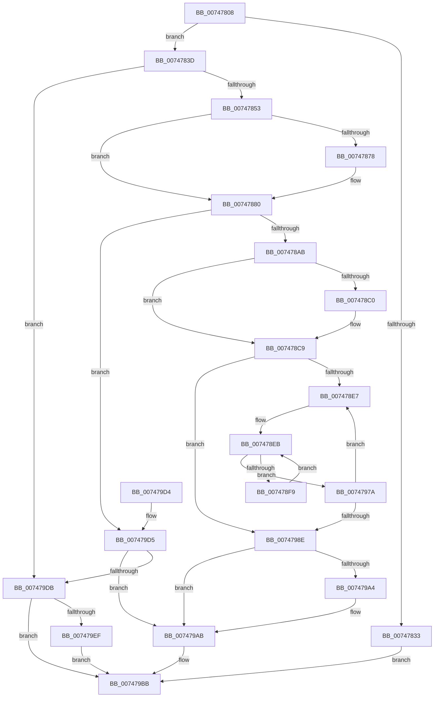

# KiInitializeSingleDpcRuntimeHistoryHashTable

- RVA: `0x00747808`–`0x007479FB` (길이 `499` bytes)
- VA: `0x0000000140747808`
- 실행 섹션: `PAGE`
- PDB 이름 있음: `예`; PDB Function 태그: `아니요`
- unwind 정보 RVA: `0x000CAC30`
- 디코드: `140`개 명령, `499/499` bytes 표시
- 미해석 바이트: `0` (있으면 어셈블리에 `.byte`로 보존)

> 이 문서는 커널 이미지의 기계어와 PDB 기호를 분석해 생성했습니다. 4번과 5번은 함수 원형과 자료형을 바이너리 사용 방식에서 추정한 C 해석이며 원본 소스 복구 결과는 아닙니다.

## 1. Dependencies

- 직접 호출 지점: **7**; 고유 호출 대상: **3**
- 직접 호출자로 확인된 함수: **2**
- RIP 상대 이미지 참조: **1**

### Outgoing calls
- `0x00747826` → [KiDpcRuntimeHistoryHashTableAllocate](../../text/4B/KiDpcRuntimeHistoryHashTableAllocate_function_004B446C.md) (function, `0x004B446C`)
- `0x00747842` → [KiDpcRuntimeHistoryHashTableAllocate](../../text/4B/KiDpcRuntimeHistoryHashTableAllocate_function_004B446C.md) (function, `0x004B446C`)
- `0x00747860` → [KeInitializeDpc](../../text/45/KeInitializeDpc_function_0045BBD0.md) (function, `0x0045BBD0`)
- `0x0074789A` → [KiDpcRuntimeHistoryHashTableAllocate](../../text/4B/KiDpcRuntimeHistoryHashTableAllocate_function_004B446C.md) (function, `0x004B446C`)
- `0x007479A6` → [CmSiFreeMemory](../../text/47/CmSiFreeMemory_function_00475D80.md) (function, `0x00475D80`)
- `0x007479E5` → [CmSiFreeMemory](../../text/47/CmSiFreeMemory_function_00475D80.md) (function, `0x00475D80`)
- `0x007479F4` → [CmSiFreeMemory](../../text/47/CmSiFreeMemory_function_00475D80.md) (function, `0x00475D80`)

### Direct callers
- [KiStartDynamicProcessor](KiStartDynamicProcessor_function_007456C8.md) at `0x00745A13`
- [KiInitializeDpcRuntimeHistoryHashTables](../../init/C3/KiInitializeDpcRuntimeHistoryHashTables_function_00C3A398.md) at `0x00C3A3E7`

### Static image references
- `0x00747856` → RVA `0x00482F60` (`KiDpcRuntimeHistoryHashTableCleanupDpcRoutine`; read)

## 2. Other-region calls and transfers

- 다른 실행 섹션으로 향하는 call: **7**
  - `0x00747826` → [KiDpcRuntimeHistoryHashTableAllocate](../../text/4B/KiDpcRuntimeHistoryHashTableAllocate_function_004B446C.md) (`PAGE` → `.text`)
  - `0x00747842` → [KiDpcRuntimeHistoryHashTableAllocate](../../text/4B/KiDpcRuntimeHistoryHashTableAllocate_function_004B446C.md) (`PAGE` → `.text`)
  - `0x00747860` → [KeInitializeDpc](../../text/45/KeInitializeDpc_function_0045BBD0.md) (`PAGE` → `.text`)
  - `0x0074789A` → [KiDpcRuntimeHistoryHashTableAllocate](../../text/4B/KiDpcRuntimeHistoryHashTableAllocate_function_004B446C.md) (`PAGE` → `.text`)
  - `0x007479A6` → [CmSiFreeMemory](../../text/47/CmSiFreeMemory_function_00475D80.md) (`PAGE` → `.text`)
  - `0x007479E5` → [CmSiFreeMemory](../../text/47/CmSiFreeMemory_function_00475D80.md) (`PAGE` → `.text`)
  - `0x007479F4` → [CmSiFreeMemory](../../text/47/CmSiFreeMemory_function_00475D80.md) (`PAGE` → `.text`)
- 별도 외부 분기/꼬리 이동을 확인하지 못했습니다.

## 3. Assembly (complete function range)

```asm
00747808  48 89 5C 24 08                  mov qword ptr [rsp + 8], rbx
0074780D  48 89 6C 24 18                  mov qword ptr [rsp + 0x18], rbp
00747812  56                              push rsi
00747813  57                              push rdi
00747814  41 55                           push r13
00747816  41 56                           push r14
00747818  41 57                           push r15
0074781A  48 83 EC 20                     sub rsp, 0x20
0074781E  33 D2                           xor edx, edx
00747820  4C 8B F1                        mov r14, rcx
00747823  8D 4A 10                        lea ecx, [rdx + 0x10]
00747826  E8 41 CC D6 FF                  call 0x1404b446c
0074782B  48 8B F0                        mov rsi, rax
0074782E  48 85 C0                        test rax, rax
00747831  75 0A                           jne 0x14074783d
00747833  BF 17 00 00 C0                  mov edi, 0xc0000017
00747838  E9 7E 01 00 00                  jmp 0x1407479bb
0074783D  33 D2                           xor edx, edx
0074783F  8D 4A 40                        lea ecx, [rdx + 0x40]
00747842  E8 25 CC D6 FF                  call 0x1404b446c
00747847  48 8B E8                        mov rbp, rax
0074784A  48 85 C0                        test rax, rax
0074784D  0F 84 88 01 00 00               je 0x1407479db
00747853  45 33 C0                        xor r8d, r8d
00747856  48 8D 15 03 B7 D3 FF            lea rdx, [rip - 0x2c48fd]
0074785D  48 8B C8                        mov rcx, rax
00747860  E8 6B 43 D1 FF                  call 0x14045bbd0
00747865  48 8B 45 38                     mov rax, qword ptr [rbp + 0x38]
00747869  41 BD 00 08 00 00               mov r13d, 0x800
0074786F  41 8B 4E 24                     mov ecx, dword ptr [r14 + 0x24]
00747873  48 85 C0                        test rax, rax
00747876  75 08                           jne 0x140747880
00747878  66 41 03 CD                     add cx, r13w
0074787C  66 89 4D 02                     mov word ptr [rbp + 2], cx
00747880  83 26 00                        and dword ptr [rsi], 0
00747883  48 8B DE                        mov rbx, rsi
00747886  48 83 66 08 00                  and qword ptr [rsi + 8], 0
0074788B  33 D2                           xor edx, edx
0074788D  83 66 04 00                     and dword ptr [rsi + 4], 0
00747891  B9 00 02 00 00                  mov ecx, 0x200
00747896  48 83 CB 01                     or rbx, 1
0074789A  E8 CD CB D6 FF                  call 0x1404b446c
0074789F  4C 8B C0                        mov r8, rax
007478A2  48 85 C0                        test rax, rax
007478A5  0F 84 2A 01 00 00               je 0x1407479d5
007478AB  48 8D 88 00 02 00 00            lea rcx, [rax + 0x200]
007478B2  48 3B C8                        cmp rcx, rax
007478B5  48 1B C9                        sbb rcx, rcx
007478B8  48 F7 D1                        not rcx
007478BB  83 E1 40                        and ecx, 0x40
007478BE  76 09                           jbe 0x1407478c9
007478C0  48 8B F8                        mov rdi, rax
007478C3  48 8B C3                        mov rax, rbx
007478C6  F3 48 AB                        rep stosq qword ptr [rdi], rax
007478C9  8B 56 04                        mov edx, dword ptr [rsi + 4]
007478CC  49 83 CB FF                     or r11, 0xffffffffffffffff
007478D0  8B CA                           mov ecx, edx
007478D2  45 33 C9                        xor r9d, r9d
007478D5  83 E1 1F                        and ecx, 0x1f
007478D8  49 D3 E3                        shl r11, cl
007478DB  F7 C2 E0 FF FF FF               test edx, 0xffffffe0
007478E1  0F 86 A7 00 00 00               jbe 0x14074798e
007478E7  4C 8B 7E 08                     mov r15, qword ptr [rsi + 8]
007478EB  4F 8B 14 CF                     mov r10, qword ptr [r15 + r9*8]
007478EF  41 F6 C2 01                     test r10b, 1
007478F3  0F 85 81 00 00 00               jne 0x14074797a
007478F9  49 8B 02                        mov rax, qword ptr [r10]
007478FC  4B 89 04 CF                     mov qword ptr [r15 + r9*8], rax
00747900  49 8B 52 08                     mov rdx, qword ptr [r10 + 8]
00747904  49 23 D3                        and rdx, r11
00747907  48 89 54 24 58                  mov qword ptr [rsp + 0x58], rdx
0074790C  0F B6 44 24 5E                  movzx eax, byte ptr [rsp + 0x5e]
00747911  48 8D 0C 40                     lea rcx, [rax + rax*2]
00747915  0F B6 44 24 59                  movzx eax, byte ptr [rsp + 0x59]
0074791A  48 2B C1                        sub rax, rcx
0074791D  48 8D 3C C0                     lea rdi, [rax + rax*8]
00747921  0F B6 44 24 5D                  movzx eax, byte ptr [rsp + 0x5d]
00747926  48 6B C8 19                     imul rcx, rax, 0x19
0074792A  0F B6 C2                        movzx eax, dl
0074792D  48 03 F9                        add rdi, rcx
00747930  48 6B C8 0D                     imul rcx, rax, 0xd
00747934  0F B6 44 24 5C                  movzx eax, byte ptr [rsp + 0x5c]
00747939  48 03 F9                        add rdi, rcx
0074793C  48 6B C8 1D                     imul rcx, rax, 0x1d
00747940  0F B6 44 24 5B                  movzx eax, byte ptr [rsp + 0x5b]
00747945  48 03 F9                        add rdi, rcx
00747948  48 6B C8 0F                     imul rcx, rax, 0xf
0074794C  0F B6 44 24 5A                  movzx eax, byte ptr [rsp + 0x5a]
00747951  48 2B F9                        sub rdi, rcx
00747954  48 6B C8 15                     imul rcx, rax, 0x15
00747958  48 03 F9                        add rdi, rcx
0074795B  0F B6 4C 24 5F                  movzx ecx, byte ptr [rsp + 0x5f]
00747960  48 83 C1 0F                     add rcx, 0xf
00747964  48 03 CF                        add rcx, rdi
00747967  83 E1 3F                        and ecx, 0x3f
0074796A  49 8B 04 C8                     mov rax, qword ptr [r8 + rcx*8]
0074796E  49 89 02                        mov qword ptr [r10], rax
00747971  4D 89 14 C8                     mov qword ptr [r8 + rcx*8], r10
00747975  E9 71 FF FF FF                  jmp 0x1407478eb
0074797A  8B 56 04                        mov edx, dword ptr [rsi + 4]
0074797D  41 FF C1                        inc r9d
00747980  8B C2                           mov eax, edx
00747982  C1 E8 05                        shr eax, 5
00747985  44 3B C8                        cmp r9d, eax
00747988  0F 82 59 FF FF FF               jb 0x1407478e7
0074798E  48 8B 4E 08                     mov rcx, qword ptr [rsi + 8]
00747992  83 E2 1F                        and edx, 0x1f
00747995  41 0B D5                        or edx, r13d
00747998  4C 89 46 08                     mov qword ptr [rsi + 8], r8
0074799C  89 56 04                        mov dword ptr [rsi + 4], edx
0074799F  48 85 C9                        test rcx, rcx
007479A2  74 07                           je 0x1407479ab
007479A4  33 D2                           xor edx, edx
007479A6  E8 D5 E3 D2 FF                  call 0x140475d80
007479AB  49 89 B6 10 38 00 00            mov qword ptr [r14 + 0x3810], rsi
007479B2  33 FF                           xor edi, edi
007479B4  49 89 AE 18 38 00 00            mov qword ptr [r14 + 0x3818], rbp
007479BB  48 8B 5C 24 50                  mov rbx, qword ptr [rsp + 0x50]
007479C0  8B C7                           mov eax, edi
007479C2  48 8B 6C 24 60                  mov rbp, qword ptr [rsp + 0x60]
007479C7  48 83 C4 20                     add rsp, 0x20
007479CB  41 5F                           pop r15
007479CD  41 5E                           pop r14
007479CF  41 5D                           pop r13
007479D1  5F                              pop rdi
007479D2  5E                              pop rsi
007479D3  C3                              ret
007479D4  CC                              int3
007479D5  83 7E 04 20                     cmp dword ptr [rsi + 4], 0x20
007479D9  73 D0                           jae 0x1407479ab
007479DB  33 D2                           xor edx, edx
007479DD  48 8B CE                        mov rcx, rsi
007479E0  BF 17 00 00 C0                  mov edi, 0xc0000017
007479E5  E8 96 E3 D2 FF                  call 0x140475d80
007479EA  48 85 ED                        test rbp, rbp
007479ED  74 CC                           je 0x1407479bb
007479EF  33 D2                           xor edx, edx
007479F1  48 8B CD                        mov rcx, rbp
007479F4  E8 87 E3 D2 FF                  call 0x140475d80
007479F9  EB C0                           jmp 0x1407479bb
```

## 4. C-style interpretation (structured pseudocode)

```c
__int64 __fastcall KiInitializeSingleDpcRuntimeHistoryHashTable(__int64 a1, int a2, int a3, int a4)
{
    __int64 result;
    __int64 v_r11;
    __int64 v_rbx;
    __int64 v_rdi;
    __int64 v_rsp;
    unsigned __int64 v_stack_p10;
    unsigned __int8 v_stack_p11;
    unsigned __int8 v_stack_p12;
    unsigned __int8 v_stack_p13;
    unsigned __int8 v_stack_p14;
    unsigned __int8 v_stack_p15;
    unsigned __int8 v_stack_p16;
    unsigned __int8 v_stack_p17;
    unsigned __int64 v_stack_p18;
    unsigned __int64 v_stack_p8;

    v_stack_p8 = v_rbx;
    v_stack_p18 = v_rbp;
    v_rsp = (v_rsp) - (32);
    a2 = 0;
    result = KiDpcRuntimeHistoryHashTableAllocate(a2 + 16, a2, a3, a4);
    if (result != 0) goto loc_0074783D;
    goto loc_007479BB;
loc_0074783D:
    a2 = 0;
    result = KiDpcRuntimeHistoryHashTableAllocate(a2 + 64, a2, a3, a4);
    if (result == 0) goto loc_007479DB;
    a3 = 0;
    result = KeInitializeDpc(result, v_rip - 2902269, a3, a4);
    if (*(unsigned __int64 *)(result + 56) == 0) {
        a1 = (unsigned __int16)(((unsigned int)(*(unsigned int *)(a1 + 36))) + ((unsigned __int16)((unsigned int)(0x800ULL))));
        *(unsigned __int16 *)(result + 2) = (unsigned __int16)(a1);
    }
    a2 = 0;
    v_rbx = (result) | (1);
    result = KiDpcRuntimeHistoryHashTableAllocate(512, a2, a3, a4);
    if (result == 0) goto loc_007479D5;
    a1 = ~(result + 512);
    a1 = (unsigned int)((a1) & (64));
    v_rdi = (unsigned int)(0xC0000017ULL);
    if (!(condition_is_below_or_equal)) {
        v_rdi = result;
        result = v_rbx;
    }
    v_r11 = (v_r11) | (-1);
    a4 = 0;
    a1 = (unsigned int)(((unsigned int)((unsigned int)((unsigned int)(*(unsigned int *)(result + 4))))) & (31));
    v_r11 = (v_r11) << ((unsigned __int8)(a1));
    if (condition_is_below_or_equal) goto loc_0074798E;
loc_007478E7:
loc_007478EB:
    if ((((unsigned __int8)(*(unsigned __int64 *)(*(unsigned __int64 *)(result + 8) + a4 * 8))) & (1)) != 0) goto loc_0074797A;
    *(unsigned __int64 *)(*(unsigned __int64 *)(result + 8) + a4 * 8) = *(unsigned __int64 *)(*(unsigned __int64 *)(*(unsigned __int64 *)(result + 8) + a4 * 8));
    a2 = (*(unsigned __int64 *)(*(unsigned __int64 *)(*(unsigned __int64 *)(result + 8) + a4 * 8) + 8)) & (v_r11);
    v_stack_p10 = a2;
    result = (v_stack_p11) - (v_stack_p16 + v_stack_p16 * 2);
    a1 = (v_stack_p16 + v_stack_p16 * 2) * (v_stack_p15);
    v_rdi = (result + result * 8) + (a1);
    a1 = (a1) * ((unsigned __int8)(a2));
    v_rdi = (v_rdi) + (a1);
    a1 = (a1) * (v_stack_p14);
    v_rdi = (v_rdi) + (a1);
    a1 = (a1) * (v_stack_p13);
    v_rdi = (v_rdi) - (a1);
    a1 = (a1) * (v_stack_p12);
    v_rdi = (v_rdi) + (a1);
    a1 = (v_stack_p17) + (15);
    a1 = (a1) + (v_rdi);
    a1 = (unsigned int)((a1) & (63));
    *(unsigned __int64 *)(*(unsigned __int64 *)(*(unsigned __int64 *)(result + 8) + a4 * 8)) = *(unsigned __int64 *)(result + a1 * 8);
    *(unsigned __int64 *)(result + a1 * 8) = *(unsigned __int64 *)(*(unsigned __int64 *)(result + 8) + a4 * 8);
    goto loc_007478EB;
loc_0074797A:
    a4 = (unsigned int)((a4) + 1);
    result = (unsigned int)(((unsigned int)((unsigned int)((unsigned int)(*(unsigned int *)(result + 4))))) >> (5));
    if (a4 < ((unsigned int)(result))) goto loc_007478E7;
loc_0074798E:
    a2 = (unsigned int)(((unsigned int)(*(unsigned int *)(result + 4))) & (31));
    a2 = (unsigned int)((a2) | ((unsigned int)((unsigned int)(0x800ULL))));
    *(unsigned __int64 *)(result + 8) = result;
    *(unsigned int *)(result + 4) = a2;
    if (*(unsigned __int64 *)(result + 8) != 0) {
        a2 = 0;
        result = CmSiFreeMemory(*(unsigned __int64 *)(result + 8), a2, result, a4);
    }
    *(unsigned __int64 *)(a1 + 14352) = result;
    v_rdi = 0;
    *(unsigned __int64 *)(a1 + 14360) = result;
loc_007479BB:
    v_rsp = (v_rsp) + (32);
    return 0;
loc_007479D5:
    if ((*(unsigned int *)(result + 4)) >= 32) goto loc_007479AB;
loc_007479DB:
    a2 = 0;
    result = CmSiFreeMemory(result, a2, result, a4);
    if (v_stack_p18 == 0) goto loc_007479BB;
    a2 = 0;
    result = CmSiFreeMemory(v_stack_p18, a2, result, a4);
    goto loc_007479BB;
}
```

## 5. (Beta) C Style

```c
int64_t KiInitializeSingleDpcRuntimeHistoryHashTable(void *Arg1, int32_t Arg2, int32_t Arg3, int32_t Arg4)
{
    uint8_t *arg1 = (uint8_t *)Arg1;

    int64_t result;
    int64_t local_r11;
    int64_t local_rbx;
    int64_t local_rdi;
    int64_t local_rsp;
    uint64_t v_stack_p10;
    uint8_t v_stack_p11;
    uint8_t v_stack_p12;
    uint8_t v_stack_p13;
    uint8_t v_stack_p14;
    uint8_t v_stack_p15;
    uint8_t v_stack_p16;
    uint8_t v_stack_p17;
    uint64_t v_stack_p18;
    uint64_t v_stack_p8;

    v_stack_p8 = local_rbx;
    v_stack_p18 = local_rbp;
    local_rsp = (local_rsp) - (32);
    Arg2 = 0;
    result = KiDpcRuntimeHistoryHashTableAllocate(Arg2 + 16, Arg2, Arg3, Arg4);
    if (result != 0) goto loc_0074783D;
    goto loc_007479BB;
loc_0074783D:
    Arg2 = 0;
    result = KiDpcRuntimeHistoryHashTableAllocate(Arg2 + 64, Arg2, Arg3, Arg4);
    if (result == 0) goto loc_007479DB;
    Arg3 = 0;
    result = KeInitializeDpc(result, v_rip - 2902269, Arg3, Arg4);
    if (*(uint64_t *)(result + 0x38) == 0) {
        Arg1 = (uint16_t)(((uint32_t)(*(uint32_t *)(arg1 + 0x24))) + ((uint16_t)((uint32_t)(0x800ULL))));
        *(uint16_t *)(result + 0x2) = (uint16_t)(Arg1);
    }
    Arg2 = 0;
    local_rbx = (result) | (1);
    result = KiDpcRuntimeHistoryHashTableAllocate(512, Arg2, Arg3, Arg4);
    if (result == 0) goto loc_007479D5;
    Arg1 = ~(result + 512);
    Arg1 = (uint32_t)((Arg1) & (64));
    local_rdi = (uint32_t)(0xC0000017ULL);
    if (!(condition_is_below_or_equal)) {
        local_rdi = result;
        result = local_rbx;
    }
    local_r11 = (local_r11) | (-1);
    Arg4 = 0;
    Arg1 = (uint32_t)(((uint32_t)((uint32_t)((uint32_t)(*(uint32_t *)(result + 0x4))))) & (31));
    local_r11 = (local_r11) << ((uint8_t)(Arg1));
    if (condition_is_below_or_equal) goto loc_0074798E;
loc_007478E7:
loc_007478EB:
    if ((((uint8_t)(*(uint64_t *)(*(uint64_t *)(result + 0x8) + Arg4 * 8))) & (1)) != 0) goto loc_0074797A;
    *(uint64_t *)(*(uint64_t *)(result + 0x8) + Arg4 * 8) = *(uint64_t *)(*(uint64_t *)(*(uint64_t *)(result + 0x8) + Arg4 * 8));
    Arg2 = (*(uint64_t *)(*(uint64_t *)(*(uint64_t *)(result + 0x8) + Arg4 * 8) + 0x8)) & (local_r11);
    v_stack_p10 = Arg2;
    result = (v_stack_p11) - (v_stack_p16 + v_stack_p16 * 2);
    Arg1 = (v_stack_p16 + v_stack_p16 * 2) * (v_stack_p15);
    local_rdi = (result + result * 8) + (Arg1);
    Arg1 = (Arg1) * ((uint8_t)(Arg2));
    local_rdi = (local_rdi) + (Arg1);
    Arg1 = (Arg1) * (v_stack_p14);
    local_rdi = (local_rdi) + (Arg1);
    Arg1 = (Arg1) * (v_stack_p13);
    local_rdi = (local_rdi) - (Arg1);
    Arg1 = (Arg1) * (v_stack_p12);
    local_rdi = (local_rdi) + (Arg1);
    Arg1 = (v_stack_p17) + (15);
    Arg1 = (Arg1) + (local_rdi);
    Arg1 = (uint32_t)((Arg1) & (63));
    *(uint64_t *)(*(uint64_t *)(*(uint64_t *)(result + 0x8) + Arg4 * 8)) = *(uint64_t *)(result + arg1 * 8);
    *(uint64_t *)(result + arg1 * 8) = *(uint64_t *)(*(uint64_t *)(result + 0x8) + Arg4 * 8);
    goto loc_007478EB;
loc_0074797A:
    Arg4 = (uint32_t)((Arg4) + 1);
    result = (uint32_t)(((uint32_t)((uint32_t)((uint32_t)(*(uint32_t *)(result + 0x4))))) >> (5));
    if (Arg4 < ((uint32_t)(result))) goto loc_007478E7;
loc_0074798E:
    Arg2 = (uint32_t)(((uint32_t)(*(uint32_t *)(result + 0x4))) & (31));
    Arg2 = (uint32_t)((Arg2) | ((uint32_t)((uint32_t)(0x800ULL))));
    *(uint64_t *)(result + 0x8) = result;
    *(uint32_t *)(result + 0x4) = Arg2;
    if (*(uint64_t *)(result + 0x8) != 0) {
        Arg2 = 0;
        result = CmSiFreeMemory(*(uint64_t *)(result + 0x8), Arg2, result, Arg4);
    }
    *(uint64_t *)(arg1 + 0x3810) = result;
    local_rdi = 0;
    *(uint64_t *)(arg1 + 0x3818) = result;
loc_007479BB:
    local_rsp = (local_rsp) + (32);
    return 0;
loc_007479D5:
    if ((*(uint32_t *)(result + 0x4)) >= 32) goto loc_007479AB;
loc_007479DB:
    Arg2 = 0;
    result = CmSiFreeMemory(result, Arg2, result, Arg4);
    if (v_stack_p18 == 0) goto loc_007479BB;
    Arg2 = 0;
    result = CmSiFreeMemory(v_stack_p18, Arg2, result, Arg4);
    goto loc_007479BB;
}
```

### 관측된 메모리 오프셋

구조체 형식이 확인되지 않은 접근은 인자 기준의 오프셋으로만 기록했습니다.

| 기준 인자 | 오프셋 표현 | 폭 (bit) | 접근 |
|---|---:|---:|---|
| `Arg1` | `+ 0x24` | `32` | `R` |
| `Arg1` | `+ 0x3810` | `64` | `W` |
| `Arg1` | `+ 0x3818` | `64` | `W` |

## 6. Execution-region graph

[열기: 2D/3D 그래프와 함수 탐색 컨트롤 패널](../../../control-panel.html?section=page&rva=0x00747808&view=graph)

- 2D 그래프는 위에서 아래로 흐르고, 3D 그래프는 빈 공간을 드래그해 회전합니다. Shift+드래그는 이동, 휠은 확대·축소, 함수 노드 선택은 대상 보고서 이동입니다.

### Static fallback


