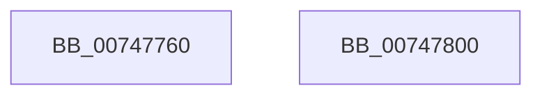

# KiLogUserCetSetContextIpValidationFailureWorker

- RVA: `0x00747760`–`0x00747801` (길이 `161` bytes)
- VA: `0x0000000140747760`
- 실행 섹션: `PAGE`
- PDB 이름 있음: `예`; PDB Function 태그: `아니요`
- unwind 정보 RVA: `0x000CABD8`
- 디코드: `41`개 명령, `161/161` bytes 표시
- 미해석 바이트: `0` (있으면 어셈블리에 `.byte`로 보존)

> 이 문서는 커널 이미지의 기계어와 PDB 기호를 분석해 생성했습니다. 4번과 5번은 함수 원형과 자료형을 바이너리 사용 방식에서 추정한 C 해석이며 원본 소스 복구 결과는 아닙니다.

## 1. Dependencies

- 직접 호출 지점: **7**; 고유 호출 대상: **7**
- 직접 호출자로 확인된 함수: **0**
- RIP 상대 이미지 참조: **1**

### Outgoing calls
- `0x0074779C` → [KiStackAttachProcess](../../text/21/KiStackAttachProcess_function_00216820.md) (function, `0x00216820`)
- `0x007477B6` → [EtwTimLogUserCetSetContextIpValidationFailure](../7B/EtwTimLogUserCetSetContextIpValidationFailure_function_007BB920.md) (function, `0x007BB920`)
- `0x007477C2` → [KiUnstackDetachProcess](../../text/21/KiUnstackDetachProcess_function_00217D30.md) (function, `0x00217D30`)
- `0x007477CE` → [ExReleaseRundownProtection](../../text/34/ExReleaseRundownProtection_function_00349E80.md) (function, `0x00349E80`)
- `0x007477D6` → [ObfDereferenceObject](../../text/2F/ObfDereferenceObject_function_002F9350.md) (function, `0x002F9350`)
- `0x007477E0` → [ExFreePoolWithTag](../../poolcode/B8/ExFreePoolWithTag_function_00B82870.md) (function, `0x00B82870`)
- `0x007477ED` → [_security_check_cookie](../../text/6A/_security_check_cookie_function_006AC640.md) (function, `0x006AC640`)

### Direct callers
- 이 함수 시작 RVA로 연결되는 직접 call은 확인되지 않았습니다. 간접 호출은 완전히 역산할 수 없습니다.

### Static image references
- `0x0074776A` → RVA `0x00E0A740` (`.data`; read)

## 2. Other-region calls and transfers

- 다른 실행 섹션으로 향하는 call: **6**
  - `0x0074779C` → [KiStackAttachProcess](../../text/21/KiStackAttachProcess_function_00216820.md) (`PAGE` → `.text`)
  - `0x007477C2` → [KiUnstackDetachProcess](../../text/21/KiUnstackDetachProcess_function_00217D30.md) (`PAGE` → `.text`)
  - `0x007477CE` → [ExReleaseRundownProtection](../../text/34/ExReleaseRundownProtection_function_00349E80.md) (`PAGE` → `.text`)
  - `0x007477D6` → [ObfDereferenceObject](../../text/2F/ObfDereferenceObject_function_002F9350.md) (`PAGE` → `.text`)
  - `0x007477E0` → [ExFreePoolWithTag](../../poolcode/B8/ExFreePoolWithTag_function_00B82870.md) (`PAGE` → `POOLCODE`)
  - `0x007477ED` → [_security_check_cookie](../../text/6A/_security_check_cookie_function_006AC640.md) (`PAGE` → `.text`)
- 별도 외부 분기/꼬리 이동을 확인하지 못했습니다.

## 3. Assembly (complete function range)

```asm
00747760  48 89 5C 24 10                  mov qword ptr [rsp + 0x10], rbx
00747765  57                              push rdi
00747766  48 83 EC 70                     sub rsp, 0x70
0074776A  48 8B 05 CF 2F 6C 00            mov rax, qword ptr [rip + 0x6c2fcf]
00747771  48 33 C4                        xor rax, rsp
00747774  48 89 44 24 60                  mov qword ptr [rsp + 0x60], rax
00747779  48 8B 59 28                     mov rbx, qword ptr [rcx + 0x28]
0074777D  4C 8D 44 24 30                  lea r8, [rsp + 0x30]
00747782  0F 57 C0                        xorps xmm0, xmm0
00747785  48 8B F9                        mov rdi, rcx
00747788  48 8B CB                        mov rcx, rbx
0074778B  33 D2                           xor edx, edx
0074778D  0F 11 44 24 30                  movups xmmword ptr [rsp + 0x30], xmm0
00747792  0F 11 44 24 40                  movups xmmword ptr [rsp + 0x40], xmm0
00747797  0F 11 44 24 50                  movups xmmword ptr [rsp + 0x50], xmm0
0074779C  E8 7F F0 AC FF                  call 0x140216820
007477A1  8B 47 3C                        mov eax, dword ptr [rdi + 0x3c]
007477A4  48 8B D3                        mov rdx, rbx
007477A7  44 8B 4F 38                     mov r9d, dword ptr [rdi + 0x38]
007477AB  4C 8B 47 30                     mov r8, qword ptr [rdi + 0x30]
007477AF  8B 4F 20                        mov ecx, dword ptr [rdi + 0x20]
007477B2  89 44 24 20                     mov dword ptr [rsp + 0x20], eax
007477B6  E8 65 41 07 00                  call 0x1407bb920
007477BB  33 D2                           xor edx, edx
007477BD  48 8D 4C 24 30                  lea rcx, [rsp + 0x30]
007477C2  E8 69 05 AD FF                  call 0x140217d30
007477C7  48 8D 8B E8 01 00 00            lea rcx, [rbx + 0x1e8]
007477CE  E8 AD 26 C0 FF                  call 0x140349e80
007477D3  48 8B CB                        mov rcx, rbx
007477D6  E8 75 1B BB FF                  call 0x1402f9350
007477DB  33 D2                           xor edx, edx
007477DD  48 8B CF                        mov rcx, rdi
007477E0  E8 8B B0 43 00                  call 0x140b82870
007477E5  48 8B 4C 24 60                  mov rcx, qword ptr [rsp + 0x60]
007477EA  48 33 CC                        xor rcx, rsp
007477ED  E8 4E 4E F6 FF                  call 0x1406ac640
007477F2  48 8B 9C 24 88 00 00 00         mov rbx, qword ptr [rsp + 0x88]
007477FA  48 83 C4 70                     add rsp, 0x70
007477FE  5F                              pop rdi
007477FF  C3                              ret
00747800  CC                              int3
```

## 4. C-style interpretation (structured pseudocode)

```c
__int64 __fastcall KiLogUserCetSetContextIpValidationFailureWorker(__int64 a1, int a2)
{
    __int64 result;
    __int64 v_rsp;
    unsigned __int64 v_stack_m18;
    unsigned __int64 v_stack_m28;
    unsigned __int64 v_stack_m38;
    unsigned __int64 v_stack_m48;
    unsigned int v_stack_m58;
    unsigned __int64 v_stack_p10;

    v_stack_p10 = v_rbx;
    v_rsp = (v_rsp) - (112);
    result = (*(unsigned __int64 *)(v_rip + 7090127)) ^ (v_rsp);
    v_stack_m18 = result;
    a2 = 0;
    v_stack_m48 = v_xmm0;
    v_stack_m38 = v_xmm0;
    v_stack_m28 = v_xmm0;
    result = KiStackAttachProcess(*(unsigned __int64 *)(a1 + 40), a2, v_stack_m48, a4);
    v_stack_m58 = (unsigned int)((unsigned int)(*(unsigned int *)(a1 + 60)));
    result = EtwTimLogUserCetSetContextIpValidationFailure((unsigned int)(*(unsigned int *)(a1 + 32)), *(unsigned __int64 *)(a1 + 40), *(unsigned __int64 *)(a1 + 48), (unsigned int)(*(unsigned int *)(a1 + 56)));
    a2 = 0;
    result = KiUnstackDetachProcess(v_stack_m48, a2, *(unsigned __int64 *)(a1 + 48), (unsigned int)(*(unsigned int *)(a1 + 56)));
    result = ExReleaseRundownProtection(*(unsigned __int64 *)(a1 + 40) + 488, a2, *(unsigned __int64 *)(a1 + 48), (unsigned int)(*(unsigned int *)(a1 + 56)));
    result = ObfDereferenceObject(*(unsigned __int64 *)(a1 + 40), a2, *(unsigned __int64 *)(a1 + 48), (unsigned int)(*(unsigned int *)(a1 + 56)));
    a2 = 0;
    result = ExFreePoolWithTag(a1, a2, *(unsigned __int64 *)(a1 + 48), (unsigned int)(*(unsigned int *)(a1 + 56)));
    a1 = (v_stack_m18) ^ (v_rsp);
    result = _security_check_cookie(a1, a2, *(unsigned __int64 *)(a1 + 48), (unsigned int)(*(unsigned int *)(a1 + 56)));
    v_rsp = (v_rsp) + (112);
    return result;
}
```

## 5. (Beta) C Style

```c
int64_t KiLogUserCetSetContextIpValidationFailureWorker(void *Arg1, int32_t Arg2)
{
    uint8_t *arg1 = (uint8_t *)Arg1;

    int64_t result;
    int64_t local_rsp;
    uint64_t v_stack_m18;
    uint64_t v_stack_m28;
    uint64_t v_stack_m38;
    uint64_t v_stack_m48;
    uint32_t v_stack_m58;
    uint64_t v_stack_p10;

    v_stack_p10 = local_rbx;
    local_rsp = (local_rsp) - (112);
    result = (*(uint64_t *)(v_rip + 0x6C2FCF)) ^ (local_rsp);
    v_stack_m18 = result;
    Arg2 = 0;
    v_stack_m48 = v_xmm0;
    v_stack_m38 = v_xmm0;
    v_stack_m28 = v_xmm0;
    result = KiStackAttachProcess(*(uint64_t *)(arg1 + 0x28), Arg2, v_stack_m48, a4);
    v_stack_m58 = (uint32_t)((uint32_t)(*(uint32_t *)(arg1 + 0x3C)));
    result = EtwTimLogUserCetSetContextIpValidationFailure((uint32_t)(*(uint32_t *)(arg1 + 0x20)), *(uint64_t *)(arg1 + 0x28), *(uint64_t *)(arg1 + 0x30), (uint32_t)(*(uint32_t *)(arg1 + 0x38)));
    Arg2 = 0;
    result = KiUnstackDetachProcess(v_stack_m48, Arg2, *(uint64_t *)(arg1 + 0x30), (uint32_t)(*(uint32_t *)(arg1 + 0x38)));
    result = ExReleaseRundownProtection(*(uint64_t *)(arg1 + 0x28) + 488, Arg2, *(uint64_t *)(arg1 + 0x30), (uint32_t)(*(uint32_t *)(arg1 + 0x38)));
    result = ObfDereferenceObject(*(uint64_t *)(arg1 + 0x28), Arg2, *(uint64_t *)(arg1 + 0x30), (uint32_t)(*(uint32_t *)(arg1 + 0x38)));
    Arg2 = 0;
    result = ExFreePoolWithTag(Arg1, Arg2, *(uint64_t *)(arg1 + 0x30), (uint32_t)(*(uint32_t *)(arg1 + 0x38)));
    Arg1 = (v_stack_m18) ^ (local_rsp);
    result = _security_check_cookie(Arg1, Arg2, *(uint64_t *)(arg1 + 0x30), (uint32_t)(*(uint32_t *)(arg1 + 0x38)));
    local_rsp = (local_rsp) + (112);
    return result;
}
```

### 관측된 메모리 오프셋

구조체 형식이 확인되지 않은 접근은 인자 기준의 오프셋으로만 기록했습니다.

| 기준 인자 | 오프셋 표현 | 폭 (bit) | 접근 |
|---|---:|---:|---|
| `Arg1` | `+ 0x20` | `32` | `R` |
| `Arg1` | `+ 0x28` | `64` | `R` |
| `Arg1` | `+ 0x30` | `64` | `R` |
| `Arg1` | `+ 0x38` | `32` | `R` |
| `Arg1` | `+ 0x3C` | `32` | `R` |

## 6. Execution-region graph

[열기: 2D/3D 그래프와 함수 탐색 컨트롤 패널](../../../control-panel.html?section=page&rva=0x00747760&view=graph)

- 2D 그래프는 위에서 아래로 흐르고, 3D 그래프는 빈 공간을 드래그해 회전합니다. Shift+드래그는 이동, 휠은 확대·축소, 함수 노드 선택은 대상 보고서 이동입니다.

### Static fallback


