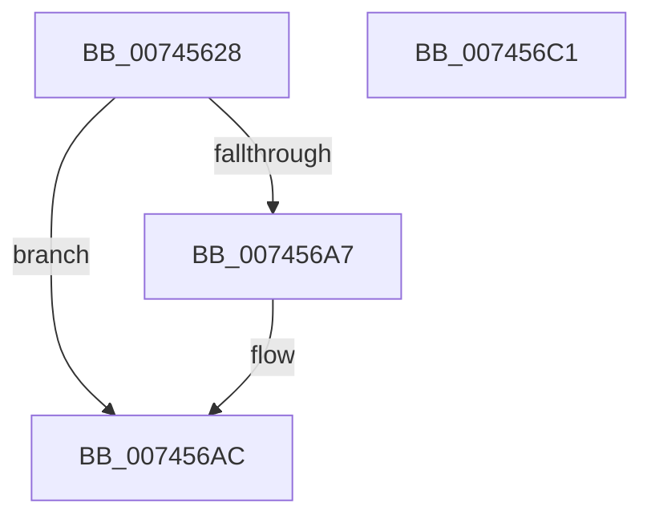

# KiStartDpcThread

- RVA: `0x00745628`–`0x007456C2` (길이 `154` bytes)
- VA: `0x0000000140745628`
- 실행 섹션: `PAGE`
- PDB 이름 있음: `예`; PDB Function 태그: `아니요`
- unwind 정보 RVA: `0x000C9F88`
- 디코드: `39`개 명령, `154/154` bytes 표시
- 미해석 바이트: `0` (있으면 어셈블리에 `.byte`로 보존)

> 이 문서는 커널 이미지의 기계어와 PDB 기호를 분석해 생성했습니다. 4번과 5번은 함수 원형과 자료형을 바이너리 사용 방식에서 추정한 C 해석이며 원본 소스 복구 결과는 아닙니다.

## 1. Dependencies

- 직접 호출 지점: **3**; 고유 호출 대상: **3**
- 직접 호출자로 확인된 함수: **2**
- RIP 상대 이미지 참조: **2**

### Outgoing calls
- `0x00745696` → [PsCreateSystemThreadEx](../9E/PsCreateSystemThreadEx_function_009ED120.md) (function, `0x009ED120`)
- `0x007456A7` → [ZwClose](../../text/6A/ZwClose_function_006AD2B0.md) (function, `0x006AD2B0`)
- `0x007456B6` → [_security_check_cookie](../../text/6A/_security_check_cookie_function_006AC640.md) (function, `0x006AC640`)

### Direct callers
- [KiInitializeDynamicProcessor](../../pagelk/B6/KiInitializeDynamicProcessor_function_00B679C8.md) at `0x00B679FC`
- [KeInitSystem](../../init/C7/KeInitSystem_function_00C71660.md) at `0x00C71885`

### Static image references
- `0x00745630` → RVA `0x00E0A740` (`.data`; read)
- `0x0074567E` → RVA `0x005C84F0` (`KiExecuteDpc`; read)

## 2. Other-region calls and transfers

- 다른 실행 섹션으로 향하는 call: **2**
  - `0x007456A7` → [ZwClose](../../text/6A/ZwClose_function_006AD2B0.md) (`PAGE` → `.text`)
  - `0x007456B6` → [_security_check_cookie](../../text/6A/_security_check_cookie_function_006AC640.md) (`PAGE` → `.text`)
- 별도 외부 분기/꼬리 이동을 확인하지 못했습니다.

## 3. Assembly (complete function range)

```asm
00745628  4C 8B DC                        mov r11, rsp
0074562B  53                              push rbx
0074562C  48 83 EC 70                     sub rsp, 0x70
00745630  48 8B 05 09 51 6C 00            mov rax, qword ptr [rip + 0x6c5109]
00745637  48 33 C4                        xor rax, rsp
0074563A  48 89 44 24 68                  mov qword ptr [rsp + 0x68], rax
0074563F  0F B6 81 D0 00 00 00            movzx eax, byte ptr [rcx + 0xd0]
00745646  0F 57 C0                        xorps xmm0, xmm0
00745649  49 83 63 D8 00                  and qword ptr [r11 - 0x28], 0
0074564E  45 33 C9                        xor r9d, r9d
00745651  0F 11 44 24 58                  movups xmmword ptr [rsp + 0x58], xmm0
00745656  66 89 44 24 60                  mov word ptr [rsp + 0x60], ax
0074565B  45 33 C0                        xor r8d, r8d
0074565E  48 8B 81 C8 00 00 00            mov rax, qword ptr [rcx + 0xc8]
00745665  BA FF FF 1F 00                  mov edx, 0x1fffff
0074566A  49 89 43 E0                     mov qword ptr [r11 - 0x20], rax
0074566E  48 8D 41 24                     lea rax, [rcx + 0x24]
00745672  49 89 43 C8                     mov qword ptr [r11 - 0x38], rax
00745676  49 8D 43 E0                     lea rax, [r11 - 0x20]
0074567A  49 89 43 C0                     mov qword ptr [r11 - 0x40], rax
0074567E  48 8D 05 6B 2E E8 FF            lea rax, [rip - 0x17d195]
00745685  49 89 4B B8                     mov qword ptr [r11 - 0x48], rcx
00745689  49 8D 4B D8                     lea rcx, [r11 - 0x28]
0074568D  49 89 43 B0                     mov qword ptr [r11 - 0x50], rax
00745691  49 83 63 A8 00                  and qword ptr [r11 - 0x58], 0
00745696  E8 85 7A 2A 00                  call 0x1409ed120
0074569B  48 8B 4C 24 50                  mov rcx, qword ptr [rsp + 0x50]
007456A0  8B D8                           mov ebx, eax
007456A2  48 85 C9                        test rcx, rcx
007456A5  74 05                           je 0x1407456ac
007456A7  E8 04 7C F6 FF                  call 0x1406ad2b0
007456AC  8B C3                           mov eax, ebx
007456AE  48 8B 4C 24 68                  mov rcx, qword ptr [rsp + 0x68]
007456B3  48 33 CC                        xor rcx, rsp
007456B6  E8 85 6F F6 FF                  call 0x1406ac640
007456BB  48 83 C4 70                     add rsp, 0x70
007456BF  5B                              pop rbx
007456C0  C3                              ret
007456C1  CC                              int3
```

## 4. C-style interpretation (structured pseudocode)

```c
__int64 __fastcall KiStartDpcThread(__int64 a1, __int64 a2, int a3, int a4)
{
    __int64 result;
    __int64 v_rsp;
    unsigned __int64 v_stack_m10;
    unsigned __int16 v_stack_m18;
    unsigned __int64 v_stack_m20;
    unsigned __int64 v_stack_m28;

    v_rsp = (v_rsp) - (112);
    result = (*(unsigned __int64 *)(v_rip + 7098633)) ^ (v_rsp);
    v_stack_m10 = result;
    a4 = 0;
    v_stack_m20 = v_xmm0;
    v_stack_m18 = (unsigned __int16)(*(unsigned __int8 *)(a1 + 208));
    a3 = 0;
    *(unsigned __int64 *)(v_rsp - 32) = *(unsigned __int64 *)(a1 + 200);
    *(unsigned __int64 *)(v_rsp - 56) = a1 + 36;
    *(unsigned __int64 *)(v_rsp - 64) = v_rsp - 32;
    *(unsigned __int64 *)(v_rsp - 72) = a1;
    *(unsigned __int64 *)(v_rsp - 80) = v_rip - 1560981;
    result = PsCreateSystemThreadEx(v_rsp - 40, (unsigned int)(0x1FFFFFULL), a3, a4);
    if (v_stack_m28 != 0) {
        result = ZwClose(v_stack_m28, (unsigned int)(0x1FFFFFULL), a3, a4);
    }
    a1 = (v_stack_m10) ^ (v_rsp);
    result = _security_check_cookie(a1, (unsigned int)(0x1FFFFFULL), a3, a4);
    v_rsp = (v_rsp) + (112);
    return result;
}
```

## 5. (Beta) C Style

```c
int64_t KiStartDpcThread(void *Arg1, int64_t Arg2, int32_t Arg3, int32_t Arg4)
{
    uint8_t *arg1 = (uint8_t *)Arg1;

    int64_t result;
    int64_t local_rsp;
    uint64_t v_stack_m10;
    uint16_t v_stack_m18;
    uint64_t v_stack_m20;
    uint64_t v_stack_m28;

    local_rsp = (local_rsp) - (112);
    result = (*(uint64_t *)(v_rip + 0x6C5109)) ^ (local_rsp);
    v_stack_m10 = result;
    Arg4 = 0;
    v_stack_m20 = v_xmm0;
    v_stack_m18 = (uint16_t)(*(uint8_t *)(arg1 + 0xD0));
    Arg3 = 0;
    *(uint64_t *)(local_rsp - 0x20) = *(uint64_t *)(arg1 + 0xC8);
    *(void **)(local_rsp - 0x38) = Arg1 + 36;
    *(uint64_t *)(local_rsp - 0x40) = local_rsp - 32;
    *(void **)(local_rsp - 0x48) = Arg1;
    *(uint64_t *)(local_rsp - 0x50) = v_rip - 1560981;
    result = PsCreateSystemThreadEx(local_rsp - 40, (uint32_t)(0x1FFFFFULL), Arg3, Arg4);
    if (v_stack_m28 != 0) {
        result = ZwClose(v_stack_m28, (uint32_t)(0x1FFFFFULL), Arg3, Arg4);
    }
    Arg1 = (v_stack_m10) ^ (local_rsp);
    result = _security_check_cookie(Arg1, (uint32_t)(0x1FFFFFULL), Arg3, Arg4);
    local_rsp = (local_rsp) + (112);
    return result;
}
```

### 관측된 메모리 오프셋

구조체 형식이 확인되지 않은 접근은 인자 기준의 오프셋으로만 기록했습니다.

| 기준 인자 | 오프셋 표현 | 폭 (bit) | 접근 |
|---|---:|---:|---|
| `Arg1` | `+ 0x24` | `64` | `R` |
| `Arg1` | `+ 0xC8` | `64` | `R` |
| `Arg1` | `+ 0xD0` | `8` | `R` |

## 6. Execution-region graph

[열기: 2D/3D 그래프와 함수 탐색 컨트롤 패널](../../../control-panel.html?section=page&rva=0x00745628&view=graph)

- 2D 그래프는 위에서 아래로 흐르고, 3D 그래프는 빈 공간을 드래그해 회전합니다. Shift+드래그는 이동, 휠은 확대·축소, 함수 노드 선택은 대상 보고서 이동입니다.

### Static fallback


