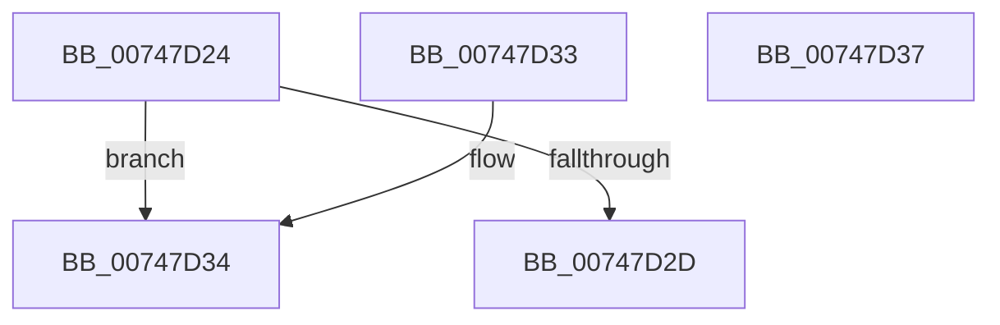

# KiSystemServiceTraceTableCompareFunction

- RVA: `0x00747D24`–`0x00747D38` (길이 `20` bytes)
- VA: `0x0000000140747D24`
- 실행 섹션: `PAGE`
- PDB 이름 있음: `예`; PDB Function 태그: `아니요`
- unwind 정보 RVA: `0x000DB714`
- 디코드: `9`개 명령, `20/20` bytes 표시
- 미해석 바이트: `0` (있으면 어셈블리에 `.byte`로 보존)

> 이 문서는 커널 이미지의 기계어와 PDB 기호를 분석해 생성했습니다. 4번과 5번은 함수 원형과 자료형을 바이너리 사용 방식에서 추정한 C 해석이며 원본 소스 복구 결과는 아닙니다.

## 1. Dependencies

- 직접 호출 지점: **0**; 고유 호출 대상: **0**
- 직접 호출자로 확인된 함수: **2**
- RIP 상대 이미지 참조: **0**

### Outgoing calls
- 직접 디코드된 call 명령이 없습니다.

### Direct callers
- [KiGetSystemServiceTraceTable](KiGetSystemServiceTraceTable_function_00747BE4.md) at `0x00747C7B`
- [KiTrackSystemCallEntry](KiTrackSystemCallEntry_function_00747D40.md) at `0x00747DA9`

### Static image references
- 디코드된 RIP-relative 메모리 참조가 없습니다.

## 2. Other-region calls and transfers

- 다른 실행 섹션으로 향하는 call: **0**
- 별도 외부 분기/꼬리 이동을 확인하지 못했습니다.

## 3. Assembly (complete function range)

```asm
00747D24  48 8B 42 18                     mov rax, qword ptr [rdx + 0x18]
00747D28  48 3B C8                        cmp rcx, rax
00747D2B  76 07                           jbe 0x140747d34
00747D2D  B8 01 00 00 00                  mov eax, 1
00747D32  C3                              ret
00747D33  CC                              int3
00747D34  1B C0                           sbb eax, eax
00747D36  C3                              ret
00747D37  CC                              int3
```

## 4. C-style interpretation (structured pseudocode)

```c
__int64 __fastcall KiSystemServiceTraceTableCompareFunction(__int64 a1, __int64 a2)
{
    if (a1 <= (*(unsigned __int64 *)(a2 + 24))) goto loc_00747D34;
    return 1;
loc_00747D34:
    return 1;
}
```

## 5. (Beta) C Style

```c
int64_t KiSystemServiceTraceTableCompareFunction(int64_t Arg1, void *Arg2)
{
    uint8_t *arg2 = (uint8_t *)Arg2;

    if (Arg1 <= (*(uint64_t *)(arg2 + 0x18))) goto loc_00747D34;
    return 1;
loc_00747D34:
    return 1;
}
```

### 관측된 메모리 오프셋

구조체 형식이 확인되지 않은 접근은 인자 기준의 오프셋으로만 기록했습니다.

| 기준 인자 | 오프셋 표현 | 폭 (bit) | 접근 |
|---|---:|---:|---|
| `Arg2` | `+ 0x18` | `64` | `R` |

## 6. Execution-region graph

[열기: 2D/3D 그래프와 함수 탐색 컨트롤 패널](../../../control-panel.html?section=page&rva=0x00747D24&view=graph)

- 2D 그래프는 위에서 아래로 흐르고, 3D 그래프는 빈 공간을 드래그해 회전합니다. Shift+드래그는 이동, 휠은 확대·축소, 함수 노드 선택은 대상 보고서 이동입니다.

### Static fallback


