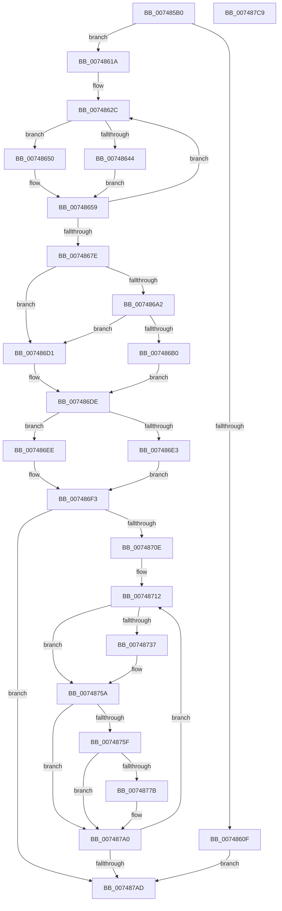

# KiTpBuildExcludedKernelTracepointBitmap

- RVA: `0x007485B0`–`0x007487CA` (길이 `538` bytes)
- VA: `0x00000001407485B0`
- 실행 섹션: `PAGE`
- PDB 이름 있음: `예`; PDB Function 태그: `예`
- unwind 정보 RVA: `0x000C5220`
- 디코드: `150`개 명령, `538/538` bytes 표시
- 미해석 바이트: `0` (있으면 어셈블리에 `.byte`로 보존)

> 이 문서는 커널 이미지의 기계어와 PDB 기호를 분석해 생성했습니다. 4번과 5번은 함수 원형과 자료형을 바이너리 사용 방식에서 추정한 C 해석이며 원본 소스 복구 결과는 아닙니다.

## 1. Dependencies

- 직접 호출 지점: **11**; 고유 호출 대상: **7**
- 직접 호출자로 확인된 함수: **1**
- RIP 상대 이미지 참조: **6**

### Outgoing calls
- `0x00748605` → [ExAllocatePool2](../../poolcode/B8/ExAllocatePool2_function_00B820F0.md) (function, `0x00B820F0`)
- `0x0074863A` → [RtlLookupFunctionEntry](../../text/2F/RtlLookupFunctionEntry_function_002F2F30.md) (function, `0x002F2F30`)
- `0x00748649` → [FsRtlNumberOfRunsInBaseMcb](../../text/45/FsRtlNumberOfRunsInBaseMcb_function_004574D0.md) (function, `0x004574D0`)
- `0x0074866F` → [RtlSetBits](../../text/3E/RtlSetBits_function_003E1610.md) (function, `0x003E1610`)
- `0x007486D6` → [RtlpxLookupFunctionTable](../../text/2F/RtlpxLookupFunctionTable_function_002F3610.md) (function, `0x002F3610`)
- `0x00748720` → [RtlLookupPrimaryFunctionEntry](../../text/5E/RtlLookupPrimaryFunctionEntry_function_005EED4C.md) (function, `0x005EED4C`)
- `0x0074872E` → [RtlIsSpecialUnwind](../../text/5E/RtlIsSpecialUnwind_function_005EECF4.md) (function, `0x005EECF4`)
- `0x0074873F` → [FsRtlNumberOfRunsInBaseMcb](../../text/45/FsRtlNumberOfRunsInBaseMcb_function_004574D0.md) (function, `0x004574D0`)
- `0x00748755` → [RtlSetBits](../../text/3E/RtlSetBits_function_003E1610.md) (function, `0x003E1610`)
- `0x00748785` → [FsRtlNumberOfRunsInBaseMcb](../../text/45/FsRtlNumberOfRunsInBaseMcb_function_004574D0.md) (function, `0x004574D0`)
- `0x0074879B` → [RtlSetBits](../../text/3E/RtlSetBits_function_003E1610.md) (function, `0x003E1610`)

### Direct callers
- [KiTpIsExcludedKernelTracepointLocation](KiTpIsExcludedKernelTracepointLocation_function_007487D0.md) at `0x0074883B`

### Static image references
- `0x007485C6` → RVA `0x00FC6CB0` (`ALMOSTRO`; read)
- `0x007485DC` → RVA `0x00FC6B28` (`ALMOSTRO`; read)
- `0x0074861C` → RVA `0x000080D0` (`.rdata`; read)
- `0x00748687` → RVA `0x01200038` (`CFGRO`; read)
- `0x007486A2` → RVA `0x01200040` (`CFGRO`; read)
- `0x007486B0` → RVA `0x01200030` (`CFGRO`; read)

## 2. Other-region calls and transfers

- 다른 실행 섹션으로 향하는 call: **11**
  - `0x00748605` → [ExAllocatePool2](../../poolcode/B8/ExAllocatePool2_function_00B820F0.md) (`PAGE` → `POOLCODE`)
  - `0x0074863A` → [RtlLookupFunctionEntry](../../text/2F/RtlLookupFunctionEntry_function_002F2F30.md) (`PAGE` → `.text`)
  - `0x00748649` → [FsRtlNumberOfRunsInBaseMcb](../../text/45/FsRtlNumberOfRunsInBaseMcb_function_004574D0.md) (`PAGE` → `.text`)
  - `0x0074866F` → [RtlSetBits](../../text/3E/RtlSetBits_function_003E1610.md) (`PAGE` → `.text`)
  - `0x007486D6` → [RtlpxLookupFunctionTable](../../text/2F/RtlpxLookupFunctionTable_function_002F3610.md) (`PAGE` → `.text`)
  - `0x00748720` → [RtlLookupPrimaryFunctionEntry](../../text/5E/RtlLookupPrimaryFunctionEntry_function_005EED4C.md) (`PAGE` → `.text`)
  - `0x0074872E` → [RtlIsSpecialUnwind](../../text/5E/RtlIsSpecialUnwind_function_005EECF4.md) (`PAGE` → `.text`)
  - `0x0074873F` → [FsRtlNumberOfRunsInBaseMcb](../../text/45/FsRtlNumberOfRunsInBaseMcb_function_004574D0.md) (`PAGE` → `.text`)
  - `0x00748755` → [RtlSetBits](../../text/3E/RtlSetBits_function_003E1610.md) (`PAGE` → `.text`)
  - `0x00748785` → [FsRtlNumberOfRunsInBaseMcb](../../text/45/FsRtlNumberOfRunsInBaseMcb_function_004574D0.md) (`PAGE` → `.text`)
  - `0x0074879B` → [RtlSetBits](../../text/3E/RtlSetBits_function_003E1610.md) (`PAGE` → `.text`)
- 별도 외부 분기/꼬리 이동을 확인하지 못했습니다.

## 3. Assembly (complete function range)

```asm
007485B0  48 89 5C 24 10                  mov qword ptr [rsp + 0x10], rbx
007485B5  48 89 6C 24 18                  mov qword ptr [rsp + 0x18], rbp
007485BA  56                              push rsi
007485BB  57                              push rdi
007485BC  41 54                           push r12
007485BE  41 56                           push r14
007485C0  41 57                           push r15
007485C2  48 83 EC 40                     sub rsp, 0x40
007485C6  48 8B 1D E3 E6 87 00            mov rbx, qword ptr [rip + 0x87e6e3]
007485CD  0F 57 C0                        xorps xmm0, xmm0
007485D0  48 83 64 24 70 00               and qword ptr [rsp + 0x70], 0
007485D6  48 8B F9                        mov rdi, rcx
007485D9  0F 11 01                        movups xmmword ptr [rcx], xmm0
007485DC  48 2B 1D 45 E5 87 00            sub rbx, qword ptr [rip + 0x87e545]
007485E3  B9 40 00 00 00                  mov ecx, 0x40
007485E8  48 83 C3 0F                     add rbx, 0xf
007485EC  41 B8 46 74 72 70               mov r8d, 0x70727446
007485F2  48 C1 EB 04                     shr rbx, 4
007485F6  48 83 C3 1F                     add rbx, 0x1f
007485FA  48 83 E3 E0                     and rbx, 0xffffffffffffffe0
007485FE  48 8B D3                        mov rdx, rbx
00748601  48 C1 EA 03                     shr rdx, 3
00748605  E8 E6 9A 43 00                  call 0x140b820f0
0074860A  48 85 C0                        test rax, rax
0074860D  75 0B                           jne 0x14074861a
0074860F  0F 57 C0                        xorps xmm0, xmm0
00748612  0F 11 07                        movups xmmword ptr [rdi], xmm0
00748615  E9 93 01 00 00                  jmp 0x1407487ad
0074861A  89 1F                           mov dword ptr [rdi], ebx
0074861C  48 8D 35 AD FA 8B FF            lea rsi, [rip - 0x740553]
00748623  48 89 47 08                     mov qword ptr [rdi + 8], rax
00748627  BD C6 00 00 00                  mov ebp, 0xc6
0074862C  48 8B 1E                        mov rbx, qword ptr [rsi]
0074862F  48 8D 54 24 70                  lea rdx, [rsp + 0x70]
00748634  48 8B CB                        mov rcx, rbx
00748637  45 33 C0                        xor r8d, r8d
0074863A  E8 F1 A8 BA FF                  call 0x1402f2f30
0074863F  48 85 C0                        test rax, rax
00748642  74 0C                           je 0x140748650
00748644  8B 18                           mov ebx, dword ptr [rax]
00748646  48 8B C8                        mov rcx, rax
00748649  E8 82 EE D0 FF                  call 0x1404574d0
0074864E  EB 09                           jmp 0x140748659
00748650  2B 1D D2 E4 87 00               sub ebx, dword ptr [rip + 0x87e4d2]
00748656  8D 43 01                        lea eax, [rbx + 1]
00748659  44 8B C0                        mov r8d, eax
0074865C  48 8B CF                        mov rcx, rdi
0074865F  49 83 C0 0F                     add r8, 0xf
00748663  C1 EB 04                        shr ebx, 4
00748666  49 C1 E8 04                     shr r8, 4
0074866A  8B D3                           mov edx, ebx
0074866C  44 2B C3                        sub r8d, ebx
0074866F  E8 9C 8F C9 FF                  call 0x1403e1610
00748674  48 83 C6 08                     add rsi, 8
00748678  48 83 ED 01                     sub rbp, 1
0074867C  75 AE                           jne 0x14074862c
0074867E  48 8B 0D A3 E4 87 00            mov rcx, qword ptr [rip + 0x87e4a3]
00748685  33 C0                           xor eax, eax
00748687  48 8B 15 AA 79 AB 00            mov rdx, qword ptr [rip + 0xab79aa]
0074868E  33 DB                           xor ebx, ebx
00748690  48 89 44 24 30                  mov qword ptr [rsp + 0x30], rax
00748695  0F 57 C0                        xorps xmm0, xmm0
00748698  0F 11 44 24 20                  movups xmmword ptr [rsp + 0x20], xmm0
0074869D  48 3B CA                        cmp rcx, rdx
007486A0  72 2F                           jb 0x1407486d1
007486A2  8B 05 98 79 AB 00               mov eax, dword ptr [rip + 0xab7998]
007486A8  48 03 C2                        add rax, rdx
007486AB  48 3B C8                        cmp rcx, rax
007486AE  73 21                           jae 0x1407486d1
007486B0  0F 28 0D 79 79 AB 00            movaps xmm1, xmmword ptr [rip + 0xab7979]
007486B7  F2 0F 10 05 81 79 AB 00         movsd xmm0, qword ptr [rip + 0xab7981]
007486BF  66 49 0F 7E CE                  movq r14, xmm1
007486C4  0F 11 4C 24 20                  movups xmmword ptr [rsp + 0x20], xmm1
007486C9  F2 0F 11 44 24 30               movsd qword ptr [rsp + 0x30], xmm0
007486CF  EB 0D                           jmp 0x1407486de
007486D1  48 8D 54 24 20                  lea rdx, [rsp + 0x20]
007486D6  E8 35 AF BA FF                  call 0x1402f3610
007486DB  4C 8B F0                        mov r14, rax
007486DE  4D 85 F6                        test r14, r14
007486E1  74 0B                           je 0x1407486ee
007486E3  4C 8B 7C 24 28                  mov r15, qword ptr [rsp + 0x28]
007486E8  8B 5C 24 34                     mov ebx, dword ptr [rsp + 0x34]
007486EC  EB 05                           jmp 0x1407486f3
007486EE  4C 8B 7C 24 70                  mov r15, qword ptr [rsp + 0x70]
007486F3  8B CB                           mov ecx, ebx
007486F5  48 B8 AB AA AA AA AA AA AA AA   movabs rax, 0xaaaaaaaaaaaaaaab
007486FF  48 F7 E1                        mul rcx
00748702  48 C1 EA 03                     shr rdx, 3
00748706  85 D2                           test edx, edx
00748708  0F 84 9F 00 00 00               je 0x1407487ad
0074870E  33 DB                           xor ebx, ebx
00748710  8B EA                           mov ebp, edx
00748712  48 8D 04 5B                     lea rax, [rbx + rbx*2]
00748716  49 8B D7                        mov rdx, r15
00748719  4D 8D 24 86                     lea r12, [r14 + rax*4]
0074871D  49 8B CC                        mov rcx, r12
00748720  E8 27 66 EA FF                  call 0x1405eed4c
00748725  49 8B D7                        mov rdx, r15
00748728  48 8B C8                        mov rcx, rax
0074872B  48 8B F0                        mov rsi, rax
0074872E  E8 C1 65 EA FF                  call 0x1405eecf4
00748733  85 C0                           test eax, eax
00748735  74 23                           je 0x14074875a
00748737  8B 16                           mov edx, dword ptr [rsi]
00748739  48 8B CE                        mov rcx, rsi
0074873C  C1 EA 04                        shr edx, 4
0074873F  E8 8C ED D0 FF                  call 0x1404574d0
00748744  44 8B C0                        mov r8d, eax
00748747  48 8B CF                        mov rcx, rdi
0074874A  49 83 C0 0F                     add r8, 0xf
0074874E  49 C1 E8 04                     shr r8, 4
00748752  44 2B C2                        sub r8d, edx
00748755  E8 B6 8E C9 FF                  call 0x1403e1610
0074875A  49 3B F4                        cmp rsi, r12
0074875D  74 41                           je 0x1407487a0
0074875F  8B 0E                           mov ecx, dword ptr [rsi]
00748761  48 8B 47 08                     mov rax, qword ptr [rdi + 8]
00748765  C1 E9 04                        shr ecx, 4
00748768  8B D1                           mov edx, ecx
0074876A  80 E1 07                        and cl, 7
0074876D  48 C1 EA 03                     shr rdx, 3
00748771  8A 14 02                        mov dl, byte ptr [rdx + rax]
00748774  D2 FA                           sar dl, cl
00748776  F6 C2 01                        test dl, 1
00748779  74 25                           je 0x1407487a0
0074877B  41 8B 14 24                     mov edx, dword ptr [r12]
0074877F  49 8B CC                        mov rcx, r12
00748782  C1 EA 04                        shr edx, 4
00748785  E8 46 ED D0 FF                  call 0x1404574d0
0074878A  44 8B C0                        mov r8d, eax
0074878D  48 8B CF                        mov rcx, rdi
00748790  49 83 C0 0F                     add r8, 0xf
00748794  49 C1 E8 04                     shr r8, 4
00748798  44 2B C2                        sub r8d, edx
0074879B  E8 70 8E C9 FF                  call 0x1403e1610
007487A0  48 FF C3                        inc rbx
007487A3  48 83 ED 01                     sub rbp, 1
007487A7  0F 85 65 FF FF FF               jne 0x140748712
007487AD  4C 8D 5C 24 40                  lea r11, [rsp + 0x40]
007487B2  48 8B C7                        mov rax, rdi
007487B5  49 8B 5B 38                     mov rbx, qword ptr [r11 + 0x38]
007487B9  49 8B 6B 40                     mov rbp, qword ptr [r11 + 0x40]
007487BD  49 8B E3                        mov rsp, r11
007487C0  41 5F                           pop r15
007487C2  41 5E                           pop r14
007487C4  41 5C                           pop r12
007487C6  5F                              pop rdi
007487C7  5E                              pop rsi
007487C8  C3                              ret
007487C9  CC                              int3
```

## 4. C-style interpretation (structured pseudocode)

```c
__int64 __fastcall KiTpBuildExcludedKernelTracepointBitmap(__int64 a1)
{
    __int64 result;
    __int64 v_rbp;
    __int64 v_rbx;
    __int64 v_rsi;
    __int64 v_rsp;
    unsigned __int64 v_stack_m28;
    unsigned int v_stack_m34;
    unsigned __int64 v_stack_m38;
    unsigned __int64 v_stack_m40;
    unsigned __int64 v_stack_m48;
    unsigned __int64 v_stack_p10;
    unsigned __int64 v_stack_p18;
    unsigned __int64 v_stack_p8;

    v_stack_p10 = v_rbx;
    v_stack_p18 = v_rbp;
    v_rsp = (v_rsp) - (64);
    *(unsigned __int64 *)(a1) = v_xmm0;
    v_rbx = (*(unsigned __int64 *)(v_rip + 8906467)) - (*(unsigned __int64 *)(v_rip + 8906053));
    v_rbx = (v_rbx) + (15);
    v_rbx = (v_rbx) >> (4);
    v_rbx = (v_rbx) + (31);
    v_rbx = (v_rbx) & (-32);
    a2 = (v_rbx) >> (3);
    result = ExAllocatePool2(64, a2, (unsigned int)(0x70727446ULL), a4);
    if (result != 0) goto loc_0074861A;
    *(unsigned __int64 *)(a1) = v_xmm0;
    goto loc_007487AD;
loc_0074861A:
    *(unsigned int *)(a1) = (unsigned int)(v_rbx);
    *(unsigned __int64 *)(a1 + 8) = result;
loc_0074862C:
    a3 = 0;
    result = RtlLookupFunctionEntry(*(unsigned __int64 *)(v_rip - 7603539), v_stack_p8, a3, a4);
    if (result == 0) goto loc_00748650;
    result = FsRtlNumberOfRunsInBaseMcb(result, v_stack_p8, a3, a4);
    goto loc_00748659;
loc_00748650:
    v_rbx = (unsigned int)(((unsigned int)(*(unsigned int *)(result))) - (*(unsigned int *)(v_rip + 8905938)));
loc_00748659:
    a3 = ((unsigned int)((unsigned int)(v_rbx + 1))) + (15);
    v_rbx = (unsigned int)((v_rbx) >> (4));
    a3 = (a3) >> (4);
    a3 = (unsigned int)((a3) - ((unsigned int)(v_rbx)));
    result = RtlSetBits(a1, (unsigned int)((unsigned int)(v_rbx)), a3, a4);
    v_rsi = (v_rip - 7603539) + (8);
    v_rbp = (198) - (1);
    if (condition_is_not_equal) goto loc_0074862C;
    result = 0;
    v_rbx = 0;
    v_stack_m38 = 0;
    v_stack_m48 = v_xmm0;
    if ((*(unsigned __int64 *)(v_rip + 8905891)) < (*(unsigned __int64 *)(v_rip + 11237802))) goto loc_007486D1;
    result = ((unsigned int)(*(unsigned int *)(v_rip + 11237784))) + (*(unsigned __int64 *)(v_rip + 11237802));
    if ((*(unsigned __int64 *)(v_rip + 8905891)) >= result) goto loc_007486D1;
    v_stack_m48 = v_xmm1;
    v_stack_m38 = v_xmm0;
    goto loc_007486DE;
loc_007486D1:
    result = RtlpxLookupFunctionTable(*(unsigned __int64 *)(v_rip + 8905891), v_stack_m48, a3, a4);
loc_007486DE:
    if (result == 0) goto loc_007486EE;
    goto loc_007486F3;
loc_007486EE:
loc_007486F3:
    a2 = (v_stack_m48) >> (3);
    if ((unsigned int)(a2) == 0) goto loc_007487AD;
    v_rbx = 0;
loc_00748712:
    result = RtlLookupPrimaryFunctionEntry(result + v_rbx + v_rbx * 2 * 4, v_stack_p8, a3, a4);
    result = RtlIsSpecialUnwind(result, v_stack_p8, a3, a4);
    if ((unsigned int)(result) != 0) {
        a2 = *(unsigned int *)(result);
        a1 = result;
        a2 = (unsigned int)((a2) >> (4));
        result = FsRtlNumberOfRunsInBaseMcb(a1, a2, a3, a4);
        a3 = (unsigned int)(result);
        a1 = a1;
        a3 = (a3) + (15);
        a3 = (a3) >> (4);
        a3 = (unsigned int)((a3) - ((unsigned int)(a2)));
        result = RtlSetBits(a1, a2, a3, a4);
    }
    if (result == (result + v_rbx + v_rbx * 2 * 4)) goto loc_007487A0;
    a1 = (unsigned int)(((unsigned int)(*(unsigned int *)(result))) >> (4));
    a1 = (unsigned __int8)((a1) & (7));
    a2 = ((unsigned int)((unsigned int)(a1))) >> (3);
    a2 = (unsigned __int8)((*(unsigned __int8 *)(a2 + *(unsigned __int64 *)(a1 + 8) * 1)) >> ((unsigned __int8)(a1)));
    result = *(unsigned __int64 *)(a1 + 8);
    if ((((unsigned __int8)(a2)) & (1)) != 0) {
        a2 = *(unsigned int *)(result + v_rbx + v_rbx * 2 * 4);
        a1 = result + v_rbx + v_rbx * 2 * 4;
        a2 = (unsigned int)((a2) >> (4));
        result = FsRtlNumberOfRunsInBaseMcb(a1, a2, a3, a4);
        a3 = (unsigned int)(result);
        a1 = a1;
        a3 = (a3) + (15);
        a3 = (a3) >> (4);
        a3 = (unsigned int)((a3) - ((unsigned int)(a2)));
        result = RtlSetBits(a1, a2, a3, a4);
    }
    v_rbx = (v_rbx) + 1;
    v_rbp = ((unsigned int)((unsigned int)(a2))) - (1);
    if (condition_is_not_equal) goto loc_00748712;
loc_007487AD:
    return a1;
}
```

## 5. (Beta) C Style

```c
void *KiTpBuildExcludedKernelTracepointBitmap(void *Arg1)
{
    uint8_t *arg1 = (uint8_t *)Arg1;

    int64_t result;
    int64_t local_rbp;
    int64_t local_rbx;
    int64_t local_rsi;
    int64_t local_rsp;
    uint64_t v_stack_m28;
    uint32_t v_stack_m34;
    uint64_t v_stack_m38;
    uint64_t v_stack_m40;
    uint64_t v_stack_m48;
    uint64_t v_stack_p10;
    uint64_t v_stack_p18;
    uint64_t v_stack_p8;

    v_stack_p10 = local_rbx;
    v_stack_p18 = local_rbp;
    local_rsp = (local_rsp) - (64);
    *(uint64_t *)(arg1) = v_xmm0;
    local_rbx = (*(uint64_t *)(v_rip + 0x87E6E3)) - (*(uint64_t *)(v_rip + 0x87E545));
    local_rbx = (local_rbx) + (15);
    local_rbx = (local_rbx) >> (4);
    local_rbx = (local_rbx) + (31);
    local_rbx = (local_rbx) & (-32);
    a2 = (local_rbx) >> (3);
    result = ExAllocatePool2(64, a2, (uint32_t)(0x70727446ULL), a4);
    if (result != 0) goto loc_0074861A;
    *(uint64_t *)(arg1) = v_xmm0;
    goto loc_007487AD;
loc_0074861A:
    *(uint32_t *)(arg1) = (uint32_t)(local_rbx);
    *(uint64_t *)(arg1 + 0x8) = result;
loc_0074862C:
    a3 = 0;
    result = RtlLookupFunctionEntry(*(uint64_t *)(v_rip - 0x740553), v_stack_p8, a3, a4);
    if (result == 0) goto loc_00748650;
    result = FsRtlNumberOfRunsInBaseMcb(result, v_stack_p8, a3, a4);
    goto loc_00748659;
loc_00748650:
    local_rbx = (uint32_t)(((uint32_t)(*(uint32_t *)(result))) - (*(uint32_t *)(v_rip + 0x87E4D2)));
loc_00748659:
    a3 = ((uint32_t)((uint32_t)(local_rbx + 1))) + (15);
    local_rbx = (uint32_t)((local_rbx) >> (4));
    a3 = (a3) >> (4);
    a3 = (uint32_t)((a3) - ((uint32_t)(local_rbx)));
    result = RtlSetBits(Arg1, (uint32_t)((uint32_t)(local_rbx)), a3, a4);
    local_rsi = (v_rip - 7603539) + (8);
    local_rbp = (198) - (1);
    if (condition_is_not_equal) goto loc_0074862C;
    result = 0;
    local_rbx = 0;
    v_stack_m38 = 0;
    v_stack_m48 = v_xmm0;
    if ((*(uint64_t *)(v_rip + 0x87E4A3)) < (*(uint64_t *)(v_rip + 0xAB79AA))) goto loc_007486D1;
    result = ((uint32_t)(*(uint32_t *)(v_rip + 0xAB7998))) + (*(uint64_t *)(v_rip + 0xAB79AA));
    if ((*(uint64_t *)(v_rip + 0x87E4A3)) >= result) goto loc_007486D1;
    v_stack_m48 = v_xmm1;
    v_stack_m38 = v_xmm0;
    goto loc_007486DE;
loc_007486D1:
    result = RtlpxLookupFunctionTable(*(uint64_t *)(v_rip + 0x87E4A3), v_stack_m48, a3, a4);
loc_007486DE:
    if (result == 0) goto loc_007486EE;
    goto loc_007486F3;
loc_007486EE:
loc_007486F3:
    a2 = (v_stack_m48) >> (3);
    if ((uint32_t)(a2) == 0) goto loc_007487AD;
    local_rbx = 0;
loc_00748712:
    result = RtlLookupPrimaryFunctionEntry(result + local_rbx + local_rbx * 2 * 4, v_stack_p8, a3, a4);
    result = RtlIsSpecialUnwind(result, v_stack_p8, a3, a4);
    if ((uint32_t)(result) != 0) {
        a2 = *(uint32_t *)(result);
        Arg1 = result;
        a2 = (uint32_t)((a2) >> (4));
        result = FsRtlNumberOfRunsInBaseMcb(Arg1, a2, a3, a4);
        a3 = (uint32_t)(result);
        Arg1 = Arg1;
        a3 = (a3) + (15);
        a3 = (a3) >> (4);
        a3 = (uint32_t)((a3) - ((uint32_t)(a2)));
        result = RtlSetBits(Arg1, a2, a3, a4);
    }
    if (result == (result + local_rbx + local_rbx * 2 * 4)) goto loc_007487A0;
    Arg1 = (uint32_t)(((uint32_t)(*(uint32_t *)(result))) >> (4));
    Arg1 = (uint8_t)((Arg1) & (7));
    a2 = ((uint32_t)((uint32_t)(Arg1))) >> (3);
    a2 = (uint8_t)((*(uint8_t *)(a2 + *(uint64_t *)(arg1 + 0x8) * 1)) >> ((uint8_t)(Arg1)));
    result = *(uint64_t *)(arg1 + 0x8);
    if ((((uint8_t)(a2)) & (1)) != 0) {
        a2 = *(uint32_t *)(result + local_rbx + local_rbx * 2 * 4);
        Arg1 = result + local_rbx + local_rbx * 2 * 4;
        a2 = (uint32_t)((a2) >> (4));
        result = FsRtlNumberOfRunsInBaseMcb(Arg1, a2, a3, a4);
        a3 = (uint32_t)(result);
        Arg1 = Arg1;
        a3 = (a3) + (15);
        a3 = (a3) >> (4);
        a3 = (uint32_t)((a3) - ((uint32_t)(a2)));
        result = RtlSetBits(Arg1, a2, a3, a4);
    }
    local_rbx = (local_rbx) + 1;
    local_rbp = ((uint32_t)((uint32_t)(a2))) - (1);
    if (condition_is_not_equal) goto loc_00748712;
loc_007487AD:
    return Arg1;
}
```

### 관측된 메모리 오프셋

구조체 형식이 확인되지 않은 접근은 인자 기준의 오프셋으로만 기록했습니다.

| 기준 인자 | 오프셋 표현 | 폭 (bit) | 접근 |
|---|---:|---:|---|
| `Arg1` | `+ 0x0` | `32` | `W` |
| `Arg1` | `+ 0x0` | `128` | `R` |
| `Arg1` | `+ 0x8` | `64` | `R` |
| `Arg1` | `+ 0x8` | `64` | `W` |

## 6. Execution-region graph

[열기: 2D/3D 그래프와 함수 탐색 컨트롤 패널](../../../control-panel.html?section=page&rva=0x007485B0&view=graph)

- 2D 그래프는 위에서 아래로 흐르고, 3D 그래프는 빈 공간을 드래그해 회전합니다. Shift+드래그는 이동, 휠은 확대·축소, 함수 노드 선택은 대상 보고서 이동입니다.

### Static fallback


