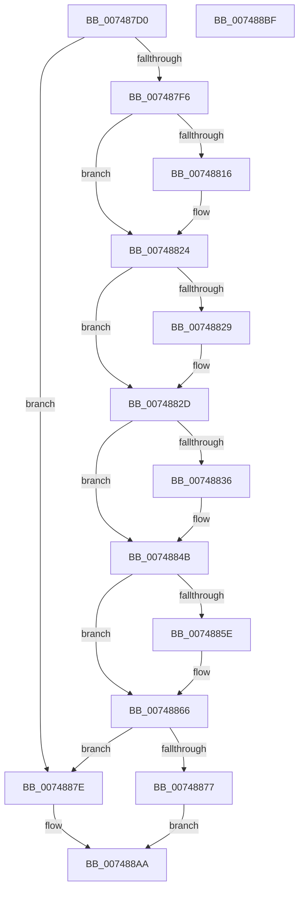

# KiTpIsExcludedKernelTracepointLocation

- RVA: `0x007487D0`–`0x007488C0` (길이 `240` bytes)
- VA: `0x00000001407487D0`
- 실행 섹션: `PAGE`
- PDB 이름 있음: `예`; PDB Function 태그: `아니요`
- unwind 정보 RVA: `0x00066400`
- 디코드: `61`개 명령, `240/240` bytes 표시
- 미해석 바이트: `0` (있으면 어셈블리에 `.byte`로 보존)

> 이 문서는 커널 이미지의 기계어와 PDB 기호를 분석해 생성했습니다. 4번과 5번은 함수 원형과 자료형을 바이너리 사용 방식에서 추정한 C 해석이며 원본 소스 복구 결과는 아닙니다.

## 1. Dependencies

- 직접 호출 지점: **6**; 고유 호출 대상: **6**
- 직접 호출자로 확인된 함수: **1**
- RIP 상대 이미지 참조: **6**

### Outgoing calls
- `0x00748805` → [KeAbPreAcquire](../../text/21/KeAbPreAcquire_function_00210230.md) (function, `0x00210230`)
- `0x0074881F` → [ExfAcquirePushLockExclusiveEx](../../text/20/ExfAcquirePushLockExclusiveEx_function_0020FC90.md) (function, `0x0020FC90`)
- `0x0074883B` → [KiTpBuildExcludedKernelTracepointBitmap](KiTpBuildExcludedKernelTracepointBitmap_function_007485B0.md) (function, `0x007485B0`)
- `0x00748861` → [ExfTryToWakePushLock](../../text/26/ExfTryToWakePushLock_function_00265DD0.md) (function, `0x00265DD0`)
- `0x00748869` → [KeAbPostRelease](../../text/2E/KeAbPostRelease_function_002E1600.md) (function, `0x002E1600`)
- `0x0074889E` → [RtlNumberOfSetBitsInRange](../../text/4C/RtlNumberOfSetBitsInRange_function_004C7300.md) (function, `0x004C7300`)

### Direct callers
- [KiTpIsSupportedKernelTracepointLocation](KiTpIsSupportedKernelTracepointLocation_function_007488C8.md) at `0x00748975`

### Static image references
- `0x007487E9` → RVA `0x00F10798` (`.data`; read)
- `0x007487F6` → RVA `0x00F10778` (`.data`; read)
- `0x00748843` → RVA `0x00F10790` (`.data`; write)
- `0x0074884F` → RVA `0x00F10778` (`.data`; read/write)
- `0x0074887E` → RVA `0x00FC6B28` (`ALMOSTRO`; read)
- `0x00748885` → RVA `0x00F10790` (`.data`; read)

## 2. Other-region calls and transfers

- 다른 실행 섹션으로 향하는 call: **5**
  - `0x00748805` → [KeAbPreAcquire](../../text/21/KeAbPreAcquire_function_00210230.md) (`PAGE` → `.text`)
  - `0x0074881F` → [ExfAcquirePushLockExclusiveEx](../../text/20/ExfAcquirePushLockExclusiveEx_function_0020FC90.md) (`PAGE` → `.text`)
  - `0x00748861` → [ExfTryToWakePushLock](../../text/26/ExfTryToWakePushLock_function_00265DD0.md) (`PAGE` → `.text`)
  - `0x00748869` → [KeAbPostRelease](../../text/2E/KeAbPostRelease_function_002E1600.md) (`PAGE` → `.text`)
  - `0x0074889E` → [RtlNumberOfSetBitsInRange](../../text/4C/RtlNumberOfSetBitsInRange_function_004C7300.md) (`PAGE` → `.text`)
- 별도 외부 분기/꼬리 이동을 확인하지 못했습니다.

## 3. Assembly (complete function range)

```asm
007487D0  48 89 5C 24 08                  mov qword ptr [rsp + 8], rbx
007487D5  48 89 6C 24 10                  mov qword ptr [rsp + 0x10], rbp
007487DA  48 89 74 24 18                  mov qword ptr [rsp + 0x18], rsi
007487DF  57                              push rdi
007487E0  48 83 EC 30                     sub rsp, 0x30
007487E4  33 DB                           xor ebx, ebx
007487E6  48 8B F1                        mov rsi, rcx
007487E9  48 39 1D A8 7F 7C 00            cmp qword ptr [rip + 0x7c7fa8], rbx
007487F0  0F 85 88 00 00 00               jne 0x14074887e
007487F6  48 8D 2D 7B 7F 7C 00            lea rbp, [rip + 0x7c7f7b]
007487FD  45 33 C0                        xor r8d, r8d
00748800  48 8B CD                        mov rcx, rbp
00748803  33 D2                           xor edx, edx
00748805  E8 26 7A AC FF                  call 0x140210230
0074880A  F0 48 0F BA 6D 00 00            lock bts qword ptr [rbp], 0
00748811  48 8B F8                        mov rdi, rax
00748814  73 0E                           jae 0x140748824
00748816  4C 8B C5                        mov r8, rbp
00748819  48 8B D0                        mov rdx, rax
0074881C  48 8B CD                        mov rcx, rbp
0074881F  E8 6C 74 AC FF                  call 0x14020fc90
00748824  48 85 FF                        test rdi, rdi
00748827  74 04                           je 0x14074882d
00748829  C6 47 0A 01                     mov byte ptr [rdi + 0xa], 1
0074882D  48 39 1D 64 7F 7C 00            cmp qword ptr [rip + 0x7c7f64], rbx
00748834  75 15                           jne 0x14074884b
00748836  48 8D 4C 24 20                  lea rcx, [rsp + 0x20]
0074883B  E8 70 FD FF FF                  call 0x1407485b0
00748840  0F 10 00                        movups xmm0, xmmword ptr [rax]
00748843  F3 0F 7F 05 45 7F 7C 00         movdqu xmmword ptr [rip + 0x7c7f45], xmm0
0074884B  48 83 C8 FF                     or rax, 0xffffffffffffffff
0074884F  F0 48 0F C1 05 20 7F 7C 00      lock xadd qword ptr [rip + 0x7c7f20], rax
00748858  24 06                           and al, 6
0074885A  3C 02                           cmp al, 2
0074885C  75 08                           jne 0x140748866
0074885E  48 8B CD                        mov rcx, rbp
00748861  E8 6A D5 B1 FF                  call 0x140265dd0
00748866  48 8B CD                        mov rcx, rbp
00748869  E8 92 8D B9 FF                  call 0x1402e1600
0074886E  48 39 1D 23 7F 7C 00            cmp qword ptr [rip + 0x7c7f23], rbx
00748875  75 07                           jne 0x14074887e
00748877  B8 01 00 00 00                  mov eax, 1
0074887C  EB 2C                           jmp 0x1407488aa
0074887E  48 2B 35 A3 E2 87 00            sub rsi, qword ptr [rip + 0x87e2a3]
00748885  48 8D 0D 04 7F 7C 00            lea rcx, [rip + 0x7c7f04]
0074888C  48 8B D6                        mov rdx, rsi
0074888F  48 C1 EA 04                     shr rdx, 4
00748893  4C 8D 46 10                     lea r8, [rsi + 0x10]
00748897  49 C1 E8 04                     shr r8, 4
0074889B  44 2B C2                        sub r8d, edx
0074889E  E8 5D EA D7 FF                  call 0x1404c7300
007488A3  85 C0                           test eax, eax
007488A5  0F 95 C3                        setne bl
007488A8  8B C3                           mov eax, ebx
007488AA  48 8B 5C 24 40                  mov rbx, qword ptr [rsp + 0x40]
007488AF  48 8B 6C 24 48                  mov rbp, qword ptr [rsp + 0x48]
007488B4  48 8B 74 24 50                  mov rsi, qword ptr [rsp + 0x50]
007488B9  48 83 C4 30                     add rsp, 0x30
007488BD  5F                              pop rdi
007488BE  C3                              ret
007488BF  CC                              int3
```

## 4. C-style interpretation (structured pseudocode)

```c
__int64 __fastcall KiTpIsExcludedKernelTracepointLocation(__int64 a1, int a2, int a3)
{
    __int64 result;
    __int64 v_rbx;
    __int64 v_rsi;
    __int64 v_rsp;
    unsigned __int64 v_stack_m18;
    unsigned __int64 v_stack_p10;
    unsigned __int64 v_stack_p18;
    unsigned __int64 v_stack_p8;

    v_stack_p8 = v_rbx;
    v_stack_p10 = v_rbp;
    v_stack_p18 = v_rsi;
    v_rsp = (v_rsp) - (48);
    v_rbx = 0;
    if ((*(unsigned __int64 *)(v_rip + 8159144)) != 0) goto loc_0074887E;
    a3 = 0;
    a2 = 0;
    result = KeAbPreAcquire(v_rip + 8159099, a2, a3, a4);
    if (!(condition_is_above_or_equal)) {
        a3 = v_rip + 8159099;
        a2 = result;
        a1 = v_rip + 8159099;
        result = ExfAcquirePushLockExclusiveEx(a1, a2, a3, a4);
    }
    if (result != 0) {
        *(unsigned __int8 *)(result + 10) = 1;
    }
    if ((*(unsigned __int64 *)(v_rip + 8159076)) == 0) {
        a1 = v_stack_m18;
        result = KiTpBuildExcludedKernelTracepointBitmap(a1, a2, a3, a4);
        *(unsigned __int64 *)(v_rip + 8159045) = v_xmm0;
    }
    result = (result) | (-1);
    result = (unsigned __int8)((result) & (6));
    if (((unsigned __int8)(result)) == 2) {
        a1 = v_rip + 8159099;
        result = ExfTryToWakePushLock(a1, a2, a3, a4);
    }
    result = KeAbPostRelease(v_rip + 8159099, a2, a3, a4);
    if ((*(unsigned __int64 *)(v_rip + 8159011)) != 0) goto loc_0074887E;
    goto loc_007488AA;
loc_0074887E:
    v_rsi = (a1) - (*(unsigned __int64 *)(v_rip + 8905379));
    a2 = (v_rsi) >> (4);
    a3 = (v_rsi + 16) >> (4);
    a3 = (unsigned int)((a3) - (a2));
    result = RtlNumberOfSetBitsInRange(v_rip + 8158980, a2, a3, a4);
    v_rbx = ((unsigned int)(result) != 0) ? 1 : 0;
loc_007488AA:
    v_rsp = (v_rsp) + (48);
    return (unsigned int)((unsigned int)(v_rbx));
}
```

## 5. (Beta) C Style

```c
int64_t KiTpIsExcludedKernelTracepointLocation(void *Arg1, int32_t Arg2, int32_t Arg3)
{
    uint8_t *arg1 = (uint8_t *)Arg1;

    int64_t result;
    int64_t local_rbx;
    int64_t local_rsi;
    int64_t local_rsp;
    uint64_t v_stack_m18;
    uint64_t v_stack_p10;
    uint64_t v_stack_p18;
    uint64_t v_stack_p8;

    v_stack_p8 = local_rbx;
    v_stack_p10 = local_rbp;
    v_stack_p18 = local_rsi;
    local_rsp = (local_rsp) - (48);
    local_rbx = 0;
    if ((*(uint64_t *)(v_rip + 0x7C7FA8)) != 0) goto loc_0074887E;
    Arg3 = 0;
    Arg2 = 0;
    result = KeAbPreAcquire(v_rip + 8159099, Arg2, Arg3, a4);
    if (!(condition_is_above_or_equal)) {
        Arg3 = v_rip + 8159099;
        Arg2 = result;
        Arg1 = v_rip + 8159099;
        result = ExfAcquirePushLockExclusiveEx(Arg1, Arg2, Arg3, a4);
    }
    if (result != 0) {
        *(uint8_t *)(result + 0xA) = 1;
    }
    if ((*(uint64_t *)(v_rip + 0x7C7F64)) == 0) {
        Arg1 = v_stack_m18;
        result = KiTpBuildExcludedKernelTracepointBitmap(Arg1, Arg2, Arg3, a4);
        *(uint64_t *)(v_rip + 0x7C7F45) = v_xmm0;
    }
    result = (result) | (-1);
    result = (uint8_t)((result) & (6));
    if (((uint8_t)(result)) == 2) {
        Arg1 = v_rip + 8159099;
        result = ExfTryToWakePushLock(Arg1, Arg2, Arg3, a4);
    }
    result = KeAbPostRelease(v_rip + 8159099, Arg2, Arg3, a4);
    if ((*(uint64_t *)(v_rip + 0x7C7F23)) != 0) goto loc_0074887E;
    goto loc_007488AA;
loc_0074887E:
    local_rsi = (Arg1) - (*(uint64_t *)(v_rip + 0x87E2A3));
    Arg2 = (local_rsi) >> (4);
    Arg3 = (local_rsi + 16) >> (4);
    Arg3 = (uint32_t)((Arg3) - (Arg2));
    result = RtlNumberOfSetBitsInRange(v_rip + 8158980, Arg2, Arg3, a4);
    local_rbx = ((uint32_t)(result) != 0) ? 1 : 0;
loc_007488AA:
    local_rsp = (local_rsp) + (48);
    return (uint32_t)((uint32_t)(local_rbx));
}
```

### 관측된 메모리 오프셋

구조체 형식이 확인되지 않은 접근은 인자 기준의 오프셋으로만 기록했습니다.

| 기준 인자 | 오프셋 표현 | 폭 (bit) | 접근 |
|---|---:|---:|---|
| `Arg1` | `+ 0x10` | `64` | `R` |

## 6. Execution-region graph

[열기: 2D/3D 그래프와 함수 탐색 컨트롤 패널](../../../control-panel.html?section=page&rva=0x007487D0&view=graph)

- 2D 그래프는 위에서 아래로 흐르고, 3D 그래프는 빈 공간을 드래그해 회전합니다. Shift+드래그는 이동, 휠은 확대·축소, 함수 노드 선택은 대상 보고서 이동입니다.

### Static fallback


