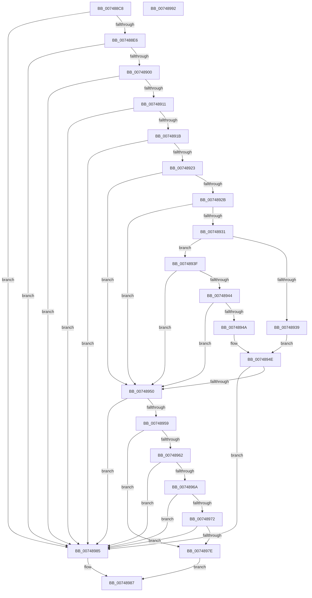

# KiTpIsSupportedKernelTracepointLocation

- RVA: `0x007488C8`–`0x00748993` (길이 `203` bytes)
- VA: `0x00000001407488C8`
- 실행 섹션: `PAGE`
- PDB 이름 있음: `예`; PDB Function 태그: `아니요`
- unwind 정보 RVA: `0x0005CAAC`
- 디코드: `59`개 명령, `203/203` bytes 표시
- 미해석 바이트: `0` (있으면 어셈블리에 `.byte`로 보존)

> 이 문서는 커널 이미지의 기계어와 PDB 기호를 분석해 생성했습니다. 4번과 5번은 함수 원형과 자료형을 바이너리 사용 방식에서 추정한 C 해석이며 원본 소스 복구 결과는 아닙니다.

## 1. Dependencies

- 직접 호출 지점: **3**; 고유 호출 대상: **3**
- 직접 호출자로 확인된 함수: **1**
- RIP 상대 이미지 참조: **2**

### Outgoing calls
- `0x007488D8` → [RtlImageNtHeader](../../text/44/RtlImageNtHeader_function_00443B60.md) (function, `0x00443B60`)
- `0x007488F2` → [RtlSectionTableFromVirtualAddress](../../text/43/RtlSectionTableFromVirtualAddress_function_00432CF0.md) (function, `0x00432CF0`)
- `0x00748975` → [KiTpIsExcludedKernelTracepointLocation](KiTpIsExcludedKernelTracepointLocation_function_007487D0.md) (function, `0x007487D0`)

### Direct callers
- [KeSetTracepoint](KeSetTracepoint_function_00747F80.md) at `0x007481B2`

### Static image references
- `0x00748950` → RVA `0x00FC6B98` (`ALMOSTRO`; read)
- `0x00748959` → RVA `0x00FC6B28` (`ALMOSTRO`; read)

## 2. Other-region calls and transfers

- 다른 실행 섹션으로 향하는 call: **2**
  - `0x007488D8` → [RtlImageNtHeader](../../text/44/RtlImageNtHeader_function_00443B60.md) (`PAGE` → `.text`)
  - `0x007488F2` → [RtlSectionTableFromVirtualAddress](../../text/43/RtlSectionTableFromVirtualAddress_function_00432CF0.md) (`PAGE` → `.text`)
- 별도 외부 분기/꼬리 이동을 확인하지 못했습니다.

## 3. Assembly (complete function range)

```asm
007488C8  48 89 5C 24 08                  mov qword ptr [rsp + 8], rbx
007488CD  57                              push rdi
007488CE  48 83 EC 20                     sub rsp, 0x20
007488D2  48 8B FA                        mov rdi, rdx
007488D5  48 8B D9                        mov rbx, rcx
007488D8  E8 83 B2 CF FF                  call 0x140443b60
007488DD  48 85 C0                        test rax, rax
007488E0  0F 84 9F 00 00 00               je 0x140748985
007488E6  44 8B C7                        mov r8d, edi
007488E9  48 8B D3                        mov rdx, rbx
007488EC  44 2B C3                        sub r8d, ebx
007488EF  48 8B C8                        mov rcx, rax
007488F2  E8 F9 A3 CE FF                  call 0x140432cf0
007488F7  48 85 C0                        test rax, rax
007488FA  0F 84 85 00 00 00               je 0x140748985
00748900  8B 48 24                        mov ecx, dword ptr [rax + 0x24]
00748903  81 E1 00 00 00 22               and ecx, 0x22000000
00748909  81 F9 00 00 00 20               cmp ecx, 0x20000000
0074890F  75 74                           jne 0x140748985
00748911  8B 08                           mov ecx, dword ptr [rax]
00748913  81 F9 49 4E 49 54               cmp ecx, 0x54494e49
00748919  74 6A                           je 0x140748985
0074891B  81 F9 4B 56 41 53               cmp ecx, 0x5341564b
00748921  74 62                           je 0x140748985
00748923  81 F9 50 41 47 45               cmp ecx, 0x45474150
00748929  75 25                           jne 0x140748950
0074892B  83 78 04 00                     cmp dword ptr [rax + 4], 0
0074892F  74 1F                           je 0x140748950
00748931  8A 50 04                        mov dl, byte ptr [rax + 4]
00748934  80 FA 77                        cmp dl, 0x77
00748937  75 06                           jne 0x14074893f
00748939  80 78 05 78                     cmp byte ptr [rax + 5], 0x78
0074893D  EB 0F                           jmp 0x14074894e
0074893F  80 FA 56                        cmp dl, 0x56
00748942  75 0C                           jne 0x140748950
00748944  80 78 05 52                     cmp byte ptr [rax + 5], 0x52
00748948  75 06                           jne 0x140748950
0074894A  80 78 06 46                     cmp byte ptr [rax + 6], 0x46
0074894E  74 35                           je 0x140748985
00748950  48 3B 1D 41 E2 87 00            cmp rbx, qword ptr [rip + 0x87e241]
00748957  74 2C                           je 0x140748985
00748959  48 3B 1D C8 E1 87 00            cmp rbx, qword ptr [rip + 0x87e1c8]
00748960  75 1C                           jne 0x14074897e
00748962  81 F9 54 52 41 43               cmp ecx, 0x43415254
00748968  74 1B                           je 0x140748985
0074896A  81 F9 45 53 55 50               cmp ecx, 0x50555345
00748970  74 13                           je 0x140748985
00748972  48 8B CF                        mov rcx, rdi
00748975  E8 56 FE FF FF                  call 0x1407487d0
0074897A  85 C0                           test eax, eax
0074897C  75 07                           jne 0x140748985
0074897E  B8 01 00 00 00                  mov eax, 1
00748983  EB 02                           jmp 0x140748987
00748985  33 C0                           xor eax, eax
00748987  48 8B 5C 24 30                  mov rbx, qword ptr [rsp + 0x30]
0074898C  48 83 C4 20                     add rsp, 0x20
00748990  5F                              pop rdi
00748991  C3                              ret
00748992  CC                              int3
```

## 4. C-style interpretation (structured pseudocode)

```c
__int64 __fastcall KiTpIsSupportedKernelTracepointLocation(__int64 a1, __int64 a2)
{
    __int64 result;
    __int64 v_rsp;
    unsigned __int64 v_stack_p8;

    v_stack_p8 = v_rbx;
    v_rsp = (v_rsp) - (32);
    result = RtlImageNtHeader(a1, a2, a3, a4);
    if (result == 0) goto loc_00748985;
    a3 = (unsigned int)(((unsigned int)((unsigned int)(a2))) - ((unsigned int)(a1)));
    result = RtlSectionTableFromVirtualAddress(result, a1, a3, a4);
    if (result == 0) goto loc_00748985;
    a1 = (unsigned int)(((unsigned int)(*(unsigned int *)(result + 36))) & (0x22000000ULL));
    if (((unsigned int)(a1)) != 0x20000000ULL) goto loc_00748985;
    if (((unsigned int)((unsigned int)(*(unsigned int *)(result)))) == 0x54494E49ULL) goto loc_00748985;
    if (((unsigned int)((unsigned int)(*(unsigned int *)(result)))) == 0x5341564BULL) goto loc_00748985;
    if (((unsigned int)((unsigned int)(*(unsigned int *)(result)))) != 0x45474150ULL) goto loc_00748950;
    if ((*(unsigned int *)(result + 4)) == 0) goto loc_00748950;
    if (((unsigned __int8)(*(unsigned __int8 *)(result + 4))) != 119) goto loc_0074893F;
    goto loc_0074894E;
loc_0074893F:
    if (((unsigned __int8)(*(unsigned __int8 *)(result + 4))) != 86) goto loc_00748950;
    if ((*(unsigned __int8 *)(result + 5)) != 82) goto loc_00748950;
loc_0074894E:
    if ((*(unsigned __int8 *)(result + 6)) == 70) goto loc_00748985;
loc_00748950:
    if (a1 == (*(unsigned __int64 *)(v_rip + 8905281))) goto loc_00748985;
    if (a1 != (*(unsigned __int64 *)(v_rip + 8905160))) goto loc_0074897E;
    if (((unsigned int)((unsigned int)(*(unsigned int *)(result)))) == 0x43415254ULL) goto loc_00748985;
    if (((unsigned int)((unsigned int)(*(unsigned int *)(result)))) == 0x50555345ULL) goto loc_00748985;
    result = KiTpIsExcludedKernelTracepointLocation(a2, *(unsigned __int8 *)(result + 4), a3, a4);
    if ((unsigned int)(result) != 0) goto loc_00748985;
loc_0074897E:
    goto loc_00748987;
loc_00748985:
    result = 0;
loc_00748987:
    v_rsp = (v_rsp) + (32);
    return result;
}
```

## 5. (Beta) C Style

```c
int64_t KiTpIsSupportedKernelTracepointLocation(int64_t Arg1, int64_t Arg2)
{
    int64_t result;
    int64_t local_rsp;
    uint64_t v_stack_p8;

    v_stack_p8 = local_rbx;
    local_rsp = (local_rsp) - (32);
    result = RtlImageNtHeader(Arg1, Arg2, a3, a4);
    if (result == 0) goto loc_00748985;
    a3 = (uint32_t)(((uint32_t)((uint32_t)(Arg2))) - ((uint32_t)(Arg1)));
    result = RtlSectionTableFromVirtualAddress(result, Arg1, a3, a4);
    if (result == 0) goto loc_00748985;
    Arg1 = (uint32_t)(((uint32_t)(*(uint32_t *)(result + 0x24))) & (0x22000000ULL));
    if (((uint32_t)(Arg1)) != 0x20000000ULL) goto loc_00748985;
    if (((uint32_t)((uint32_t)(*(uint32_t *)(result)))) == 0x54494E49ULL) goto loc_00748985;
    if (((uint32_t)((uint32_t)(*(uint32_t *)(result)))) == 0x5341564BULL) goto loc_00748985;
    if (((uint32_t)((uint32_t)(*(uint32_t *)(result)))) != 0x45474150ULL) goto loc_00748950;
    if ((*(uint32_t *)(result + 0x4)) == 0) goto loc_00748950;
    if (((uint8_t)(*(uint8_t *)(result + 0x4))) != 119) goto loc_0074893F;
    goto loc_0074894E;
loc_0074893F:
    if (((uint8_t)(*(uint8_t *)(result + 0x4))) != 86) goto loc_00748950;
    if ((*(uint8_t *)(result + 0x5)) != 82) goto loc_00748950;
loc_0074894E:
    if ((*(uint8_t *)(result + 0x6)) == 70) goto loc_00748985;
loc_00748950:
    if (Arg1 == (*(uint64_t *)(v_rip + 0x87E241))) goto loc_00748985;
    if (Arg1 != (*(uint64_t *)(v_rip + 0x87E1C8))) goto loc_0074897E;
    if (((uint32_t)((uint32_t)(*(uint32_t *)(result)))) == 0x43415254ULL) goto loc_00748985;
    if (((uint32_t)((uint32_t)(*(uint32_t *)(result)))) == 0x50555345ULL) goto loc_00748985;
    result = KiTpIsExcludedKernelTracepointLocation(Arg2, *(uint8_t *)(result + 0x4), a3, a4);
    if ((uint32_t)(result) != 0) goto loc_00748985;
loc_0074897E:
    goto loc_00748987;
loc_00748985:
    result = 0;
loc_00748987:
    local_rsp = (local_rsp) + (32);
    return result;
}
```

## 6. Execution-region graph

[열기: 2D/3D 그래프와 함수 탐색 컨트롤 패널](../../../control-panel.html?section=page&rva=0x007488C8&view=graph)

- 2D 그래프는 위에서 아래로 흐르고, 3D 그래프는 빈 공간을 드래그해 회전합니다. Shift+드래그는 이동, 휠은 확대·축소, 함수 노드 선택은 대상 보고서 이동입니다.

### Static fallback


