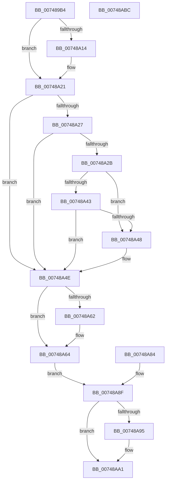

# KiTpReadImageData

- RVA: `0x007489B4`–`0x00748ABD` (길이 `265` bytes)
- VA: `0x00000001407489B4`
- 실행 섹션: `PAGE`
- PDB 이름 있음: `예`; PDB Function 태그: `아니요`
- unwind 정보 RVA: `0x000CB36C`
- 디코드: `83`개 명령, `265/265` bytes 표시
- 미해석 바이트: `0` (있으면 어셈블리에 `.byte`로 보존)

> 이 문서는 커널 이미지의 기계어와 PDB 기호를 분석해 생성했습니다. 4번과 5번은 함수 원형과 자료형을 바이너리 사용 방식에서 추정한 C 해석이며 원본 소스 복구 결과는 아닙니다.

## 1. Dependencies

- 직접 호출 지점: **5**; 고유 호출 대상: **4**
- 직접 호출자로 확인된 함수: **1**
- RIP 상대 이미지 참조: **1**

### Outgoing calls
- `0x00748A1B` → [KiStackAttachProcess](../../text/21/KiStackAttachProcess_function_00216820.md) (function, `0x00216820`)
- `0x00748A58` → [memcpy](../../text/6C/memcpy_function_006C6840.md) (function, `0x006C6840`)
- `0x00748A77` → [memcpy](../../text/6C/memcpy_function_006C6840.md) (function, `0x006C6840`)
- `0x00748A9C` → [KiUnstackDetachProcess](../../text/21/KiUnstackDetachProcess_function_00217D30.md) (function, `0x00217D30`)
- `0x00748AAB` → [_security_check_cookie](../../text/6A/_security_check_cookie_function_006AC640.md) (function, `0x006AC640`)

### Direct callers
- [RtlIcParseInstruction](../../tracesup/BC/RtlIcParseInstruction_function_00BC70E8.md) at `0x00BC7127`
- [RtlIcParseInstruction](../../tracesup/BC/RtlIcParseInstruction_function_00BC70E8.md) at `0x00BC716B`

### Static image references
- `0x007489C0` → RVA `0x00E0A740` (`.data`; read)

## 2. Other-region calls and transfers

- 다른 실행 섹션으로 향하는 call: **5**
  - `0x00748A1B` → [KiStackAttachProcess](../../text/21/KiStackAttachProcess_function_00216820.md) (`PAGE` → `.text`)
  - `0x00748A58` → [memcpy](../../text/6C/memcpy_function_006C6840.md) (`PAGE` → `.text`)
  - `0x00748A77` → [memcpy](../../text/6C/memcpy_function_006C6840.md) (`PAGE` → `.text`)
  - `0x00748A9C` → [KiUnstackDetachProcess](../../text/21/KiUnstackDetachProcess_function_00217D30.md) (`PAGE` → `.text`)
  - `0x00748AAB` → [_security_check_cookie](../../text/6A/_security_check_cookie_function_006AC640.md) (`PAGE` → `.text`)
- 별도 외부 분기/꼬리 이동을 확인하지 못했습니다.

## 3. Assembly (complete function range)

```asm
007489B4  40 53                           push rbx
007489B6  56                              push rsi
007489B7  57                              push rdi
007489B8  41 56                           push r14
007489BA  41 57                           push r15
007489BC  48 83 EC 70                     sub rsp, 0x70
007489C0  48 8B 05 79 1D 6C 00            mov rax, qword ptr [rip + 0x6c1d79]
007489C7  48 33 C4                        xor rax, rsp
007489CA  48 89 44 24 60                  mov qword ptr [rsp + 0x60], rax
007489CF  49 8B F1                        mov rsi, r9
007489D2  4C 8B F2                        mov r14, rdx
007489D5  48 8B D9                        mov rbx, rcx
007489D8  48 89 4C 24 28                  mov qword ptr [rsp + 0x28], rcx
007489DD  0F 57 C0                        xorps xmm0, xmm0
007489E0  0F 11 44 24 30                  movups xmmword ptr [rsp + 0x30], xmm0
007489E5  0F 11 44 24 40                  movups xmmword ptr [rsp + 0x40], xmm0
007489EA  0F 11 44 24 50                  movups xmmword ptr [rsp + 0x50], xmm0
007489EF  8B 41 10                        mov eax, dword ptr [rcx + 0x10]
007489F2  25 FF 0F 00 00                  and eax, 0xfff
007489F7  BF 00 10 00 00                  mov edi, 0x1000
007489FC  2B F8                           sub edi, eax
007489FE  41 3B F8                        cmp edi, r8d
00748A01  41 0F 47 F8                     cmova edi, r8d
00748A05  89 7C 24 20                     mov dword ptr [rsp + 0x20], edi
00748A09  44 8B FF                        mov r15d, edi
00748A0C  48 8B 09                        mov rcx, qword ptr [rcx]
00748A0F  48 85 C9                        test rcx, rcx
00748A12  74 0D                           je 0x140748a21
00748A14  4C 8D 44 24 30                  lea r8, [rsp + 0x30]
00748A19  33 D2                           xor edx, edx
00748A1B  E8 00 DE AC FF                  call 0x140216820
00748A20  90                              nop
00748A21  80 7B 08 00                     cmp byte ptr [rbx + 8], 0
00748A25  74 27                           je 0x140748a4e
00748A27  85 FF                           test edi, edi
00748A29  74 23                           je 0x140748a4e
00748A2B  48 8B 4B 10                     mov rcx, qword ptr [rbx + 0x10]
00748A2F  8B D7                           mov edx, edi
00748A31  48 03 D1                        add rdx, rcx
00748A34  48 B8 00 00 FF FF FF 7F 00 00   movabs rax, 0x7fffffff0000
00748A3E  48 3B D0                        cmp rdx, rax
00748A41  77 05                           ja 0x140748a48
00748A43  48 3B D1                        cmp rdx, rcx
00748A46  73 06                           jae 0x140748a4e
00748A48  8A 00                           mov al, byte ptr [rax]
00748A4A  8B 7C 24 20                     mov edi, dword ptr [rsp + 0x20]
00748A4E  44 8B C7                        mov r8d, edi
00748A51  48 8B 53 10                     mov rdx, qword ptr [rbx + 0x10]
00748A55  49 8B CE                        mov rcx, r14
00748A58  E8 E3 DD F7 FF                  call 0x1406c6840
00748A5D  48 85 F6                        test rsi, rsi
00748A60  74 02                           je 0x140748a64
00748A62  89 3E                           mov dword ptr [rsi], edi
00748A64  8B 43 20                        mov eax, dword ptr [rbx + 0x20]
00748A67  3B C7                           cmp eax, edi
00748A69  41 0F 43 C7                     cmovae eax, r15d
00748A6D  44 8B C0                        mov r8d, eax
00748A70  49 8B D6                        mov rdx, r14
00748A73  48 8B 4B 18                     mov rcx, qword ptr [rbx + 0x18]
00748A77  E8 C4 DD F7 FF                  call 0x1406c6840
00748A7C  33 FF                           xor edi, edi
00748A7E  89 7C 24 24                     mov dword ptr [rsp + 0x24], edi
00748A82  EB 0B                           jmp 0x140748a8f
00748A84  8B F8                           mov edi, eax
00748A86  89 44 24 24                     mov dword ptr [rsp + 0x24], eax
00748A8A  48 8B 5C 24 28                  mov rbx, qword ptr [rsp + 0x28]
00748A8F  48 83 3B 00                     cmp qword ptr [rbx], 0
00748A93  74 0C                           je 0x140748aa1
00748A95  33 D2                           xor edx, edx
00748A97  48 8D 4C 24 30                  lea rcx, [rsp + 0x30]
00748A9C  E8 8F F2 AC FF                  call 0x140217d30
00748AA1  8B C7                           mov eax, edi
00748AA3  48 8B 4C 24 60                  mov rcx, qword ptr [rsp + 0x60]
00748AA8  48 33 CC                        xor rcx, rsp
00748AAB  E8 90 3B F6 FF                  call 0x1406ac640
00748AB0  48 83 C4 70                     add rsp, 0x70
00748AB4  41 5F                           pop r15
00748AB6  41 5E                           pop r14
00748AB8  5F                              pop rdi
00748AB9  5E                              pop rsi
00748ABA  5B                              pop rbx
00748ABB  C3                              ret
00748ABC  CC                              int3
```

## 4. C-style interpretation (structured pseudocode)

```c
__int64 __fastcall KiTpReadImageData(__int64 a1, __int64 a2, int a3, __int64 a4)
{
    __int64 result;
    __int64 v_rdi;
    __int64 v_rsp;
    unsigned __int64 v_stack_m38;
    unsigned __int64 v_stack_m48;
    unsigned __int64 v_stack_m58;
    unsigned __int64 v_stack_m68;
    unsigned __int64 v_stack_m70;
    unsigned int v_stack_m74;
    unsigned int v_stack_m78;

    v_rsp = (v_rsp) - (112);
    result = (*(unsigned __int64 *)(v_rip + 7085433)) ^ (v_rsp);
    v_stack_m38 = result;
    v_stack_m70 = a1;
    v_stack_m68 = v_xmm0;
    v_stack_m58 = v_xmm0;
    v_stack_m48 = v_xmm0;
    result = (unsigned int)(((unsigned int)(*(unsigned int *)(a1 + 16))) & (0xFFFULL));
    v_rdi = (unsigned int)(((unsigned int)(0x1000ULL)) - ((unsigned int)(result)));
    if (((unsigned int)(v_rdi)) > a3) { v_rdi = a3; }
    v_stack_m78 = (unsigned int)(v_rdi);
    if (*(unsigned __int64 *)(a1) != 0) {
        a3 = v_stack_m68;
        a2 = 0;
        result = KiStackAttachProcess(*(unsigned __int64 *)(a1), a2, a3, a4);
    }
    if ((*(unsigned __int8 *)(a1 + 8)) == 0) goto loc_00748A4E;
    if ((unsigned int)(v_rdi) == 0) goto loc_00748A4E;
    a2 = ((unsigned int)((unsigned int)(v_rdi))) + (*(unsigned __int64 *)(a1 + 16));
    if (a2 > result) goto loc_00748A48;
    if (a2 < (*(unsigned __int64 *)(a1 + 16))) {
        result = *(unsigned __int8 *)(result);
        v_rdi = v_stack_m78;
    }
    result = memcpy(a2, *(unsigned __int64 *)(a1 + 16), (unsigned int)((unsigned int)(v_rdi)), a4);
    if (a4 != 0) {
        *(unsigned int *)(a4) = (unsigned int)(v_rdi);
    }
    result = (unsigned int)(*(unsigned int *)(a1 + 32));
    if (((unsigned int)((unsigned int)(*(unsigned int *)(a1 + 32)))) >= ((unsigned int)(v_rdi))) { result = (unsigned int)((unsigned int)((unsigned int)(v_rdi))); }
    result = memcpy(*(unsigned __int64 *)(a1 + 24), a2, (unsigned int)((unsigned int)(result)), a4);
    v_rdi = 0;
    v_stack_m74 = 0;
    goto loc_00748A8F;
loc_00748A8F:
    if ((*(unsigned __int64 *)(a1)) != 0) {
        a2 = 0;
        a1 = v_stack_m68;
        result = KiUnstackDetachProcess(a1, a2, (unsigned int)((unsigned int)(result)), a4);
    }
    a1 = (v_stack_m38) ^ (v_rsp);
    result = _security_check_cookie(a1, a2, (unsigned int)((unsigned int)(result)), a4);
    v_rsp = (v_rsp) + (112);
    return result;
}
```

## 5. (Beta) C Style

```c
int64_t KiTpReadImageData(void *Arg1, int64_t Arg2, int32_t Arg3, int64_t Arg4)
{
    uint8_t *arg1 = (uint8_t *)Arg1;

    int64_t result;
    int64_t local_rdi;
    int64_t local_rsp;
    uint64_t v_stack_m38;
    uint64_t v_stack_m48;
    uint64_t v_stack_m58;
    uint64_t v_stack_m68;
    uint64_t v_stack_m70;
    uint32_t v_stack_m74;
    uint32_t v_stack_m78;

    local_rsp = (local_rsp) - (112);
    result = (*(uint64_t *)(v_rip + 0x6C1D79)) ^ (local_rsp);
    v_stack_m38 = result;
    v_stack_m70 = Arg1;
    v_stack_m68 = v_xmm0;
    v_stack_m58 = v_xmm0;
    v_stack_m48 = v_xmm0;
    result = (uint32_t)(((uint32_t)(*(uint32_t *)(arg1 + 0x10))) & (0xFFFULL));
    local_rdi = (uint32_t)(((uint32_t)(0x1000ULL)) - ((uint32_t)(result)));
    if (((uint32_t)(local_rdi)) > Arg3) { local_rdi = Arg3; }
    v_stack_m78 = (uint32_t)(local_rdi);
    if (*(uint64_t *)(arg1) != 0) {
        Arg3 = v_stack_m68;
        Arg2 = 0;
        result = KiStackAttachProcess(*(uint64_t *)(arg1), Arg2, Arg3, Arg4);
    }
    if ((*(uint8_t *)(arg1 + 0x8)) == 0) goto loc_00748A4E;
    if ((uint32_t)(local_rdi) == 0) goto loc_00748A4E;
    Arg2 = ((uint32_t)((uint32_t)(local_rdi))) + (*(uint64_t *)(arg1 + 0x10));
    if (Arg2 > result) goto loc_00748A48;
    if (Arg2 < (*(uint64_t *)(arg1 + 0x10))) {
        result = *(uint8_t *)(result);
        local_rdi = v_stack_m78;
    }
    result = memcpy(Arg2, *(uint64_t *)(arg1 + 0x10), (uint32_t)((uint32_t)(local_rdi)), Arg4);
    if (Arg4 != 0) {
        *(uint32_t *)(Arg4) = (uint32_t)(local_rdi);
    }
    result = (uint32_t)(*(uint32_t *)(arg1 + 0x20));
    if (((uint32_t)((uint32_t)(*(uint32_t *)(arg1 + 0x20)))) >= ((uint32_t)(local_rdi))) { result = (uint32_t)((uint32_t)((uint32_t)(local_rdi))); }
    result = memcpy(*(uint64_t *)(arg1 + 0x18), Arg2, (uint32_t)((uint32_t)(result)), Arg4);
    local_rdi = 0;
    v_stack_m74 = 0;
    goto loc_00748A8F;
loc_00748A8F:
    if ((*(uint64_t *)(arg1)) != 0) {
        Arg2 = 0;
        Arg1 = v_stack_m68;
        result = KiUnstackDetachProcess(Arg1, Arg2, (uint32_t)((uint32_t)(result)), Arg4);
    }
    Arg1 = (v_stack_m38) ^ (local_rsp);
    result = _security_check_cookie(Arg1, Arg2, (uint32_t)((uint32_t)(result)), Arg4);
    local_rsp = (local_rsp) + (112);
    return result;
}
```

### 관측된 메모리 오프셋

구조체 형식이 확인되지 않은 접근은 인자 기준의 오프셋으로만 기록했습니다.

| 기준 인자 | 오프셋 표현 | 폭 (bit) | 접근 |
|---|---:|---:|---|
| `Arg1` | `+ 0x0` | `64` | `R` |
| `Arg1` | `+ 0x8` | `8` | `R` |
| `Arg1` | `+ 0x10` | `32` | `R` |
| `Arg1` | `+ 0x10` | `64` | `R` |
| `Arg1` | `+ 0x18` | `64` | `R` |
| `Arg1` | `+ 0x20` | `32` | `R` |

## 6. Execution-region graph

[열기: 2D/3D 그래프와 함수 탐색 컨트롤 패널](../../../control-panel.html?section=page&rva=0x007489B4&view=graph)

- 2D 그래프는 위에서 아래로 흐르고, 3D 그래프는 빈 공간을 드래그해 회전합니다. Shift+드래그는 이동, 휠은 확대·축소, 함수 노드 선택은 대상 보고서 이동입니다.

### Static fallback


