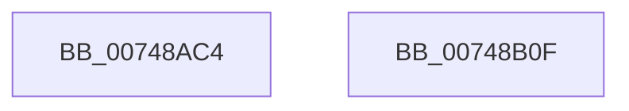

# KiTpSetupCompletion

- RVA: `0x00748AC4`–`0x00748B10` (길이 `76` bytes)
- VA: `0x0000000140748AC4`
- 실행 섹션: `PAGE`
- PDB 이름 있음: `예`; PDB Function 태그: `아니요`
- unwind 정보 RVA: `0x0005CC98`
- 디코드: `19`개 명령, `76/76` bytes 표시
- 미해석 바이트: `0` (있으면 어셈블리에 `.byte`로 보존)

> 이 문서는 커널 이미지의 기계어와 PDB 기호를 분석해 생성했습니다. 4번과 5번은 함수 원형과 자료형을 바이너리 사용 방식에서 추정한 C 해석이며 원본 소스 복구 결과는 아닙니다.

## 1. Dependencies

- 직접 호출 지점: **1**; 고유 호출 대상: **1**
- 직접 호출자로 확인된 함수: **1**
- RIP 상대 이미지 참조: **0**

### Outgoing calls
- `0x00748B05` → [RtlIcParseInstruction](../../tracesup/BC/RtlIcParseInstruction_function_00BC70E8.md) (function, `0x00BC70E8`)

### Direct callers
- [KeSetTracepoint](KeSetTracepoint_function_00747F80.md) at `0x0074835D`
- [KeSetTracepoint](KeSetTracepoint_function_00747F80.md) at `0x007483B4`

### Static image references
- 디코드된 RIP-relative 메모리 참조가 없습니다.

## 2. Other-region calls and transfers

- 다른 실행 섹션으로 향하는 call: **1**
  - `0x00748B05` → [RtlIcParseInstruction](../../tracesup/BC/RtlIcParseInstruction_function_00BC70E8.md) (`PAGE` → `TRACESUP`)
- 별도 외부 분기/꼬리 이동을 확인하지 못했습니다.

## 3. Assembly (complete function range)

```asm
00748AC4  4C 8B DC                        mov r11, rsp
00748AC7  48 83 EC 58                     sub rsp, 0x58
00748ACB  33 C0                           xor eax, eax
00748ACD  89 44 24 29                     mov dword ptr [rsp + 0x29], eax
00748AD1  66 89 44 24 2D                  mov word ptr [rsp + 0x2d], ax
00748AD6  88 44 24 2F                     mov byte ptr [rsp + 0x2f], al
00748ADA  89 44 24 44                     mov dword ptr [rsp + 0x44], eax
00748ADE  8B 84 24 80 00 00 00            mov eax, dword ptr [rsp + 0x80]
00748AE5  49 89 4B C8                     mov qword ptr [r11 - 0x38], rcx
00748AE9  88 54 24 28                     mov byte ptr [rsp + 0x28], dl
00748AED  49 8D 53 C8                     lea rdx, [r11 - 0x38]
00748AF1  4D 89 4B E0                     mov qword ptr [r11 - 0x20], r9
00748AF5  4C 8B 8C 24 88 00 00 00         mov r9, qword ptr [rsp + 0x88]
00748AFD  4D 89 43 D8                     mov qword ptr [r11 - 0x28], r8
00748B01  89 44 24 40                     mov dword ptr [rsp + 0x40], eax
00748B05  E8 DE E5 47 00                  call 0x140bc70e8
00748B0A  48 83 C4 58                     add rsp, 0x58
00748B0E  C3                              ret
00748B0F  CC                              int3
```

## 4. C-style interpretation (structured pseudocode)

```c
__int64 __fastcall KiTpSetupCompletion(__int64 a1, unsigned __int8 a2, __int64 a3, __int64 a4, unsigned int a5, __int64 a6)
{
    __int64 result;
    __int64 v_rsp;
    unsigned int v_stack_m14;
    unsigned int v_stack_m18;
    unsigned __int8 v_stack_m29;
    unsigned __int16 v_stack_m2B;
    unsigned int v_stack_m2F;
    unsigned __int8 v_stack_m30;

    v_rsp = (v_rsp) - (88);
    result = 0;
    v_stack_m2F = 0;
    v_stack_m2B = 0;
    v_stack_m29 = 0;
    v_stack_m14 = 0;
    *(unsigned __int64 *)(v_rsp - 56) = a1;
    v_stack_m30 = a2;
    *(unsigned __int64 *)(v_rsp - 32) = a4;
    *(unsigned __int64 *)(v_rsp - 40) = a3;
    v_stack_m18 = (unsigned int)((unsigned int)(a5));
    result = RtlIcParseInstruction(a1, v_rsp - 56, a3, a6);
    v_rsp = (v_rsp) + (88);
    return result;
}
```

## 5. (Beta) C Style

```c
int64_t KiTpSetupCompletion(int64_t Arg1, uint8_t Arg2, int64_t Arg3, int64_t Arg4, uint32_t Arg5, int64_t Arg6)
{
    int64_t result;
    int64_t local_rsp;
    uint32_t v_stack_m14;
    uint32_t v_stack_m18;
    uint8_t v_stack_m29;
    uint16_t v_stack_m2B;
    uint32_t v_stack_m2F;
    uint8_t v_stack_m30;

    local_rsp = (local_rsp) - (88);
    result = 0;
    v_stack_m2F = 0;
    v_stack_m2B = 0;
    v_stack_m29 = 0;
    v_stack_m14 = 0;
    *(uint64_t *)(local_rsp - 0x38) = Arg1;
    v_stack_m30 = Arg2;
    *(uint64_t *)(local_rsp - 0x20) = Arg4;
    *(uint64_t *)(local_rsp - 0x28) = Arg3;
    v_stack_m18 = (uint32_t)((uint32_t)(Arg5));
    result = RtlIcParseInstruction(Arg1, local_rsp - 56, Arg3, Arg6);
    local_rsp = (local_rsp) + (88);
    return result;
}
```

## 6. Execution-region graph

[열기: 2D/3D 그래프와 함수 탐색 컨트롤 패널](../../../control-panel.html?section=page&rva=0x00748AC4&view=graph)

- 2D 그래프는 위에서 아래로 흐르고, 3D 그래프는 빈 공간을 드래그해 회전합니다. Shift+드래그는 이동, 휠은 확대·축소, 함수 노드 선택은 대상 보고서 이동입니다.

### Static fallback


